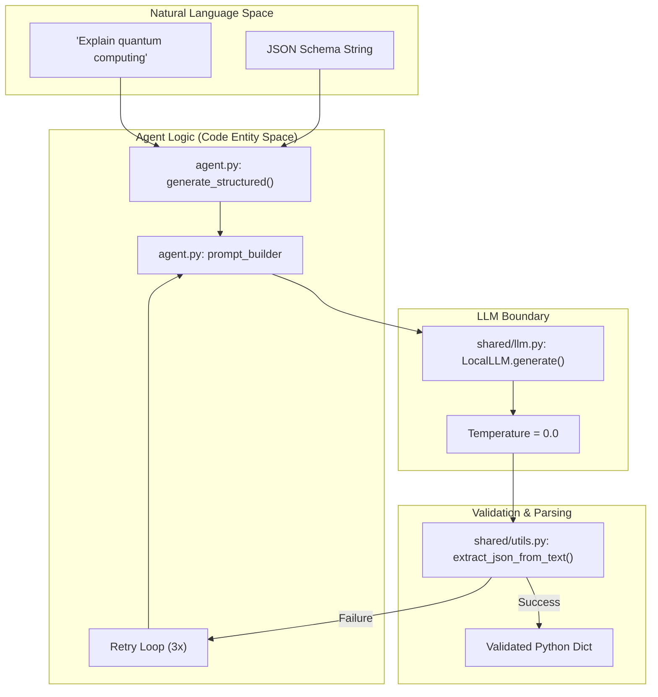
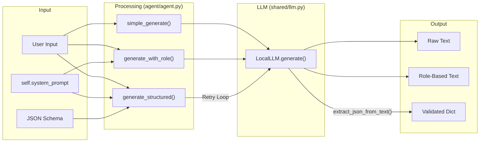

<!-- source: DeepWiki mcp.deepwiki.com · repo pguso/agents-from-scratch · page 3.1 Lessons 01–03: LLM Fundamentals · fetched 2026-10-26 -->

# Lessons 01–03: LLM Fundamentals

Relevant source files

The following files were used as context for generating this wiki page:

- [agent/tools.py](agent/tools.py)
- [lessons/01_basic_llm_chat.md](lessons/01_basic_llm_chat.md)
- [lessons/02_system_prompt.md](lessons/02_system_prompt.md)
- [lessons/03_structured_output.md](lessons/03_structured_output.md)

This section covers the foundational building blocks of the "Agents from Scratch" architecture. It progresses from simple text completion to behavior-shaping via roles, and finally to the engineering of reliable, structured data exchange between the LLM and the Python runtime.

## Lesson 01: Basic Text Generation

The most fundamental interaction with a Large Language Model (LLM) is a "text in, text out" completion. In this codebase, this is handled by the `LocalLLM` wrapper, which abstracts the `llama-cpp-python` library.

### Key Concepts
*   **Tokens**: The atomic units of text processed by the model. Models do not see words; they see numerical representations of sub-word units [lessons/01_basic_llm_chat.md:24-29]().
*   **Context Window**: The total number of tokens (input + output) the model can hold in memory at once [lessons/01_basic_llm_chat.md:30-33]().
*   **Probabilistic Nature**: LLMs are pattern matchers that predict the next most likely token. They are not "thinking" but performing statistical completion [lessons/01_basic_llm_chat.md:82-88]().

### Implementation
The `Agent.simple_generate` method provides the thinnest possible wrapper around the model's generation capability.

| Entity | Role |
| :--- | :--- |
| `Agent.simple_generate` | Takes raw string input and returns raw string output [agent/agent.py:49-54](). |
| `LocalLLM.generate` | The underlying call to the GGUF model via `llama-cpp-python` [lessons/01_basic_llm_chat.md:53-53](). |

**Sources:**
* [lessons/01_basic_llm_chat.md:1-119]()
* [agent/agent.py:46-54]()

---

## Lesson 02: System Prompts and Roles

Lesson 02 introduces the **Instruction Hierarchy**. By prepending a "System Prompt" to the user's input, we can shape the model's persona, tone, and constraints without changing the underlying model weights [lessons/02_system_prompt.md:18-41]().

### The Role-Based Prompt Pattern
The codebase uses a specific format to ensure the model distinguishes between its instructions and the user's request:
1.  **System Prompt**: The "persona" (e.g., "You are a technical expert").
2.  **User Input**: The specific task.
3.  **Response Tag**: A marker (e.g., `Assistant:`) to trigger the model's completion.

### Implementation: `generate_with_role`
The `Agent` class maintains a `self.system_prompt` attribute, which defaults to a "calm, precise, and helpful AI assistant" [lessons/02_system_prompt.md:97-98]().

**Data Flow: Role-Shaped Generation**
1.  The system prompt is combined with user input into a single string [agent/agent.py:71-74]().
2.  The LLM generates a response based on this combined context.
3.  The `Agent` performs post-processing to strip any artifacts like `<SYSTEM>` or `<USER>` tags that the model might have hallucinated [agent/agent.py:78-80]().

**Sources:**
* [lessons/02_system_prompt.md:1-209]()
* [agent/agent.py:63-81]()

---

## Lesson 03: Structured Output and Contracts

Lesson 03 moves from "Creative Writing" to "Software Engineering" by introducing the **Output Contract**. Instead of free-text, the model is forced to return JSON that adheres to a specific schema [lessons/03_structured_output.md:18-27]().

### The Trust Boundary
A core philosophy of this project is the **Trust Boundary**: Never trust LLM output directly. The system must parse, validate, and handle failures [lessons/03_structured_output.md:29-36]().

### Implementation: `generate_structured`
This method implements a robust loop to ensure data integrity:
1.  **Strict Prompting**: Uses "CRITICAL INSTRUCTIONS" to demand ONLY valid JSON [agent/agent.py:65-68]().
2.  **Deterministic Generation**: Sets `temperature=0.0` to reduce randomness [agent/agent.py:79-79]().
3.  **JSON Extraction**: Uses `extract_json_from_text` (from `shared/utils.py`) to find the JSON block even if the model includes conversational filler [agent/agent.py:80-80]().
4.  **Retry Logic**: If parsing fails, it retries up to 3 times before returning `None` [agent/agent.py:78-85]().

### Technical Bridge: Natural Language to Code Entity
The following diagram illustrates how Lesson 03 bridges the gap between a natural language request and a validated Python dictionary.

**LLM to JSON Pipeline**

**Sources:**
* [lessons/03_structured_output.md:1-175]()
* [agent/agent.py:50-86]()

---

## Technical Summary Table

| Feature | Lesson | Method | Primary Goal |
| :--- | :--- | :--- | :--- |
| **Basic Chat** | 01 | `simple_generate` | Connectivity & Tokenization |
| **Role Play** | 02 | `generate_with_role` | Behavioral Consistency |
| **Structured Output** | 03 | `generate_structured` | Reliability & Type Safety |

### Data Flow Overview
The following diagram maps the progression of data through the first three lessons.

**Lessons 01-03 Data Flow**

**Sources:**
* [agent/agent.py:46-86]()
* [lessons/01_basic_llm_chat.md:44-57]()
* [lessons/02_system_prompt.md:61-87]()
* [lessons/03_structured_output.md:45-86]()

---

