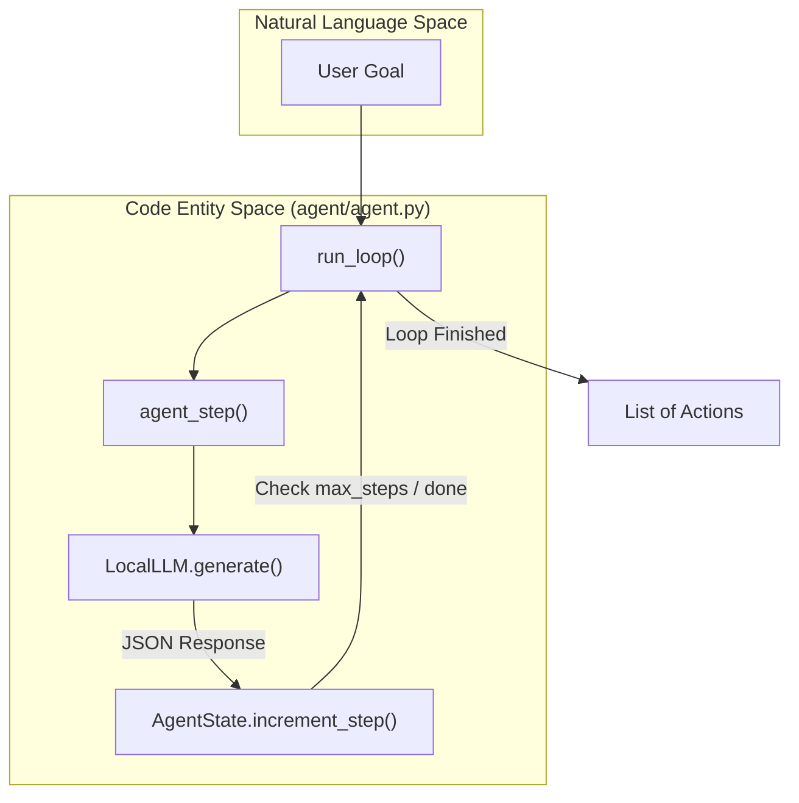
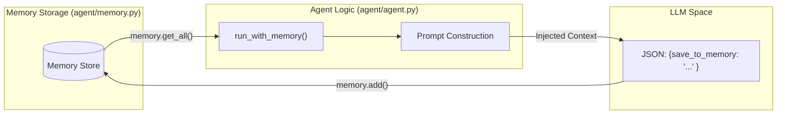

<!-- source: DeepWiki mcp.deepwiki.com · repo pguso/agents-from-scratch · page 3.3 Lessons 06–07: Agent Loop and Memory · fetched 2026-10-26 -->

# Lessons 06–07: Agent Loop and Memory

Relevant source files

The following files were used as context for generating this wiki page:

- [diagrams/lesson-05-tool-calling.png](diagrams/lesson-05-tool-calling.png)
- [diagrams/lesson-06-agent-loop.png](diagrams/lesson-06-agent-loop.png)
- [diagrams/lesson-07-memory.png](diagrams/lesson-07-memory.png)
- [diagrams/lesson-08-planning.png](diagrams/lesson-08-planning.png)
- [lessons/06_agent_loop.md](lessons/06_agent_loop.md)
- [lessons/07_memory.md](lessons/07_memory.md)

This section covers the transition from a single-turn tool-calling bot to a stateful autonomous agent. It focuses on the implementation of the core execution loop (Lesson 06) and the mechanisms for persisting information across distinct user interactions (Lesson 07).

## Lesson 06: The Stateful Agent Loop

Lesson 06 introduces the fundamental difference between a chatbot and an agent: the ability to **observe, decide, act, and repeat** using an internal state [lessons/06_agent_loop.md:5-7](). While a chatbot typically responds once and stops, an agent runs a loop to take multiple steps toward a complex goal [lessons/06_agent_loop.md:19-23]().

### Core Implementation: agent_step and run_loop

The agent loop is implemented through two primary methods in the `Agent` class:

1.  **`agent_step(user_input)`**: Executes a single iteration of the cycle. It serializes the current `AgentState` into the prompt, requests a decision from the LLM, and increments the step counter [lessons/06_agent_loop.md:52-96]().
2.  **`run_loop(user_input, max_steps)`**: Orchestrates multiple steps. It resets the state and continues calling `agent_step` until a termination condition is met [lessons/06_agent_loop.md:98-124]().

### Termination Conditions
To prevent infinite execution, the loop relies on specific exit criteria [lessons/06_agent_loop.md:31-39]():
*   **Agent Decision**: The LLM outputs a specific `done` action [lessons/06_agent_loop.md:119-120]().
*   **Safety Limits**: The `max_steps` parameter (defaulting to 5) acts as a circuit breaker [lessons/06_agent_loop.md:112-131]().
*   **Failure**: The loop terminates if the LLM fails to provide a valid JSON response after three retries [lessons/06_agent_loop.md:86-96]().

### Loop Data Flow
The following diagram bridges the conceptual loop to the specific methods in `agent/agent.py`.

**Agent Execution Cycle**

Sources: [lessons/06_agent_loop.md:49-124](), [lessons/06_agent_loop.md:168-176]()

---

## Lesson 07: Memory Persistence

Lesson 07 introduces the `Memory` system, which allows an agent to retain information across completely separate execution loops [lessons/07_memory.md:5-7](). This provides continuity that simple state (which resets per loop) cannot achieve [lessons/07_memory.md:147-152]().

### Context vs. Memory
The codebase makes a strict distinction between these two concepts:
*   **Context**: The temporary information visible in the current prompt [lessons/07_memory.md:21-23]().
*   **Memory**: Persistent storage that survives across interactions and is loaded into the context when needed [lessons/07_memory.md:21-23]().

### Implementation: run_with_memory
The `run_with_memory` method manages the interaction between the LLM and the `Memory` class [lessons/07_memory.md:48-105]():
1.  **Retrieval**: It calls `self.memory.get_all()` to fetch stored strings [lessons/07_memory.md:60]().
2.  **Augmentation**: It builds a `memory_str` and injects it into the system prompt [lessons/07_memory.md:63-72]().
3.  **Action**: The LLM is instructed to return a JSON object containing a `reply` and an optional `save_to_memory` field [lessons/07_memory.md:82]().
4.  **Persistence**: If `save_to_memory` contains a value, the agent calls `self.memory.add()` to store the new fact [lessons/07_memory.md:98-99]().

### Memory System Architecture
This diagram illustrates how the `Memory` class interacts with the LLM prompt cycle.

**Memory Persistence Flow**

Sources: [lessons/07_memory.md:48-105](), [lessons/07_memory.md:135-152]()

### Limitations and Considerations
*   **Retrieval Logic**: The current implementation uses a "get all" approach, which may hit context window limits as memories grow [lessons/07_memory.md:34-35](), [lessons/07_memory.md:184-188]().
*   **Explicit Control**: The agent must explicitly decide to save a fact; it does not automatically record every interaction [lessons/07_memory.md:165-166]().
*   **No Decay**: Memories do not currently have a "forgetting" mechanism or priority weighting [lessons/07_memory.md:41]().

Sources: [lessons/06_agent_loop.md](), [lessons/07_memory.md]()

---

