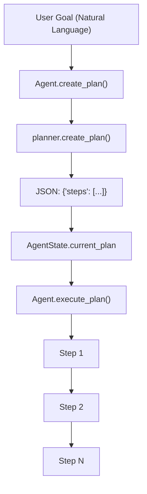
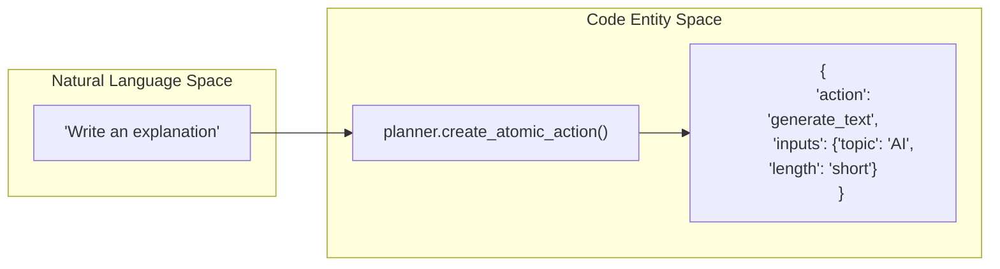
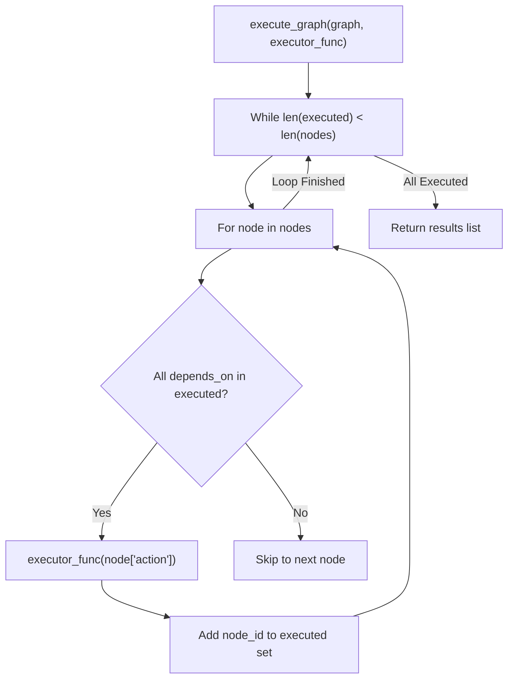

<!-- source: DeepWiki mcp.deepwiki.com · repo pguso/agents-from-scratch · page 3.4 Lessons 08–10: Planning and Atom of Thought · fetched 2026-10-26 -->

# Lessons 08–10: Planning and Atom of Thought

Relevant source files

The following files were used as context for generating this wiki page:

- [agent/planner.py](agent/planner.py)
- [diagrams/agent-architecture.png](diagrams/agent-architecture.png)
- [diagrams/lesson-10-atom-of-thoght.png](diagrams/lesson-10-atom-of-thoght.png)
- [lessons/08_planning.md](lessons/08_planning.md)
- [lessons/09_atomic_actions.md](lessons/09_atomic_actions.md)
- [lessons/10_atom_of_thought.md](lessons/10_atom_of_thought.md)

This section covers the evolution of the agent's cognitive capabilities from simple sequential execution to complex dependency-based task graphs. It details how the agent breaks down high-level goals into data-driven plans (Lesson 08), transforms vague steps into validated atomic actions (Lesson 09), and manages complex workflows using Atom of Thought (AoT) dependency graphs (Lesson 10).

## 3.4.1 Planning as Data (Lesson 08)

Lesson 08 introduces the concept that planning is a **data generation** task rather than an internal reasoning process [agent/planner.py:4-5](). By treating a plan as a structured data object, it becomes inspectable and modifiable before any execution occurs [lessons/08_planning.md:21-24]().

### Plan Generation and Structure
The primary entry point for creating a plan is `create_plan`. This function enforces a strict JSON output contract using a system prompt that requires a `"steps"` list [agent/planner.py:11-38]().

| Function | Role | Implementation Detail |
| :--- | :--- | :--- |
| `create_plan` | Goal Decomposition | Uses `LocalLLM` with `temperature=0.0` for deterministic step generation [agent/planner.py:41](). |
| `Agent.create_plan` | State Integration | Calls the planner and stores the result in `self.state.current_plan` [lessons/08_planning.md:63-66](). |
| `Agent.execute_plan` | Sequential Loop | Iterates through `plan["steps"]` and updates `self.state.increment_step()` [lessons/08_planning.md:70-94](). |

### Sequential Execution Flow
The execution at this stage is a simple linear progression. The agent treats each string in the steps list as a discrete task to be handled in order [lessons/08_planning.md:28-32]().

**Planning Data Flow**

Sources: [agent/planner.py:11-47](), [lessons/08_planning.md:48-95]()

---

## 3.4.2 Atomic Steps and Safe Execution (Lesson 09)

Lesson 09 addresses the ambiguity of natural language steps (e.g., "Research topic") by converting them into **Atomic Actions** [lessons/09_atomic_actions.md:5-7](). An atomic action is the smallest indivisible unit of work that the system can validate [lessons/09_atomic_actions.md:21-23]().

### The Atomic Action Schema
The function `create_atomic_action` forces the LLM to map a vague plan step into a structured dictionary containing an `action` name and an `inputs` map [agent/planner.py:50-84]().

*   **Atomicity**: Ensures the operation either succeeds fully or fails without partial side effects [lessons/09_atomic_actions.md:21-24]().
*   **Typed Execution**: By requiring an `inputs` dictionary, the system can eventually validate parameters against expected schemas [lessons/09_atomic_actions.md:33-38]().

**From Vague Step to Atomic Code Entity**

Sources: [agent/planner.py:50-94](), [lessons/09_atomic_actions.md:153-157]()

---

## 3.4.3 Atom of Thought (AoT) Dependency Graphs (Lesson 10)

Lesson 10 introduces the **Atom of Thought (AoT)** framework. Instead of a linear list, the agent generates a Directed Acyclic Graph (DAG) where nodes represent actions and edges represent execution dependencies [lessons/10_atom_of_thought.md:5-7]().

### Graph Construction and Validation
The `create_aot_graph` function generates a JSON structure containing a list of nodes. Each node must have a unique `id`, an `action`, and a `depends_on` list [agent/planner.py:111-128]().

The implementation includes a multi-stage validation loop:
1.  **JSON Extraction**: Ensures the LLM output is valid JSON [agent/planner.py:132]().
2.  **Structural Integrity**: Checks for the presence of `id`, `action`, and `depends_on` in every node [agent/planner.py:138]().
3.  **Reference Integrity**: Ensures all IDs listed in `depends_on` actually exist within the graph [lessons/10_atom_of_thought.md:94-102]().

### Topological Execution
The `execute_graph` function implements a topological sort to ensure actions are executed in the correct order [agent/planner.py:150-168](). It uses an iterative approach with a `max_iterations` guard (calculated as `len(nodes) * 2`) to prevent infinite loops caused by potential cycles [agent/planner.py:170-173]().

**AoT Execution Logic**

Sources: [agent/planner.py:150-206](), [lessons/10_atom_of_thought.md:124-138]()

### Comparison of Planning Levels

| Feature | Lesson 08 (Sequential) | Lesson 09 (Atomic) | Lesson 10 (AoT) |
| :--- | :--- | :--- | :--- |
| **Structure** | List of strings | List of Dicts (Action/Inputs) | DAG (Nodes/Dependencies) |
| **Validation** | JSON format only | Schema (Action/Inputs) | Structural + Reference Integrity |
| **Execution** | Linear `for` loop | Linear `for` loop | Topological Resolution |
| **Parallelism** | Not possible | Not possible | Possible (Independent Nodes) |

Sources: [lessons/08_planning.md:162-176](), [lessons/09_atomic_actions.md:145-157](), [lessons/10_atom_of_thought.md:166-183]()

---

