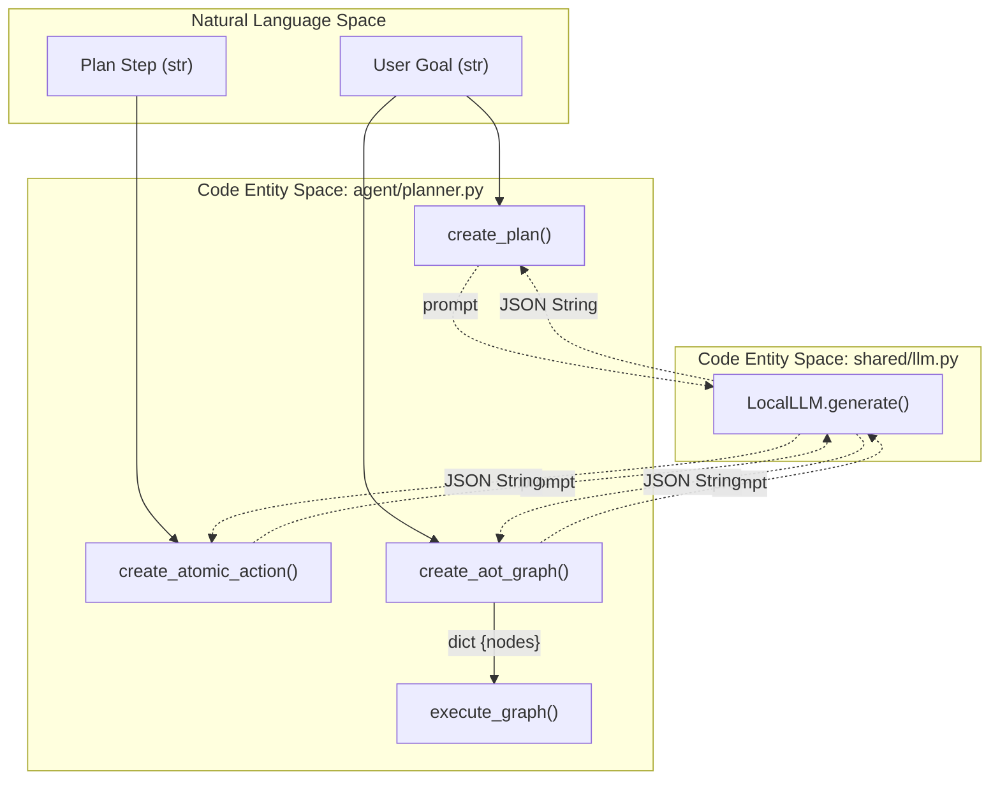
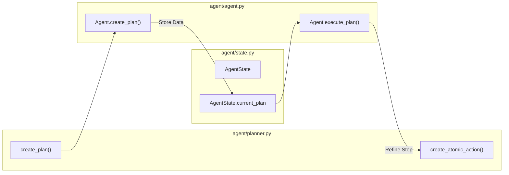

<!-- source: DeepWiki mcp.deepwiki.com · repo pguso/agents-from-scratch · page 4 Planning Engine · fetched 2026-10-26 -->

# Planning Engine

Relevant source files

The following files were used as context for generating this wiki page:

- [agent/planner.py](agent/planner.py)
- [lessons/08_planning.md](lessons/08_planning.md)

The Planning Engine is a standalone subsystem encapsulated in `agent/planner.py`. It treats planning not as an abstract "reasoning" process, but as a **structured data generation** task [agent/planner.py:4-5](). By transforming high-level goals into inspectable JSON data structures, the system allows for validation, modification, and step-by-step execution before any actions are actually performed.

The engine supports three distinct levels of complexity introduced across Lessons 08, 09, and 10: sequential step generation, atomic action mapping, and dependency-aware graph execution.

### Architectural Overview

The Planning Engine interfaces with the `LocalLLM` to generate plans and interacts with `AgentState` to persist the current plan during an agent's lifecycle.

**Planning Data Flow**

Sources: [agent/planner.py:11-147](), [shared/llm.py:1-20]()

---

### Planning Modes

The engine provides three primary functions to handle different task complexities:

| Function | Output Structure | Use Case |
| :--- | :--- | :--- |
| `create_plan` | `{"steps": [str, ...]}` | High-level decomposition of a goal into a linear sequence [agent/planner.py:11-47](). |
| `create_atomic_action` | `{"action": str, "inputs": dict}` | Translating a text step into a machine-readable tool call [agent/planner.py:50-93](). |
| `create_aot_graph` | `{"nodes": [{"id", "action", "depends_on"}]}` | Modeling complex tasks where steps can run in parallel or require specific prerequisites [agent/planner.py:96-147](). |

### Core Mechanics

#### 1. Sequential Planning and Atomic Actions
This mode focuses on linear execution. The `create_plan` function uses a retry loop (up to 3 attempts) and `temperature=0.0` to ensure stable, valid JSON output [agent/planner.py:40-41](). Once a plan exists, `create_atomic_action` can be used to refine individual steps into specific tool-calling schemas.

For more details on prompt construction, JSON extraction, and state updates, see **[Sequential Planning and Atomic Actions (#4.1)]**.

#### 2. Atom of Thought (AoT) Graph Execution
The most advanced mode treats a plan as a Directed Acyclic Graph (DAG). The `create_aot_graph` function generates nodes with explicit `depends_on` relationships [agent/planner.py:111-119](). These are then processed by `execute_graph`, which performs a topological sort to ensure actions are only executed once their dependencies are satisfied [agent/planner.py:185-195]().

For details on topological sorting, cycle detection, and error handling during graph execution, see **[Atom of Thought Graph Execution (#4.2)]**.

---

### Implementation in the Agent Loop

The `Agent` class in `agent/agent.py` wraps these utility functions to integrate them into the agent's state. When `create_plan` is called on the agent, it stores the resulting dictionary in `self.state.current_plan`, making the plan persistent across turns [lessons/08_planning.md:63-68]().

**Entity Mapping: Planning to State**

Sources: [agent/planner.py:11-93](), [lessons/08_planning.md:48-95]()

### Sources:
- [agent/planner.py:1-206]()
- [lessons/08_planning.md:1-232]()
- [agent/agent.py:1-100]() (Inferred from Lesson 08 context)

---

