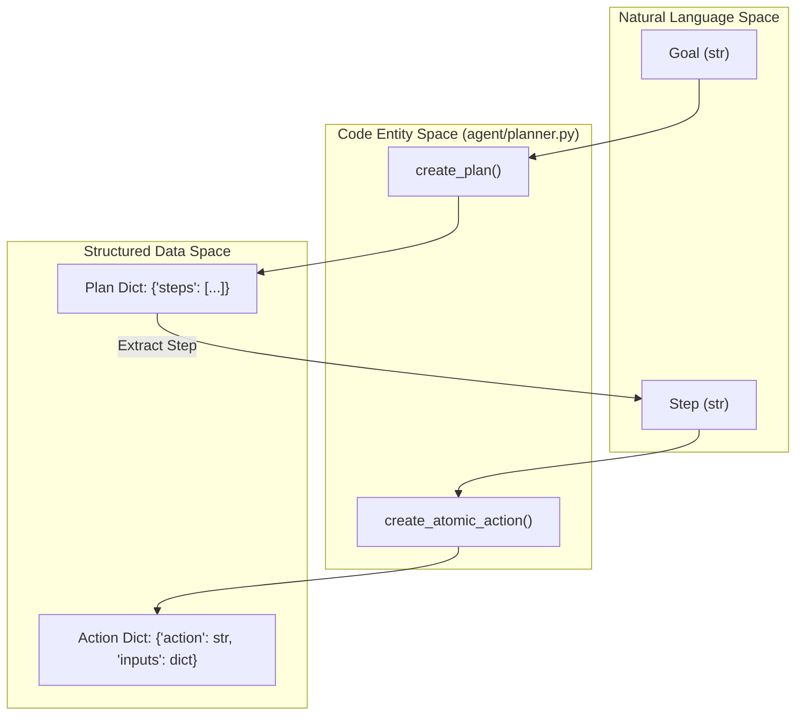
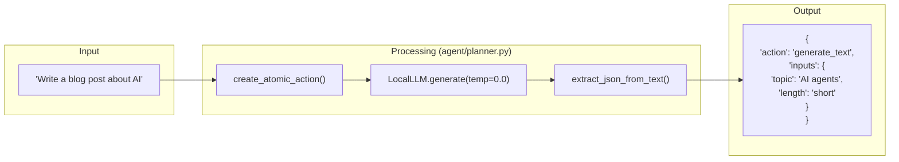

<!-- source: DeepWiki mcp.deepwiki.com · repo pguso/agents-from-scratch · page 4.1 Sequential Planning and Atomic Actions · fetched 2026-10-26 -->

# Sequential Planning and Atomic Actions

<details>
<summary>Relevant source files</summary>

The following files were used as context for generating this wiki page:

- [agent/planner.py](agent/planner.py)
- [lessons/08_planning.md](lessons/08_planning.md)
- [lessons/09_atomic_actions.md](lessons/09_atomic_actions.md)

</details>


Sequential planning and atomic actions represent the first two levels of the planning engine in the 'Agents from Scratch' architecture. This system moves away from "chain-of-thought" text generation toward **Planning as Data**, where plans are inspectable, validated JSON structures.

## Overview of the Planning Pipeline

The transition from a high-level natural language goal to an executable action occurs in two distinct phases:
1.  **Sequential Planning**: Breaking a goal into a list of high-level text strings (steps).
2.  **Atomic Action Conversion**: Transforming a vague text step into a structured dictionary containing an `action` name and an `inputs` map.

### Data Flow: Goal to Atomic Action

The following diagram illustrates how natural language is transformed into code-ready data structures through `agent/planner.py`.

**Diagram: Planning Data Transformation**

Sources: [agent/planner.py:11-23](), [agent/planner.py:50-62](), [lessons/08_planning.md:171-178]()

---

## Sequential Planning (`create_plan`)

The `create_plan` function is the entry point for multi-step task resolution. It treats planning as a structured data generation task rather than an abstract reasoning process.

### Implementation Details
-   **Prompt Construction**: The function uses a strict system prompt that demands ONLY valid JSON and provides a specific schema: `{"steps": ["step1", "step2", "step3"]}` [agent/planner.py:26-38]().
-   **Temperature-Zero Generation**: To ensure maximum consistency and adherence to the schema, `llm.generate` is called with `temperature=0.0` [agent/planner.py:41-41]().
-   **Retry Loop**: The system implements a 3-attempt retry loop to handle malformed JSON or schema violations [agent/planner.py:40-46]().
-   **Validation**: The result is passed through `extract_json_from_text` and validated to ensure the key `"steps"` exists and contains a list [agent/planner.py:42-44]().

### State Integration
When called via the `Agent` class, the generated plan is persisted in the `AgentState` object to allow for tracking progress across execution cycles.

```python
# agent/agent.py (Conceptual logic from Lesson 08)
plan = create_plan(self.llm, goal)
if plan:
    self.state.current_plan = plan
```
Sources: [agent/planner.py:11-47](), [lessons/08_planning.md:48-68]()

---

## Atomic Actions (`create_atomic_action`)

Atomic actions solve the problem of ambiguity. While a plan step might be "Research AI agents," an atomic action provides the specific parameters required for a tool or function to execute.

### The Atomic Contract
An atomic action is defined by two mandatory components:
1.  **Action**: A simple, atomic operation name (e.g., `web_search`, `calculate`).
2.  **Inputs**: A dictionary of parameters required for that specific action.

### Implementation Logic
The `create_atomic_action` function performs a "narrowing" transformation:
-   It takes a single string `step` from a previously generated plan [agent/planner.py:50-58]().
-   It prompts the LLM to map this step to the `{ "action": "...", "inputs": {...} }` format [agent/planner.py:65-85]().
-   Like the planner, it uses a **temperature-zero** approach and a **retry loop** [agent/planner.py:86-93]().

**Diagram: Step-to-Action Mapping**

Sources: [agent/planner.py:50-94](), [lessons/09_atomic_actions.md:153-157]()

---

## Execution and Validation Patterns

The repository emphasizes that plans are not just for the LLM; they are for the system to validate and the user to inspect.

### Sequential Execution Logic
In Lesson 08, execution is handled by iterating through the plan's steps. The `AgentState` is updated at each interval using `increment_step()` to maintain a pointer to the current progress.

| Feature | Sequential Planning (L08) | Atomic Actions (L09) |
| :--- | :--- | :--- |
| **Data Structure** | List of strings | Dictionary of action/inputs |
| **Validation** | JSON Schema (steps key) | JSON Schema (action/inputs keys) |
| **Granularity** | High-level milestones | Indivisible operations |
| **State Update** | `state.current_plan` | Validated against tool registry |

### Key Functions Summary

| Function | File | Purpose |
| :--- | :--- | :--- |
| `create_plan` | `agent/planner.py` | Generates the high-level sequence of steps from a goal. |
| `create_atomic_action` | `agent/planner.py` | Converts a text step into a structured action/input object. |
| `extract_json_from_text` | `shared/utils.py` | Sanitizes LLM output to find and parse JSON blocks. |
| `increment_step` | `agent/state.py` | Advances the internal counter as steps are completed. |

Sources: [agent/planner.py:11-94](), [lessons/08_planning.md:70-94](), [lessons/09_atomic_actions.md:161-179]()

---

