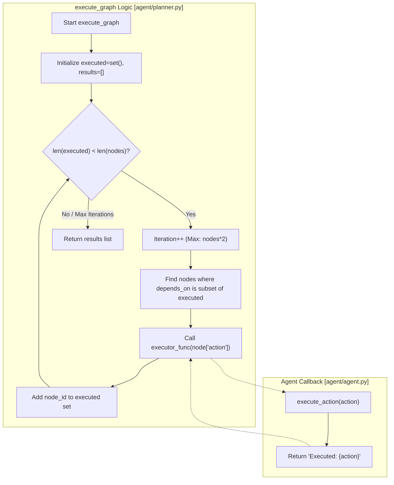

<!-- source: DeepWiki mcp.deepwiki.com · repo pguso/agents-from-scratch · page 4.2 Atom of Thought Graph Execution · fetched 2026-10-26 -->

# Atom of Thought Graph Execution

Relevant source files

The following files were used as context for generating this wiki page:

- [agent/planner.py](agent/planner.py)
- [diagrams/agent-architecture.png](diagrams/agent-architecture.png)
- [diagrams/lesson-10-atom-of-thoght.png](diagrams/lesson-10-atom-of-thoght.png)
- [lessons/10_atom_of_thought.md](lessons/10_atom_of_thought.md)

The **Atom of Thought (AoT)** engine represents the most advanced planning tier in the repository. It transitions from sequential list-based planning to **Directed Acyclic Graphs (DAGs)**, where actions are nodes and execution order is determined by explicit dependencies. This approach enables the agent to handle complex workflows where tasks can be executed in parallel or must wait for specific prerequisites.

## The AoT Workflow

The AoT system operates in two distinct phases: **Graph Generation** and **Topological Execution**. Unlike sequential plans, the AoT graph is validated for structural integrity (e.g., ensuring no circular dependencies) before a single action is performed.

### From Goal to Graph

The process begins with `create_aot_graph`. The LLM is instructed to decompose a goal into a JSON structure containing a list of nodes. Each node includes a unique identifier, an action description, and a list of IDs it depends on [agent/planner.py:96-128]().

**AoT Data Structure (Natural Language to Code Space)**

The following diagram illustrates how the LLM's natural language understanding is mapped into the validated code entities used by the `execute_graph` function.

| Natural Language Concept | Code Entity (JSON/Dict) | Implementation Detail |
| :--- | :--- | :--- |
| **Task** | `node["action"]` | A string describing the atomic operation [agent/planner.py:123](). |
| **Prerequisite** | `node["depends_on"]` | A list of strings referencing other `id` fields [agent/planner.py:124](). |
| **Unique Step** | `node["id"]` | A unique string (e.g., "1", "2") [agent/planner.py:122](). |
| **The Plan** | `graph["nodes"]` | A list of dictionary objects [agent/planner.py:119](). |

Sources: [agent/planner.py:96-147](), [lessons/10_atom_of_thought.md:17-35]()

## Graph Generation and Validation

The `create_aot_graph` function implements a retry loop (up to 3 attempts) to ensure the LLM produces a valid schema [agent/planner.py:130-132](). 

### Validation Steps:
1.  **Schema Presence**: Ensures the response contains a `"nodes"` key and it is a list [agent/planner.py:134]().
2.  **Field Integrity**: Every node must contain `id`, `action`, and `depends_on` [agent/planner.py:138]().
3.  **Reference Integrity**: The `depends_on` field must be a list [agent/planner.py:140]().
4.  **Reference Validation**: In the `Agent` class wrapper, the system further validates that every ID listed in `depends_on` actually exists as a node within the graph [lessons/10_atom_of_thought.md:94-102]().

Sources: [agent/planner.py:130-147](), [lessons/10_atom_of_thought.md:81-104]()

## Execution Engine

The `execute_graph` function performs a topological sort at runtime to resolve dependencies. It uses an iterative approach to find and execute "ready" nodes—those whose dependencies have all been successfully completed or marked as handled [agent/planner.py:150-162]().

### Topological Sort Logic
The executor maintains a `set` of `executed` node IDs and a `results` list. It loops through the nodes repeatedly until all are processed or a safety guard (`max_iterations`) is hit [agent/planner.py:164-173]().

**Execution Flow Diagram**

This diagram shows the relationship between the `execute_graph` logic and the `executor_func` callback provided by the `Agent`.

### Error Handling and Safety
*   **Max Iterations Guard**: To prevent infinite loops caused by circular dependencies (if validation missed them), the loop terminates if iterations exceed `len(nodes) * 2` [agent/planner.py:170-173]().
*   **Exception Isolation**: If the `executor_func` raises an exception, the error is caught, logged in the results, and the node is marked as `executed` (with `success: False`) to prevent blocking the rest of the graph [agent/planner.py:187-204]().

Sources: [agent/planner.py:150-206](), [lessons/10_atom_of_thought.md:124-138]()

## Integration in the Agent Class

The `Agent` class (Lesson 10) exposes two high-level methods to interface with the planning engine:

1.  `create_aot_plan(goal)`: A wrapper for `create_aot_graph` [lessons/10_atom_of_thought.md:110-122]().
2.  `execute_aot_plan(graph)`: Provides a local `execute_action` closure to `execute_graph` to perform the work [lessons/10_atom_of_thought.md:124-138]().

### Comparison of Planning Modes

| Feature | Sequential Planning (Lesson 08) | AoT Graph Execution (Lesson 10) |
| :--- | :--- | :--- |
| **Data Structure** | List of strings | Directed Acyclic Graph (Nodes/Edges) |
| **Ordering** | Implicit (Index in list) | Explicit (`depends_on` IDs) |
| **Validation** | Basic JSON check | Structural & Reference Integrity |
| **Parallelism** | None (Serial) | Supported (Nodes with shared deps) |
| **File Reference** | `create_plan` [agent/planner.py:11]() | `create_aot_graph` [agent/planner.py:96]() |

Sources: [agent/planner.py:11-147](), [lessons/10_atom_of_thought.md:166-184]()

---

