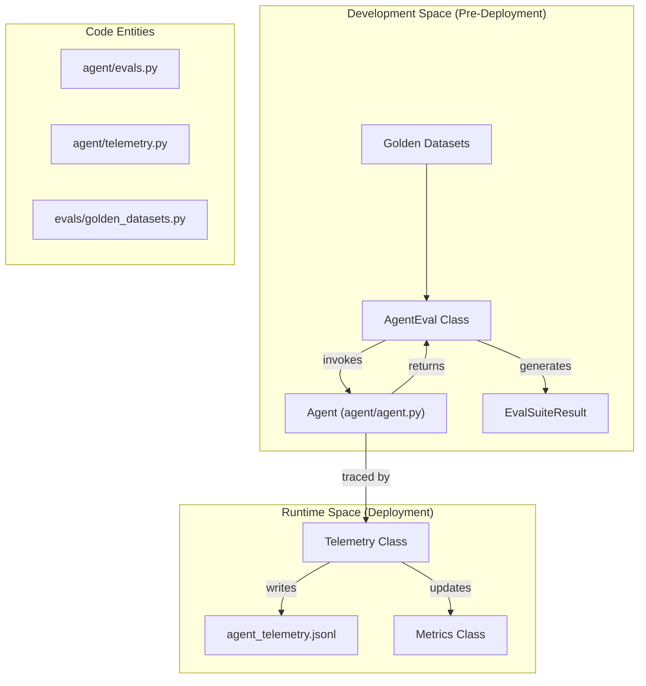
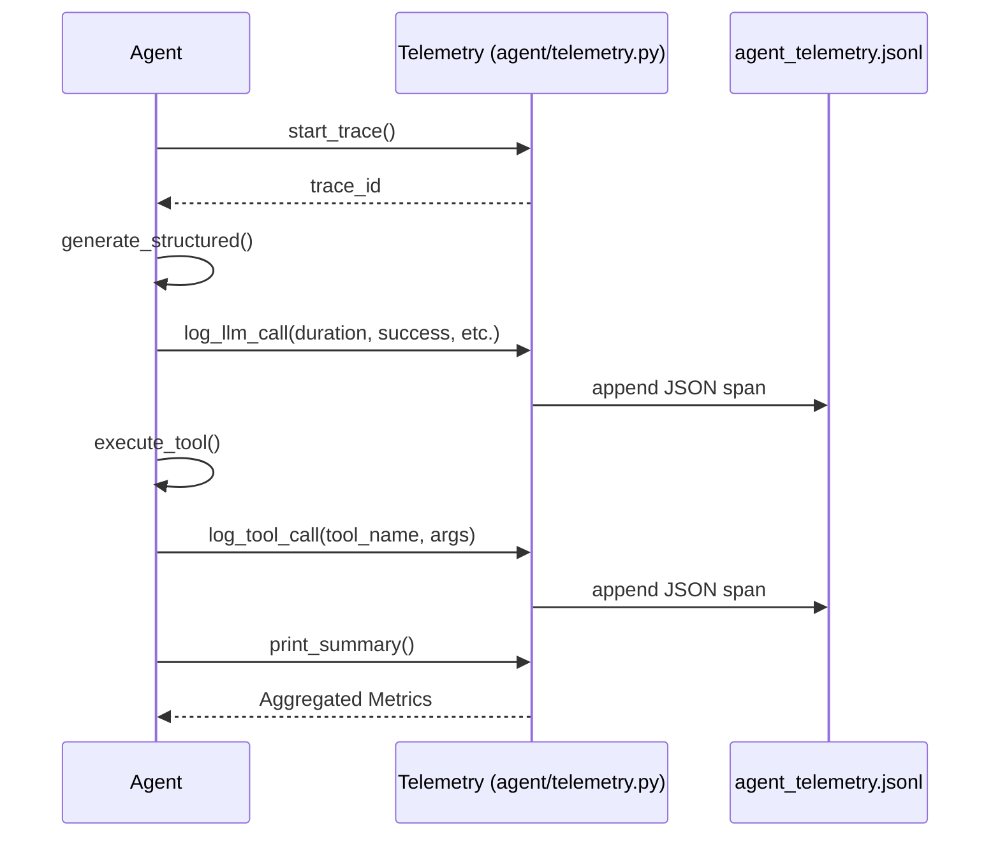

<!-- source: DeepWiki mcp.deepwiki.com · repo pguso/agents-from-scratch · page 5 Evaluation and Telemetry · fetched 2026-10-26 -->

# Evaluation and Telemetry

Relevant source files

The following files were used as context for generating this wiki page:

- [agent/evals.py](agent/evals.py)
- [agent/telemetry.py](agent/telemetry.py)
- [lessons/11_evals.md](lessons/11_evals.md)
- [lessons/12_telemetry.md](lessons/12_telemetry.md)

This section covers the production-readiness subsystems of the `agents-from-scratch` repository. While previous lessons focus on agent capabilities (planning, memory, tools), these components ensure those capabilities remain reliable and observable. The system is split into **Evaluation** (pre-deployment regression testing) and **Telemetry** (runtime observability).

## Overview of Reliability Subsystems

The transition from a prototype to a production-ready agent requires answering two critical questions:
1. **Regression Testing:** "How do I know if my agent still works after I change a prompt?" [lessons/11_evals.md:5-5]().
2. **Observability:** "What is my agent actually doing at runtime?" [lessons/12_telemetry.md:5-5]().

The codebase addresses these through two dedicated modules: `agent/evals.py` and `agent/telemetry.py`.

### System Relationship Diagram
This diagram illustrates how the Evaluation and Telemetry systems interface with the core `Agent` and the external environment.

**Agent Reliability Architecture**

Sources: [agent/evals.py:58-68](), [agent/telemetry.py:85-101](), [lessons/11_evals.md:27-31](), [lessons/12_telemetry.md:134-138]()

---

## Evaluation Framework

The evaluation framework provides regression testing for agent capabilities. It uses **Golden Datasets**—known-good examples that serve as the source of truth [lessons/11_evals.md:27-29]().

### Core Components
*   **`AgentEval`**: The main evaluator class that wraps an `Agent` instance to run test suites [agent/evals.py:58-75]().
*   **`EvalSuiteResult`**: Aggregates results, calculating pass rates and generating human-readable summaries [agent/evals.py:29-55]().
*   **Golden Datasets**: Defined in `evals/golden_datasets.py`, these include `STRUCTURED_OUTPUT_GOLDEN`, `TOOL_CALL_GOLDEN`, and `MEMORY_GOLDEN` [evals/golden_datasets.py:1-176]().

The framework focuses on **Hard Assertions**, such as validating that JSON output matches a schema or that the correct tool was selected [lessons/11_evals.md:33-39]().

For implementation details and adding new test cases, see [Evaluation Framework](#5.1).

Sources: [agent/evals.py:1-136](), [lessons/11_evals.md:66-135]()

---

## Telemetry and Observability

Telemetry provides **Structured Logging** (JSONL format) rather than simple print statements, making agent behavior searchable and parseable [lessons/12_telemetry.md:19-27]().

### Observability Data Model
The system uses a hierarchical data model to track operations:

| Entity | Code Reference | Description |
| :--- | :--- | :--- |
| **Span** | `Span` [agent/telemetry.py:23-40]() | A single discrete operation (LLM call, tool execution). |
| **Trace** | `trace_id` [agent/telemetry.py:113-121]() | A collection of spans representing one full agent interaction. |
| **Metrics** | `Metrics` [agent/telemetry.py:44-83]() | Aggregated data like `llm_success_rate` and `avg_latency_ms`. |

### Telemetry Logic Flow
This diagram shows how the `Telemetry` class captures data from the `Agent` during a typical execution loop.

**Telemetry Execution Trace**

Sources: [agent/telemetry.py:85-180](), [lessons/12_telemetry.md:105-132](), [lessons/12_telemetry.md:191-196]()

For details on interpreting logs and using the `traced` decorator, see [Telemetry and Observability](#5.2).

Sources: [agent/telemetry.py:1-210](), [lessons/12_telemetry.md:1-138]()

---

