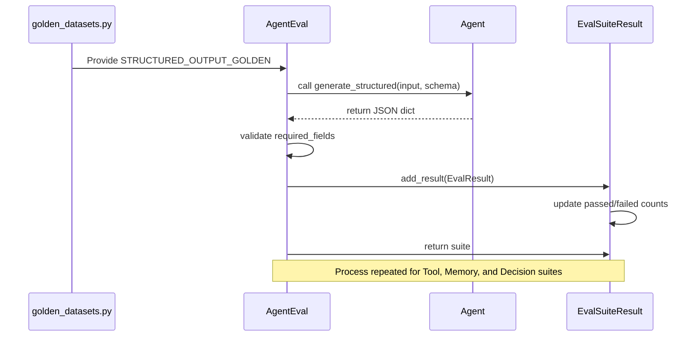

<!-- source: DeepWiki mcp.deepwiki.com · repo pguso/agents-from-scratch · page 5.1 Evaluation Framework · fetched 2026-10-26 -->

# Evaluation Framework

<details>
<summary>Relevant source files</summary>

The following files were used as context for generating this wiki page:

- [agent/evals.py](agent/evals.py)
- [evals/__init__.py](evals/__init__.py)
- [evals/golden_datasets.py](evals/golden_datasets.py)
- [lessons/11_evals.md](lessons/11_evals.md)

</details>


The Evaluation Framework provides a regression testing system for agents. It ensures that changes to prompts, model parameters, or core logic do not degrade the agent's performance in critical areas such as JSON parsing, tool selection, and memory retention [agent/evals.py:1-12]().

## Core Components

The framework is built around three primary classes in `agent/evals.py` that handle the execution and reporting of test suites.

### EvalResult
A dataclass representing the outcome of a single test case. It captures the input provided to the agent, the expected outcome, the actual result returned, and any error messages encountered during execution [agent/evals.py:19-25]().

### EvalSuiteResult
A container for a collection of `EvalResult` objects. It tracks the number of passed and failed cases and calculates the overall pass rate [agent/evals.py:29-51](). It provides a `summary()` method to generate human-readable status strings (e.g., "✓ PASSED (4/4)") [agent/evals.py:52-55]().

### AgentEval
The main coordinator class. It is initialized with an `Agent` instance and provides methods to run specific types of evaluations [agent/evals.py:58-75]().

**Entity Mapping: Evaluation Flow**

```mermaid
graph TD
    subgraph "Natural Language Space"
        "User Intent" --> "Test Input"
        "Success Criteria" --> "Expected Output"
    end

    subgraph "Code Entity Space"
        "Test Input" --> "AgentEval.test_structured_output()"
        "AgentEval.test_structured_output()" --> "Agent.generate_structured()"
        "Agent.generate_structured()" --> "EvalResult"
        "EvalResult" --> "EvalSuiteResult"
        "EvalSuiteResult" --> "print_eval_report()"
    end
```
Sources: [agent/evals.py:18-136](), [lessons/11_evals.md:186-210]()

---

## Test Suites

The framework categorizes evaluations into four distinct suites, each targeting a specific agent capability.

| Suite | Purpose | Key Validations |
| :--- | :--- | :--- |
| **Structured Output** | Validates JSON compliance [agent/evals.py:77-88]() | Valid JSON parsing, presence of required fields [agent/evals.py:99-120]() |
| **Tool Calls** | Validates tool selection accuracy [agent/evals.py:138-147]() | Correct tool name, correct argument values [agent/evals.py:169-193]() |
| **Decision Routing** | Validates intent classification [agent/evals.py:255-263]() | Matches expected choice from a list [agent/evals.py:279-289]() |
| **Memory Cycle** | Validates store-retrieve consistency [agent/evals.py:212-221]() | Expected facts appear in subsequent responses [agent/evals.py:240-249]() |

### Hard vs. Soft Assertions
The framework distinguishes between two types of assertions:
*   **Hard Assertions:** Must always pass. Examples include valid JSON syntax and the presence of mandatory schema fields [lessons/11_evals.md:35-39]().
*   **Soft Assertions:** Should usually pass. These cover semantic correctness and phrasing [lessons/11_evals.md:40-44]().

Sources: [agent/evals.py:77-289](), [lessons/11_evals.md:33-46]()

---

## Golden Datasets

"Golden" datasets are version-controlled, known-good test cases stored in `evals/golden_datasets.py`. They serve as the source of truth for the agent's expected behavior [evals/golden_datasets.py:4-12]().

### STRUCTURED_OUTPUT_GOLDEN
Tests the agent's ability to adhere to a JSON schema. Cases include happy paths (simple questions) and edge cases like inputs with special characters or numbers [evals/golden_datasets.py:22-65]().

### TOOL_CALL_GOLDEN
Focuses on the `calculator` tool. It tests various operations (add, multiply, divide, subtract) and word problems to ensure the agent maps natural language to the correct tool and arguments [evals/golden_datasets.py:73-104]().

### DECISION_GOLDEN
Tests the agent's routing logic by providing a list of choices (e.g., `summarize_text`, `translate`) and asserting the agent picks the correct one for a given input [evals/golden_datasets.py:112-137]().

### MEMORY_GOLDEN
Tests the "Store → Retrieve" cycle. It provides a `store_input` (e.g., "My name is Alice") followed by a `query_input` and asserts that the expected information exists in the agent's response [evals/golden_datasets.py:145-164]().

### EDGE_CASES_GOLDEN
Specifically targets boundary conditions that frequently break LLM prompts, such as empty inputs, very long strings, Unicode characters, and inputs that contain JSON-like structures [evals/golden_datasets.py:172-201]().

Sources: [evals/golden_datasets.py:1-201](), [lessons/11_evals.md:27-32]()

---

## Data Flow and Execution

The evaluation process follows a structured path from loading golden cases to generating a final report.

**System Data Flow: Evaluation Execution**



### Adding New Golden Cases
To extend the evaluation framework, developers add new dictionaries to the relevant list in `evals/golden_datasets.py`. 

For a new tool call test:
1.  Define the `input` string [evals/golden_datasets.py:75]().
2.  Define the `expected_tool` name [evals/golden_datasets.py:77]().
3.  (Optional) Define `expected_args` to validate specific parameter extraction [evals/golden_datasets.py:78]().

### Running the Evals
Evaluations are typically executed via `AgentEval.run_all()`, which accepts lists of cases for each suite [agent/evals.py:293-315](). The results are then passed to `print_eval_report()` to output a formatted summary to the console [agent/evals.py:321-356]().

Sources: [agent/evals.py:293-356](), [evals/golden_datasets.py:73-79](), [lessons/11_evals.md:186-210]()

---

