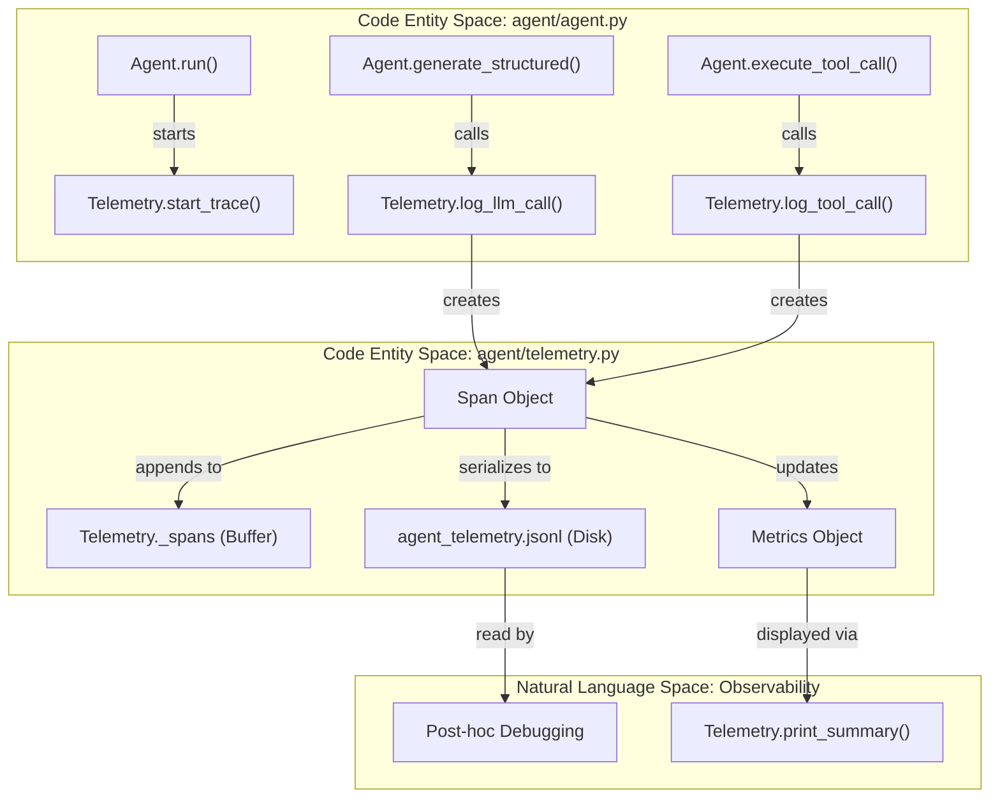
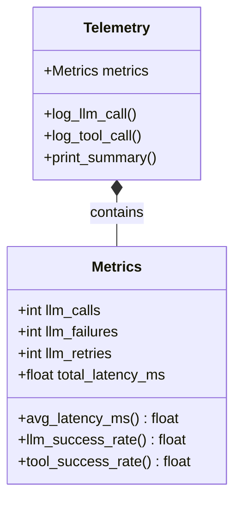

<!-- source: DeepWiki mcp.deepwiki.com · repo pguso/agents-from-scratch · page 5.2 Telemetry and Observability · fetched 2026-10-26 -->

# Telemetry and Observability

<details>
<summary>Relevant source files</summary>

The following files were used as context for generating this wiki page:

- [agent/telemetry.py](agent/telemetry.py)
- [agent_telemetry.jsonl](agent_telemetry.jsonl)
- [lessons/12_telemetry.md](lessons/12_telemetry.md)

</details>


The Telemetry system provides runtime observability for the agent, moving beyond simple print statements to structured, machine-readable data. While evaluations (Lesson 11) verify behavior before deployment, telemetry tracks what the agent actually does during live interactions. This module implements structured logging, span-based tracing, and real-time metrics aggregation.

### Core Concepts

The system is built on three primary abstractions defined in `agent/telemetry.py`:

1.  **Span**: Represents a single discrete operation (e.g., an LLM call, a tool execution, or a memory access) [agent/telemetry.py:23-29]().
2.  **Trace**: A collection of spans linked by a common `trace_id`, representing a full end-to-end agent interaction [agent/telemetry.py:31](), [lessons/12_telemetry.md:29-35]().
3.  **Metrics**: Aggregated statistics derived from spans, such as latency, success rates, and retry counts [agent/telemetry.py:44-53]().

### Telemetry Data Flow

The following diagram illustrates how runtime events in the `Agent` are captured as `Span` objects and processed into both persistent logs and in-memory metrics.

**Diagram: Runtime Event Capture and Processing**

Sources: [agent/telemetry.py:123-130](), [agent/telemetry.py:149-172](), [lessons/12_telemetry.md:144-171]()

---

### Implementation Details

#### The Telemetry Class
The `Telemetry` class manages the lifecycle of a trace and provides specialized logging methods for different agent activities. It defaults to logging to `agent_telemetry.jsonl` [agent/telemetry.py:101-111]().

*   **`start_trace()`**: Generates a unique 8-character UUID to group all subsequent operations in a single session [agent/telemetry.py:113-121]().
*   **`log_llm_call()`**: Captures prompt/response lengths, duration, success status, and retry attempts [agent/telemetry.py:131-148]().
*   **`log_tool_call()`**: Records the tool name, arguments passed, the result returned, and any execution errors [agent/telemetry.py:174-189]().
*   **`log_memory_operation()`**: Tracks interactions with the `Memory` subsystem, specifically `add`, `get`, or `clear` operations [agent/telemetry.py:211-220]().

#### Structured Logging (JSONL)
The system uses **JSON Lines (JSONL)** format. Each line is a valid JSON object, making the log file easy to parse with standard tools or search via `grep` using the `trace_id` [lessons/12_telemetry.md:191-201]().

**Example Span Structure:**
| Field | Description |
| :--- | :--- |
| `span_id` | Unique identifier for the specific operation [agent/telemetry.py:30](). |
| `trace_id` | Identifier linking all operations in one agent run [agent/telemetry.py:31](). |
| `event_type` | Type of event: `llm_call`, `tool_call`, `memory_op`, `decision` [agent/telemetry.py:32](). |
| `timestamp` | ISO 8601 formatted time of occurrence [agent/telemetry.py:33](). |
| `duration_ms` | Time taken for the operation in milliseconds [agent/telemetry.py:34](). |
| `data` | Event-specific metadata (e.g., tool arguments, prompt length) [agent/telemetry.py:35](). |

Sources: [agent/telemetry.py:23-40](), [lessons/12_telemetry.md:19-27]()

---

### Metrics and Summarization

The `Metrics` class provides real-time aggregation of agent performance. It calculates success rates and average latencies dynamically using Python `@property` decorators [agent/telemetry.py:55-69]().

**Diagram: Metrics Aggregation Logic**

Sources: [agent/telemetry.py:44-82]()

#### Summary Output
The `print_summary()` method provides a human-readable console output of the current session's health [agent/telemetry.py:261-276]().

```text
========================================
TELEMETRY SUMMARY
========================================
LLM Calls:      5
  Success Rate: 80.00%
  Avg Latency:  1420.5ms
  Retries:      1
Tool Calls:     2
  Success Rate: 100.00%
Memory Ops:     3
========================================
```
Sources: [lessons/12_telemetry.md:173-187]()

---

### The Traced Decorator

To simplify instrumentation, the module provides a `traced` decorator. This can be applied to any function to automatically log its execution as a span, capturing the duration and any exceptions that occur [agent/telemetry.py:284-307]().

**Implementation Pattern:**
1.  The decorator checks if the first argument (`self`) has a `telemetry` attribute [agent/telemetry.py:295]().
2.  It records the start time [agent/telemetry.py:296]().
3.  It executes the wrapped function and calculates `duration_ms` [agent/telemetry.py:298-301]().
4.  It logs the event with the function name as the `event_type` [agent/telemetry.py:303-306]().

Sources: [agent/telemetry.py:284-310]()

---

