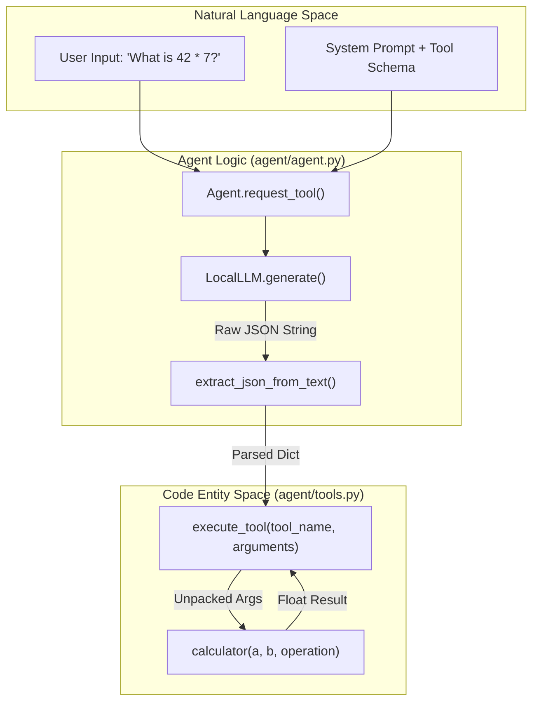
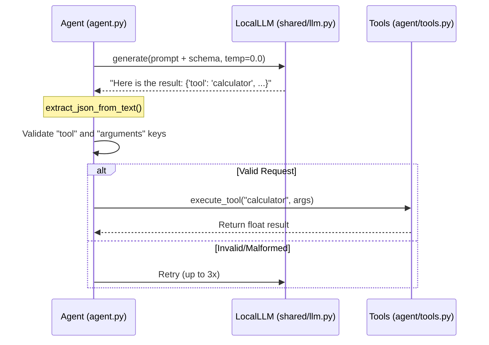

<!-- source: DeepWiki mcp.deepwiki.com · repo pguso/agents-from-scratch · page 6 Tools System · fetched 2026-10-26 -->

# Tools System

Relevant source files

The following files were used as context for generating this wiki page:

- [agent/tools.py](agent/tools.py)
- [lessons/02_system_prompt.md](lessons/02_system_prompt.md)
- [lessons/03_structured_output.md](lessons/03_structured_output.md)
- [lessons/05_tools.md](lessons/05_tools.md)

The **Tools System** provides a secure, structured interface that allows the LLM to interact with external systems. In the "Agents from Scratch" philosophy, tools are treated as **interfaces, not abilities** [lessons/05_tools.md:151-153](). The model describes what it needs through a structured JSON request, but the Python environment maintains absolute control over the actual execution [lessons/05_tools.md:38-39]().

## Core Logic and Dispatch

The system is centered around `agent/tools.py`, which acts as the registry and execution engine. It separates the **schema** (what the model sees) from the **implementation** (what the system runs).

### Key Functions

| Function | Purpose |
| :--- | :--- |
| `get_tool_schema()` | Returns a dictionary defining available tools, their descriptions, and parameter requirements (types, enums, required fields) [agent/tools.py:36-59](). |
| `execute_tool()` | The central dispatcher. It maps a `tool_name` string to a Python function and unpacks the provided `arguments` dictionary into that function [agent/tools.py:62-83](). |
| `calculator()` | A reference implementation of a tool. It performs basic arithmetic and includes internal validation for operations [agent/tools.py:11-33](). |

**Sources:** [agent/tools.py:11-83](), [lessons/05_tools.md:21-23]()

## Natural Language to Code Execution

The transition from a user's natural language request to a verified code execution follows a strict pipeline. This ensures that the model never has direct access to the underlying system.

### Tool Call Flow: Text to Execution
The following diagram illustrates how `Agent.request_tool` bridges the gap between the LLM's probabilistic text generation and the deterministic execution in `agent/tools.py`.

**Sources:** [agent/agent.py:52-103](), [agent/tools.py:62-83](), [lessons/05_tools.md:120-128]()

## Structured Tool Requests

To ensure reliability, tool calls use the **Output Contract** pattern introduced in Lesson 03 [lessons/03_structured_output.md:18-20](). The model is instructed to return a specific JSON structure: `{"tool": "name", "arguments": {...}}` [lessons/05_tools.md:27-29]().

### The Trust Boundary
The `Agent` class implements a retry loop (up to 3 attempts) to handle malformed JSON or missing fields [agent/agent.py:83-90]().

**Sources:** [agent/agent.py:52-90](), [lessons/03_structured_output.md:29-36](), [lessons/05_tools.md:105-110]()

## Security and Validation

The system enforces security through several layers of separation:
1.  **Instructional Separation**: The system prompt explicitly tells the model it is a "tool-calling assistant" and must only output JSON [lessons/05_tools.md:64-81]().
2.  **Dispatcher Validation**: `execute_tool` checks the `tool_name` against a hardcoded dictionary of allowed functions. If the model requests a non-existent tool, it raises a `ValueError` rather than attempting dynamic execution [agent/tools.py:80-81]().
3.  **Parameter Validation**: The `calculator` tool validates the `operation` string against an internal map of allowed lambdas [agent/tools.py:23-31]().

**Sources:** [agent/tools.py:23-33](), [agent/tools.py:76-83](), [lessons/05_tools.md:159-161]()

## Extending the Tool Registry

To add new capabilities, developers must modify `agent/tools.py` in three places:

1.  **Implementation**: Define the Python function (e.g., `def weather_tool(city: str)`).
2.  **Schema**: Update `get_tool_schema()` to include the new tool's metadata, parameters, and required fields [agent/tools.py:45-59]().
3.  **Registration**: Add the function to the `tools` mapping inside `execute_tool()` [agent/tools.py:76-78]().

This manual registration ensures that no "shadow" capabilities exist that the developer has not explicitly exposed to the model [lessons/05_tools.md:154-157]().

**Sources:** [agent/tools.py:36-83](), [lessons/05_tools.md:186-190]()

---

