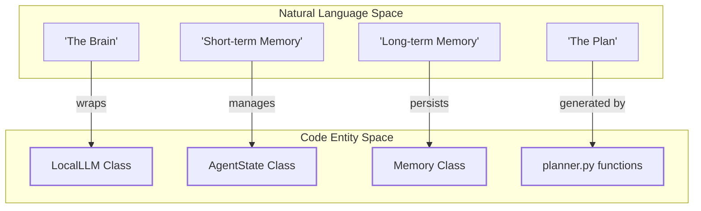
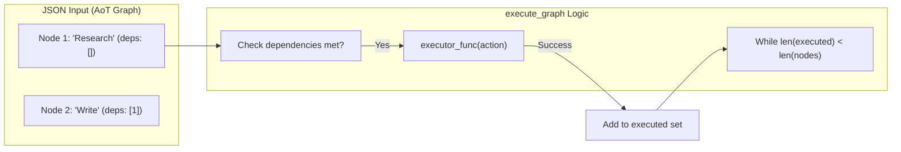

<!-- source: DeepWiki mcp.deepwiki.com · repo pguso/agents-from-scratch · page 7 Glossary · fetched 2026-10-26 -->

# Glossary

Relevant source files

The following files were used as context for generating this wiki page:

- [README.md](README.md)
- [agent/agent.py](agent/agent.py)
- [agent/evals.py](agent/evals.py)
- [agent/planner.py](agent/planner.py)
- [agent/telemetry.py](agent/telemetry.py)
- [lessons/10_atom_of_thought.md](lessons/10_atom_of_thought.md)
- [shared/llm.py](shared/llm.py)
- [shared/utils.py](shared/utils.py)

This page provides a comprehensive reference for the technical terms, architectural patterns, and domain-specific jargon used in the **Agents from Scratch** repository. It serves as a bridge between high-level conceptual descriptions and the actual implementation details found in the Python source code.

## Core Concepts

### Agent Loop (Observe-Decide-Act)
The fundamental runtime cycle of the agent. Unlike a simple request-response chatbot, an agent maintains an internal state and repeatedly executes a loop until a termination condition is met (e.g., the task is marked as "done").

*   **Implementation**: Controlled by `Agent.run_loop` [agent/agent.py:276-305]().
*   **Data Flow**:
    1.  **Observe**: The agent checks its current `AgentState` [agent/state.py:7-40]().
    2.  **Decide**: The agent calls `Agent.decide` [agent/agent.py:152-195]() to choose between "act" or "done".
    3.  **Act**: If "act" is chosen, it performs a tool call or internal operation and increments `step_count`.

### Structured Output (Output Contract)
The practice of forcing the LLM to return data in a machine-readable format (JSON) rather than free-form text. This creates a "Trust Boundary" where the system can programmatically validate the model's response before execution.

*   **Implementation**: Handled by `Agent.generate_structured` [agent/agent.py:111-146]() and the utility `extract_json_from_text` [shared/utils.py:27-110]().
*   **Retry Logic**: The system uses a 3-attempt loop [agent/agent.py:139-146]() to recover from malformed JSON or schema violations.

### Atomic Action
A discrete, self-contained task derived from a larger plan. Atomic actions are designed to be "safe" and "testable," representing the smallest unit of work the agent can perform.

*   **Implementation**: Created via `create_atomic_action` [agent/planner.py:50-93]().
*   **Structure**: A dictionary containing an `action` name and an `inputs` dictionary [agent/planner.py:73-76]().

---

## Architectural Mapping

The following diagram bridges the "Natural Language Space" (how we describe agents) to the "Code Entity Space" (the actual classes and functions).

### System Mapping: Conceptual to Code

**Sources**: [agent/agent.py:38-60](), [agent/state.py:7-15](), [agent/memory.py:7-12](), [agent/planner.py:11-23]()

---

## Planning Terminology

### Sequential Planning
A linear list of steps generated to achieve a goal. It assumes each step must follow the previous one without complex branching.

*   **Code Pointer**: `create_plan` [agent/planner.py:11-47]().

### Atom of Thought (AoT)
A dependency graph approach to planning. Instead of a list, the agent generates a Directed Acyclic Graph (DAG) where nodes represent actions and edges represent dependencies.

*   **Implementation**: `create_aot_graph` [agent/planner.py:96-147]() and `execute_graph` [agent/planner.py:150-206]().
*   **Validation**: The graph is validated for structural integrity (ensuring all `depends_on` IDs exist) before execution [agent/planner.py:135-145]().

### Execution Graph (AoT Graph)
The following diagram illustrates how the `execute_graph` function processes the JSON structure generated by the LLM.

### AoT Execution Logic

**Sources**: [agent/planner.py:150-206](), [lessons/10_atom_of_thought.md:152-162]()

---

## Telemetry and Evaluation

### Span
A single recorded operation within a trace, capturing an LLM call, a tool execution, or a memory operation.

*   **Implementation**: `Span` dataclass [agent/telemetry.py:23-40]().
*   **Fields**: Includes `span_id`, `trace_id`, `duration_ms`, and `event_type` [agent/telemetry.py:30-36]().

### Golden Dataset
A collection of "known-good" inputs and expected outputs used for regression testing.

*   **Usage**: Used by `AgentEval` [agent/evals.py:58-75]() to verify that prompt changes haven't broken existing capabilities like tool calling or decision making.

---

## Technical Abbreviations & Jargon

| Term | Definition | Code Reference |
| :--- | :--- | :--- |
| **GGUF** | The binary format used by `llama-cpp-python` for local model weights. | [shared/llm.py:41-46]() |
| **DAG** | Directed Acyclic Graph. Used in AoT to ensure no infinite loops in dependencies. | [lessons/10_atom_of_thought.md:212-216]() |
| **JSONL** | JSON Lines. The format used for telemetry logs to allow efficient appending. | [agent/telemetry.py:101-108]() |
| **System Prompt** | The initial instruction that sets the "persona" or "role" of the LLM. | [agent/agent.py:49-53]() |
| **Temperature** | A hyperparameter (0.0 to 1.0) controlling randomness. 0.0 is used for planning. | [shared/llm.py:28-31]() |
| **Topological Sort** | The algorithm used to determine execution order in an AoT graph. | [agent/planner.py:168-173]() |

**Sources**: [shared/llm.py:18-47](), [agent/telemetry.py:123-130](), [agent/planner.py:150-168](), [lessons/10_atom_of_thought.md:212-216]()