# Page: Overview

# Overview

<details>
<summary>Relevant source files</summary>

The following files were used as context for generating this wiki page:

- [PHILOSOPHY.md](PHILOSOPHY.md)
- [QUICKSTART.md](QUICKSTART.md)
- [README.md](README.md)

</details>


The **Agents from Scratch** repository is a technical curriculum designed to demystify AI agents by building one from first principles. Unlike many modern AI projects that rely on complex frameworks (like LangChain or CrewAI) or cloud APIs, this project uses a **local-first philosophy**, requiring only a local LLM and standard Python code [README.md:5-7]().

The core mission is to provide **mechanical understanding**—the ability to debug, extend, and reason about agent systems as software engineering constructs rather than "magical" entities [PHILOSOPHY.md:5-7]().

## Educational Philosophy

This repository is built on the belief that agents are not personalities, but rather **loops, state, and constraints** [README.md:28-30](). It adheres to several strict design principles:

*   **Explicit over Implicit**: No hidden logic or opaque "Chain of Thought" steps. Every state transition is visible in the code [PHILOSOPHY.md:31-40]().
*   **Structured Outputs**: Reliability is achieved through JSON contracts and validation rather than clever prompting alone [PHILOSOPHY.md:64-73]().
*   **Local-First**: All examples run on consumer hardware using `llama-cpp-python` and GGUF models, ensuring privacy and zero API costs [PHILOSOPHY.md:157-165]().
*   **Progressive Complexity**: The agent evolves across 12 lessons, adding exactly one capability at a time [README.md:34-49]().

For a deeper dive into these principles, see **[Design Philosophy](#1.2)**.

## System Architecture

The project bridges the gap between unstructured Natural Language (the LLM's domain) and Structured Code (the application's domain). The following diagram illustrates how the primary code entities interact to form the agent loop.

### Agent Loop and Code Entity Mapping
This diagram shows how the `Agent` class coordinates various subsystems defined in the `agent/` directory.

```mermaid
graph TD
    subgraph "Natural Language Space"
        UserPrompt["User Prompt (String)"]
        LLMOutput["LLM Response (Text/JSON)"]
    end

    subgraph "Code Entity Space (agent/)"
        Agent["Agent Class (agent.py)"]
        State["AgentState (state.py)"]
        Planner["Planner Subsystem (planner.py)"]
        Memory["Memory (memory.py)"]
        Tools["Tool Registry (tools.py)"]
    end

    subgraph "Execution Layer"
        LLM["LocalLLM (shared/llm.py)"]
        SystemExec["Python Environment"]
    end

    UserPrompt --> Agent
    Agent -->|".generate()"| LLM
    LLM --> LLMOutput
    LLMOutput -->|"(utils.safe_json_parse)"| Agent
    Agent -->| "Update" | State
    Agent -->| "Consult" | Memory
    Agent -->| "Create Plan" | Planner
    Agent -->| "Execute" | Tools
    Tools -->| "Side Effects" | SystemExec
```
**Sources:** [agent/agent.py:1-10](), [agent/state.py:1-5](), [agent/planner.py:1-5](), [shared/llm.py:1-10]()

## Repository Structure

The codebase is organized to support a step-by-step learning path.

| Directory / File | Purpose |
| :--- | :--- |
| `agent/` | Contains the core implementation: `agent.py`, `state.py`, `planner.py`, etc. [README.md:89-96]() |
| `lessons/` | Markdown files (01-12) explaining the concepts behind each stage [README.md:99]() |
| `shared/` | Reusable utilities for LLM interaction, prompt building, and JSON parsing [README.md:88]() |
| `complete_example.py` | A reference file demonstrating all 12 lessons in isolation [README.md:84]() |
| `models/` | Local directory for storing GGUF model files [README.md:87]() |

### From Prompt to Action: Data Flow
This diagram maps the transition from a text goal to a validated code execution using specific functions found in the `Planner` and `Agent` classes.

```mermaid
graph LR
    subgraph "Input"
        Goal["Goal: 'Calculate 5+5'"]
    end

    subgraph "Planning (planner.py)"
        P1["create_plan()"]
        P2["create_atomic_action()"]
    end

    subgraph "Execution (agent.py & tools.py)"
        E1["execute_tool_call()"]
        E2["calculator()"]
    end

    Goal --> P1
    P1 -->| "List of steps" | P2
    P2 -->| "Action: 'calculator'" | E1
    E1 -->| "Call" | E2
    E2 -->| "Result: 10" | Goal
```
**Sources:** [agent/planner.py:10-50](), [agent/agent.py:100-120](), [agent/tools.py:1-20]()

## Navigation and Setup

To begin working with the repository, follow these steps:

1.  **Environment Setup**: Install dependencies and download a compatible GGUF model (e.g., Llama-3-8B). For a detailed walkthrough, see **[Getting Started](#1.1)**.
2.  **Verify Installation**: Use the `setup_check.py` script to ensure your environment is configured correctly [QUICKSTART.md:41-42]().
3.  **Run Examples**: Execute `complete_example.py` to see the agent in action across different lesson stages [README.md:73]().
4.  **Follow the Curriculum**: Read through the `lessons/` directory in order, as each lesson builds on the code established in the previous one [README.md:145-151]().

**Sources:** [README.md:70-75](), [QUICKSTART.md:1-50]()

---

# Page: Getting Started

# Getting Started

<details>
<summary>Relevant source files</summary>

The following files were used as context for generating this wiki page:

- [QUICKSTART.md](QUICKSTART.md)
- [requirements.txt](requirements.txt)
- [setup_check.py](setup_check.py)

</details>


This page provides a step-by-step guide to setting up the "AI Agents from Scratch" environment. The repository is designed to be local-first, meaning all inference happens on your hardware using `llama-cpp-python`. By the end of this guide, you will have a verified environment capable of running complex agentic workflows without external API dependencies.

## Prerequisites

Before beginning the installation, ensure your system meets the following hardware and software requirements:

*   **Python:** Version 3.10 or higher [setup_check.py:12-20]().
*   **RAM:** At least 8GB is recommended for running 7B or 8B parameter models [QUICKSTART.md:8]().
*   **Disk Space:** 5-10GB for storing GGUF model files [QUICKSTART.md:9]().

## Step 1: Environment Setup

It is recommended to use a virtual environment to manage dependencies. The primary dependency is `llama-cpp-python`, which provides the Python bindings for `llama.cpp` to run GGUF models.

```bash
# Create a virtual environment
python -m venv venv

# Activate the environment
# On Linux/macOS:
source venv/bin/activate  
# On Windows:
venv\Scripts\activate

# Install required packages
pip install -r requirements.txt
```

**Sources:** [QUICKSTART.md:11-23](), [requirements.txt:1]()

## Step 2: Model Acquisition

The agents in this repository require a model in the GGUF format. By default, the examples are configured to look for a Llama 3 8B Instruct model.

1.  Create a directory named `models/` in the repository root [QUICKSTART.md:31]().
2.  Download a compatible GGUF file (e.g., `Meta-Llama-3-8B-Instruct-Q4_K_M.gguf`) from Hugging Face [QUICKSTART.md:29-30]().
3.  Place the file in the `models/` directory. You may rename it to `llama-3-8b-instruct.gguf` for compatibility with the default paths in the scripts [QUICKSTART.md:32]().

**Quantization Selection:**
| Quantization | RAM Required | Recommendation |
| :--- | :--- | :--- |
| Q4_K_M | ~5GB | Balanced (Recommended) |
| Q5_K_M | ~6GB | Higher Quality |
| Q8_0 | ~8GB | Best Quality |

**Sources:** [QUICKSTART.md:25-37](), [QUICKSTART.md:86-90]()

## Step 3: Verification with setup_check.py

The `setup_check.py` script automates the verification of your environment. It performs four critical checks to ensure the repository is ready for execution.

### Environment Verification Logic
The script executes the following functions sequentially:
1.  `check_python_version()`: Validates `sys.version_info` is >= 3.10 [setup_check.py:12-20]().
2.  `check_dependencies()`: Attempts to import `llama_cpp` [setup_check.py:23-32]().
3.  `check_model_directory()`: Verifies the `models/` folder exists and scans for `.gguf` files [setup_check.py:35-53]().
4.  `check_structure()`: Ensures the core packages (`shared/`, `agent/`, `lessons/`) are present [setup_check.py:56-68]().

### Setup Flow Diagram
The following diagram illustrates the verification flow within `setup_check.py`.

**System Setup Flow**
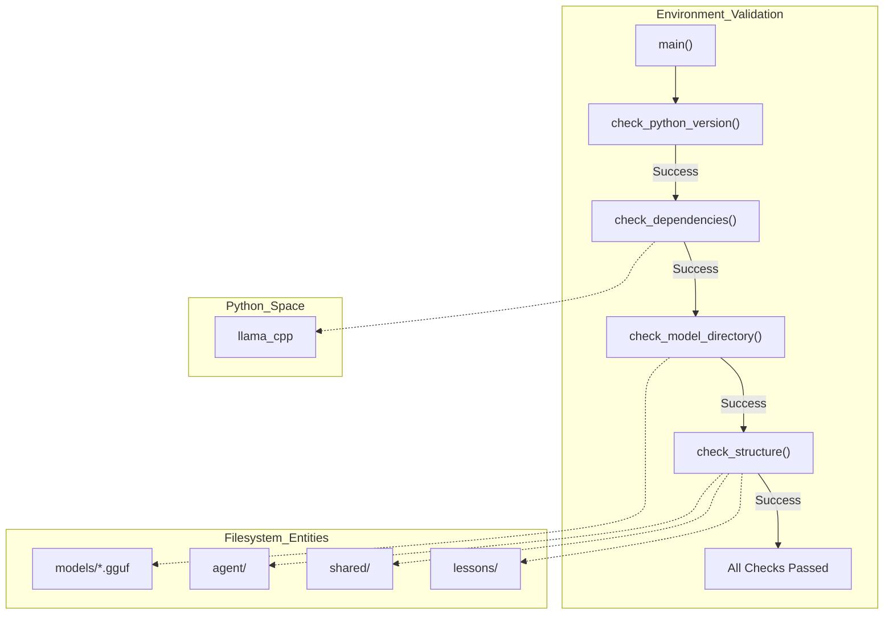
**Sources:** [setup_check.py:71-102](), [QUICKSTART.md:38-49]()

## Step 4: Running the First Example

Once `setup_check.py` returns a success message, you can run `complete_example.py`. This script serves as the primary entry point for demonstrating the progression from basic LLM calls to complex autonomous agents.

```bash
python complete_example.py
```

### Data Flow in complete_example.py
When you run the example, the system initializes the `LocalLLM` wrapper, which loads the model into memory. The execution flows through various lessons, building the `AgentState` and utilizing the `Agent` class to perform tasks.

**Execution Initialization**
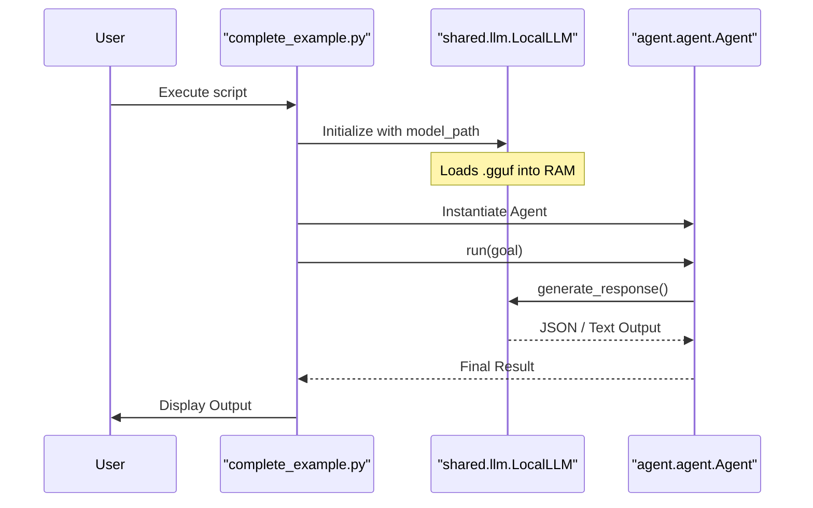

**Sources:** [QUICKSTART.md:50-56](), [setup_check.py:96]()

## Troubleshooting

If you encounter issues during setup, refer to the following common resolutions:

*   **ModuleNotFoundError:** Ensure you have activated your virtual environment and run `pip install llama-cpp-python` [QUICKSTART.md:71-75]().
*   **Model file not found:** Verify the filename in `complete_example.py` matches the actual file in your `models/` directory [QUICKSTART.md:77-82]().
*   **Slow Inference:** CPU-based inference is significantly slower than GPU. Expect 10-30 seconds per response depending on your hardware [QUICKSTART.md:91-96]().

**Sources:** [QUICKSTART.md:69-97]()

---

# Page: Design Philosophy

# Design Philosophy

<details>
<summary>Relevant source files</summary>

The following files were used as context for generating this wiki page:

- [CONTRIBUTING.md](CONTRIBUTING.md)
- [PHILOSOPHY.md](PHILOSOPHY.md)
- [README.md](README.md)

</details>


This page outlines the core technical beliefs and architectural constraints that govern the `agents-from-scratch` repository. The project rejects "magical" abstractions in favor of mechanical understanding, treating agents not as digital personalities, but as deterministic loops managing explicit state and structured data [README.md:28-30]().

## Core Beliefs

The implementation is guided by four primary pillars designed to move agent development from probabilistic guesswork to engineering discipline.

| Pillar | Description | Implementation Detail |
| :--- | :--- | :--- |
| **Explicit State** | State is never hidden in opaque context windows; it is a visible Python object [PHILOSOPHY.md:53-62](). | `AgentState` class in `agent/state.py` |
| **Structured Outputs** | Reliability is enforced through JSON contracts rather than "clever" prompting [PHILOSOPHY.md:64-73](). | `extract_json_from_text` in `shared/utils.py` |
| **Validated Decisions** | LLM outputs are treated as untrusted proposals that must pass validation and retry logic [PHILOSOPHY.md:75-85](). | Retry loops in `Agent.decide` and `Agent.create_plan` |
| **Data-Driven Planning** | Plans are discrete data structures (lists or DAGs), not free-form "thoughts" [PHILOSOPHY.md:87-99](). | `Planner` logic in `agent/planner.py` |

**Sources:** [README.md:135-142](), [PHILOSOPHY.md:51-101]()

---

## From Natural Language to Code Entities

The following diagram bridges the gap between high-level "Agent" concepts and the specific Python classes and files that implement them.

### Mapping Concepts to Implementation
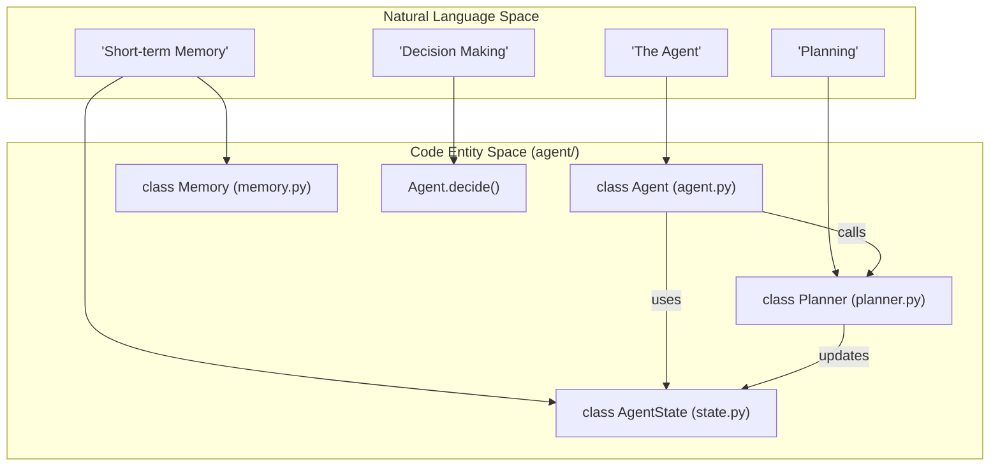
**Sources:** [README.md:89-96](), [agent/agent.py:1-20](), [agent/state.py:1-10]()

---

## Technical Constraints

### 1. Explicit State over Hidden Context
In many frameworks, the "state" of an agent is buried within a growing list of chat messages. This codebase externalizes state into the `AgentState` class [agent/state.py:4-15](). This allows the system to track specific variables—like `steps`, `done` status, and the `current_plan`—independently of the LLM's conversation history [PHILOSOPHY.md:55-60]().

### 2. Structured Contracts (JSON)
To ensure the system can act on LLM outputs, every significant decision is forced into a JSON schema. The `shared/utils.py` helper `extract_json_from_text` is used to strip away conversational filler and isolate the machine-readable instruction [shared/utils.py:15-35](). If the LLM fails to provide valid JSON, the agent triggers a retry loop rather than attempting to "guess" the intent [PHILOSOPHY.md:77-85]().

### 3. Local-First Execution
The project exclusively uses `llama-cpp-python` to interface with GGUF models stored in the `models/` directory [README.md:71-73](). This constraint ensures:
*   **Zero Latency Variance:** No network-induced delays.
*   **Privacy:** Data never leaves the local machine.
*   **Cost:** Unlimited experimentation without API tokens.
*   **Reproducibility:** The exact model version is controlled by the developer.

### 4. No External Frameworks
The repository avoids LangChain, CrewAI, or AutoGen. By building the `Agent` loop [agent/agent.py:150-180]() and the `LocalLLM` wrapper [shared/llm.py:8-25]() from scratch, the "magic" of agentic behavior is revealed to be a series of standard software engineering patterns: loops, conditionals, and error handling [PHILOSOPHY.md:11-20]().

---

## The Observe-Decide-Act Loop

The architecture follows a strict cycle. The LLM is never allowed to execute code directly; it only proposes "Actions" which the Python runtime validates and executes.

### Agent Loop Logic Flow
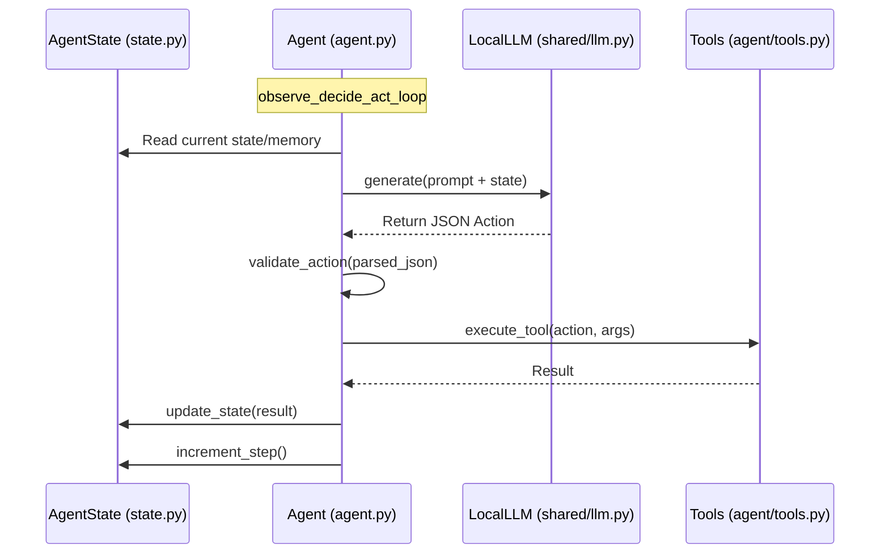
**Sources:** [README.md:43-44](), [agent/agent.py:150-185](), [PHILOSOPHY.md:105-113]()

---

## Why No ReAct?
While ReAct (Reasoning + Acting) is a popular research pattern, this codebase deliberately avoids it in favor of **Planning as Data** [PHILOSOPHY.md:147-155]().
1.  **Transparency:** ReAct "thoughts" are often discarded or unparseable. Discrete plans in `AgentState.current_plan` are persistent and inspectable [agent/state.py:12-14]().
2.  **Separation of Concerns:** Planning happens in `agent/planner.py`, while execution happens in `agent/agent.py`. This prevents the LLM from getting "lost" in a long chain of thought during execution [PHILOSOPHY.md:153-154]().

**Sources:** [README.md:102-126](), [PHILOSOPHY.md:1-204](), [shared/utils.py:1-40](), [agent/state.py:1-20]()

---

# Page: Core Architecture

# Core Architecture

<details>
<summary>Relevant source files</summary>

The following files were used as context for generating this wiki page:

- [agent/agent.py](agent/agent.py)
- [complete_example.py](complete_example.py)
- [diagrams/agent-architecture.png](diagrams/agent-architecture.png)
- [diagrams/lesson-10-atom-of-thoght.png](diagrams/lesson-10-atom-of-thoght.png)

</details>


The `Agents from Scratch` codebase is designed to demonstrate how an AI agent is constructed from the ground up without relying on high-level frameworks. The architecture follows a modular design where the `Agent` class acts as the central orchestrator, integrating language model interactions, state management, and planning capabilities.

## The Agent Orchestrator

The `Agent` class is the heart of the repository [agent/agent.py:30-37](). It is designed to grow through a series of 12 lessons, starting from a simple wrapper around a Large Language Model (LLM) and evolving into a complex system capable of autonomous planning and tool execution.

### High-Level Component Interaction
The diagram below illustrates how the `Agent` class interfaces with the core subsystems to perform tasks.

**System Entity Relationship**
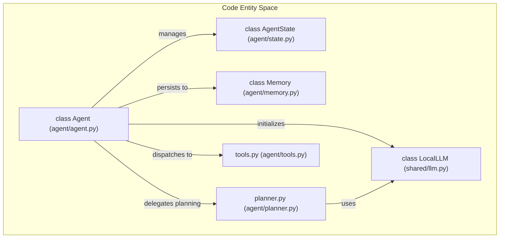
Sources: [agent/agent.py:38-60](), [agent/agent.py:22-27]()

For a deep dive into the implementation of these methods and the retry patterns used, see [The Agent Class](#2.1).

## The Observe-Decide-Act Loop

The agent operates on a fundamental execution cycle introduced in Lesson 06 [agent/agent.py:13-14](). This loop allows the agent to process information, determine the next best step, and execute actions until a goal is met or a limit is reached.

1.  **Observe**: The agent receives user input and retrieves relevant context from its `Memory` [agent/agent.py:330-335]().
2.  **Decide**: Using the `decide` method, the model selects an action from a list of available choices [agent/agent.py:152-164]().
3.  **Act**: The agent executes the chosen action, which might involve calling a tool via `execute_tool_call` [agent/agent.py:239-245]() or updating its internal state.

### Loop Execution Flow
This diagram maps the logical loop to specific function calls within the codebase.

**Logic to Code Mapping**
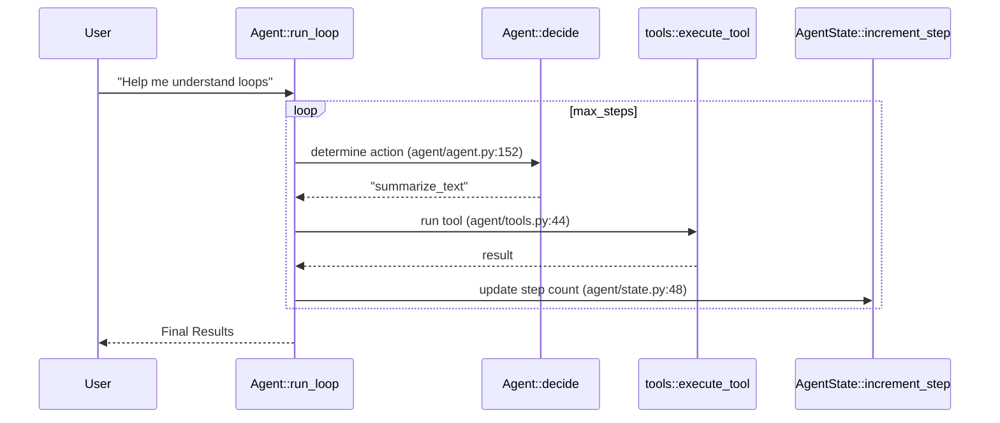
Sources: [agent/agent.py:270-305](), [complete_example.py:86-108]()

## State and Memory Management

To maintain consistency across multiple turns or complex plans, the architecture relies on two distinct systems:
*   **AgentState**: Tracks the immediate status of a single execution run, including the current step, the active plan, and whether the task is finished [agent/state.py:7-16]().
*   **Memory**: A persistent store used to "save" facts that should survive across different sessions [agent/memory.py:6-12]().

For details on how these are serialized into prompts, see [State Management](#2.2).

## Planning and Utilities

The agent's intelligence is augmented by a dedicated planning engine and a set of shared utilities:
*   **Planning Engine**: Located in `agent/planner.py`, it handles the creation of sequential plans and complex "Atom of Thought" (AoT) dependency graphs [agent/agent.py:27]().
*   **Shared Utilities**: The `shared/` package provides the `LocalLLM` wrapper for `llama-cpp-python` and critical JSON parsing helpers that ensure the agent's output remains machine-readable [shared/utils.py:11-15]().

For more information on the LLM wrapper and prompt builders, see [Shared Utilities](#2.3).

## Lesson-Based Progression

The architecture is not static; it is designed to be understood chronologically.

| Lesson | Focus | Key Code Entity |
| :--- | :--- | :--- |
| 01-03 | Fundamentals | `Agent.simple_generate`, `Agent.generate_structured` |
| 04-05 | Action | `Agent.decide`, `Agent.request_tool` |
| 06-07 | Persistence | `Agent.run_loop`, `Memory` |
| 08-10 | Reasoning | `create_plan`, `create_aot_graph` |

Sources: [agent/agent.py:7-17](), [complete_example.py:13-193]()

---

# Page: The Agent Class

# The Agent Class

<details>
<summary>Relevant source files</summary>

The following files were used as context for generating this wiki page:

- [agent/agent.py](agent/agent.py)
- [complete_example.py](complete_example.py)

</details>


The `Agent` class, defined in `agent/agent.py`, is the central orchestrator of the repository. It serves as a unified interface that evolves across 12 lessons, progressively integrating subsystems for state management, memory, tool execution, and hierarchical planning. Unlike framework-driven agents, this class explicitly manages the transition from natural language inputs to structured, validated code execution.

### Architecture Overview

The `Agent` is designed as a stateful wrapper around a `LocalLLM` instance. It maintains an internal `AgentState` to track the lifecycle of a single task and a `Memory` system to persist information across multiple interactions.

#### System Wiring Diagram
This diagram illustrates how the `Agent` class connects natural language processing to internal code entities.

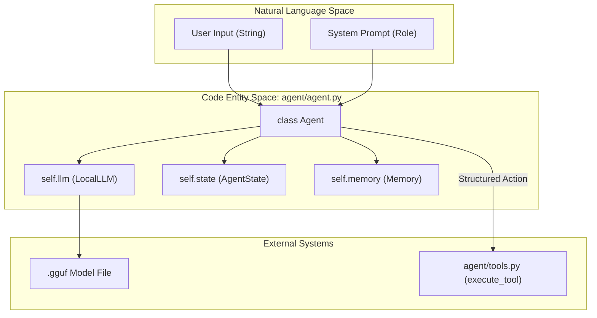
**Sources:** [agent/agent.py:30-60](), [agent/agent.py:22-27]()

---

### Constructor and Initialization

The constructor initializes the core components required for basic interaction and prepares the stateful containers used in later lessons.

| Component | Code Entity | Purpose |
| :--- | :--- | :--- |
| **LLM Engine** | `self.llm` | Wrapper for `llama-cpp-python` to run GGUF models [agent/agent.py:46](). |
| **Persona** | `self.system_prompt` | Defines the "calm, precise" behavior of the assistant [agent/agent.py:49-53](). |
| **Lifecycle** | `self.state` | Tracks steps, status, and current plans [agent/agent.py:56](). |
| **Persistence** | `self.memory` | Stores facts across different `run()` calls [agent/agent.py:59](). |

**Sources:** [agent/agent.py:38-60]()

---

### Method Progression by Lesson

The `Agent` class implements methods that correspond to specific educational milestones. Each method builds upon the previous ones, moving from raw text to complex graph execution.

#### 1. Fundamental Interaction (Lessons 01–03)
*   **`simple_generate(user_input)`**: The most basic entry point, passing raw strings to the LLM [agent/agent.py:65-77]().
*   **`generate_with_role(user_input)`**: Wraps input in a template including `self.system_prompt` and cleans up model-generated artifacts like `<SYSTEM>` tags [agent/agent.py:83-105]().
*   **`generate_structured(user_input, schema)`**: Forces the model into an **Output Contract**. It uses a specialized prompt demanding "ONLY valid JSON" and implements a retry loop [agent/agent.py:111-146]().

#### 2. Decisions and Tools (Lessons 04–05)
*   **`decide(user_input, choices)`**: Constrains the model to a finite list of strings. It validates that the returned JSON `decision` key exists within the provided `choices` list [agent/agent.py:152-195]().
*   **`request_tool(user_input)`**: Prompts the model to output a JSON object containing a `tool` name and `arguments` [agent/agent.py:201-230]().
*   **`execute_tool_call(tool_call)`**: A pass-through to the `execute_tool` utility, shielding the agent from tool implementation details [agent/agent.py:243-254]().

#### 3. The Agent Loop (Lesson 06)
*   **`run_loop(user_input, max_steps)`**: The primary entry point for autonomous behavior. It initializes `self.state`, then enters a loop calling `agent_step()` until the model decides it is `done` or hits `max_steps` [agent/agent.py:269-311]().

#### 4. Memory and Persistence (Lesson 07)
*   **`run_with_memory(user_input)`**: Extends the structured output pattern to include a `save_to_memory` field. If present in the LLM response, the agent calls `self.memory.save()` to persist the data [agent/agent.py:365-410]().

#### 5. Planning and Graph Execution (Lessons 08–10)
The agent delegates complex logic to the `planner.py` module while maintaining the execution state.
*   **`create_plan(goal)`**: Generates a sequential list of steps [agent/agent.py:423-435]().
*   **`execute_plan(plan)`**: Iterates through steps, converting each into an atomic action [agent/agent.py:437-458]().
*   **`create_aot_plan(goal)`**: Generates an **Atom of Thought** dependency graph [agent/agent.py:510-522]().
*   **`execute_aot_plan(graph)`**: Uses `execute_graph` to process nodes in topological order [agent/agent.py:524-541]().

**Sources:** [agent/agent.py:65-541]()

---

### The Retry Pattern

A critical robust-engineering pattern used in `generate_structured`, `decide`, and `request_tool` is the **Validation Retry Loop**. Because LLMs are probabilistic, the agent does not assume the first response is valid.

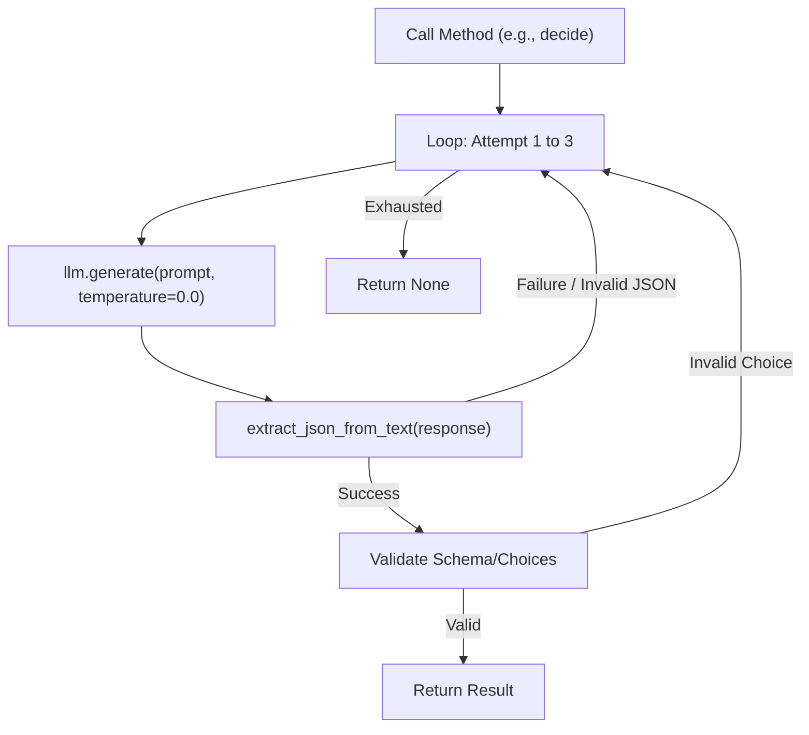

**Key Implementation Details:**
*   **Temperature 0.0**: Used in structured methods to ensure maximum determinism [agent/agent.py:140]().
*   **JSON Extraction**: Uses `extract_json_from_text` to find JSON blocks even if the model includes preamble text [agent/agent.py:141]().
*   **Validation**: The agent checks if the parsed JSON matches the expected keys (e.g., `if decision in choices`) [agent/agent.py:192]().

**Sources:** [agent/agent.py:138-146](), [agent/agent.py:186-195]()

---

### Data Flow: The `run()` Entrypoint

The `run()` method (introduced in Lesson 06) represents the "Observe-Decide-Act" cycle. It demonstrates how `AgentState` and `LocalLLM` are wired together.

1.  **State Reset**: `self.state.reset(user_input)` clears previous task data [agent/agent.py:283]().
2.  **Loop**: The agent executes up to `max_steps` [agent/agent.py:288]().
3.  **Prompt Assembly**: The agent builds a prompt containing the current `state.history` and `state.step_count` [agent/agent.py:328-335]().
4.  **Decision**: The LLM returns a JSON object with an `action` and `reason` [agent/agent.py:340]().
5.  **State Update**: The action is logged to `self.state.add_history()`, and the step counter increments [agent/agent.py:348]().
6.  **Termination**: If the action is `"done"`, the loop breaks [agent/agent.py:302]().

**Sources:** [agent/agent.py:280-311](), [agent/agent.py:313-358]()

---

# Page: State Management

# State Management

<details>
<summary>Relevant source files</summary>

The following files were used as context for generating this wiki page:

- [agent/memory.py](agent/memory.py)
- [agent/state.py](agent/state.py)
- [lessons/07_memory.md](lessons/07_memory.md)

</details>


State Management in the `agents-from-scratch` repository is built on the principle of **explicit visibility**. Unlike frameworks that hide agent history or internal variables within complex objects, this codebase treats state and memory as plain, inspectable data structures. This ensures that the developer—and the LLM—can always verify the current context of an operation.

The system is divided into two primary components:
1.  **`AgentState`**: Manages the lifecycle and execution progress of a single task or "run."
2.  **`Memory`**: Manages long-term persistence of facts across multiple separate interactions.

## AgentState Class

The `AgentState` class, defined in `agent/state.py`, serves as the "scratchpad" for the agent's current execution loop. It tracks how many steps have been taken, whether the goal has been reached, and what the current plan looks like.

### Fields and Lifecycle
The state is designed to grow in complexity as the user progresses through the lessons:
- **`steps`**: An integer counter tracking the number of iterations in the current `observe-decide-act` loop [agent/state.py:23]().
- **`done`**: A boolean flag used to terminate the execution loop when the agent determines its task is complete [agent/state.py:24]().
- **`current_plan`**: Stores the sequence of steps generated during planning phases (introduced in Lesson 08) [agent/state.py:25]().
- **`last_action`**: Records the most recent operation performed, providing context for the next decision [agent/state.py:26]().

### Key Methods
| Method | Description |
| :--- | :--- |
| `increment_step()` | Increases the `steps` counter by 1. Called after every action or LLM interaction [agent/state.py:28-30](). |
| `mark_done()` | Sets `done` to `True`, signaling the agent loop to stop [agent/state.py:32-34](). |
| `reset()` | Reverts all fields to their initial values (`steps=0`, `done=False`, etc.) to prepare for a new goal [agent/state.py:36-41](). |
| `to_dict()` | Serializes the state into a dictionary, which is frequently used to inject state information into LLM prompts [agent/state.py:43-55](). |

**Sources:** [agent/state.py:9-59](), [lessons/07_memory.md:139-145]()

---

## Memory Class

The `Memory` class, defined in `agent/memory.py`, handles **Persistence**. While `AgentState` resets between tasks, `Memory` is intended to survive across different `run()` calls, allowing the agent to remember user preferences or facts (e.g., "The user's name is Alice") [lessons/07_memory.md:25-29]().

### Data Flow: Memory to Prompt
The agent does not have direct "consciousness" of the memory; instead, memory must be explicitly retrieved and injected into the prompt context.

**LLM-Memory Interaction Logic:**
1.  **Retrieval**: The agent calls `self.memory.get_all()` [lessons/07_memory.md:60]().
2.  **Serialization**: The list of strings is formatted into a "You remember the following..." block [lessons/07_memory.md:63-66]().
3.  **Inference**: The LLM processes the prompt containing these memories.
4.  **Storage**: If the LLM includes a `save_to_memory` key in its JSON response, the agent calls `self.memory.add()` [lessons/07_memory.md:98-99]().

### Key Methods
- `add(item)`: Appends a new string to memory if it is not already present [agent/memory.py:22-30]().
- `get_all()`: Returns a copy of the entire memory list [agent/memory.py:32-39]().
- `search(query)`: Performs a simple case-insensitive substring search over stored items [agent/memory.py:53-64]().

**Sources:** [agent/memory.py:9-76](), [lessons/07_memory.md:19-35]()

---

## Technical Architecture Diagrams

### State Lifecycle and Code Entity Mapping
This diagram shows how the "Natural Language" goal is transformed into "Code Entities" and managed through the `AgentState` lifecycle.

**Diagram: State Entity Mapping**
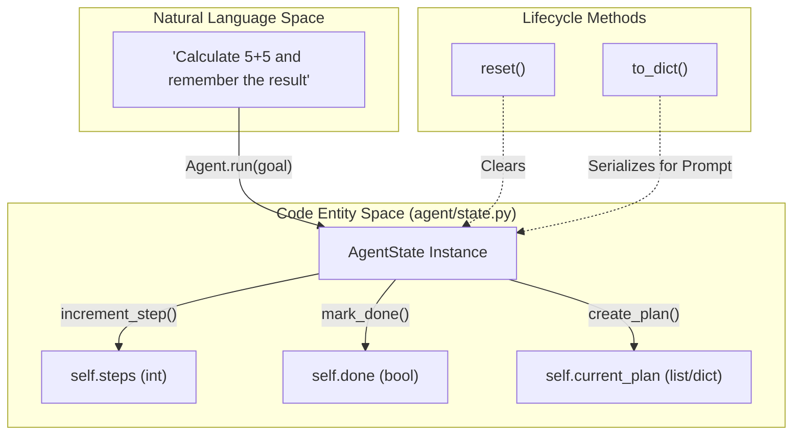
**Sources:** [agent/state.py:9-55](), [lessons/07_memory.md:139-145]()

### Memory Persistence Flow
This diagram illustrates the "Memory Loop" where the `Agent` class mediates between the `LocalLLM` (Natural Language) and the `Memory` object (Structured Storage).

**Diagram: Memory Interaction Flow**
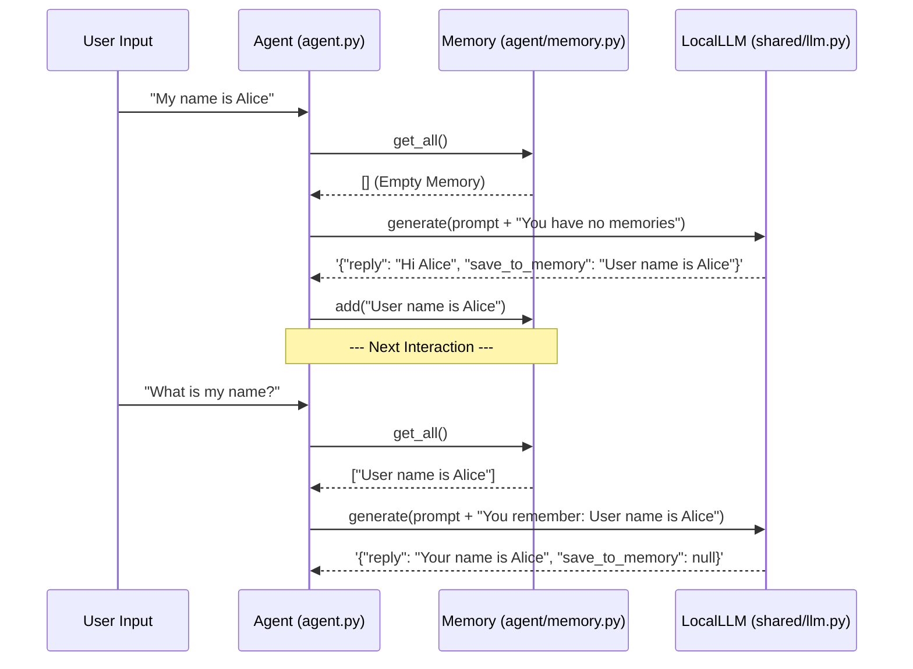
**Sources:** [lessons/07_memory.md:48-105](), [agent/memory.py:22-39]()

---

## Comparison: Context vs. Memory

A critical distinction in this architecture is the difference between temporary context and persistent memory.

| Feature | Context (Prompt) | Memory (`agent/memory.py`) |
| :--- | :--- | :--- |
| **Duration** | Lasts for one LLM call. | Persists across multiple interactions. |
| **Storage** | String in RAM (System Prompt + History). | List of strings in the `Memory` object. |
| **Visibility** | Directly visible to the LLM. | Only visible if the Agent explicitly loads it. |
| **Implementation** | `f-string` interpolation in `agent.py`. | `self.items` list in `Memory` class. |

**Sources:** [lessons/07_memory.md:19-35](), [agent/memory.py:9-16]()

---

# Page: Shared Utilities

# Shared Utilities

<details>
<summary>Relevant source files</summary>

The following files were used as context for generating this wiki page:

- [shared/README.md](shared/README.md)
- [shared/llama_logging.py](shared/llama_logging.py)
- [shared/llm.py](shared/llm.py)
- [shared/prompts.py](shared/prompts.py)
- [shared/utils.py](shared/utils.py)

</details>


The `shared/` package contains the foundational, "boring" helpers that support the entire agent architecture [shared/README.md:3-3](). These utilities are intentionally kept simple and free of complex logic to ensure that the core lesson code remains focused on agentic patterns rather than boilerplate string manipulation or library-specific configuration [shared/README.md:13-20]().

### LLM Interface (`llm.py`)

The `LocalLLM` class serves as a minimal wrapper around the `llama-cpp-python` library [shared/llm.py:18-23](). It provides a consistent interface for text generation while abstracting away the underlying GGUF model management.

#### Key Characteristics
- **No Hidden Logic**: It does not implement retries, tool calling, or memory internally; these are handled by the higher-level `Agent` class in later lessons [shared/llm.py:5-9]().
- **Deterministic Defaults**: Defaults to a low temperature (`0.2`) to favor predictable outputs suitable for structured JSON [shared/llm.py:28-28]().
- **Stop Sequences**: Automatically includes standard stop sequences like `</s>`, `User:`, and `Assistant:` to prevent the model from hallucinating both sides of a conversation [shared/llm.py:64-64]().

#### Implementation Details
The `__init__` method initializes the `Llama` instance with a specified context window (`n_ctx`) and disables internal `llama.cpp` logging via a global shim [shared/llm.py:41-46](). The `generate` method takes a raw string prompt and returns a stripped string response [shared/llm.py:49-71]().

**Data Flow: Text Generation**
"This diagram shows how the `LocalLLM` class bridges the gap between raw Python strings and the `llama_cpp.Llama` inference engine."

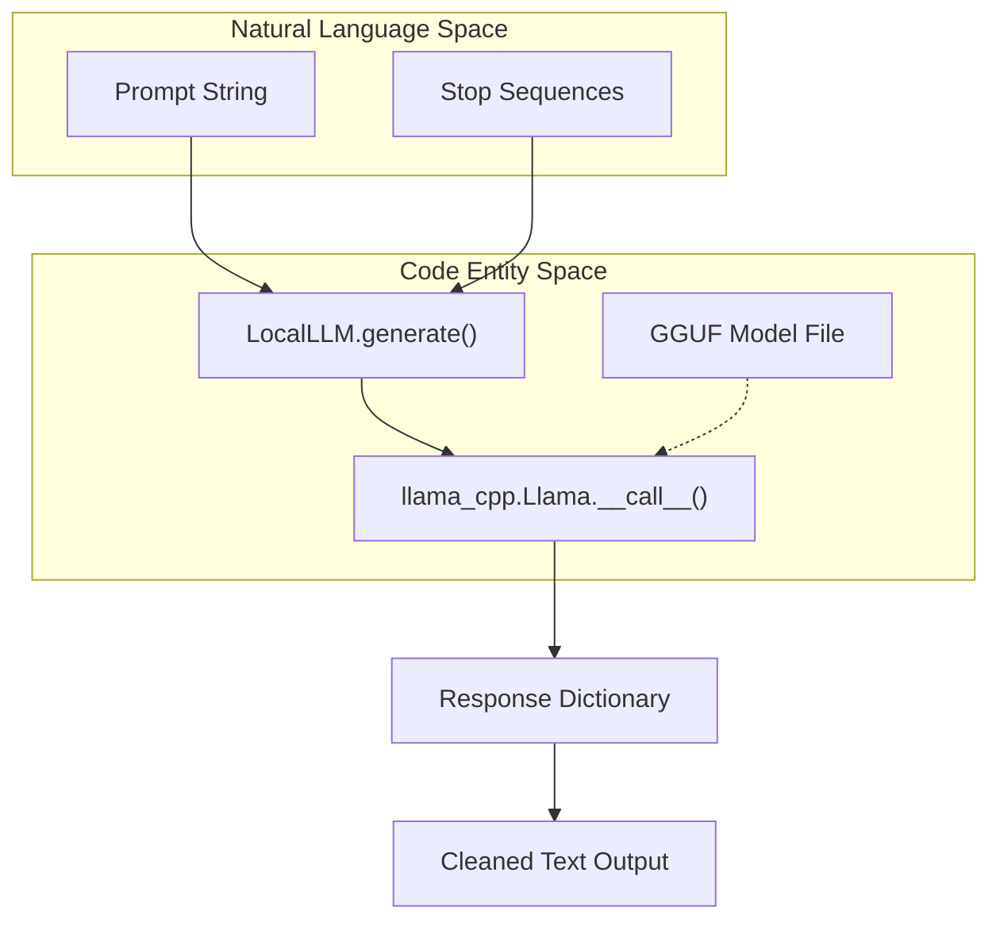
Sources: [shared/llm.py:41-71](), [shared/llm.py:18-23]()

---

### JSON and Text Helpers (`utils.py`)

Reliable JSON parsing is critical for the "Output Contract" pattern used throughout the repository. The `utils.py` file provides robust extraction logic to handle imperfect model outputs.

#### `safe_json_parse(text)`
A wrapper around `json.loads` that catches `JSONDecodeError` and `TypeError`, returning `None` instead of crashing [shared/utils.py:11-24]().

#### `extract_json_from_text(text)`
This is the primary helper for processing LLM responses. It attempts to find valid JSON even if the model includes conversational "noise" [shared/utils.py:27-38](). It follows a multi-stage recovery strategy:
1. **Markdown Stripping**: Removes ` ```json ` and ` ``` ` blocks [shared/utils.py:43-50]().
2. **Prefix Removal**: Strips common model prefixes like "JSON:" or "Response:" [shared/utils.py:53-56]().
3. **Brace/Bracket Extraction**: Searches for the first `{` and last `}` (or `[` and `]`) to isolate the JSON object from surrounding text [shared/utils.py:64-96]().
4. **Heuristic Repair**: Attempts to fix common issues like unclosed strings by checking quote counts and appending missing characters [shared/utils.py:75-86]().

**Entity Mapping: JSON Extraction**
"This diagram maps the logical steps of the `extract_json_from_text` function to the specific code entities that handle them."

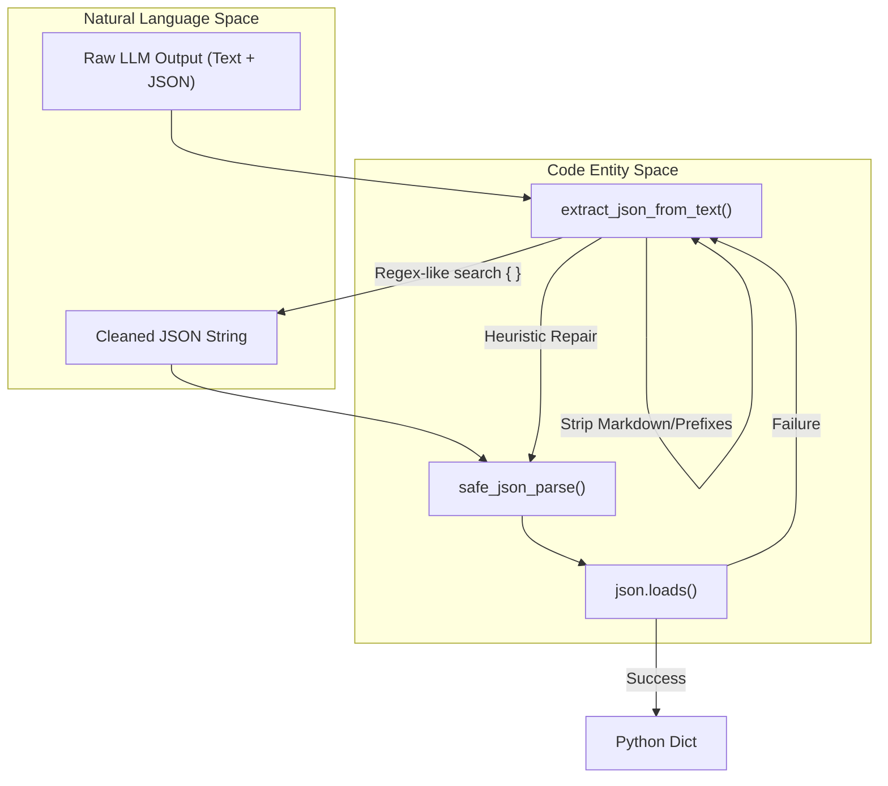
Sources: [shared/utils.py:27-110](), [shared/utils.py:11-24]()

---

### Prompt Builders (`prompts.py`)

Prompts are treated as first-class citizens. Rather than using static files, the repository uses builder functions that evolve in complexity as the lessons progress [shared/prompts.py:1-11]().

| Function | Lesson | Purpose |
| :--- | :--- | :--- |
| `base_prompt` | 01 | Passes raw user input directly [shared/prompts.py:14-26](). |
| `system_prompt` | 02 | Wraps input in `<SYSTEM>` and `<USER>` tags [shared/prompts.py:29-48](). |
| `json_contract` | 03 | Appends a schema and demands "ONLY valid JSON" [shared/prompts.py:51-71](). |
| `decision_prompt` | 04 | Constrains output to a specific list of choices [shared/prompts.py:74-99](). |
| `tool_call_prompt` | 05 | Provides tool definitions and requests a `tool`/`arguments` object [shared/prompts.py:102-129](). |
| `agent_step_prompt` | 06 | Includes the current `AgentState` for loop-based reasoning [shared/prompts.py:132-161](). |
| `memory_prompt` | 07 | Injects relevant facts from the `Memory` subsystem [shared/prompts.py:164-197](). |
| `planning_prompt` | 08 | Requests a list of `steps` to reach a goal [shared/prompts.py:200-222](). |
| `aot_prompt` | 10 | Requests a dependency graph (`nodes` with `depends_on`) [shared/prompts.py:251-279](). |

Sources: [shared/prompts.py:1-279]()

---

### Noise Suppression (`llama_logging.py`)

To maintain a clean terminal output focused on agent behavior, the repository suppresses the verbose C++ logs generated by `llama.cpp`.

The `disable_llama_logging()` function uses `ctypes` to interface with the native C library [shared/llama_logging.py:17-22](). It defines a `_silent_log` callback that does nothing and passes it to `llama_cpp.llama_log_set` [shared/llama_logging.py:25-29](). A module-level reference `_silent_callback_ref` is maintained to prevent the Python garbage collector from reclaiming the callback while the C library is still using it [shared/llama_logging.py:14-14]().

Sources: [shared/llama_logging.py:1-29]()

---

# Page: Lesson Progression

# Lesson Progression

<details>
<summary>Relevant source files</summary>

The following files were used as context for generating this wiki page:

- [README.md](README.md)
- [complete_example.py](complete_example.py)
- [lessons/01_basic_llm_chat.md](lessons/01_basic_llm_chat.md)

</details>


This page provides a high-level overview of the 12-lesson curriculum designed to build a functional AI agent from scratch. The curriculum follows a "local-first" philosophy, moving from basic text generation to complex graph-based execution and production-ready observability.

Each lesson is implemented as a method or a set of methods within the `Agent` class in [agent/agent.py:1-10]() and demonstrated in [complete_example.py:1-10]().

## Curriculum Roadmap

The following diagram illustrates how the lessons transition from simple text completion to structured agency and finally to system reliability.

### From Text to Agency: System Evolution
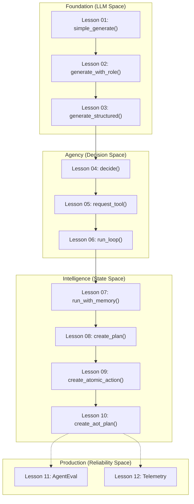
**Sources:** [README.md:34-50](), [README.md:143-151](), [complete_example.py:13-232]()

---

## 3.1 Lessons 01–03: LLM Fundamentals
These lessons establish the "Output Contract" between the user and the model. 
- **Lesson 01**: Introduces basic text-in/text-out using `simple_generate` [agent/agent.py:44-54]().
- **Lesson 02**: Introduces the `SYSTEM_PROMPT` to define roles and behaviors [agent/agent.py:56-72]().
- **Lesson 03**: Enforces a "Trust Boundary" by requiring the model to return valid JSON matching a specific schema, implemented in `generate_structured` [agent/agent.py:74-114]().

For details, see [Lessons 01–03: LLM Fundamentals](#3.1).

**Sources:** [lessons/01_basic_llm_chat.md:1-119](), [agent/agent.py:44-114]()

---

## 3.2 Lessons 04–05: Decision Making and Tool Calling
These lessons move the agent from passive generation to active selection.
- **Lesson 04**: Implements `decide`, which constrains the LLM to choose from a specific list of strings [agent/agent.py:116-150]().
- **Lesson 05**: Introduces `request_tool` and `execute_tool_call`, allowing the agent to interface with Python functions like the `calculator` [agent/tools.py:1-40]().

For details, see [Lessons 04–05: Decision Making and Tool Calling](#3.2).

**Sources:** [agent/agent.py:116-188](), [agent/tools.py:1-40]()

---

## 3.3 Lessons 06–07: Agent Loop and Memory
This phase introduces persistence and iterative reasoning.
- **Lesson 06**: Wraps the decision-making process in a `run_loop` that continues until a "final_answer" is reached [agent/agent.py:190-245]().
- **Lesson 07**: Adds a `Memory` class [agent/memory.py:1-30]() to persist facts across different `run_with_memory` calls, using the `save_to_memory` JSON field [agent/agent.py:247-300]().

For details, see [Lessons 06–07: Agent Loop and Memory](#3.3).

**Sources:** [agent/agent.py:190-300](), [agent/memory.py:1-30](), [agent/state.py:1-40]()

---

## 3.4 Lessons 08–10: Planning and Atom of Thought
The final architectural stage focuses on decomposing complex goals into executable data structures.
- **Lesson 08**: Introduces `create_plan`, which generates a sequential list of steps [agent/planner.py:1-50]().
- **Lesson 09**: Implements `create_atomic_action` to turn vague plan steps into validated `action`/`inputs` dictionaries [agent/planner.py:52-100]().
- **Lesson 10**: Introduces "Atom of Thought" (AoT), using `create_aot_graph` to build Directed Acyclic Graphs (DAGs) for non-linear execution [agent/planner.py:102-180]().

For details, see [Lessons 08–10: Planning and Atom of Thought](#3.4).

**Sources:** [agent/planner.py:1-180](), [complete_example.py:139-193]()

---

## 3.5 Lessons 11–12: Evals and Telemetry
These lessons cover the operational requirements for deploying agents.
- **Lesson 11**: Uses `AgentEval` and "Golden Datasets" to perform regression testing [agent/evals.py:1-60]().
- **Lesson 12**: Implements a `Telemetry` system to track LLM latency, token usage, and tool success rates in a `agent_telemetry.jsonl` file [agent/telemetry.py:1-100]().

**Sources:** [agent/evals.py:1-100](), [agent/telemetry.py:1-100](), [complete_example.py:194-240]()

---

# Page: Lessons 01–03: LLM Fundamentals

# Lessons 01–03: LLM Fundamentals

<details>
<summary>Relevant source files</summary>

The following files were used as context for generating this wiki page:

- [agent/tools.py](agent/tools.py)
- [lessons/01_basic_llm_chat.md](lessons/01_basic_llm_chat.md)
- [lessons/02_system_prompt.md](lessons/02_system_prompt.md)
- [lessons/03_structured_output.md](lessons/03_structured_output.md)

</details>


This section covers the foundational building blocks of the "Agents from Scratch" architecture. It progresses from simple text completion to behavior-shaping via roles, and finally to the engineering of reliable, structured data exchange between the LLM and the Python runtime.

## Lesson 01: Basic Text Generation

The most fundamental interaction with a Large Language Model (LLM) is a "text in, text out" completion. In this codebase, this is handled by the `LocalLLM` wrapper, which abstracts the `llama-cpp-python` library.

### Key Concepts
*   **Tokens**: The atomic units of text processed by the model. Models do not see words; they see numerical representations of sub-word units [lessons/01_basic_llm_chat.md:24-29]().
*   **Context Window**: The total number of tokens (input + output) the model can hold in memory at once [lessons/01_basic_llm_chat.md:30-33]().
*   **Probabilistic Nature**: LLMs are pattern matchers that predict the next most likely token. They are not "thinking" but performing statistical completion [lessons/01_basic_llm_chat.md:82-88]().

### Implementation
The `Agent.simple_generate` method provides the thinnest possible wrapper around the model's generation capability.

| Entity | Role |
| :--- | :--- |
| `Agent.simple_generate` | Takes raw string input and returns raw string output [agent/agent.py:49-54](). |
| `LocalLLM.generate` | The underlying call to the GGUF model via `llama-cpp-python` [lessons/01_basic_llm_chat.md:53-53](). |

**Sources:**
* [lessons/01_basic_llm_chat.md:1-119]()
* [agent/agent.py:46-54]()

---

## Lesson 02: System Prompts and Roles

Lesson 02 introduces the **Instruction Hierarchy**. By prepending a "System Prompt" to the user's input, we can shape the model's persona, tone, and constraints without changing the underlying model weights [lessons/02_system_prompt.md:18-41]().

### The Role-Based Prompt Pattern
The codebase uses a specific format to ensure the model distinguishes between its instructions and the user's request:
1.  **System Prompt**: The "persona" (e.g., "You are a technical expert").
2.  **User Input**: The specific task.
3.  **Response Tag**: A marker (e.g., `Assistant:`) to trigger the model's completion.

### Implementation: `generate_with_role`
The `Agent` class maintains a `self.system_prompt` attribute, which defaults to a "calm, precise, and helpful AI assistant" [lessons/02_system_prompt.md:97-98]().

**Data Flow: Role-Shaped Generation**
1.  The system prompt is combined with user input into a single string [agent/agent.py:71-74]().
2.  The LLM generates a response based on this combined context.
3.  The `Agent` performs post-processing to strip any artifacts like `<SYSTEM>` or `<USER>` tags that the model might have hallucinated [agent/agent.py:78-80]().

**Sources:**
* [lessons/02_system_prompt.md:1-209]()
* [agent/agent.py:63-81]()

---

## Lesson 03: Structured Output and Contracts

Lesson 03 moves from "Creative Writing" to "Software Engineering" by introducing the **Output Contract**. Instead of free-text, the model is forced to return JSON that adheres to a specific schema [lessons/03_structured_output.md:18-27]().

### The Trust Boundary
A core philosophy of this project is the **Trust Boundary**: Never trust LLM output directly. The system must parse, validate, and handle failures [lessons/03_structured_output.md:29-36]().

### Implementation: `generate_structured`
This method implements a robust loop to ensure data integrity:
1.  **Strict Prompting**: Uses "CRITICAL INSTRUCTIONS" to demand ONLY valid JSON [agent/agent.py:65-68]().
2.  **Deterministic Generation**: Sets `temperature=0.0` to reduce randomness [agent/agent.py:79-79]().
3.  **JSON Extraction**: Uses `extract_json_from_text` (from `shared/utils.py`) to find the JSON block even if the model includes conversational filler [agent/agent.py:80-80]().
4.  **Retry Logic**: If parsing fails, it retries up to 3 times before returning `None` [agent/agent.py:78-85]().

### Technical Bridge: Natural Language to Code Entity
The following diagram illustrates how Lesson 03 bridges the gap between a natural language request and a validated Python dictionary.

**LLM to JSON Pipeline**
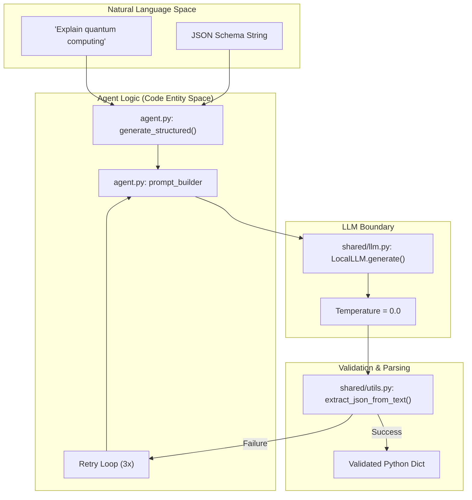

**Sources:**
* [lessons/03_structured_output.md:1-175]()
* [agent/agent.py:50-86]()

---

## Technical Summary Table

| Feature | Lesson | Method | Primary Goal |
| :--- | :--- | :--- | :--- |
| **Basic Chat** | 01 | `simple_generate` | Connectivity & Tokenization |
| **Role Play** | 02 | `generate_with_role` | Behavioral Consistency |
| **Structured Output** | 03 | `generate_structured` | Reliability & Type Safety |

### Data Flow Overview
The following diagram maps the progression of data through the first three lessons.

**Lessons 01-03 Data Flow**
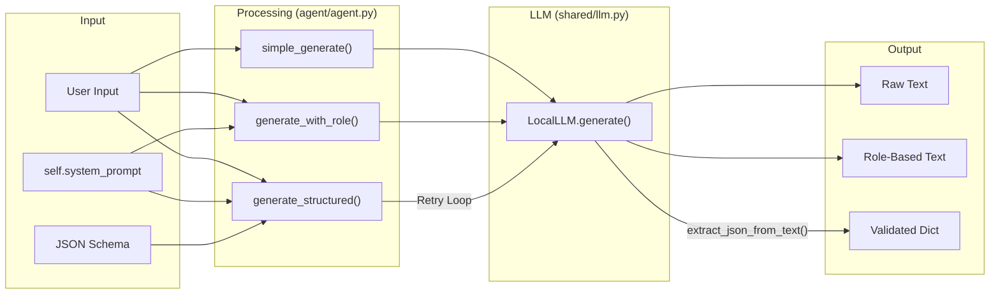

**Sources:**
* [agent/agent.py:46-86]()
* [lessons/01_basic_llm_chat.md:44-57]()
* [lessons/02_system_prompt.md:61-87]()
* [lessons/03_structured_output.md:45-86]()

---

# Page: Lessons 04–05: Decision Making and Tool Calling

# Lessons 04–05: Decision Making and Tool Calling

<details>
<summary>Relevant source files</summary>

The following files were used as context for generating this wiki page:

- [agent/tools.py](agent/tools.py)
- [lessons/02_system_prompt.md](lessons/02_system_prompt.md)
- [lessons/03_structured_output.md](lessons/03_structured_output.md)
- [lessons/04_decision_making.md](lessons/04_decision_making.md)
- [lessons/05_tools.md](lessons/05_tools.md)

</details>


Lessons 04 and 05 transition the LLM from a passive text generator into an active agent capable of selecting actions and requesting external execution. This phase introduces **constrained decision spaces** and **tool interfaces**, establishing the principle that while the model requests actions, the system maintains control over execution.

## Lesson 04: Decision Making and Routing

Lesson 04 introduces the first moment of true agency: **Intent Detection** via constrained choices [lessons/04_decision_making.md:5-35](). Instead of generating free-form text, the model is presented with a finite set of options (a decision schema) and must select exactly one [lessons/04_decision_making.md:19-24]().

### Implementation: The `decide` Method
The `Agent.decide` method implements this by dynamically building a prompt that lists available choices and mandates a specific JSON format: `{"decision": "choice_name"}` [agent/agent.py:49-81]().

Key features of the decision logic include:
*   **Finite Choice Space**: The model is restricted to a provided `list[str]` of choices [agent/agent.py:49-62]().
*   **Validation**: The system verifies that the parsed decision string exists within the original `choices` list [agent/agent.py:89-90]().
*   **Deterministic Routing**: Once a valid decision is returned, the application code can use standard conditional logic to route the execution path [lessons/04_decision_making.md:25-29]().

### Decision Flow Diagram
This diagram illustrates how a natural language request is mapped to a code-level decision through the `decide` function.

**Figure 1: Decision Routing Logic**
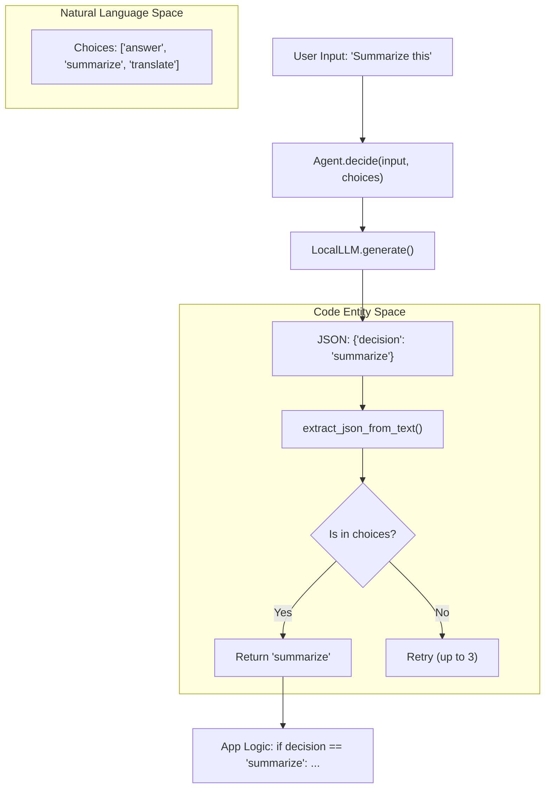
Sources: [agent/agent.py:49-93](), [lessons/04_decision_making.md:48-93]()

---

## Lesson 05: Tool Calling

Lesson 05 extends the agent's capabilities beyond its internal knowledge by introducing **Tools**. Tools are defined as **interfaces**, not innate abilities of the model [agent/tools.py:4-6](). The model describes what it needs, and the system executes the request [lessons/05_tools.md:19-23]().

### The Tool Registry Pattern
The codebase uses a centralized tool registry in `agent/tools.py`. This separates the definition of what a tool *does* from the schema describing *how to call it*.

| Component | Function / Entity | Role |
| :--- | :--- | :--- |
| **Tool Implementation** | `calculator(a, b, operation)` | Performs the actual logic (e.g., arithmetic) [agent/tools.py:11-33](). |
| **Schema Provider** | `get_tool_schema()` | Returns a JSON schema describing parameters and types for the LLM [agent/tools.py:36-59](). |
| **Dispatcher** | `execute_tool(name, args)` | Maps a string name to a Python function and unpacks arguments [agent/tools.py:62-83](). |

### Implementation: `request_tool` and `execute_tool_call`
The `Agent` class splits tool interaction into two distinct phases to maintain a security boundary:

1.  **`request_tool(user_input)`**: The LLM analyzes the input and generates a structured tool call: `{"tool": "name", "arguments": {...}}` [agent/agent.py:52-90]().
2.  **`execute_tool_call(tool_call)`**: The system takes the validated JSON and passes it to the `execute_tool` dispatcher [agent/agent.py:92-102]().

### Tool Calling Data Flow
This diagram bridges the gap between the LLM's request and the Python function execution.

**Figure 2: Tool Request and Execution Boundary**
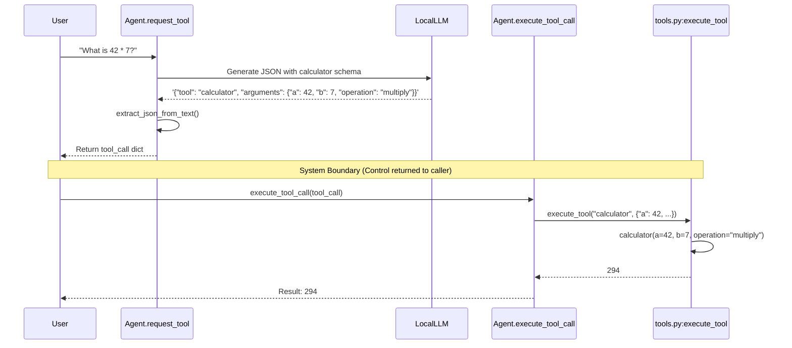
Sources: [agent/agent.py:52-103](), [agent/tools.py:62-83](), [lessons/05_tools.md:49-103]()

---

## Separation of Concerns and Safety

A core architectural principle introduced in these lessons is the **Trust Boundary** [lessons/03_structured_output.md:29-36]().

*   **Model as Requester**: The LLM is treated as a fallible component that provides a specification of intent [lessons/05_tools.md:37-39]().
*   **System as Executor**: The Python environment validates the request (checking tool names, argument types, and allowed operations) before any code is run [lessons/05_tools.md:159-161]().
*   **Retry Logic**: Both `decide` and `request_tool` utilize a retry loop (default 3 attempts) to handle malformed JSON or invalid selections, turning probabilistic LLM outputs into reliable system inputs [agent/agent.py:83-89](), [agent/agent.py:83-90]().

### Comparison of Patterns

| Feature | Lesson 04 (Decisions) | Lesson 05 (Tools) |
| :--- | :--- | :--- |
| **Output Goal** | Select a single string from a list [lessons/04_decision_making.md:134-137](). | Generate a tool name + arguments dict [lessons/05_tools.md:140-147](). |
| **Validation** | `decision in choices` [agent/agent.py:89](). | `tool in parsed` and `arguments in parsed` [agent/agent.py:87](). |
| **Purpose** | High-level routing/intent detection [lessons/04_decision_making.md:31-35](). | Extending capabilities (math, APIs) [lessons/05_tools.md:7-15](). |

Sources: [agent/agent.py:49-103](), [lessons/04_decision_making.md:1-183](), [lessons/05_tools.md:1-197](), [agent/tools.py:1-83]()

---

# Page: Lessons 06–07: Agent Loop and Memory

# Lessons 06–07: Agent Loop and Memory

<details>
<summary>Relevant source files</summary>

The following files were used as context for generating this wiki page:

- [diagrams/lesson-05-tool-calling.png](diagrams/lesson-05-tool-calling.png)
- [diagrams/lesson-06-agent-loop.png](diagrams/lesson-06-agent-loop.png)
- [diagrams/lesson-07-memory.png](diagrams/lesson-07-memory.png)
- [diagrams/lesson-08-planning.png](diagrams/lesson-08-planning.png)
- [lessons/06_agent_loop.md](lessons/06_agent_loop.md)
- [lessons/07_memory.md](lessons/07_memory.md)

</details>


This section covers the transition from a single-turn tool-calling bot to a stateful autonomous agent. It focuses on the implementation of the core execution loop (Lesson 06) and the mechanisms for persisting information across distinct user interactions (Lesson 07).

## Lesson 06: The Stateful Agent Loop

Lesson 06 introduces the fundamental difference between a chatbot and an agent: the ability to **observe, decide, act, and repeat** using an internal state [lessons/06_agent_loop.md:5-7](). While a chatbot typically responds once and stops, an agent runs a loop to take multiple steps toward a complex goal [lessons/06_agent_loop.md:19-23]().

### Core Implementation: agent_step and run_loop

The agent loop is implemented through two primary methods in the `Agent` class:

1.  **`agent_step(user_input)`**: Executes a single iteration of the cycle. It serializes the current `AgentState` into the prompt, requests a decision from the LLM, and increments the step counter [lessons/06_agent_loop.md:52-96]().
2.  **`run_loop(user_input, max_steps)`**: Orchestrates multiple steps. It resets the state and continues calling `agent_step` until a termination condition is met [lessons/06_agent_loop.md:98-124]().

### Termination Conditions
To prevent infinite execution, the loop relies on specific exit criteria [lessons/06_agent_loop.md:31-39]():
*   **Agent Decision**: The LLM outputs a specific `done` action [lessons/06_agent_loop.md:119-120]().
*   **Safety Limits**: The `max_steps` parameter (defaulting to 5) acts as a circuit breaker [lessons/06_agent_loop.md:112-131]().
*   **Failure**: The loop terminates if the LLM fails to provide a valid JSON response after three retries [lessons/06_agent_loop.md:86-96]().

### Loop Data Flow
The following diagram bridges the conceptual loop to the specific methods in `agent/agent.py`.

**Agent Execution Cycle**
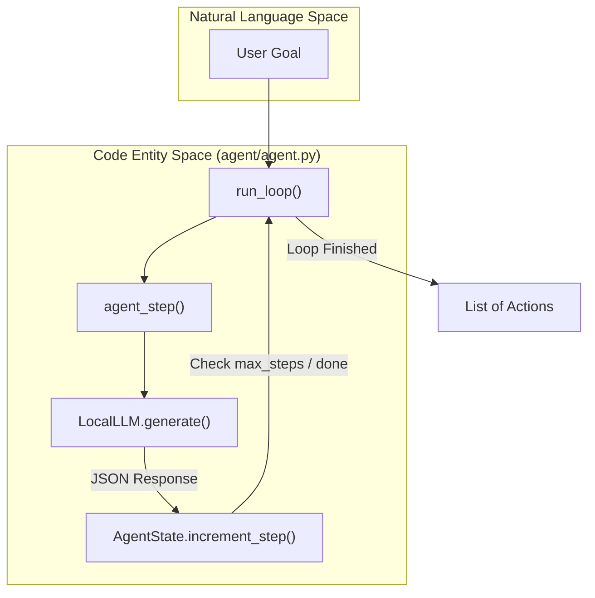
Sources: [lessons/06_agent_loop.md:49-124](), [lessons/06_agent_loop.md:168-176]()

---

## Lesson 07: Memory Persistence

Lesson 07 introduces the `Memory` system, which allows an agent to retain information across completely separate execution loops [lessons/07_memory.md:5-7](). This provides continuity that simple state (which resets per loop) cannot achieve [lessons/07_memory.md:147-152]().

### Context vs. Memory
The codebase makes a strict distinction between these two concepts:
*   **Context**: The temporary information visible in the current prompt [lessons/07_memory.md:21-23]().
*   **Memory**: Persistent storage that survives across interactions and is loaded into the context when needed [lessons/07_memory.md:21-23]().

### Implementation: run_with_memory
The `run_with_memory` method manages the interaction between the LLM and the `Memory` class [lessons/07_memory.md:48-105]():
1.  **Retrieval**: It calls `self.memory.get_all()` to fetch stored strings [lessons/07_memory.md:60]().
2.  **Augmentation**: It builds a `memory_str` and injects it into the system prompt [lessons/07_memory.md:63-72]().
3.  **Action**: The LLM is instructed to return a JSON object containing a `reply` and an optional `save_to_memory` field [lessons/07_memory.md:82]().
4.  **Persistence**: If `save_to_memory` contains a value, the agent calls `self.memory.add()` to store the new fact [lessons/07_memory.md:98-99]().

### Memory System Architecture
This diagram illustrates how the `Memory` class interacts with the LLM prompt cycle.

**Memory Persistence Flow**
```mermaid
graph LR
    subgraph "Memory Storage (agent/memory.py)"
        MDB[("Memory Store")]
    end

    subgraph "Agent Logic (agent/agent.py)"
        RWM["run_with_memory()"]
        Prompt["Prompt Construction"]
    end

    subgraph "LLM Space"
        Output["JSON: {save_to_memory: '...' }"]
    end

    MDB -- "memory.get_all()" --> RWM
    RWM --> Prompt
    Prompt -- "Injected Context" --> Output
    Output -- "memory.add()" --> MDB
```
Sources: [lessons/07_memory.md:48-105](), [lessons/07_memory.md:135-152]()

### Limitations and Considerations
*   **Retrieval Logic**: The current implementation uses a "get all" approach, which may hit context window limits as memories grow [lessons/07_memory.md:34-35](), [lessons/07_memory.md:184-188]().
*   **Explicit Control**: The agent must explicitly decide to save a fact; it does not automatically record every interaction [lessons/07_memory.md:165-166]().
*   **No Decay**: Memories do not currently have a "forgetting" mechanism or priority weighting [lessons/07_memory.md:41]().

Sources: [lessons/06_agent_loop.md](), [lessons/07_memory.md]()

---

# Page: Lessons 08–10: Planning and Atom of Thought

# Lessons 08–10: Planning and Atom of Thought

<details>
<summary>Relevant source files</summary>

The following files were used as context for generating this wiki page:

- [agent/planner.py](agent/planner.py)
- [diagrams/agent-architecture.png](diagrams/agent-architecture.png)
- [diagrams/lesson-10-atom-of-thoght.png](diagrams/lesson-10-atom-of-thoght.png)
- [lessons/08_planning.md](lessons/08_planning.md)
- [lessons/09_atomic_actions.md](lessons/09_atomic_actions.md)
- [lessons/10_atom_of_thought.md](lessons/10_atom_of_thought.md)

</details>


This section covers the evolution of the agent's cognitive capabilities from simple sequential execution to complex dependency-based task graphs. It details how the agent breaks down high-level goals into data-driven plans (Lesson 08), transforms vague steps into validated atomic actions (Lesson 09), and manages complex workflows using Atom of Thought (AoT) dependency graphs (Lesson 10).

## 3.4.1 Planning as Data (Lesson 08)

Lesson 08 introduces the concept that planning is a **data generation** task rather than an internal reasoning process [agent/planner.py:4-5](). By treating a plan as a structured data object, it becomes inspectable and modifiable before any execution occurs [lessons/08_planning.md:21-24]().

### Plan Generation and Structure
The primary entry point for creating a plan is `create_plan`. This function enforces a strict JSON output contract using a system prompt that requires a `"steps"` list [agent/planner.py:11-38]().

| Function | Role | Implementation Detail |
| :--- | :--- | :--- |
| `create_plan` | Goal Decomposition | Uses `LocalLLM` with `temperature=0.0` for deterministic step generation [agent/planner.py:41](). |
| `Agent.create_plan` | State Integration | Calls the planner and stores the result in `self.state.current_plan` [lessons/08_planning.md:63-66](). |
| `Agent.execute_plan` | Sequential Loop | Iterates through `plan["steps"]` and updates `self.state.increment_step()` [lessons/08_planning.md:70-94](). |

### Sequential Execution Flow
The execution at this stage is a simple linear progression. The agent treats each string in the steps list as a discrete task to be handled in order [lessons/08_planning.md:28-32]().

**Planning Data Flow**
```mermaid
graph TD
    UserGoal["User Goal (Natural Language)"] --> AgentPlan["Agent.create_plan()"]
    AgentPlan --> LLMGen["planner.create_plan()"]
    LLMGen --> JSON["JSON: {'steps': [...]}"]
    JSON --> State["AgentState.current_plan"]
    State --> Exec["Agent.execute_plan()"]
    Exec --> Step1["Step 1"]
    Step1 --> Step2["Step 2"]
    Step2 --> StepN["Step N"]
```
Sources: [agent/planner.py:11-47](), [lessons/08_planning.md:48-95]()

---

## 3.4.2 Atomic Steps and Safe Execution (Lesson 09)

Lesson 09 addresses the ambiguity of natural language steps (e.g., "Research topic") by converting them into **Atomic Actions** [lessons/09_atomic_actions.md:5-7](). An atomic action is the smallest indivisible unit of work that the system can validate [lessons/09_atomic_actions.md:21-23]().

### The Atomic Action Schema
The function `create_atomic_action` forces the LLM to map a vague plan step into a structured dictionary containing an `action` name and an `inputs` map [agent/planner.py:50-84]().

*   **Atomicity**: Ensures the operation either succeeds fully or fails without partial side effects [lessons/09_atomic_actions.md:21-24]().
*   **Typed Execution**: By requiring an `inputs` dictionary, the system can eventually validate parameters against expected schemas [lessons/09_atomic_actions.md:33-38]().

**From Vague Step to Atomic Code Entity**
```mermaid
graph LR
    subgraph "Natural Language Space"
        Step["'Write an explanation'"]
    end
    
    subgraph "Code Entity Space"
        Func["planner.create_atomic_action()"]
        JSON["{
          'action': 'generate_text',
          'inputs': {'topic': 'AI', 'length': 'short'}
        }"]
    end
    
    Step --> Func
    Func --> JSON
```
Sources: [agent/planner.py:50-94](), [lessons/09_atomic_actions.md:153-157]()

---

## 3.4.3 Atom of Thought (AoT) Dependency Graphs (Lesson 10)

Lesson 10 introduces the **Atom of Thought (AoT)** framework. Instead of a linear list, the agent generates a Directed Acyclic Graph (DAG) where nodes represent actions and edges represent execution dependencies [lessons/10_atom_of_thought.md:5-7]().

### Graph Construction and Validation
The `create_aot_graph` function generates a JSON structure containing a list of nodes. Each node must have a unique `id`, an `action`, and a `depends_on` list [agent/planner.py:111-128]().

The implementation includes a multi-stage validation loop:
1.  **JSON Extraction**: Ensures the LLM output is valid JSON [agent/planner.py:132]().
2.  **Structural Integrity**: Checks for the presence of `id`, `action`, and `depends_on` in every node [agent/planner.py:138]().
3.  **Reference Integrity**: Ensures all IDs listed in `depends_on` actually exist within the graph [lessons/10_atom_of_thought.md:94-102]().

### Topological Execution
The `execute_graph` function implements a topological sort to ensure actions are executed in the correct order [agent/planner.py:150-168](). It uses an iterative approach with a `max_iterations` guard (calculated as `len(nodes) * 2`) to prevent infinite loops caused by potential cycles [agent/planner.py:170-173]().

**AoT Execution Logic**
```mermaid
graph TD
    Start["execute_graph(graph, executor_func)"] --> Iter["While len(executed) < len(nodes)"]
    Iter --> NodeLoop["For node in nodes"]
    NodeLoop --> CheckDep{"All depends_on in executed?"}
    CheckDep -- "Yes" --> Exec["executor_func(node['action'])"]
    Exec --> Mark["Add node_id to executed set"]
    CheckDep -- "No" --> Next["Skip to next node"]
    Mark --> NodeLoop
    NodeLoop -- "Loop Finished" --> Iter
    Iter -- "All Executed" --> End["Return results list"]
```
Sources: [agent/planner.py:150-206](), [lessons/10_atom_of_thought.md:124-138]()

### Comparison of Planning Levels

| Feature | Lesson 08 (Sequential) | Lesson 09 (Atomic) | Lesson 10 (AoT) |
| :--- | :--- | :--- | :--- |
| **Structure** | List of strings | List of Dicts (Action/Inputs) | DAG (Nodes/Dependencies) |
| **Validation** | JSON format only | Schema (Action/Inputs) | Structural + Reference Integrity |
| **Execution** | Linear `for` loop | Linear `for` loop | Topological Resolution |
| **Parallelism** | Not possible | Not possible | Possible (Independent Nodes) |

Sources: [lessons/08_planning.md:162-176](), [lessons/09_atomic_actions.md:145-157](), [lessons/10_atom_of_thought.md:166-183]()

---

# Page: Planning Engine

# Planning Engine

<details>
<summary>Relevant source files</summary>

The following files were used as context for generating this wiki page:

- [agent/planner.py](agent/planner.py)
- [lessons/08_planning.md](lessons/08_planning.md)

</details>


The Planning Engine is a standalone subsystem encapsulated in `agent/planner.py`. It treats planning not as an abstract "reasoning" process, but as a **structured data generation** task [agent/planner.py:4-5](). By transforming high-level goals into inspectable JSON data structures, the system allows for validation, modification, and step-by-step execution before any actions are actually performed.

The engine supports three distinct levels of complexity introduced across Lessons 08, 09, and 10: sequential step generation, atomic action mapping, and dependency-aware graph execution.

### Architectural Overview

The Planning Engine interfaces with the `LocalLLM` to generate plans and interacts with `AgentState` to persist the current plan during an agent's lifecycle.

**Planning Data Flow**
```mermaid
graph TD
    subgraph "Natural Language Space"
        UserGoal["User Goal (str)"]
        PlanStep["Plan Step (str)"]
    end

    subgraph "Code Entity Space: agent/planner.py"
        direction TB
        L8["create_plan()"]
        L9["create_atomic_action()"]
        L10["create_aot_graph()"]
        Exec["execute_graph()"]
    end

    subgraph "Code Entity Space: shared/llm.py"
        LLM["LocalLLM.generate()"]
    end

    UserGoal --> L8
    UserGoal --> L10
    PlanStep --> L9
    
    L8 -. "prompt" .-> LLM
    L9 -. "prompt" .-> LLM
    L10 -. "prompt" .-> LLM
    
    LLM -. "JSON String" .-> L8
    LLM -. "JSON String" .-> L9
    LLM -. "JSON String" .-> L10

    L10 -->|"dict {nodes}"| Exec
```
Sources: [agent/planner.py:11-147](), [shared/llm.py:1-20]()

---

### Planning Modes

The engine provides three primary functions to handle different task complexities:

| Function | Output Structure | Use Case |
| :--- | :--- | :--- |
| `create_plan` | `{"steps": [str, ...]}` | High-level decomposition of a goal into a linear sequence [agent/planner.py:11-47](). |
| `create_atomic_action` | `{"action": str, "inputs": dict}` | Translating a text step into a machine-readable tool call [agent/planner.py:50-93](). |
| `create_aot_graph` | `{"nodes": [{"id", "action", "depends_on"}]}` | Modeling complex tasks where steps can run in parallel or require specific prerequisites [agent/planner.py:96-147](). |

### Core Mechanics

#### 1. Sequential Planning and Atomic Actions
This mode focuses on linear execution. The `create_plan` function uses a retry loop (up to 3 attempts) and `temperature=0.0` to ensure stable, valid JSON output [agent/planner.py:40-41](). Once a plan exists, `create_atomic_action` can be used to refine individual steps into specific tool-calling schemas.

For more details on prompt construction, JSON extraction, and state updates, see **[Sequential Planning and Atomic Actions (#4.1)]**.

#### 2. Atom of Thought (AoT) Graph Execution
The most advanced mode treats a plan as a Directed Acyclic Graph (DAG). The `create_aot_graph` function generates nodes with explicit `depends_on` relationships [agent/planner.py:111-119](). These are then processed by `execute_graph`, which performs a topological sort to ensure actions are only executed once their dependencies are satisfied [agent/planner.py:185-195]().

For details on topological sorting, cycle detection, and error handling during graph execution, see **[Atom of Thought Graph Execution (#4.2)]**.

---

### Implementation in the Agent Loop

The `Agent` class in `agent/agent.py` wraps these utility functions to integrate them into the agent's state. When `create_plan` is called on the agent, it stores the resulting dictionary in `self.state.current_plan`, making the plan persistent across turns [lessons/08_planning.md:63-68]().

**Entity Mapping: Planning to State**
```mermaid
graph LR
    subgraph "agent/planner.py"
        P_GEN["create_plan()"]
        A_GEN["create_atomic_action()"]
    end

    subgraph "agent/state.py"
        AS["AgentState"]
        CP["AgentState.current_plan"]
    end

    subgraph "agent/agent.py"
        AG["Agent.create_plan()"]
        AG_EX["Agent.execute_plan()"]
    end

    P_GEN --> AG
    AG -->|"Store Data"| CP
    CP --> AG_EX
    AG_EX -->|"Refine Step"| A_GEN
```
Sources: [agent/planner.py:11-93](), [lessons/08_planning.md:48-95]()

### Sources:
- [agent/planner.py:1-206]()
- [lessons/08_planning.md:1-232]()
- [agent/agent.py:1-100]() (Inferred from Lesson 08 context)

---

# Page: Sequential Planning and Atomic Actions

# Sequential Planning and Atomic Actions

<details>
<summary>Relevant source files</summary>

The following files were used as context for generating this wiki page:

- [agent/planner.py](agent/planner.py)
- [lessons/08_planning.md](lessons/08_planning.md)
- [lessons/09_atomic_actions.md](lessons/09_atomic_actions.md)

</details>


Sequential planning and atomic actions represent the first two levels of the planning engine in the 'Agents from Scratch' architecture. This system moves away from "chain-of-thought" text generation toward **Planning as Data**, where plans are inspectable, validated JSON structures.

## Overview of the Planning Pipeline

The transition from a high-level natural language goal to an executable action occurs in two distinct phases:
1.  **Sequential Planning**: Breaking a goal into a list of high-level text strings (steps).
2.  **Atomic Action Conversion**: Transforming a vague text step into a structured dictionary containing an `action` name and an `inputs` map.

### Data Flow: Goal to Atomic Action

The following diagram illustrates how natural language is transformed into code-ready data structures through `agent/planner.py`.

**Diagram: Planning Data Transformation**
```mermaid
graph TD
    subgraph "Natural Language Space"
        G["Goal (str)"]
        S["Step (str)"]
    end

    subgraph "Code Entity Space (agent/planner.py)"
        CP["create_plan()"]
        CAA["create_atomic_action()"]
    end

    subgraph "Structured Data Space"
        PD["Plan Dict: {'steps': [...]}"]
        AD["Action Dict: {'action': str, 'inputs': dict}"]
    end

    G --> CP
    CP --> PD
    PD -->|"Extract Step"| S
    S --> CAA
    CAA --> AD
```
Sources: [agent/planner.py:11-23](), [agent/planner.py:50-62](), [lessons/08_planning.md:171-178]()

---

## Sequential Planning (`create_plan`)

The `create_plan` function is the entry point for multi-step task resolution. It treats planning as a structured data generation task rather than an abstract reasoning process.

### Implementation Details
-   **Prompt Construction**: The function uses a strict system prompt that demands ONLY valid JSON and provides a specific schema: `{"steps": ["step1", "step2", "step3"]}` [agent/planner.py:26-38]().
-   **Temperature-Zero Generation**: To ensure maximum consistency and adherence to the schema, `llm.generate` is called with `temperature=0.0` [agent/planner.py:41-41]().
-   **Retry Loop**: The system implements a 3-attempt retry loop to handle malformed JSON or schema violations [agent/planner.py:40-46]().
-   **Validation**: The result is passed through `extract_json_from_text` and validated to ensure the key `"steps"` exists and contains a list [agent/planner.py:42-44]().

### State Integration
When called via the `Agent` class, the generated plan is persisted in the `AgentState` object to allow for tracking progress across execution cycles.

```python
# agent/agent.py (Conceptual logic from Lesson 08)
plan = create_plan(self.llm, goal)
if plan:
    self.state.current_plan = plan
```
Sources: [agent/planner.py:11-47](), [lessons/08_planning.md:48-68]()

---

## Atomic Actions (`create_atomic_action`)

Atomic actions solve the problem of ambiguity. While a plan step might be "Research AI agents," an atomic action provides the specific parameters required for a tool or function to execute.

### The Atomic Contract
An atomic action is defined by two mandatory components:
1.  **Action**: A simple, atomic operation name (e.g., `web_search`, `calculate`).
2.  **Inputs**: A dictionary of parameters required for that specific action.

### Implementation Logic
The `create_atomic_action` function performs a "narrowing" transformation:
-   It takes a single string `step` from a previously generated plan [agent/planner.py:50-58]().
-   It prompts the LLM to map this step to the `{ "action": "...", "inputs": {...} }` format [agent/planner.py:65-85]().
-   Like the planner, it uses a **temperature-zero** approach and a **retry loop** [agent/planner.py:86-93]().

**Diagram: Step-to-Action Mapping**
```mermaid
graph LR
    subgraph "Input"
        STEP["'Write a blog post about AI'"]
    end

    subgraph "Processing (agent/planner.py)"
        FUNC["create_atomic_action()"]
        LLM["LocalLLM.generate(temp=0.0)"]
        PARSE["extract_json_from_text()"]
    end

    subgraph "Output"
        JSON["{
          'action': 'generate_text',
          'inputs': {
            'topic': 'AI agents',
            'length': 'short'
          }
        }"]
    end

    STEP --> FUNC
    FUNC --> LLM
    LLM --> PARSE
    PARSE --> JSON
```
Sources: [agent/planner.py:50-94](), [lessons/09_atomic_actions.md:153-157]()

---

## Execution and Validation Patterns

The repository emphasizes that plans are not just for the LLM; they are for the system to validate and the user to inspect.

### Sequential Execution Logic
In Lesson 08, execution is handled by iterating through the plan's steps. The `AgentState` is updated at each interval using `increment_step()` to maintain a pointer to the current progress.

| Feature | Sequential Planning (L08) | Atomic Actions (L09) |
| :--- | :--- | :--- |
| **Data Structure** | List of strings | Dictionary of action/inputs |
| **Validation** | JSON Schema (steps key) | JSON Schema (action/inputs keys) |
| **Granularity** | High-level milestones | Indivisible operations |
| **State Update** | `state.current_plan` | Validated against tool registry |

### Key Functions Summary

| Function | File | Purpose |
| :--- | :--- | :--- |
| `create_plan` | `agent/planner.py` | Generates the high-level sequence of steps from a goal. |
| `create_atomic_action` | `agent/planner.py` | Converts a text step into a structured action/input object. |
| `extract_json_from_text` | `shared/utils.py` | Sanitizes LLM output to find and parse JSON blocks. |
| `increment_step` | `agent/state.py` | Advances the internal counter as steps are completed. |

Sources: [agent/planner.py:11-94](), [lessons/08_planning.md:70-94](), [lessons/09_atomic_actions.md:161-179]()

---

# Page: Atom of Thought Graph Execution

# Atom of Thought Graph Execution

<details>
<summary>Relevant source files</summary>

The following files were used as context for generating this wiki page:

- [agent/planner.py](agent/planner.py)
- [diagrams/agent-architecture.png](diagrams/agent-architecture.png)
- [diagrams/lesson-10-atom-of-thoght.png](diagrams/lesson-10-atom-of-thoght.png)
- [lessons/10_atom_of_thought.md](lessons/10_atom_of_thought.md)

</details>


The **Atom of Thought (AoT)** engine represents the most advanced planning tier in the repository. It transitions from sequential list-based planning to **Directed Acyclic Graphs (DAGs)**, where actions are nodes and execution order is determined by explicit dependencies. This approach enables the agent to handle complex workflows where tasks can be executed in parallel or must wait for specific prerequisites.

## The AoT Workflow

The AoT system operates in two distinct phases: **Graph Generation** and **Topological Execution**. Unlike sequential plans, the AoT graph is validated for structural integrity (e.g., ensuring no circular dependencies) before a single action is performed.

### From Goal to Graph

The process begins with `create_aot_graph`. The LLM is instructed to decompose a goal into a JSON structure containing a list of nodes. Each node includes a unique identifier, an action description, and a list of IDs it depends on [agent/planner.py:96-128]().

**AoT Data Structure (Natural Language to Code Space)**

The following diagram illustrates how the LLM's natural language understanding is mapped into the validated code entities used by the `execute_graph` function.

| Natural Language Concept | Code Entity (JSON/Dict) | Implementation Detail |
| :--- | :--- | :--- |
| **Task** | `node["action"]` | A string describing the atomic operation [agent/planner.py:123](). |
| **Prerequisite** | `node["depends_on"]` | A list of strings referencing other `id` fields [agent/planner.py:124](). |
| **Unique Step** | `node["id"]` | A unique string (e.g., "1", "2") [agent/planner.py:122](). |
| **The Plan** | `graph["nodes"]` | A list of dictionary objects [agent/planner.py:119](). |

Sources: [agent/planner.py:96-147](), [lessons/10_atom_of_thought.md:17-35]()

## Graph Generation and Validation

The `create_aot_graph` function implements a retry loop (up to 3 attempts) to ensure the LLM produces a valid schema [agent/planner.py:130-132](). 

### Validation Steps:
1.  **Schema Presence**: Ensures the response contains a `"nodes"` key and it is a list [agent/planner.py:134]().
2.  **Field Integrity**: Every node must contain `id`, `action`, and `depends_on` [agent/planner.py:138]().
3.  **Reference Integrity**: The `depends_on` field must be a list [agent/planner.py:140]().
4.  **Reference Validation**: In the `Agent` class wrapper, the system further validates that every ID listed in `depends_on` actually exists as a node within the graph [lessons/10_atom_of_thought.md:94-102]().

Sources: [agent/planner.py:130-147](), [lessons/10_atom_of_thought.md:81-104]()

## Execution Engine

The `execute_graph` function performs a topological sort at runtime to resolve dependencies. It uses an iterative approach to find and execute "ready" nodes—those whose dependencies have all been successfully completed or marked as handled [agent/planner.py:150-162]().

### Topological Sort Logic
The executor maintains a `set` of `executed` node IDs and a `results` list. It loops through the nodes repeatedly until all are processed or a safety guard (`max_iterations`) is hit [agent/planner.py:164-173]().

**Execution Flow Diagram**

This diagram shows the relationship between the `execute_graph` logic and the `executor_func` callback provided by the `Agent`.

```mermaid
graph TD
    subgraph "execute_graph Logic [agent/planner.py]"
        START["Start execute_graph"] --> INIT["Initialize executed=set(), results=[]"]
        INIT --> LOOP{"len(executed) < len(nodes)?"}
        LOOP -- "Yes" --> ITER["Iteration++ (Max: nodes*2)"]
        ITER --> FIND_READY["Find nodes where depends_on is subset of executed"]
        FIND_READY --> EXEC_NODE["Call executor_func(node['action'])"]
        EXEC_NODE --> UPDATE_STATE["Add node_id to executed set"]
        UPDATE_STATE --> LOOP
        LOOP -- "No / Max Iterations" --> RETURN["Return results list"]
    end

    subgraph "Agent Callback [agent/agent.py]"
        EXEC_NODE -.-> CB["execute_action(action)"]
        CB --> RES["Return 'Executed: {action}'"]
        RES -.-> EXEC_NODE
    end
```

### Error Handling and Safety
*   **Max Iterations Guard**: To prevent infinite loops caused by circular dependencies (if validation missed them), the loop terminates if iterations exceed `len(nodes) * 2` [agent/planner.py:170-173]().
*   **Exception Isolation**: If the `executor_func` raises an exception, the error is caught, logged in the results, and the node is marked as `executed` (with `success: False`) to prevent blocking the rest of the graph [agent/planner.py:187-204]().

Sources: [agent/planner.py:150-206](), [lessons/10_atom_of_thought.md:124-138]()

## Integration in the Agent Class

The `Agent` class (Lesson 10) exposes two high-level methods to interface with the planning engine:

1.  `create_aot_plan(goal)`: A wrapper for `create_aot_graph` [lessons/10_atom_of_thought.md:110-122]().
2.  `execute_aot_plan(graph)`: Provides a local `execute_action` closure to `execute_graph` to perform the work [lessons/10_atom_of_thought.md:124-138]().

### Comparison of Planning Modes

| Feature | Sequential Planning (Lesson 08) | AoT Graph Execution (Lesson 10) |
| :--- | :--- | :--- |
| **Data Structure** | List of strings | Directed Acyclic Graph (Nodes/Edges) |
| **Ordering** | Implicit (Index in list) | Explicit (`depends_on` IDs) |
| **Validation** | Basic JSON check | Structural & Reference Integrity |
| **Parallelism** | None (Serial) | Supported (Nodes with shared deps) |
| **File Reference** | `create_plan` [agent/planner.py:11]() | `create_aot_graph` [agent/planner.py:96]() |

Sources: [agent/planner.py:11-147](), [lessons/10_atom_of_thought.md:166-184]()

---

# Page: Evaluation and Telemetry

# Evaluation and Telemetry

<details>
<summary>Relevant source files</summary>

The following files were used as context for generating this wiki page:

- [agent/evals.py](agent/evals.py)
- [agent/telemetry.py](agent/telemetry.py)
- [lessons/11_evals.md](lessons/11_evals.md)
- [lessons/12_telemetry.md](lessons/12_telemetry.md)

</details>


This section covers the production-readiness subsystems of the `agents-from-scratch` repository. While previous lessons focus on agent capabilities (planning, memory, tools), these components ensure those capabilities remain reliable and observable. The system is split into **Evaluation** (pre-deployment regression testing) and **Telemetry** (runtime observability).

## Overview of Reliability Subsystems

The transition from a prototype to a production-ready agent requires answering two critical questions:
1. **Regression Testing:** "How do I know if my agent still works after I change a prompt?" [lessons/11_evals.md:5-5]().
2. **Observability:** "What is my agent actually doing at runtime?" [lessons/12_telemetry.md:5-5]().

The codebase addresses these through two dedicated modules: `agent/evals.py` and `agent/telemetry.py`.

### System Relationship Diagram
This diagram illustrates how the Evaluation and Telemetry systems interface with the core `Agent` and the external environment.

**Agent Reliability Architecture**
```mermaid
graph TD
    subgraph "Development Space (Pre-Deployment)"
        G["Golden Datasets"] --> AE["AgentEval Class"]
        AE -- "invokes" --> A["Agent (agent/agent.py)"]
        A -- "returns" --> AE
        AE -- "generates" --> ESR["EvalSuiteResult"]
    end

    subgraph "Runtime Space (Deployment)"
        A -- "traced by" --> T["Telemetry Class"]
        T -- "writes" --> JL["agent_telemetry.jsonl"]
        T -- "updates" --> M["Metrics Class"]
    end

    subgraph "Code Entities"
        direction LR
        AE_Code["agent/evals.py"]
        T_Code["agent/telemetry.py"]
        GD_Code["evals/golden_datasets.py"]
    end
```
Sources: [agent/evals.py:58-68](), [agent/telemetry.py:85-101](), [lessons/11_evals.md:27-31](), [lessons/12_telemetry.md:134-138]()

---

## Evaluation Framework

The evaluation framework provides regression testing for agent capabilities. It uses **Golden Datasets**—known-good examples that serve as the source of truth [lessons/11_evals.md:27-29]().

### Core Components
*   **`AgentEval`**: The main evaluator class that wraps an `Agent` instance to run test suites [agent/evals.py:58-75]().
*   **`EvalSuiteResult`**: Aggregates results, calculating pass rates and generating human-readable summaries [agent/evals.py:29-55]().
*   **Golden Datasets**: Defined in `evals/golden_datasets.py`, these include `STRUCTURED_OUTPUT_GOLDEN`, `TOOL_CALL_GOLDEN`, and `MEMORY_GOLDEN` [evals/golden_datasets.py:1-176]().

The framework focuses on **Hard Assertions**, such as validating that JSON output matches a schema or that the correct tool was selected [lessons/11_evals.md:33-39]().

For implementation details and adding new test cases, see [Evaluation Framework](#5.1).

Sources: [agent/evals.py:1-136](), [lessons/11_evals.md:66-135]()

---

## Telemetry and Observability

Telemetry provides **Structured Logging** (JSONL format) rather than simple print statements, making agent behavior searchable and parseable [lessons/12_telemetry.md:19-27]().

### Observability Data Model
The system uses a hierarchical data model to track operations:

| Entity | Code Reference | Description |
| :--- | :--- | :--- |
| **Span** | `Span` [agent/telemetry.py:23-40]() | A single discrete operation (LLM call, tool execution). |
| **Trace** | `trace_id` [agent/telemetry.py:113-121]() | A collection of spans representing one full agent interaction. |
| **Metrics** | `Metrics` [agent/telemetry.py:44-83]() | Aggregated data like `llm_success_rate` and `avg_latency_ms`. |

### Telemetry Logic Flow
This diagram shows how the `Telemetry` class captures data from the `Agent` during a typical execution loop.

**Telemetry Execution Trace**
```mermaid
sequenceDiagram
    participant A as Agent
    participant T as Telemetry (agent/telemetry.py)
    participant F as agent_telemetry.jsonl

    A->>T: start_trace()
    T-->>A: trace_id
    A->>A: generate_structured()
    A->>T: log_llm_call(duration, success, etc.)
    T->>F: append JSON span
    A->>A: execute_tool()
    A->>T: log_tool_call(tool_name, args)
    T->>F: append JSON span
    A->>T: print_summary()
    T-->>A: Aggregated Metrics
```
Sources: [agent/telemetry.py:85-180](), [lessons/12_telemetry.md:105-132](), [lessons/12_telemetry.md:191-196]()

For details on interpreting logs and using the `traced` decorator, see [Telemetry and Observability](#5.2).

Sources: [agent/telemetry.py:1-210](), [lessons/12_telemetry.md:1-138]()

---

# Page: Evaluation Framework

# Evaluation Framework

<details>
<summary>Relevant source files</summary>

The following files were used as context for generating this wiki page:

- [agent/evals.py](agent/evals.py)
- [evals/__init__.py](evals/__init__.py)
- [evals/golden_datasets.py](evals/golden_datasets.py)
- [lessons/11_evals.md](lessons/11_evals.md)

</details>


The Evaluation Framework provides a regression testing system for agents. It ensures that changes to prompts, model parameters, or core logic do not degrade the agent's performance in critical areas such as JSON parsing, tool selection, and memory retention [agent/evals.py:1-12]().

## Core Components

The framework is built around three primary classes in `agent/evals.py` that handle the execution and reporting of test suites.

### EvalResult
A dataclass representing the outcome of a single test case. It captures the input provided to the agent, the expected outcome, the actual result returned, and any error messages encountered during execution [agent/evals.py:19-25]().

### EvalSuiteResult
A container for a collection of `EvalResult` objects. It tracks the number of passed and failed cases and calculates the overall pass rate [agent/evals.py:29-51](). It provides a `summary()` method to generate human-readable status strings (e.g., "✓ PASSED (4/4)") [agent/evals.py:52-55]().

### AgentEval
The main coordinator class. It is initialized with an `Agent` instance and provides methods to run specific types of evaluations [agent/evals.py:58-75]().

**Entity Mapping: Evaluation Flow**

```mermaid
graph TD
    subgraph "Natural Language Space"
        "User Intent" --> "Test Input"
        "Success Criteria" --> "Expected Output"
    end

    subgraph "Code Entity Space"
        "Test Input" --> "AgentEval.test_structured_output()"
        "AgentEval.test_structured_output()" --> "Agent.generate_structured()"
        "Agent.generate_structured()" --> "EvalResult"
        "EvalResult" --> "EvalSuiteResult"
        "EvalSuiteResult" --> "print_eval_report()"
    end
```
Sources: [agent/evals.py:18-136](), [lessons/11_evals.md:186-210]()

---

## Test Suites

The framework categorizes evaluations into four distinct suites, each targeting a specific agent capability.

| Suite | Purpose | Key Validations |
| :--- | :--- | :--- |
| **Structured Output** | Validates JSON compliance [agent/evals.py:77-88]() | Valid JSON parsing, presence of required fields [agent/evals.py:99-120]() |
| **Tool Calls** | Validates tool selection accuracy [agent/evals.py:138-147]() | Correct tool name, correct argument values [agent/evals.py:169-193]() |
| **Decision Routing** | Validates intent classification [agent/evals.py:255-263]() | Matches expected choice from a list [agent/evals.py:279-289]() |
| **Memory Cycle** | Validates store-retrieve consistency [agent/evals.py:212-221]() | Expected facts appear in subsequent responses [agent/evals.py:240-249]() |

### Hard vs. Soft Assertions
The framework distinguishes between two types of assertions:
*   **Hard Assertions:** Must always pass. Examples include valid JSON syntax and the presence of mandatory schema fields [lessons/11_evals.md:35-39]().
*   **Soft Assertions:** Should usually pass. These cover semantic correctness and phrasing [lessons/11_evals.md:40-44]().

Sources: [agent/evals.py:77-289](), [lessons/11_evals.md:33-46]()

---

## Golden Datasets

"Golden" datasets are version-controlled, known-good test cases stored in `evals/golden_datasets.py`. They serve as the source of truth for the agent's expected behavior [evals/golden_datasets.py:4-12]().

### STRUCTURED_OUTPUT_GOLDEN
Tests the agent's ability to adhere to a JSON schema. Cases include happy paths (simple questions) and edge cases like inputs with special characters or numbers [evals/golden_datasets.py:22-65]().

### TOOL_CALL_GOLDEN
Focuses on the `calculator` tool. It tests various operations (add, multiply, divide, subtract) and word problems to ensure the agent maps natural language to the correct tool and arguments [evals/golden_datasets.py:73-104]().

### DECISION_GOLDEN
Tests the agent's routing logic by providing a list of choices (e.g., `summarize_text`, `translate`) and asserting the agent picks the correct one for a given input [evals/golden_datasets.py:112-137]().

### MEMORY_GOLDEN
Tests the "Store → Retrieve" cycle. It provides a `store_input` (e.g., "My name is Alice") followed by a `query_input` and asserts that the expected information exists in the agent's response [evals/golden_datasets.py:145-164]().

### EDGE_CASES_GOLDEN
Specifically targets boundary conditions that frequently break LLM prompts, such as empty inputs, very long strings, Unicode characters, and inputs that contain JSON-like structures [evals/golden_datasets.py:172-201]().

Sources: [evals/golden_datasets.py:1-201](), [lessons/11_evals.md:27-32]()

---

## Data Flow and Execution

The evaluation process follows a structured path from loading golden cases to generating a final report.

**System Data Flow: Evaluation Execution**

```mermaid
sequenceDiagram
    participant D as golden_datasets.py
    participant E as AgentEval
    participant A as Agent
    participant R as EvalSuiteResult

    D->>E: Provide STRUCTURED_OUTPUT_GOLDEN
    E->>A: call generate_structured(input, schema)
    A-->>E: return JSON dict
    E->>E: validate required_fields
    E->>R: add_result(EvalResult)
    R->>R: update passed/failed counts
    E->>R: return suite
    Note over E,R: Process repeated for Tool, Memory, and Decision suites
```

### Adding New Golden Cases
To extend the evaluation framework, developers add new dictionaries to the relevant list in `evals/golden_datasets.py`. 

For a new tool call test:
1.  Define the `input` string [evals/golden_datasets.py:75]().
2.  Define the `expected_tool` name [evals/golden_datasets.py:77]().
3.  (Optional) Define `expected_args` to validate specific parameter extraction [evals/golden_datasets.py:78]().

### Running the Evals
Evaluations are typically executed via `AgentEval.run_all()`, which accepts lists of cases for each suite [agent/evals.py:293-315](). The results are then passed to `print_eval_report()` to output a formatted summary to the console [agent/evals.py:321-356]().

Sources: [agent/evals.py:293-356](), [evals/golden_datasets.py:73-79](), [lessons/11_evals.md:186-210]()

---

# Page: Telemetry and Observability

# Telemetry and Observability

<details>
<summary>Relevant source files</summary>

The following files were used as context for generating this wiki page:

- [agent/telemetry.py](agent/telemetry.py)
- [agent_telemetry.jsonl](agent_telemetry.jsonl)
- [lessons/12_telemetry.md](lessons/12_telemetry.md)

</details>


The Telemetry system provides runtime observability for the agent, moving beyond simple print statements to structured, machine-readable data. While evaluations (Lesson 11) verify behavior before deployment, telemetry tracks what the agent actually does during live interactions. This module implements structured logging, span-based tracing, and real-time metrics aggregation.

### Core Concepts

The system is built on three primary abstractions defined in `agent/telemetry.py`:

1.  **Span**: Represents a single discrete operation (e.g., an LLM call, a tool execution, or a memory access) [agent/telemetry.py:23-29]().
2.  **Trace**: A collection of spans linked by a common `trace_id`, representing a full end-to-end agent interaction [agent/telemetry.py:31](), [lessons/12_telemetry.md:29-35]().
3.  **Metrics**: Aggregated statistics derived from spans, such as latency, success rates, and retry counts [agent/telemetry.py:44-53]().

### Telemetry Data Flow

The following diagram illustrates how runtime events in the `Agent` are captured as `Span` objects and processed into both persistent logs and in-memory metrics.

**Diagram: Runtime Event Capture and Processing**
```mermaid
graph TD
    subgraph "Code Entity Space: agent/agent.py"
        A["Agent.run()"] -- "starts" --> B["Telemetry.start_trace()"]
        C["Agent.generate_structured()"] -- "calls" --> D["Telemetry.log_llm_call()"]
        E["Agent.execute_tool_call()"] -- "calls" --> F["Telemetry.log_tool_call()"]
    end

    subgraph "Code Entity Space: agent/telemetry.py"
        D & F -- "creates" --> G["Span Object"]
        G -- "appends to" --> H["Telemetry._spans (Buffer)"]
        G -- "updates" --> I["Metrics Object"]
        G -- "serializes to" --> J["agent_telemetry.jsonl (Disk)"]
    end

    subgraph "Natural Language Space: Observability"
        J -- "read by" --> K["Post-hoc Debugging"]
        I -- "displayed via" --> L["Telemetry.print_summary()"]
    end
```
Sources: [agent/telemetry.py:123-130](), [agent/telemetry.py:149-172](), [lessons/12_telemetry.md:144-171]()

---

### Implementation Details

#### The Telemetry Class
The `Telemetry` class manages the lifecycle of a trace and provides specialized logging methods for different agent activities. It defaults to logging to `agent_telemetry.jsonl` [agent/telemetry.py:101-111]().

*   **`start_trace()`**: Generates a unique 8-character UUID to group all subsequent operations in a single session [agent/telemetry.py:113-121]().
*   **`log_llm_call()`**: Captures prompt/response lengths, duration, success status, and retry attempts [agent/telemetry.py:131-148]().
*   **`log_tool_call()`**: Records the tool name, arguments passed, the result returned, and any execution errors [agent/telemetry.py:174-189]().
*   **`log_memory_operation()`**: Tracks interactions with the `Memory` subsystem, specifically `add`, `get`, or `clear` operations [agent/telemetry.py:211-220]().

#### Structured Logging (JSONL)
The system uses **JSON Lines (JSONL)** format. Each line is a valid JSON object, making the log file easy to parse with standard tools or search via `grep` using the `trace_id` [lessons/12_telemetry.md:191-201]().

**Example Span Structure:**
| Field | Description |
| :--- | :--- |
| `span_id` | Unique identifier for the specific operation [agent/telemetry.py:30](). |
| `trace_id` | Identifier linking all operations in one agent run [agent/telemetry.py:31](). |
| `event_type` | Type of event: `llm_call`, `tool_call`, `memory_op`, `decision` [agent/telemetry.py:32](). |
| `timestamp` | ISO 8601 formatted time of occurrence [agent/telemetry.py:33](). |
| `duration_ms` | Time taken for the operation in milliseconds [agent/telemetry.py:34](). |
| `data` | Event-specific metadata (e.g., tool arguments, prompt length) [agent/telemetry.py:35](). |

Sources: [agent/telemetry.py:23-40](), [lessons/12_telemetry.md:19-27]()

---

### Metrics and Summarization

The `Metrics` class provides real-time aggregation of agent performance. It calculates success rates and average latencies dynamically using Python `@property` decorators [agent/telemetry.py:55-69]().

**Diagram: Metrics Aggregation Logic**
```mermaid
classDiagram
    class Metrics {
        +int llm_calls
        +int llm_failures
        +int llm_retries
        +float total_latency_ms
        +avg_latency_ms() float
        +llm_success_rate() float
        +tool_success_rate() float
    }
    class Telemetry {
        +Metrics metrics
        +log_llm_call()
        +log_tool_call()
        +print_summary()
    }
    Telemetry *-- Metrics : contains
```
Sources: [agent/telemetry.py:44-82]()

#### Summary Output
The `print_summary()` method provides a human-readable console output of the current session's health [agent/telemetry.py:261-276]().

```text
========================================
TELEMETRY SUMMARY
========================================
LLM Calls:      5
  Success Rate: 80.00%
  Avg Latency:  1420.5ms
  Retries:      1
Tool Calls:     2
  Success Rate: 100.00%
Memory Ops:     3
========================================
```
Sources: [lessons/12_telemetry.md:173-187]()

---

### The Traced Decorator

To simplify instrumentation, the module provides a `traced` decorator. This can be applied to any function to automatically log its execution as a span, capturing the duration and any exceptions that occur [agent/telemetry.py:284-307]().

**Implementation Pattern:**
1.  The decorator checks if the first argument (`self`) has a `telemetry` attribute [agent/telemetry.py:295]().
2.  It records the start time [agent/telemetry.py:296]().
3.  It executes the wrapped function and calculates `duration_ms` [agent/telemetry.py:298-301]().
4.  It logs the event with the function name as the `event_type` [agent/telemetry.py:303-306]().

Sources: [agent/telemetry.py:284-310]()

---

# Page: Tools System

# Tools System

<details>
<summary>Relevant source files</summary>

The following files were used as context for generating this wiki page:

- [agent/tools.py](agent/tools.py)
- [lessons/02_system_prompt.md](lessons/02_system_prompt.md)
- [lessons/03_structured_output.md](lessons/03_structured_output.md)
- [lessons/05_tools.md](lessons/05_tools.md)

</details>


The **Tools System** provides a secure, structured interface that allows the LLM to interact with external systems. In the "Agents from Scratch" philosophy, tools are treated as **interfaces, not abilities** [lessons/05_tools.md:151-153](). The model describes what it needs through a structured JSON request, but the Python environment maintains absolute control over the actual execution [lessons/05_tools.md:38-39]().

## Core Logic and Dispatch

The system is centered around `agent/tools.py`, which acts as the registry and execution engine. It separates the **schema** (what the model sees) from the **implementation** (what the system runs).

### Key Functions

| Function | Purpose |
| :--- | :--- |
| `get_tool_schema()` | Returns a dictionary defining available tools, their descriptions, and parameter requirements (types, enums, required fields) [agent/tools.py:36-59](). |
| `execute_tool()` | The central dispatcher. It maps a `tool_name` string to a Python function and unpacks the provided `arguments` dictionary into that function [agent/tools.py:62-83](). |
| `calculator()` | A reference implementation of a tool. It performs basic arithmetic and includes internal validation for operations [agent/tools.py:11-33](). |

**Sources:** [agent/tools.py:11-83](), [lessons/05_tools.md:21-23]()

## Natural Language to Code Execution

The transition from a user's natural language request to a verified code execution follows a strict pipeline. This ensures that the model never has direct access to the underlying system.

### Tool Call Flow: Text to Execution
The following diagram illustrates how `Agent.request_tool` bridges the gap between the LLM's probabilistic text generation and the deterministic execution in `agent/tools.py`.

```mermaid
graph TD
    subgraph "Natural Language Space"
        UserReq["User Input: 'What is 42 * 7?'"]
        SysPrompt["System Prompt + Tool Schema"]
    end

    subgraph "Agent Logic (agent/agent.py)"
        ReqTool["Agent.request_tool()"]
        LLMGen["LocalLLM.generate()"]
        Extract["extract_json_from_text()"]
    end

    subgraph "Code Entity Space (agent/tools.py)"
        ExecTool["execute_tool(tool_name, arguments)"]
        CalcFunc["calculator(a, b, operation)"]
    end

    UserReq --> ReqTool
    SysPrompt --> ReqTool
    ReqTool --> LLMGen
    LLMGen -->|"Raw JSON String"| Extract
    Extract -->|"Parsed Dict"| ExecTool
    ExecTool -->|"Unpacked Args"| CalcFunc
    CalcFunc -->|"Float Result"| ExecTool
```
**Sources:** [agent/agent.py:52-103](), [agent/tools.py:62-83](), [lessons/05_tools.md:120-128]()

## Structured Tool Requests

To ensure reliability, tool calls use the **Output Contract** pattern introduced in Lesson 03 [lessons/03_structured_output.md:18-20](). The model is instructed to return a specific JSON structure: `{"tool": "name", "arguments": {...}}` [lessons/05_tools.md:27-29]().

### The Trust Boundary
The `Agent` class implements a retry loop (up to 3 attempts) to handle malformed JSON or missing fields [agent/agent.py:83-90]().

```mermaid
sequenceDiagram
    participant A as Agent (agent.py)
    participant L as LocalLLM (shared/llm.py)
    participant T as Tools (agent/tools.py)

    A->>L: generate(prompt + schema, temp=0.0)
    L-->>A: "Here is the result: {'tool': 'calculator', ...}"
    Note over A: extract_json_from_text()
    A->>A: Validate "tool" and "arguments" keys
    alt Valid Request
        A->>T: execute_tool("calculator", args)
        T-->>A: Return float result
    else Invalid/Malformed
        A->>L: Retry (up to 3x)
    end
```
**Sources:** [agent/agent.py:52-90](), [lessons/03_structured_output.md:29-36](), [lessons/05_tools.md:105-110]()

## Security and Validation

The system enforces security through several layers of separation:
1.  **Instructional Separation**: The system prompt explicitly tells the model it is a "tool-calling assistant" and must only output JSON [lessons/05_tools.md:64-81]().
2.  **Dispatcher Validation**: `execute_tool` checks the `tool_name` against a hardcoded dictionary of allowed functions. If the model requests a non-existent tool, it raises a `ValueError` rather than attempting dynamic execution [agent/tools.py:80-81]().
3.  **Parameter Validation**: The `calculator` tool validates the `operation` string against an internal map of allowed lambdas [agent/tools.py:23-31]().

**Sources:** [agent/tools.py:23-33](), [agent/tools.py:76-83](), [lessons/05_tools.md:159-161]()

## Extending the Tool Registry

To add new capabilities, developers must modify `agent/tools.py` in three places:

1.  **Implementation**: Define the Python function (e.g., `def weather_tool(city: str)`).
2.  **Schema**: Update `get_tool_schema()` to include the new tool's metadata, parameters, and required fields [agent/tools.py:45-59]().
3.  **Registration**: Add the function to the `tools` mapping inside `execute_tool()` [agent/tools.py:76-78]().

This manual registration ensures that no "shadow" capabilities exist that the developer has not explicitly exposed to the model [lessons/05_tools.md:154-157]().

**Sources:** [agent/tools.py:36-83](), [lessons/05_tools.md:186-190]()

---

# Page: Glossary

# Glossary

<details>
<summary>Relevant source files</summary>

The following files were used as context for generating this wiki page:

- [README.md](README.md)
- [agent/agent.py](agent/agent.py)
- [agent/evals.py](agent/evals.py)
- [agent/planner.py](agent/planner.py)
- [agent/telemetry.py](agent/telemetry.py)
- [lessons/10_atom_of_thought.md](lessons/10_atom_of_thought.md)
- [shared/llm.py](shared/llm.py)
- [shared/utils.py](shared/utils.py)

</details>


This page provides a comprehensive reference for the technical terms, architectural patterns, and domain-specific jargon used in the **Agents from Scratch** repository. It serves as a bridge between high-level conceptual descriptions and the actual implementation details found in the Python source code.

## Core Concepts

### Agent Loop (Observe-Decide-Act)
The fundamental runtime cycle of the agent. Unlike a simple request-response chatbot, an agent maintains an internal state and repeatedly executes a loop until a termination condition is met (e.g., the task is marked as "done").

*   **Implementation**: Controlled by `Agent.run_loop` [agent/agent.py:276-305]().
*   **Data Flow**:
    1.  **Observe**: The agent checks its current `AgentState` [agent/state.py:7-40]().
    2.  **Decide**: The agent calls `Agent.decide` [agent/agent.py:152-195]() to choose between "act" or "done".
    3.  **Act**: If "act" is chosen, it performs a tool call or internal operation and increments `step_count`.

### Structured Output (Output Contract)
The practice of forcing the LLM to return data in a machine-readable format (JSON) rather than free-form text. This creates a "Trust Boundary" where the system can programmatically validate the model's response before execution.

*   **Implementation**: Handled by `Agent.generate_structured` [agent/agent.py:111-146]() and the utility `extract_json_from_text` [shared/utils.py:27-110]().
*   **Retry Logic**: The system uses a 3-attempt loop [agent/agent.py:139-146]() to recover from malformed JSON or schema violations.

### Atomic Action
A discrete, self-contained task derived from a larger plan. Atomic actions are designed to be "safe" and "testable," representing the smallest unit of work the agent can perform.

*   **Implementation**: Created via `create_atomic_action` [agent/planner.py:50-93]().
*   **Structure**: A dictionary containing an `action` name and an `inputs` dictionary [agent/planner.py:73-76]().

---

## Architectural Mapping

The following diagram bridges the "Natural Language Space" (how we describe agents) to the "Code Entity Space" (the actual classes and functions).

### System Mapping: Conceptual to Code
```mermaid
graph TD
    subgraph "Natural Language Space"
        A["'The Brain'"] 
        B["'Short-term Memory'"]
        C["'Long-term Memory'"]
        D["'The Plan'"]
    end

    subgraph "Code Entity Space"
        A1["LocalLLM Class"]
        B1["AgentState Class"]
        C1["Memory Class"]
        D1["planner.py functions"]
    end

    A -- "wraps" --> A1
    B -- "manages" --> B1
    C -- "persists" --> C1
    D -- "generated by" --> D1

    style A1 stroke-width:2px
    style B1 stroke-width:2px
    style C1 stroke-width:2px
    style D1 stroke-width:2px
```
**Sources**: [agent/agent.py:38-60](), [agent/state.py:7-15](), [agent/memory.py:7-12](), [agent/planner.py:11-23]()

---

## Planning Terminology

### Sequential Planning
A linear list of steps generated to achieve a goal. It assumes each step must follow the previous one without complex branching.

*   **Code Pointer**: `create_plan` [agent/planner.py:11-47]().

### Atom of Thought (AoT)
A dependency graph approach to planning. Instead of a list, the agent generates a Directed Acyclic Graph (DAG) where nodes represent actions and edges represent dependencies.

*   **Implementation**: `create_aot_graph` [agent/planner.py:96-147]() and `execute_graph` [agent/planner.py:150-206]().
*   **Validation**: The graph is validated for structural integrity (ensuring all `depends_on` IDs exist) before execution [agent/planner.py:135-145]().

### Execution Graph (AoT Graph)
The following diagram illustrates how the `execute_graph` function processes the JSON structure generated by the LLM.

### AoT Execution Logic
```mermaid
graph LR
    subgraph "JSON Input (AoT Graph)"
        N1["Node 1: 'Research' (deps: [])"]
        N2["Node 2: 'Write' (deps: [1])"]
    end

    subgraph "execute_graph Logic"
        loop["While len(executed) < len(nodes)"]
        check["Check dependencies met?"]
        exec["executor_func(action)"]
    end

    N1 --> check
    check -- "Yes" --> exec
    exec -- "Success" --> mark["Add to executed set"]
    mark --> loop
```
**Sources**: [agent/planner.py:150-206](), [lessons/10_atom_of_thought.md:152-162]()

---

## Telemetry and Evaluation

### Span
A single recorded operation within a trace, capturing an LLM call, a tool execution, or a memory operation.

*   **Implementation**: `Span` dataclass [agent/telemetry.py:23-40]().
*   **Fields**: Includes `span_id`, `trace_id`, `duration_ms`, and `event_type` [agent/telemetry.py:30-36]().

### Golden Dataset
A collection of "known-good" inputs and expected outputs used for regression testing.

*   **Usage**: Used by `AgentEval` [agent/evals.py:58-75]() to verify that prompt changes haven't broken existing capabilities like tool calling or decision making.

---

## Technical Abbreviations & Jargon

| Term | Definition | Code Reference |
| :--- | :--- | :--- |
| **GGUF** | The binary format used by `llama-cpp-python` for local model weights. | [shared/llm.py:41-46]() |
| **DAG** | Directed Acyclic Graph. Used in AoT to ensure no infinite loops in dependencies. | [lessons/10_atom_of_thought.md:212-216]() |
| **JSONL** | JSON Lines. The format used for telemetry logs to allow efficient appending. | [agent/telemetry.py:101-108]() |
| **System Prompt** | The initial instruction that sets the "persona" or "role" of the LLM. | [agent/agent.py:49-53]() |
| **Temperature** | A hyperparameter (0.0 to 1.0) controlling randomness. 0.0 is used for planning. | [shared/llm.py:28-31]() |
| **Topological Sort** | The algorithm used to determine execution order in an AoT graph. | [agent/planner.py:168-173]() |

**Sources**: [shared/llm.py:18-47](), [agent/telemetry.py:123-130](), [agent/planner.py:150-168](), [lessons/10_atom_of_thought.md:212-216]()