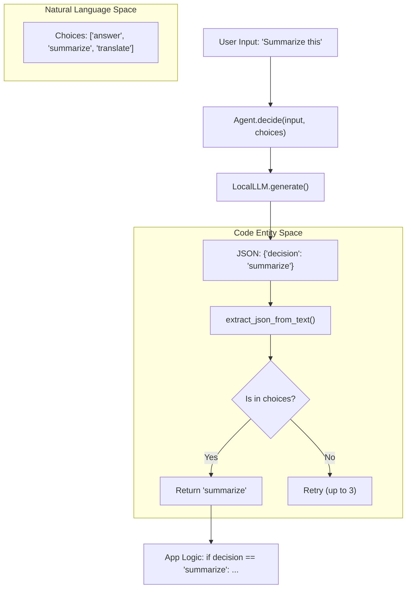
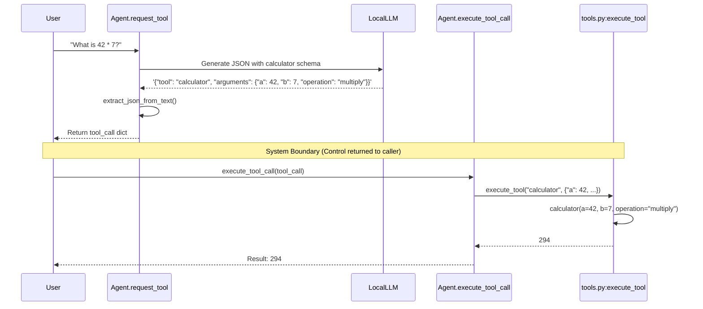

<!-- source: DeepWiki mcp.deepwiki.com · repo pguso/agents-from-scratch · page 3.2 Lessons 04–05: Decision Making and Tool Calling · patched3 2026-10-26 -->

# Lessons 04–05: Decision Making and Tool Calling
# Lessons 04–05: Decision Making and Tool Calling

Relevant source files

The following files were used as context for generating this wiki page:

- [agent/tools.py](agent/tools.py)
- [lessons/02_system_prompt.md](lessons/02_system_prompt.md)
- [lessons/03_structured_output.md](lessons/03_structured_output.md)
- [lessons/04_decision_making.md](lessons/04_decision_making.md)
- [lessons/05_tools.md](lessons/05_tools.md)

Lessons 04 and 05 transition the LLM from a passive text generator into an active agent capable of selecting actions and requesting external execution. This phase introduces **constrained decision spaces** and **tool interfaces**, establishing the principle that while the model requests actions, the system maintains control over execution.

## Lesson 04: Decision Making and Routing

Lesson 04 introduces the first moment of true agency: **Intent Detection** via constrained choices [lessons/04_decision_making.md:5-35](). Instead of generating free-form text, the model is presented with a finite set of options (a decision schema) and must select exactly one [lessons/04_decision_making.md:19-24]().

### Implementation: The `decide` Method
The `Agent.decide` method implements this by dynamically building a prompt that lists available choices and mandates a specific JSON format: `{"decision": "choice_name"}` [agent/agent.py:49-81]().

Key features of the decision logic include:
*   **Finite Choice Space**: The model is restricted to a provided `list[str]` of choices [agent/agent.py:49-62]().
*   **Validation**: The system verifies that the parsed decision string exists within the original `choices` list [agent/agent.py:89-90]().
*   **Deterministic Routing**: Once a valid decision is returned, the application code can use standard conditional logic to route the execution path [lessons/04_decision_making.md:25-29]().

### Decision Flow Diagram
This diagram illustrates how a natural language request is mapped to a code-level decision through the `decide` function.

**Figure 1: Decision Routing Logic**

Sources: [agent/agent.py:49-93](), [lessons/04_decision_making.md:48-93]()

---

## Lesson 05: Tool Calling

Lesson 05 extends the agent's capabilities beyond its internal knowledge by introducing **Tools**. Tools are defined as **interfaces**, not innate abilities of the model [agent/tools.py:4-6](). The model describes what it needs, and the system executes the request [lessons/05_tools.md:19-23]().

### The Tool Registry Pattern
The codebase uses a centralized tool registry in `agent/tools.py`. This separates the definition of what a tool *does* from the schema describing *how to call it*.

| Component | Function / Entity | Role |
| :--- | :--- | :--- |
| **Tool Implementation** | `calculator(a, b, operation)` | Performs the actual logic (e.g., arithmetic) [agent/tools.py:11-33](). |
| **Schema Provider** | `get_tool_schema()` | Returns a JSON schema describing parameters and types for the LLM [agent/tools.py:36-59](). |
| **Dispatcher** | `execute_tool(name, args)` | Maps a string name to a Python function and unpacks arguments [agent/tools.py:62-83](). |

### Implementation: `request_tool` and `execute_tool_call`
The `Agent` class splits tool interaction into two distinct phases to maintain a security boundary:

1.  **`request_tool(user_input)`**: The LLM analyzes the input and generates a structured tool call: `{"tool": "name", "arguments": {...}}` [agent/agent.py:52-90]().
2.  **`execute_tool_call(tool_call)`**: The system takes the validated JSON and passes it to the `execute_tool` dispatcher [agent/agent.py:92-102]().

### Tool Calling Data Flow
This diagram bridges the gap between the LLM's request and the Python function execution.

**Figure 2: Tool Request and Execution Boundary**

Sources: [agent/agent.py:52-103](), [agent/tools.py:62-83](), [lessons/05_tools.md:49-103]()

---

## Separation of Concerns and Safety

A core architectural principle introduced in these lessons is the **Trust Boundary** [lessons/03_structured_output.md:29-36]().

*   **Model as Requester**: The LLM is treated as a fallible component that provides a specification of intent [lessons/05_tools.md:37-39]().
*   **System as Executor**: The Python environment validates the request (checking tool names, argument types, and allowed operations) before any code is run [lessons/05_tools.md:159-161]().
*   **Retry Logic**: Both `decide` and `request_tool` utilize a retry loop (default 3 attempts) to handle malformed JSON or invalid selections, turning probabilistic LLM outputs into reliable system inputs [agent/agent.py:83-89](), [agent/agent.py:83-90]().

### Comparison of Patterns

| Feature | Lesson 04 (Decisions) | Lesson 05 (Tools) |
| :--- | :--- | :--- |
| **Output Goal** | Select a single string from a list [lessons/04_decision_making.md:134-137](). | Generate a tool name + arguments dict [lessons/05_tools.md:140-147](). |
| **Validation** | `decision in choices` [agent/agent.py:89](). | `tool in parsed` and `arguments in parsed` [agent/agent.py:87](). |
| **Purpose** | High-level routing/intent detection [lessons/04_decision_making.md:31-35](). | Extending capabilities (math, APIs) [lessons/05_tools.md:7-15](). |

Sources: [agent/agent.py:49-103](), [lessons/04_decision_making.md:1-183](), [lessons/05_tools.md:1-197](), [agent/tools.py:1-83]()

---

