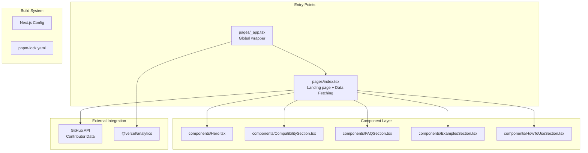
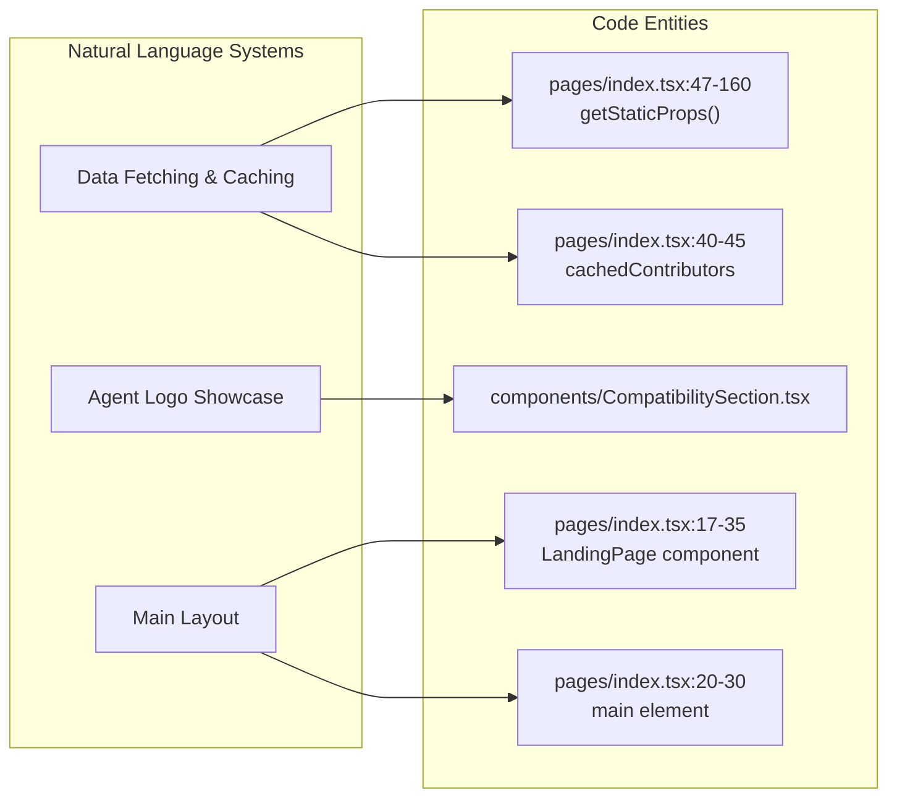
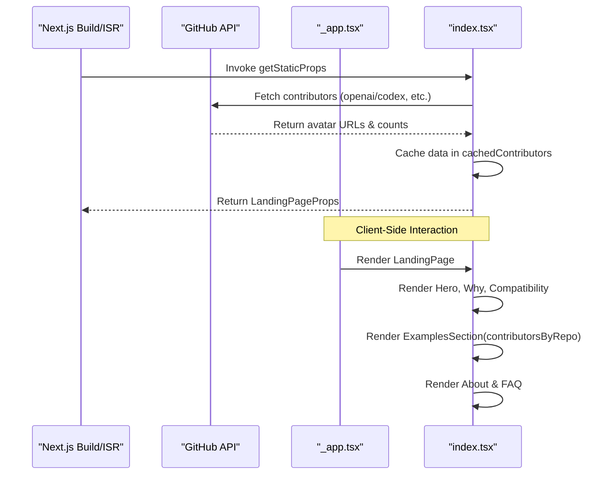

<!-- source: DeepWiki mcp.deepwiki.com · repo agentsmd/agents.md · page 1 Overview · fetched 2026-10-21 -->

# Overview

<details>
<summary>Relevant source files</summary>

The following files were used as context for generating this wiki page:

- [AGENTS.md](AGENTS.md)
- [README.md](README.md)
- [pages/index.tsx](pages/index.tsx)

</details>


## Purpose and Scope

This document provides a high-level introduction to the agents.md repository, explaining its purpose, architecture, and organization. The repository serves as both a **marketing website** and **documentation hub** for the AGENTS.md specification, hosted at https://agents.md. It is built as a Next.js application that showcases AI coding agent adoption and explains the specification format.

For detailed information about specific subsystems:
- For installation and setup instructions, see [Getting Started](#2)
- For deep technical architecture details, see [Architecture](#3)
- For component implementation specifics, see [Components](#4)
- For the AGENTS.md specification itself, see [AGENTS.md Specification](#7)

**Sources:** [README.md:1-50](), [package.json:1-28]()

## What is AGENTS.md

AGENTS.md is a simple, open format for guiding coding agents. The specification defines a standardized markdown file format that provides context and instructions to help AI coding agents work effectively on software projects. Think of it as a README for agents—a dedicated, predictable place where developers can document:

- Development environment tips and workflows [README.md:15-20]()
- Testing instructions and CI/CD patterns [README.md:21-29]()
- Pull request conventions [README.md:30-33]()
- Project-specific guidance for AI assistants [AGENTS.md:1-44]()

The format is used by open-source repositories on GitHub and supports major AI coding tools including Cursor, VS Code with Copilot, Windsurf, Devin, and others.

**Sources:** [README.md:5-33](), [AGENTS.md:1-44]()

## Repository Structure

The repository follows a standard Next.js pages router structure with static assets and configuration files:

```
agents.md/
├── pages/              # Next.js page routes
│   ├── _app.tsx       # Global app wrapper with analytics
│   ├── _document.tsx  # HTML document structure
│   └── index.tsx      # Homepage (landing page) with getStaticProps
├── components/        # React components
├── public/            # Static assets
│   ├── logos/         # Agent logos
│   └── og.png         # Open Graph social preview
├── styles/            # Global CSS
├── package.json       # Dependencies and scripts
├── pnpm-lock.yaml     # pnpm lockfile
├── README.md          # Project documentation
└── AGENTS.md          # Development guidelines for this repo
```

**Sources:** [README.md:35-50](), [pages/index.tsx:1-35](), [AGENTS.md:1-44]()

## Technology Stack

The application uses a modern frontend stack:

| Technology | Purpose |
|-----------|---------|
| **Next.js** | React framework with SSR/SSG [package.json:13]() |
| **React** | UI library [package.json:15]() |
| **TypeScript** | Type safety [package.json:25]() |
| **Tailwind CSS** | Utility-first styling [package.json:23]() |
| **pnpm** | Package manager [README.md:43]() |
| **@vercel/analytics** | Usage tracking [package.json:11]() |

### Native Performance Tooling

The stack leverages Rust-based native binaries for performance:

- **SWC** - Rust-based JavaScript/TypeScript compiler.
- **Turbopack** - Fast development bundler [AGENTS.md:5-6]().
- **Oxide** - Native CSS processing engine for Tailwind.

**Sources:** [package.json:11-26](), [AGENTS.md:1-15](), [README.md:40-47]()

## High-Level System Architecture

The following diagram shows how the major systems interact in the application:

### Application Layer Architecture



**Sources:** [pages/index.tsx:1-35](), [pages/index.tsx:47-160](), [package.json:1-28]()

### Code Entity Mapping

The following diagram maps natural language system names to specific code entities:



**Sources:** [pages/index.tsx:17-160](), [pages/index.tsx:1-12]()

## Core Application Flow

The application initialization and rendering flow follows this sequence, including the static data fetching process:



**Sources:** [pages/index.tsx:17-160](), [pages/index.tsx:47-55]()

## Key Systems Overview

The repository consists of several major systems:

| System | Primary Components | Purpose |
|--------|-------------------|---------|
| **Next.js Foundation** | `_app.tsx`, `index.tsx` | Application shell and page routing. |
| **Data Layer** | `getStaticProps` | Fetches contributor data from GitHub for specific repositories [pages/index.tsx:47-160](). |
| **Component System** | `Hero`, `CompatibilitySection`, `ExamplesSection` | UI components for content sections. |
| **Asset Management** | `public/logos/` | Static resources for agent tools. |
| **Build Pipeline** | `package.json`, pnpm | Development and production build tooling. |

### Data Fetching and Caching

The `pages/index.tsx` file implements a sophisticated `getStaticProps` function that:
- Fetches top 3 contributor avatars and total counts for featured repositories like `openai/codex` and `apache/airflow` [pages/index.tsx:50-55]().
- Uses an in-memory `cachedContributors` object to avoid hitting GitHub rate limits during development and build [pages/index.tsx:40-45]().
- Implements conditional `Authorization` headers if `GH_AUTH_TOKEN` is present [pages/index.tsx:92-94]().
- Sets a revalidation period of 24 hours in production [pages/index.tsx:158]().

**Sources:** [pages/index.tsx:40-160]()

## Development Commands

The repository provides standard scripts for development:

| Command | Purpose | Notes |
|---------|---------|-------|
| `pnpm dev` | Start development server | Recommended for iteration [AGENTS.md:10-11](). |
| `pnpm build` | Production build | Do not run during active agent sessions [AGENTS.md:12-15](). |
| `pnpm lint` | Run ESLint checks | Code quality validation [package.json:8](). |

**Important:** When working with AI coding agents, always use `pnpm dev` to maintain hot module replacement (HMR) functionality [AGENTS.md:8-16]().

**Sources:** [package.json:5-10](), [AGENTS.md:8-15](), [README.md:40-49]()

---

