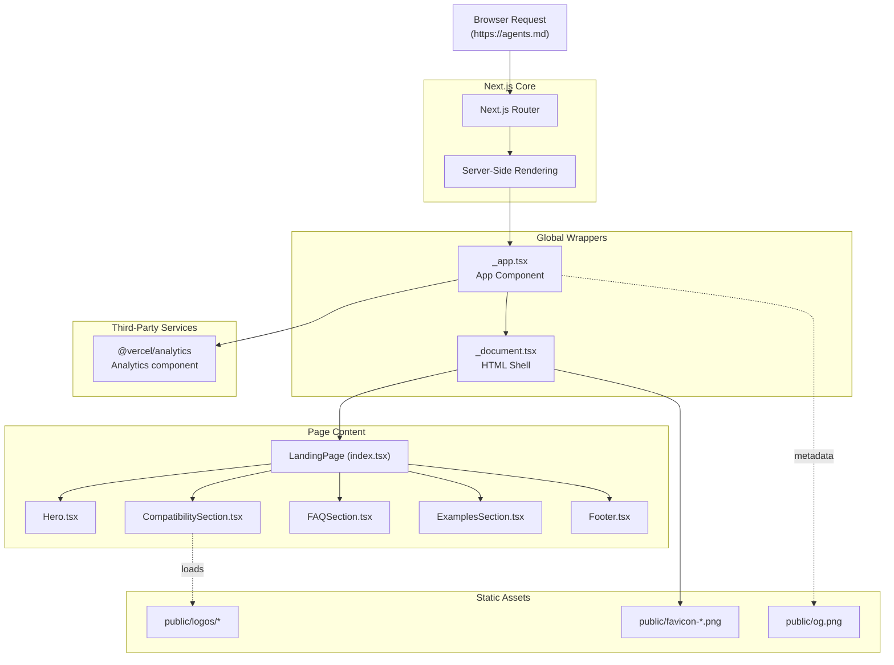
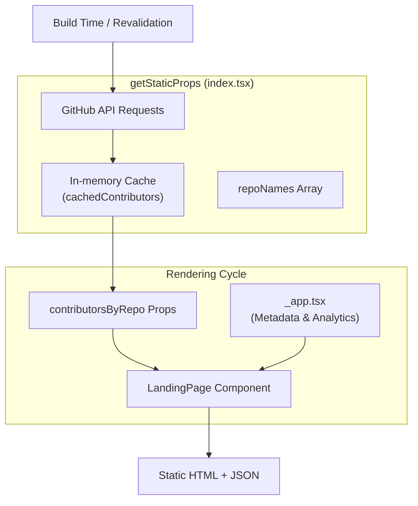
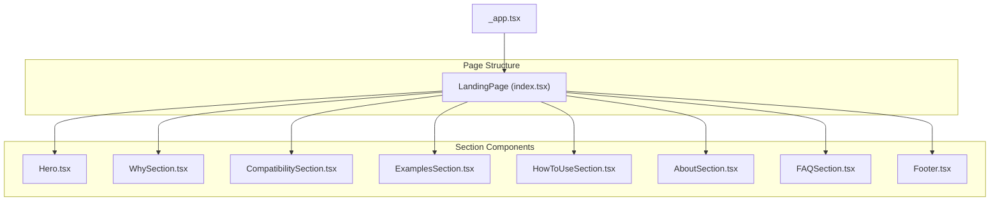
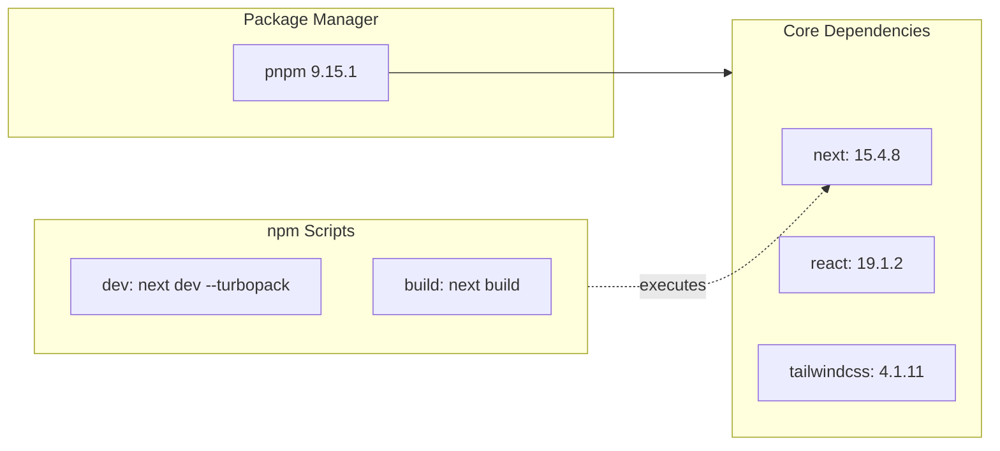

<!-- source: DeepWiki mcp.deepwiki.com · repo agentsmd/agents.md · page 3 Architecture · fetched 2026-10-21 -->

# Architecture

<details>
<summary>Relevant source files</summary>

The following files were used as context for generating this wiki page:

- [next.config.ts](next.config.ts)
- [pages/_app.tsx](pages/_app.tsx)
- [pages/index.tsx](pages/index.tsx)

</details>


This document describes the high-level architecture of the agents.md Next.js application, including the page rendering pipeline, component organization, and build system structure. For detailed information about specific components, see [Components](#4). For build system specifics, see [Build System and Dependencies](#3.2). For static asset management, see [Static Assets](#5).

## Application Structure

The agents.md repository is a **Next.js 15.4.8** application using the **Pages Router** pattern. The architecture follows a standard Next.js marketing site structure with global wrappers, page components, and static assets.

### Directory Layout

```
agents.md/
├── pages/                    # Next.js pages
│   ├── _app.tsx             # Global application wrapper
│   ├── _document.tsx        # HTML document shell
│   └── index.tsx            # Main landing page
├── components/              # React components
│   ├── Hero.tsx
│   ├── CompatibilitySection.tsx
│   ├── FAQSection.tsx
│   ├── ExamplesSection.tsx
│   └── Footer.tsx
├── public/                  # Static assets
│   ├── logos/              # Agent logo images
│   ├── favicon-*.png       # Theme-aware favicons
│   └── og.png              # Social media preview
└── styles/                  # Global CSS
    └── globals.css
```

**Sources:** [package.json:1-27](), [pages/index.tsx:1-35](), [pages/_app.tsx:1-24]()

## Next.js Foundation Architecture

The application uses the Next.js Pages Router with two critical global files that wrap all page content:

### Global Application Flow



**Sources:** [pages/_app.tsx:1-24](), [pages/index.tsx:17-35](), [components/Hero.tsx:1-72]()

### `_app.tsx` - Global Application Wrapper

The `_app.tsx` file wraps every page and handles:

- **Global CSS imports**: `@/styles/globals.css` [pages/_app.tsx:1]()
- **SEO metadata**: Title, description, Open Graph tags, and Twitter Card metadata [pages/_app.tsx:7-20]()
- **Analytics integration**: Vercel Analytics component [pages/_app.tsx:4,22]()
- **Page props injection**: Passes `pageProps` to each page component [pages/_app.tsx:21]()

For more details on the global shell, see [Next.js Foundation](#3.1).

**Sources:** [pages/_app.tsx:1-24]()

## Page Rendering Pipeline

The rendering pipeline utilizes Next.js Static Site Generation (SSG) with `getStaticProps` to fetch data at build time:

### Data Fetching and Hydration



**Key Implementation Details:**
- **GitHub API Integration**: Fetches top 3 contributor avatars and total contributor counts for featured repositories [pages/index.tsx:96-145]().
- **Caching Strategy**: Implements an in-memory cache `cachedContributors` to prevent hitting GitHub rate limits during development and build processes [pages/index.tsx:40-45]().
- **Revalidation**: Configured to revalidate every 24 hours in production [pages/index.tsx:158]().

**Sources:** [pages/index.tsx:40-160]()

## Component Hierarchy

The landing page is composed of several major sections, each implemented as a standalone React component:

### Component Tree



### Component Responsibilities

| Component | Purpose | Key Data | File Reference |
|-----------|---------|----------|----------------|
| `Hero` | Primary landing section with code preview | `HERO_AGENTS_MD` | [components/Hero.tsx:1-72]() |
| `CompatibilitySection` | Animated showcase of AI coding agents | `agents` array | [pages/index.tsx:23]() |
| `ExamplesSection` | Grid of example repositories | `contributorsByRepo` | [pages/index.tsx:24]() |
| `FAQSection` | Frequently Asked Questions | Static content | [pages/index.tsx:28]() |

**Sources:** [pages/index.tsx:17-35]()

## Build System Architecture

The build system uses modern JavaScript tooling with native Rust-based components for performance. For detailed documentation on the pipeline and native tooling, see [Build System and Dependencies](#3.2).

### Build Pipeline Components



**Key Features:**
- **Turbopack**: Used in development for fast HMR [package.json:6]().
- **Strict Mode**: Enabled for React to catch potential issues [next.config.ts:5]().

**Sources:** [package.json:1-27](), [next.config.ts:1-8]()

---

