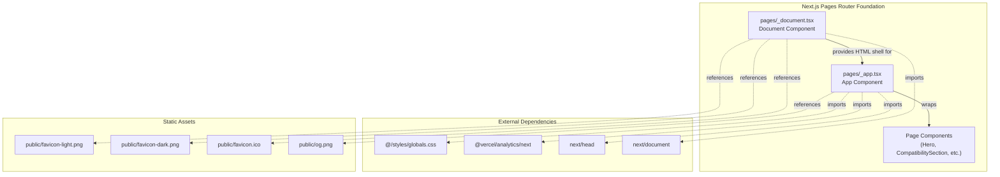
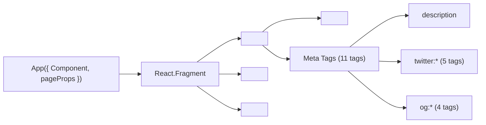
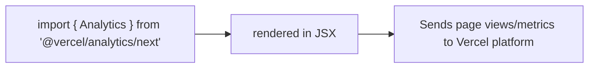
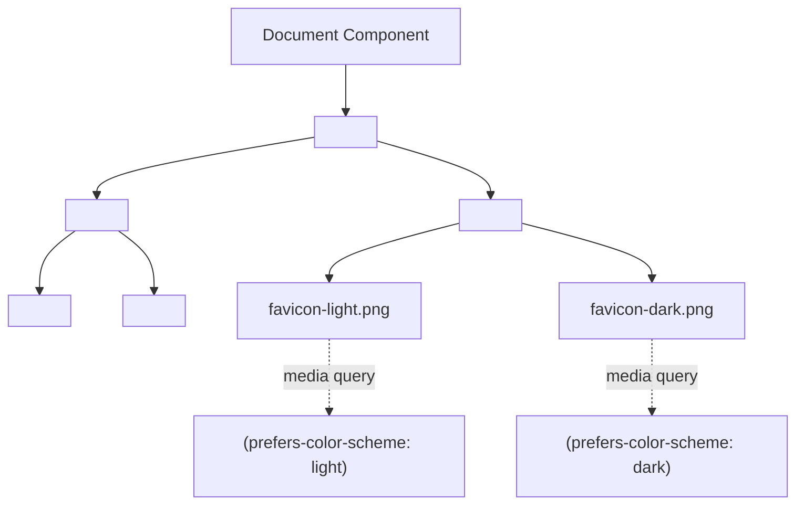
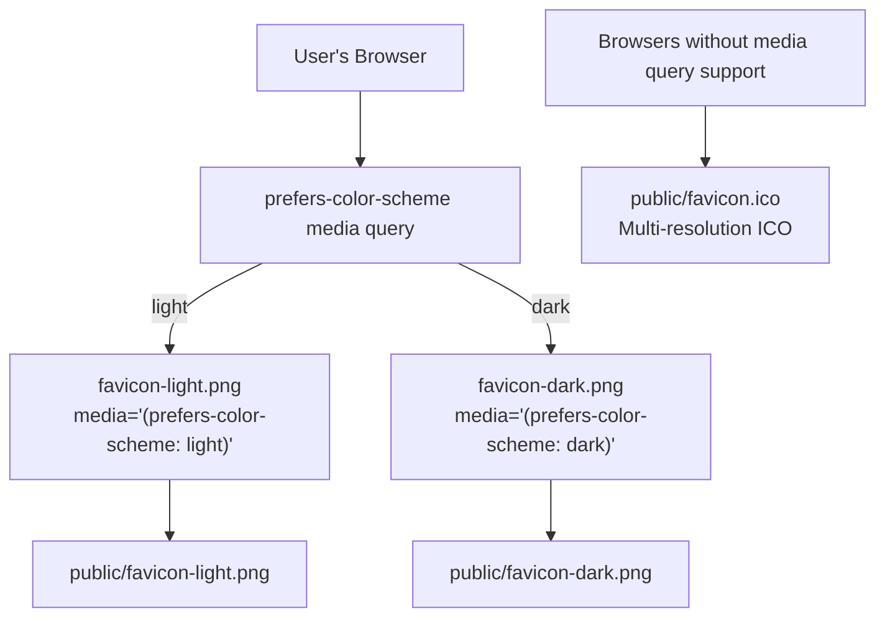
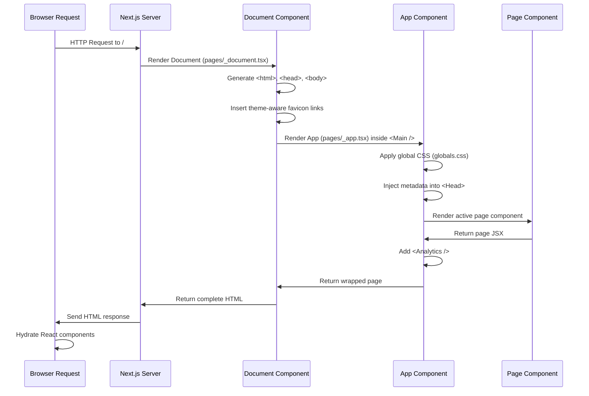

<!-- source: DeepWiki mcp.deepwiki.com · repo agentsmd/agents.md · page 3.1 Next.js Foundation · fetched 2026-10-21 -->

# Next.js Foundation

Relevant source files

The following files were used as context for generating this wiki page:

- [next-env.d.ts](next-env.d.ts)
- [pages/_app.tsx](pages/_app.tsx)
- [pages/_document.tsx](pages/_document.tsx)
- [public/favicon.ico](public/favicon.ico)
- [tsconfig.json](tsconfig.json)

This document describes the foundational Next.js configuration files that establish the global application wrapper, HTML document structure, metadata, and analytics integration for the agents.md marketing website. These files provide the structural foundation upon which all page components render.

For information about the build system and dependency management, see [Build System and Dependencies](). For information about individual page components, see [Components]().

---

## Application Architecture Overview

The Next.js foundation consists of two special files that wrap all page content and define the HTML structure:

**Next.js Foundation Structure**

**Sources:** [pages/_app.tsx:1-24](), [pages/_document.tsx:1-25]()

---

## Global App Wrapper (_app.tsx)

The `App` component in [pages/_app.tsx:5-24]() serves as the global wrapper for all pages in the application. It receives two props from Next.js: `Component` (the active page component) and `pageProps` (data for that page).

### Component Structure

**App Component Data Flow**

**Sources:** [pages/_app.tsx:5-24]()

### Metadata Configuration

The component defines comprehensive metadata for SEO and social media sharing:

| Metadata Type | Fields | Purpose |
|---------------|--------|---------|
| **Basic** | `<title>`, `description` | Page title and search engine description [pages/_app.tsx:8-9]() |
| **Twitter Card** | `twitter:card`, `twitter:title`, `twitter:description`, `twitter:image`, `twitter:domain`, `twitter:url` | Rich previews when shared on Twitter/X [pages/_app.tsx:10-15]() |
| **Open Graph** | `og:type`, `og:title`, `og:description`, `og:image` | Rich previews on Facebook, LinkedIn, etc. [pages/_app.tsx:16-19]() |

All social media metadata points to `https://agents.md/og.png` for the preview image [pages/_app.tsx:13](), [pages/_app.tsx:19]().

**Sources:** [pages/_app.tsx:7-20]()

### Analytics Integration

The component integrates Vercel Analytics by importing and rendering the `<Analytics />` component:

**Analytics Integration**

This provides automatic tracking of page views, Web Vitals, and other metrics without manual instrumentation.

**Sources:** [pages/_app.tsx:4](), [pages/_app.tsx:22]()

---

## HTML Document Shell (_document.tsx)

The `Document` component in [pages/_document.tsx:3-24]() defines the root HTML structure that wraps the entire application. Unlike `_app.tsx` which re-renders on navigation, `_document.tsx` only renders once on the server.

### HTML Structure

**Document Component Layout**

**Sources:** [pages/_document.tsx:1-25]()

### Theme-Aware Favicon System

The document implements a favicon system that responds to the user's system theme preference using CSS media queries:

**Theme-Aware Favicon Logic**

The implementation uses two `<link>` elements with different `media` attributes:

| Attribute | Value | File | Purpose |
|-----------|-------|------|---------|
| `rel` | `"icon"` | Both | Declares the link as a favicon [pages/_document.tsx:8](), [pages/_document.tsx:13]() |
| `href` | `"/favicon-light.png"` | Light | Path to light theme favicon [pages/_document.tsx:9]() |
| `href` | `"/favicon-dark.png"` | Dark | Path to dark theme favicon [pages/_document.tsx:14]() |
| `media` | `"(prefers-color-scheme: light)"` | Light | Only applies in light mode [pages/_document.tsx:10]() |
| `media` | `"(prefers-color-scheme: dark)"` | Dark | Only applies in dark mode [pages/_document.tsx:15]() |

**Sources:** [pages/_document.tsx:7-16]()

### Body Styling

The `<body>` element includes the `antialiased` class, which is a Tailwind CSS utility that applies font smoothing for improved text rendering [pages/_document.tsx:18]().

---

## Render Pipeline

The following diagram illustrates how these foundation components integrate into the Next.js server-side rendering pipeline:

**Next.js Foundation Render Sequence**

**Sources:** [pages/_document.tsx:3-24](), [pages/_app.tsx:5-24]()

---

## Key Imports and Dependencies

| Import | Source | Purpose |
|--------|--------|---------|
| `AppProps` | `next/app` | TypeScript type for App component props [pages/_app.tsx:2]() |
| `Head` | `next/head` | Component for modifying `<head>` content [pages/_app.tsx:3]() |
| `Html`, `Head`, `Main`, `NextScript` | `next/document` | Components for custom Document structure [pages/_document.tsx:1]() |
| `Analytics` | `@vercel/analytics/next` | Vercel analytics tracking [pages/_app.tsx:4]() |
| `globals.css` | `@/styles/globals.css` | Global Tailwind CSS styles [pages/_app.tsx:1]() |

**Sources:** [pages/_app.tsx:1-4](), [pages/_document.tsx:1]()

---

