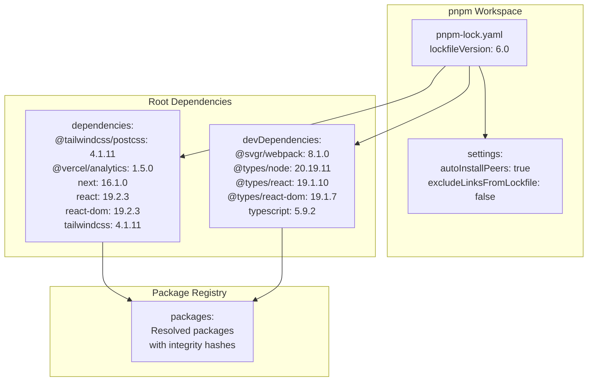
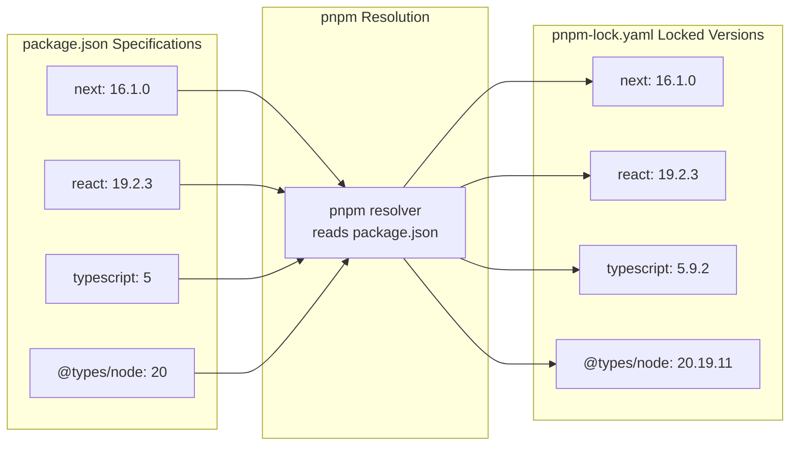
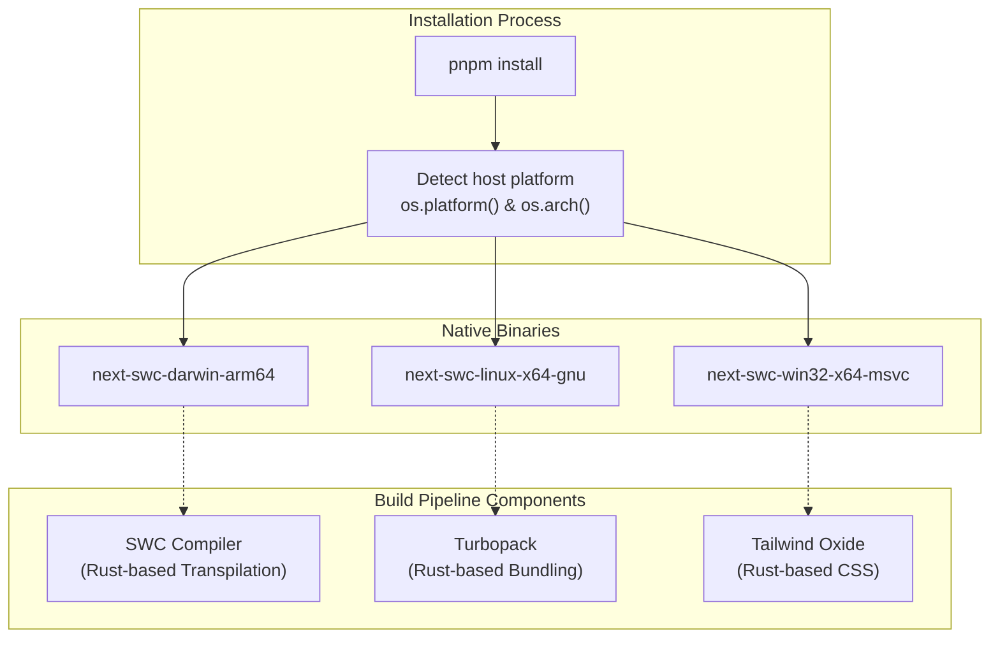
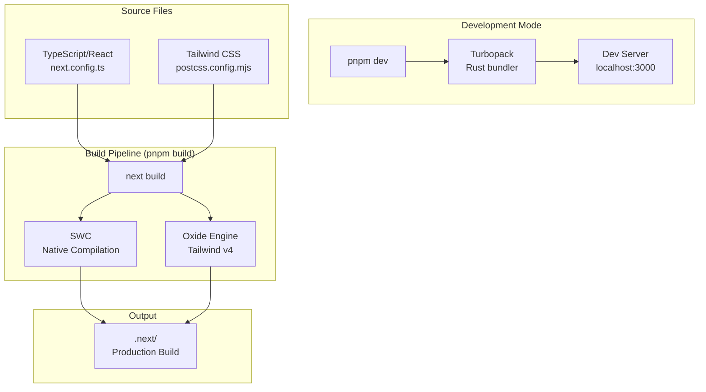
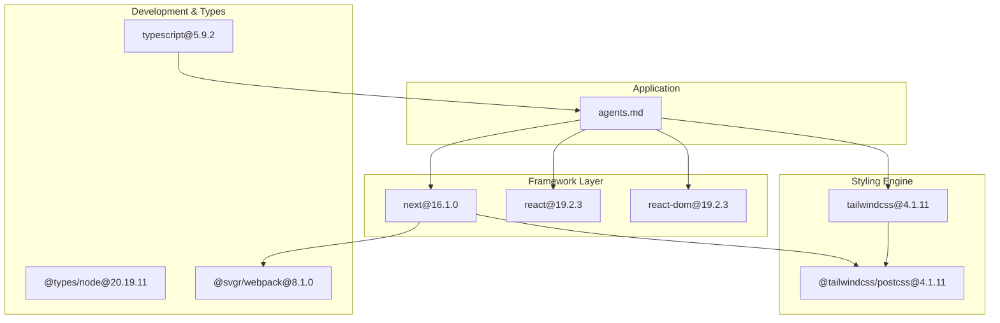

<!-- source: DeepWiki mcp.deepwiki.com · repo agentsmd/agents.md · page 3.2 Build System and Dependencies · fetched 2026-10-21 -->

# Build System and Dependencies

<details>
<summary>Relevant source files</summary>

The following files were used as context for generating this wiki page:

- [next.config.ts](next.config.ts)
- [package.json](package.json)
- [pnpm-lock.yaml](pnpm-lock.yaml)
- [postcss.config.mjs](postcss.config.mjs)

</details>


This document describes the build system, dependency management, and native tooling infrastructure for the agents.md repository. It covers package management with pnpm, the Next.js 16 build pipeline, platform-specific native binaries, and development workflows.

For information about the Next.js application configuration and runtime behavior, see [Next.js Foundation](#3.1). For deployment and production builds, see [Development Guide](#6).

## Overview

The build system is based on **Next.js 16.1.0** with **pnpm 9.15.1** as the package manager. The project leverages modern Rust-based tooling for performance: Turbopack for development bundling, SWC for JavaScript/TypeScript compilation, and Oxide for CSS processing. All dependencies are locked to specific versions in [pnpm-lock.yaml:1-43]() using lockfile version 6.0.

**Sources:** [package.json:1-27](), [pnpm-lock.yaml:1-6]()

---

## Package Manager: pnpm

The project uses **pnpm 9.15.1** as specified in [package.json:26](). pnpm provides efficient disk space usage through content-addressable storage and strict dependency isolation.

### Lockfile Configuration

The lockfile uses version `6.0` with the following settings:

| Setting | Value | Purpose |
|---------|-------|---------|
| `lockfileVersion` | `6.0` | pnpm lockfile format |
| `autoInstallPeers` | `true` | Automatically install peer dependencies |
| `excludeLinksFromLockfile` | `false` | Include symlinked dependencies in lockfile |

The lockfile contains the resolved dependency tree with precise version resolutions and integrity hashes. The structure includes root `dependencies` and `devDependencies` sections.

**Lockfile Structure:**



**Sources:** [pnpm-lock.yaml:1-45](), [package.json:26]()

---

## Core Dependencies

The application has **6 production dependencies** and **5 development dependencies** as defined in [package.json:11-25]().

### Production Dependencies

| Package | Version | Purpose |
|---------|---------|---------|
| `next` | `16.1.0` | React framework with SSR/SSG capabilities [package.json:14]() |
| `react` | `19.2.3` | UI library (React 19) [package.json:15]() |
| `react-dom` | `19.2.3` | React DOM renderer [package.json:16]() |
| `tailwindcss` | `4.1.11` | Utility-first CSS framework [package.json:17]() |
| `@tailwindcss/postcss` | `4.1.11` | PostCSS plugin for Tailwind [package.json:12]() |
| `@vercel/analytics` | `^1.5.0` | Web analytics tracking [package.json:13]() |

### Development Dependencies

| Package | Version | Purpose |
|---------|---------|---------|
| `typescript` | `5` (resolved to `5.9.2`) | TypeScript compiler [package.json:24]() |
| `@types/node` | `20` (resolved to `20.19.11`) | Node.js type definitions [package.json:21]() |
| `@types/react` | `19` (resolved to `19.1.10`) | React type definitions [package.json:22]() |
| `@types/react-dom` | `19` (resolved to `19.1.7`) | React DOM type definitions [package.json:23]() |
| `@svgr/webpack` | `^8.1.0` | Webpack loader for importing SVGs as React components [package.json:20]() |

**Version Resolution Flow:**



**Sources:** [package.json:11-25](), [pnpm-lock.yaml:7-43]()

---

## Native Tooling and Build Pipeline

The build system relies heavily on **Rust-based native binaries** provided by Next.js and Tailwind CSS for performance-critical operations.

### Next.js SWC and Turbopack

Next.js 16 uses **SWC (Speedy Web Compiler)** for JavaScript/TypeScript transpilation and **Turbopack** for the development bundler. These tools replace traditional JavaScript-based tools like Babel and Webpack with high-performance native binaries.

### Tailwind CSS v4 (Oxide)

The project uses Tailwind CSS 4.1.11, which introduces the **Oxide** engine. This is a high-performance engine written in Rust that handles CSS processing. The integration is managed via `@tailwindcss/postcss` in the PostCSS configuration [postcss.config.mjs:1-3]().

**Platform Binary Resolution:**



**Sources:** [package.json:6](), [package.json:12-17](), [postcss.config.mjs:1-3]()

---

## Build Scripts and Workflows

The project defines **4 npm scripts** in [package.json:5-9]() for development and production workflows.

### Available Scripts

| Script | Command | Purpose |
|--------|---------|---------|
| `dev` | `next dev --turbopack` | Start development server with Turbopack [package.json:6]() |
| `build` | `next build` | Build production-optimized bundle [package.json:7]() |
| `start` | `next start` | Start production server [package.json:8]() |
| `lint` | `next lint` | Run ESLint checks [package.json:9]() |

### Development Workflow

The development server uses **Turbopack**, Next.js's Rust-based bundler that provides significantly faster hot module replacement (HMR) and cold start times:

```bash
pnpm dev
# Runs: next dev --turbopack
```

Turbopack is explicitly enabled via the `--turbopack` flag in the `dev` script [package.json:6]().

### Production Build Workflow

The production build process involves:
1. **Compilation**: TypeScript to JavaScript via SWC.
2. **Bundling**: Code splitting and asset optimization.
3. **CSS Processing**: Tailwind CSS processing via the `@tailwindcss/postcss` plugin [postcss.config.mjs:2]().
4. **Static Generation**: Pre-rendering pages for optimal performance.

```bash
pnpm build
# Runs: next build
```

**Build Pipeline Flow:**



**Sources:** [package.json:5-10](), [postcss.config.mjs:1-5](), [next.config.ts:1-8]()

---

## Dependency Tree Overview

The dependency tree is managed by pnpm and resolved in [pnpm-lock.yaml]().

### Framework and UI
- **next@16.1.0**: Core framework [pnpm-lock.yaml:14]().
- **react@19.2.3**: UI library [pnpm-lock.yaml:17]().
- **react-dom@19.2.3**: DOM renderer [pnpm-lock.yaml:20]().

### Styling
- **tailwindcss@4.1.11**: Utility CSS [pnpm-lock.yaml:23]().
- **@tailwindcss/postcss@4.1.11**: PostCSS integration [pnpm-lock.yaml:8]().

### Transpilation and Types
- **typescript@5.9.2**: Language support [pnpm-lock.yaml:42]().
- **@babel/core@7.28.3**: Used by certain dependencies (like Next.js) for specific transformations [pnpm-lock.yaml:70]().

**Major Dependency Groups:**



**Sources:** [package.json:11-25](), [pnpm-lock.yaml:7-43]()

---

