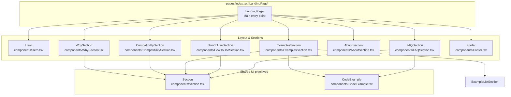
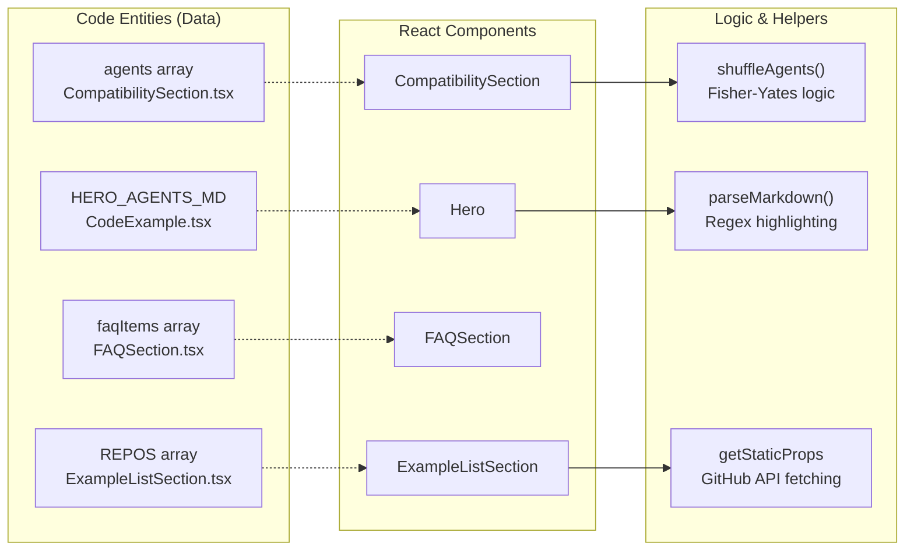

<!-- source: DeepWiki mcp.deepwiki.com · repo agentsmd/agents.md · page 4 Components · fetched 2026-10-21 -->

# Components

Relevant source files

The following files were used as context for generating this wiki page:

- [components/CodeExample.tsx](components/CodeExample.tsx)
- [components/ExamplesSection.tsx](components/ExamplesSection.tsx)
- [components/HowToUseSection.tsx](components/HowToUseSection.tsx)
- [components/Section.tsx](components/Section.tsx)
- [components/WhySection.tsx](components/WhySection.tsx)
- [pages/index.tsx](pages/index.tsx)

This document provides an overview of the React components that comprise the user interface of the agents.md marketing website. Each component is responsible for rendering a specific section of the landing page, coordinated primarily within the main landing page file.

For detailed architecture of the Next.js application structure, see [Architecture](#3). For information about static assets used by components, see [Logo Asset System](#5.1). Detailed documentation of individual components is provided in the subsections below.

## Component Architecture

The website follows a modular structure where `pages/index.tsx` acts as the orchestrator for various functional sections. All components follow Next.js and React 19 conventions, using TypeScript for type safety and Tailwind CSS for styling.

### Component Hierarchy

**Sources:** [pages/index.tsx:17-35](), [components/ExamplesSection.tsx:10-22]()

### Component-to-Code Entity Mapping

This diagram associates high-level UI sections with their specific implementation constants and functions in the codebase.

**Sources:** [components/CodeExample.tsx:22-32](), [components/CompatibilitySection.tsx:14-131](), [components/FAQSection.tsx:11-87](), [pages/index.tsx:47-160]()

## Component Registry

The following table lists the core components, their file locations, and primary responsibilities:

| Component | File Path | Responsibility |
|-----------|-----------|----------------|
| `LandingPage` | `pages/index.tsx` | Main page assembly and GitHub data fetching via `getStaticProps` |
| `Hero` | `components/Hero.tsx` | Landing page hero section with CTA and code preview |
| `WhySection` | `components/WhySection.tsx` | Explains the rationale for separating AGENTS.md from README.md |
| `CompatibilitySection` | `components/CompatibilitySection.tsx` | Animated marquee/grid of 21 AI coding agents |
| `ExamplesSection` | `components/ExamplesSection.tsx` | Container for the example code block and repository cards |
| `ExampleListSection` | `components/ExampleListSection.tsx` | Grid of repository examples with dynamic contributor data |
| `HowToUseSection` | `components/HowToUseSection.tsx` | Step-by-step guide for implementing AGENTS.md |
| `FAQSection` | `components/FAQSection.tsx` | Frequently asked questions with tool-specific code snippets |
| `Section` | `components/Section.tsx` | Reusable layout wrapper with title and `prose` styling |
| `CodeExample` | `components/CodeExample.tsx` | Markdown-aware code block with copy-to-clipboard functionality |

**Sources:** [pages/index.tsx:1-35](), [components/Section.tsx:18-44](), [components/CodeExample.tsx:126-207]()

## Data Flow and Fetching

The application uses Next.js `getStaticProps` in the root page to fetch social proof data at build time.

1.  **GitHub API Integration**: `getStaticProps` in `pages/index.tsx` iterates through a list of repository names [pages/index.tsx:50-55]().
2.  **Caching**: It implements an in-memory cache with a 12-hour TTL to avoid rate-limiting during development [pages/index.tsx:40-45]().
3.  **Data Propagation**: The fetched `contributorsByRepo` object is passed as a prop to `LandingPage`, which forwards it to `ExamplesSection` [pages/index.tsx:24](), and finally to `ExampleListSection` [components/ExamplesSection.tsx:19]().

**Sources:** [pages/index.tsx:47-160](), [components/ExamplesSection.tsx:10-22]()

## Component Overview Summaries

### Hero Component
The `Hero` component serves as the initial entry point, featuring the project's primary value proposition and a code preview using `CodeExample`.
For details, see [Hero Component](#4.2).

### CompatibilitySection Component
This is the most complex component in the UI, featuring an animated marquee of agent logos that transitions to a grid on demand.
For details, see [CompatibilitySection Component](#4.1).

### FAQ Section Component
A structured list of questions and answers, including specific technical instructions for tools like Aider or Gemini.
For details, see [FAQ Section Component](#4.3).

### Example List Section
Displays real-world adoption of the specification. It renders repository cards with metadata and contributor avatars fetched from the GitHub API.
For details, see [Example List Section](#4.4).

### Footer and About Components
The `AboutSection` provides historical context regarding the project's origins at AAIF, while the `Footer` provides navigation and attribution.
For details, see [Footer and About Components](#4.5).

### Shared Components

#### Section
The `Section` component [components/Section.tsx:18-44]() is a standardized wrapper that ensures consistent vertical spacing (`gap-6`), typography via Tailwind's `prose` class [components/Section.tsx:38](), and responsive max-width constraints.

#### CodeExample
The `CodeExample` component [components/CodeExample.tsx:126-207]() provides a "pseudo-highlighted" Markdown preview. It uses `parseMarkdown` [components/CodeExample.tsx:66-101]() and `renderLineWithInlineCode` [components/CodeExample.tsx:106-121]() to style headers and backticked code without the overhead of a full Markdown parser. It includes a copy-to-clipboard feature using the `navigator.clipboard` API [components/CodeExample.tsx:136-144]().

**Sources:** [components/Section.tsx:1-45](), [components/CodeExample.tsx:1-207]()

---

