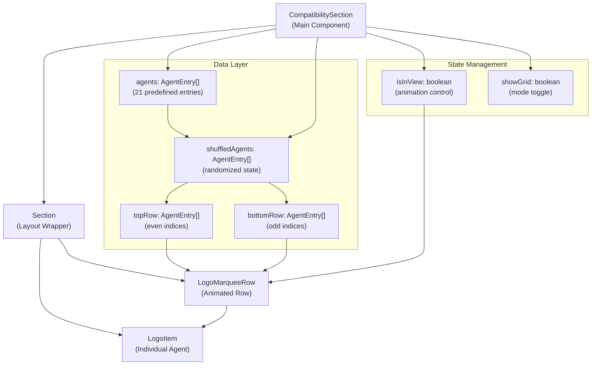
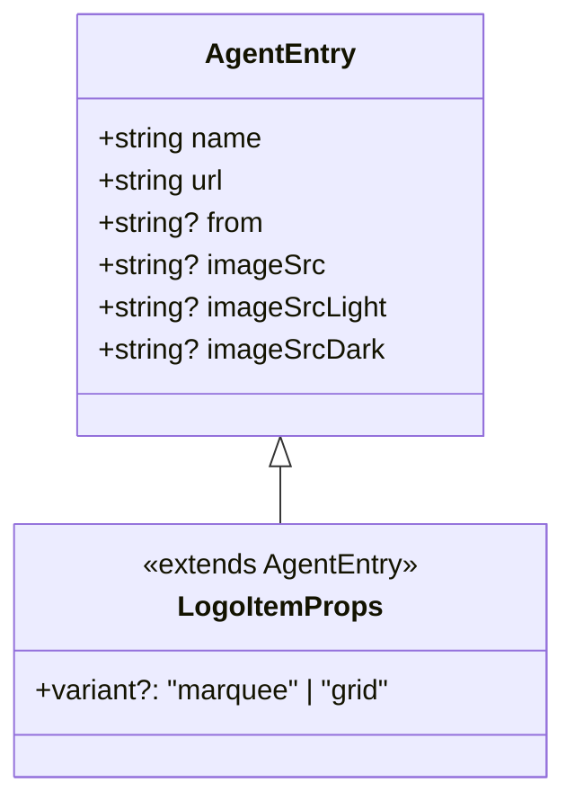
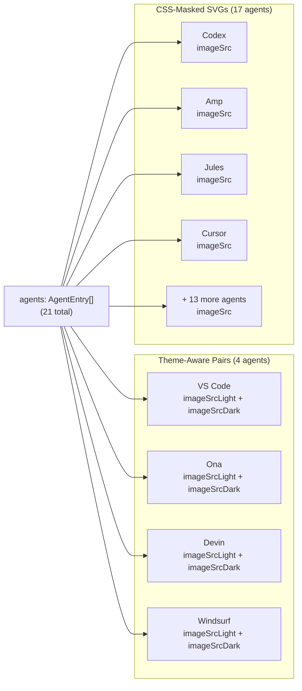
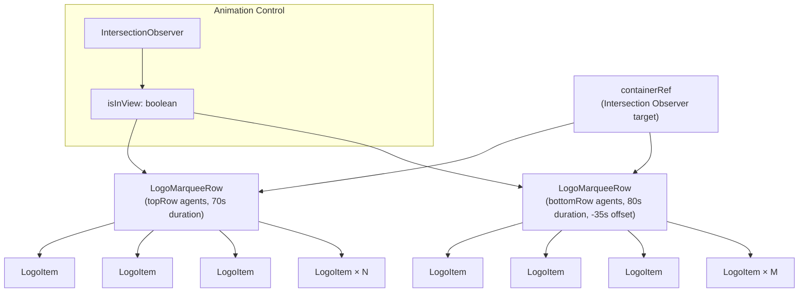
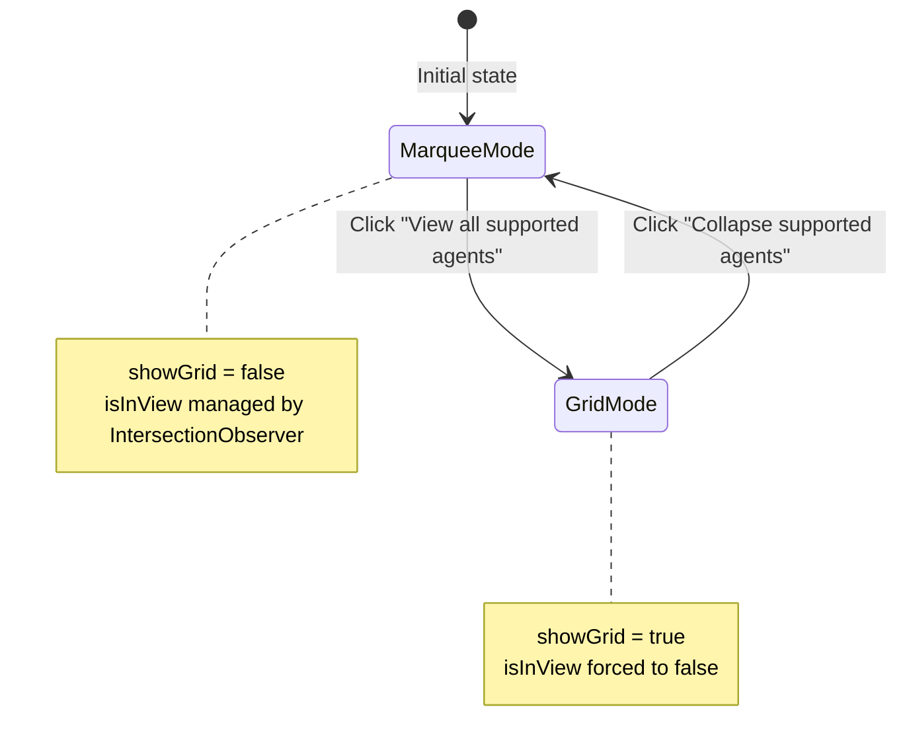

<!-- source: DeepWiki mcp.deepwiki.com · repo agentsmd/agents.md · page 4.1 CompatibilitySection Component · fetched 2026-10-21 -->

# CompatibilitySection Component

<details>
<summary>Relevant source files</summary>

The following files were used as context for generating this wiki page:

- [components/CompatibilitySection.tsx](components/CompatibilitySection.tsx)
- [public/logos/junie.svg](public/logos/junie.svg)
- [styles/globals.css](styles/globals.css)

</details>


**Purpose**: The `CompatibilitySection` component is the primary visual showcase on the agents.md website, displaying 21 AI coding agents and tools that support the AGENTS.md specification format. With an importance score of 31.60, it is the most critical component in the codebase, providing social proof of ecosystem adoption through an animated dual-marquee display or static grid layout.

**Scope**: This page covers the complete implementation of the `CompatibilitySection`, including its data structures, rendering modes, animation system, and logo handling. For information about individual logo assets and their file organization, see [Logo Asset System](#5.1). For other page components, see [Components](#4).

## Component Architecture

The `CompatibilitySection` component is organized into three main sub-components that work together to create the agent showcase:



**Sources**: [components/CompatibilitySection.tsx:1-367]()

## Data Model

### AgentEntry Type

The `AgentEntry` type defines the structure for each AI coding agent displayed in the component:



| Property | Type | Required | Description |
|----------|------|----------|-------------|
| `name` | `string` | Yes | Display name of the agent/tool |
| `url` | `string` | Yes | External link to agent's documentation or homepage |
| `from` | `string` | No | Organization name (e.g., "OpenAI", "Google", "Cognition") |
| `imageSrc` | `string` | No | Single SVG logo path for CSS masking |
| `imageSrcLight` | `string` | No | Light theme variant logo path |
| `imageSrcDark` | `string` | No | Dark theme variant logo path |

**Logo Path Patterns**: An agent must provide either `imageSrc` OR both `imageSrcLight` and `imageSrcDark`. The `LogoItem` component uses this to determine rendering strategy.

**Sources**: [components/CompatibilitySection.tsx:5-12]()

### Agents Array

The `agents` constant contains 21 predefined entries representing the complete ecosystem of AGENTS.md-compatible tools:



**Representative Examples**:

| Agent Name | Organization | Logo Type | File Path |
|------------|--------------|-----------|-----------|
| Codex | OpenAI | Single SVG | `/logos/codex.svg` |
| VS Code | (none) | Light/Dark Pair | `/logos/vscode-light.svg`, `/logos/vscode-dark.svg` |
| Devin | Cognition | Light/Dark Pair | `/logos/devin-light.svg`, `/logos/devin-dark.svg` |
| Cursor | (none) | Single SVG | `/logos/cursor.svg` |
| Windsurf | Cognition | Light/Dark Pair | `/logos/windsurf-light.svg`, `/logos/windsurf-dark.svg` |

**Sources**: [components/CompatibilitySection.tsx:14-142]()

### Agent Shuffling

The `shuffleAgents` function randomizes agent order on component mount to provide visual variety across page loads. For details, see [Agent Data and Shuffling](#4.1.1).

**Sources**: [components/CompatibilitySection.tsx:144-151](), [components/CompatibilitySection.tsx:271-274]()

## Rendering Modes

The component supports two display modes controlled by the `showGrid` state variable:

### Marquee Mode (Default)



**Characteristics**:
- **Two horizontal rows**: Agents split evenly between top and bottom rows (even/odd indices).
- **Continuous scrolling**: CSS animations move logos from right to left.
- **Performance optimization**: Animations pause when component is out of viewport.
- **Staggered timing**: Bottom row has -35s offset to create visual variety.

For details, see [Marquee Animation System](#4.1.2).

**Sources**: [components/CompatibilitySection.tsx:340-352]()

### Grid Mode

| Property | Value |
|----------|-------|
| Layout | CSS Grid |
| Columns | `grid-cols-2` (mobile), `md:grid-cols-3` (desktop) |
| Gap | `gap-8` |
| Animation | None (static display) |
| Variant | `variant="grid"` passed to `LogoItem` |

Grid mode displays all 21 agents simultaneously in a responsive grid, useful for users who want to browse the full list at once. For details, see [Grid View Toggle](#4.1.4).

**Sources**: [components/CompatibilitySection.tsx:330-338]()

### Mode Toggle Button



The toggle button is implemented at [components/CompatibilitySection.tsx:354-364]() with ARIA attributes for accessibility:
- `aria-controls="supported-agents"` links to the agent display container.
- `aria-expanded={showGrid}` indicates current state.

**Sources**: [components/CompatibilitySection.tsx:269-366]()

## LogoItem Component

The `LogoItem` component renders individual agent logos with theme-aware image handling. For details, see [LogoItem Rendering](#4.1.3).

### Theme-Aware Logo Strategies

The component implements two distinct rendering strategies based on available image properties:

#### Strategy 1: Separate Light/Dark Images

When both `imageSrcLight` and `imageSrcDark` are provided, it uses the standard Next.js `<Image>` component with theme-aware CSS classes.

**Implementation**: [components/CompatibilitySection.tsx:179-195]()

#### Strategy 2: CSS Mask with Single SVG

When only `imageSrc` is provided, it uses a CSS mask technique to allow the logo color to be controlled by the theme's background color.

**Implementation**: [components/CompatibilitySection.tsx:196-211]()

**Sources**: [components/CompatibilitySection.tsx:157-226]()

## LogoMarqueeRow Component

The `LogoMarqueeRow` component creates the infinite scrolling animation effect by doubling the agent list and applying CSS animations. For details, see [Marquee Animation System](#4.1.2).

### Agent Doubling Strategy

To create seamless infinite scrolling, the component duplicates the agent array:

```
Original:  [A, B, C]
Doubled:   [A, B, C, A, B, C]
```

**Implementation**: [components/CompatibilitySection.tsx:239]()

**Sources**: [components/CompatibilitySection.tsx:228-263]()

## Animation System

### CSS Keyframes

The marquee animation is defined in the global stylesheet using CSS custom properties.

**CSS Implementation**: [styles/globals.css:113-126]()

### Intersection Observer

The component uses the Intersection Observer API to pause animations when the component is not visible, improving performance.

**Implementation**: [components/CompatibilitySection.tsx:276-299]()

### Reduced Motion Support

The CSS includes a media query to disable animations for users who prefer reduced motion.

**Sources**: [styles/globals.css:128-132]()

## State Management

The component maintains state for viewport visibility, agent ordering, and display mode toggling. For details, see [Agent Data and Shuffling](#4.1.1).

**Sources**: [components/CompatibilitySection.tsx:266-269]()

## Section Integration

The component wraps its content in a `Section` component with dynamic configuration based on the current display mode.

**Sources**: [components/CompatibilitySection.tsx:316-329]()

---

