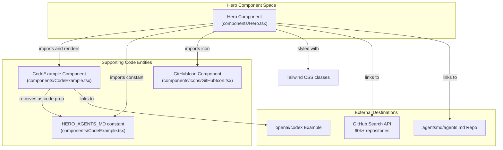
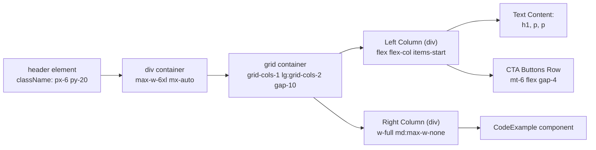
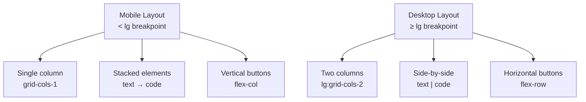

<!-- source: DeepWiki mcp.deepwiki.com · repo agentsmd/agents.md · page 4.2 Hero Component · fetched 2026-10-21 -->

# Hero Component

Relevant source files

The following files were used as context for generating this wiki page:

- [components/CodeExample.tsx](components/CodeExample.tsx)
- [components/Hero.tsx](components/Hero.tsx)

The Hero component serves as the primary landing section of the agents.md marketing website. It provides an introduction to the AGENTS.md format, displays usage statistics, and offers call-to-action buttons for exploring examples and viewing the GitHub repository. This component also renders a code sample through the `CodeExample` component to visually demonstrate what an AGENTS.md file looks like.

**Sources:** [components/Hero.tsx:1-72]()

## Component Architecture

The Hero component is a self-contained functional React component with no props or internal state. It relies on imported components and constants for rendering its interactive elements and code preview.

### Component Relationship Diagram

**Sources:** [components/Hero.tsx:1-4](), [components/Hero.tsx:5-71](), [components/CodeExample.tsx:22-32]()

## Layout Structure

The Hero component implements a responsive two-column grid layout that adapts between mobile and desktop viewports. On large screens, the text content and code example appear side-by-side; on smaller screens, they stack vertically.

### Grid System and Hierarchy

The grid uses `grid-cols-1 lg:grid-cols-2` [components/Hero.tsx:8]() to create a single column on mobile and two columns on large screens. The `gap-10` utility provides spacing between columns.

**Sources:** [components/Hero.tsx:7-8](), [components/Hero.tsx:17-59](), [components/Hero.tsx:60-67]()

### Responsive Breakpoints

| Element | Mobile (< lg) | Large (≥ lg) |
|---------|---------------|--------------|
| Grid Columns | 1 column (stacked) | 2 columns (side-by-side) |
| Left Column Alignment | `items-start` | `items-start` |
| CTA Button Layout | `flex-col` (stacked) | `flex-row` (horizontal) |
| Heading Size | `text-5xl` | `text-6xl` |

**Sources:** [components/Hero.tsx:8](), [components/Hero.tsx:17-18](), [components/Hero.tsx:40]()

## Content Elements

### Heading and Description Text

The component renders three text blocks in the left column:

1. **Main Heading** (`h1`): "AGENTS.md" - Large, bold title using `text-5xl md:text-6xl font-bold tracking-tight` [components/Hero.tsx:18]().
2. **Primary Description** (`p`): Introduces the format as "simple, open" and highlights "60k open-source projects" [components/Hero.tsx:20-33]().
3. **Secondary Description** (`p`): Explains the concept as "README for agents" with inline `<strong>` emphasis [components/Hero.tsx:35-38]().

The GitHub search link points to a specific query [components/Hero.tsx:25]() to showcase real-world adoption.

**Sources:** [components/Hero.tsx:18](), [components/Hero.tsx:20-33](), [components/Hero.tsx:35-38]()

### Call-to-Action Buttons

Two CTA buttons are rendered in a flex container with `gap-4` spacing:

| Button | Type | Destination | Visual Style |
|--------|------|-------------|--------------|
| "Explore Examples" | Internal anchor link | `#examples` | Solid background (black/white inverted for dark mode) |
| "View on GitHub" | External link | `github.com/agentsmd/agents.md` | Outlined border with icon |

The primary button uses `rounded-full bg-black text-white dark:bg-white dark:text-black` [components/Hero.tsx:44]() for maximum contrast. The secondary button uses `border border-gray-300 dark:border-gray-600` [components/Hero.tsx:53]() with an inline-flex layout to accommodate the `GitHubIcon`.

**Sources:** [components/Hero.tsx:40-58]()

### Code Example Display

The right column renders a `CodeExample` component with specific props:

| Prop | Value | Purpose |
|------|-------|---------|
| `compact` | `true` | Enables compact rendering mode [components/CodeExample.tsx:193-195]() |
| `heightClass` | `"min-h-[160px] max-h-[300px]"` | Constrains vertical size [components/Hero.tsx:63]() |
| `code` | `HERO_AGENTS_MD` | The markdown content to display [components/CodeExample.tsx:22-32]() |
| `href` | `"https://github.com/openai/codex/blob/main/AGENTS.md"` | External link to full example [components/Hero.tsx:65]() |

**Sources:** [components/Hero.tsx:60-67](), [components/CodeExample.tsx:22-32]()

## Responsive Design Strategy

The component employs a mobile-first responsive approach using Tailwind's breakpoint prefixes:

### Breakpoint-Specific Classes

- **Typography**: `text-5xl md:text-6xl` [components/Hero.tsx:18]() increases heading size.
- **Grid**: `grid-cols-1 lg:grid-cols-2` [components/Hero.tsx:8]() switches from single to two-column layout.
- **Button Row**: `flex-col sm:flex-row` [components/Hero.tsx:40]() transitions from vertical to horizontal at the small breakpoint.
- **Button Width**: `w-full sm:w-auto` [components/Hero.tsx:40]() allows full-width buttons on mobile.
- **Line Break**: `hidden sm:block` [components/Hero.tsx:22]() on the ` ` tag controls text wrapping for different screen widths.

**Sources:** [components/Hero.tsx:8](), [components/Hero.tsx:17-18](), [components/Hero.tsx:22](), [components/Hero.tsx:40]()

## Styling and Theme Support

The Hero component supports light and dark themes through Tailwind's `dark:` modifier system:

| Element | Light Mode | Dark Mode |
|---------|------------|-----------|
| Background | `bg-gray-50` | `dark:bg-gray-900/40` |
| Border | `border-gray-100` | `dark:border-gray-800` |
| Body Text | `text-gray-700` | `dark:text-gray-300` |
| Primary Button | `bg-black text-white` | `dark:bg-white dark:text-black` |
| Secondary Button Border | `border-gray-300` | `dark:border-gray-600` |
| Secondary Button Text | `text-gray-900` | `dark:text-gray-100` |

**Sources:** [components/Hero.tsx:7](), [components/Hero.tsx:20](), [components/Hero.tsx:35](), [components/Hero.tsx:44-45](), [components/Hero.tsx:53]()

## Implementation Notes

### Flexbox Alignment Strategy

The left column uses a flexbox strategy documented in code comments [components/Hero.tsx:9-16]() to align CTA buttons with the bottom edge of the code block on large screens. This is achieved through `flex flex-col` [components/Hero.tsx:17]() on the container, which allows for natural stacking on mobile while providing structure for alignment on desktop.

### Accessibility and Security

- **External Links**: All external links include `target="_blank"` with `rel="noopener noreferrer"` [components/Hero.tsx:27-28](), [components/Hero.tsx:51-52]().
- **Semantic HTML**: Uses proper `<header>` [components/Hero.tsx:7](), `<h1>` [components/Hero.tsx:18](), and `<a>` [components/Hero.tsx:42]() elements.
- **Interactive Elements**: Buttons and links have hover states like `hover:opacity-80` [components/Hero.tsx:44]() or `hover:bg-gray-100` [components/Hero.tsx:53]().

**Sources:** [components/Hero.tsx:7-58]()

---

