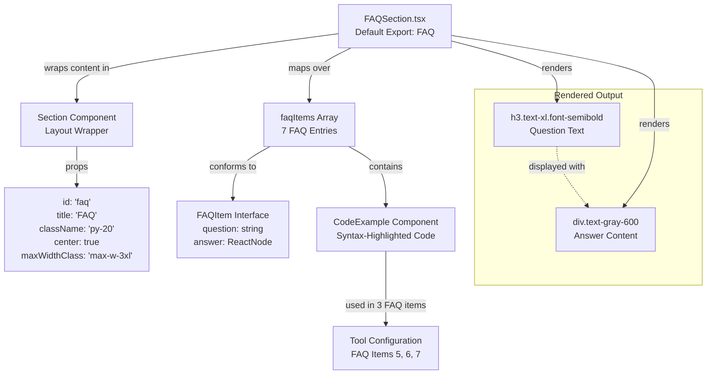
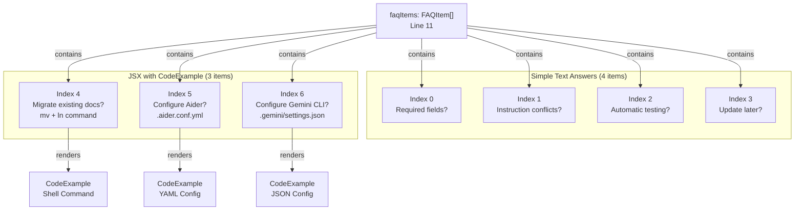
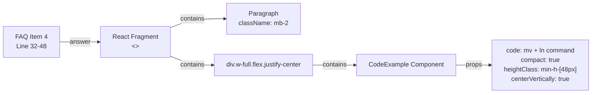
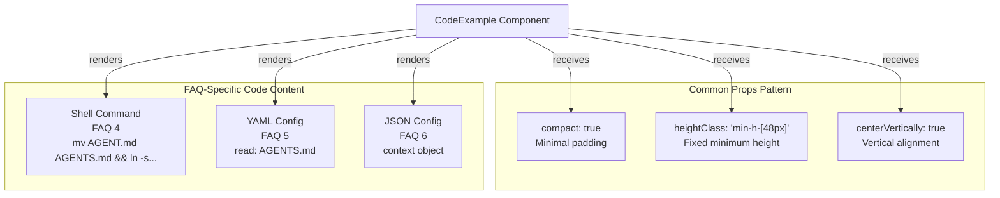
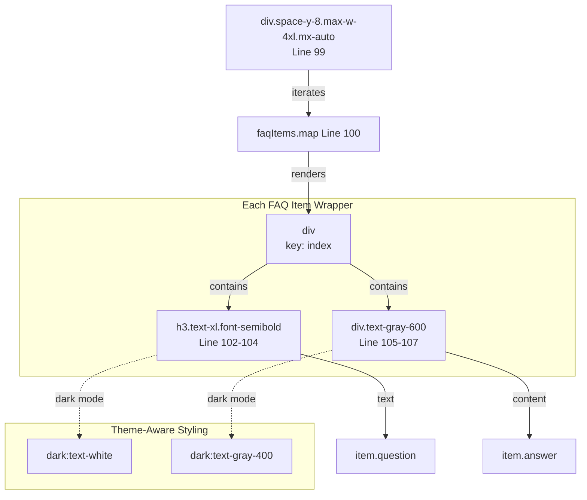

<!-- source: DeepWiki mcp.deepwiki.com · repo agentsmd/agents.md · page 4.3 FAQ Section Component · fetched 2026-10-21 -->

# FAQ Section Component

<details>
<summary>Relevant source files</summary>

The following files were used as context for generating this wiki page:

- [components/CodeExample.tsx](components/CodeExample.tsx)
- [components/FAQSection.tsx](components/FAQSection.tsx)

</details>


## Purpose and Scope

The FAQ Section Component (`FAQSection.tsx`) displays frequently asked questions about the AGENTS.md specification. It provides 7 curated question-answer pairs that address common user concerns about required fields, conflict resolution, testing automation, documentation updates, file migration, and tool-specific configuration for Aider and Gemini CLI [components/FAQSection.tsx:11-89](). The component integrates embedded code examples for practical configuration guidance using the `CodeExample` component [components/FAQSection.tsx:3-3]().

For information about the Hero component that introduces the AGENTS.md specification, see [Hero Component](#4.2). For details about the repository showcase, see [Example List Section](#4.4).

**Sources:** [components/FAQSection.tsx:1-114](), [components/CodeExample.tsx:1-207]()

---

## Component Architecture



**Diagram: FAQSection Component Hierarchy**

This diagram shows how `FAQSection` integrates with the `Section` wrapper and `CodeExample` components. The component iterates over a statically-defined `faqItems` array to generate question-answer pairs [components/FAQSection.tsx:100-109]().

**Sources:** [components/FAQSection.tsx:1-114](), [components/CodeExample.tsx:126-207]()

---

## Data Structure

### FAQItem Interface

The component defines a `FAQItem` interface that structures each question-answer pair:

| Property | Type | Description |
|----------|------|-------------|
| `question` | `string` | The question text displayed as the heading |
| `answer` | `React.ReactNode` | The answer content (plain text or JSX elements) |

**Sources:** [components/FAQSection.tsx:5-8]()

### faqItems Array Structure



**Diagram: FAQ Items Data Flow**

The `faqItems` array contains 7 entries, with items 0-3 using plain text answers and items 4-6 using JSX that embeds `CodeExample` components [components/FAQSection.tsx:11-89]().

**Sources:** [components/FAQSection.tsx:11-89]()

---

## FAQ Content Breakdown

| Index | Question | Answer Type | Code Example |
|-------|----------|-------------|--------------|
| 0 | "Are there required fields?" | Plain text | No |
| 1 | "What if instructions conflict?" | Plain text | No |
| 2 | "Will the agent run testing commands found in AGENTS.md automatically?" | Plain text | No |
| 3 | "Can I update it later?" | Plain text | No |
| 4 | "How do I migrate existing docs to AGENTS.md?" | JSX with paragraph + code | Shell command: `mv` and `ln -s` |
| 5 | "How do I configure Aider?" | JSX with paragraph + code | YAML: `read: AGENTS.md` |
| 6 | "How do I configure Gemini CLI?" | JSX with paragraph + code | JSON: `{"context": {"fileName": "AGENTS.md"}}` |

**Sources:** [components/FAQSection.tsx:11-89]()

### Plain Text FAQ Items

The first four FAQ items (indices 0-3) provide straightforward text answers:

- **Required fields:** Explains that AGENTS.md has no mandatory fields and uses standard Markdown [components/FAQSection.tsx:13-16]().
- **Conflict resolution:** States that the nearest AGENTS.md wins, with explicit user chat prompts overriding everything [components/FAQSection.tsx:18-21]().
- **Testing automation:** Confirms agents will execute relevant programmatic checks listed in AGENTS.md [components/FAQSection.tsx:23-26]().
- **Documentation updates:** Encourages treating AGENTS.md as living documentation [components/FAQSection.tsx:28-30]().

**Sources:** [components/FAQSection.tsx:13-30]()

### JSX-Based FAQ Items with Code Examples

The last three FAQ items (indices 4-6) use JSX to structure more complex answers with embedded code examples:

#### Migration FAQ (Index 4)



**Diagram: Migration FAQ Structure**

The migration FAQ demonstrates renaming `AGENT.md` to `AGENTS.md` and creating a symbolic link for backward compatibility using the command `mv AGENT.md AGENTS.md && ln -s AGENTS.md AGENT.md` [components/FAQSection.tsx:32-48]().

**Sources:** [components/FAQSection.tsx:32-48]()

#### Aider Configuration FAQ (Index 5)

Provides YAML configuration for Aider's `.aider.conf.yml` file, instructing it to read `AGENTS.md` as context. The code example displays `read: AGENTS.md` [components/FAQSection.tsx:50-66]().

**Sources:** [components/FAQSection.tsx:50-66]()

#### Gemini CLI Configuration FAQ (Index 6)

Provides JSON configuration for Gemini CLI's `.gemini/settings.json` file. The code example provides a specific JSON structure to set the filename for context [components/FAQSection.tsx:68-88]():
```json
{
  "context": {
    "fileName": "AGENTS.md"
  }
}
```

**Sources:** [components/FAQSection.tsx:68-88]()

---

## CodeExample Integration



**Diagram: CodeExample Props in FAQ Items**

All three `CodeExample` instances in the FAQ section share identical layout props to maintain visual consistency:
- `compact`: Renders the code block without the outer section wrapper [components/CodeExample.tsx:11]().
- `heightClass="min-h-[48px]"`: Overrides default height for the `<pre>` block [components/CodeExample.tsx:13]().
- `centerVertically`: Vertically centers content and the copy button for single-line commands [components/CodeExample.tsx:19]().

**Sources:** [components/FAQSection.tsx:38-84](), [components/CodeExample.tsx:5-20]()

---

## Rendering and Layout

### Section Wrapper Configuration

The `FAQ` component renders within a `Section` wrapper with specific configuration:

| Prop | Value | Purpose |
|------|-------|---------|
| `id` | `"faq"` | Enables anchor linking to this section [components/FAQSection.tsx:93]() |
| `title` | `"FAQ"` | Displays as the section heading [components/FAQSection.tsx:94]() |
| `className` | `"py-20"` | Vertical padding (5rem top/bottom) [components/FAQSection.tsx:95]() |
| `center` | `true` | Centers content horizontally [components/FAQSection.tsx:96]() |
| `maxWidthClass` | `"max-w-3xl"` | Constrains width of the section content [components/FAQSection.tsx:97]() |

**Sources:** [components/FAQSection.tsx:91-98]()

### FAQ Item Rendering



**Diagram: FAQ Item Rendering Flow**

Each FAQ item renders as a `div` containing an `h3` question heading and a `div` answer container. The component uses `map()` to iterate over the `faqItems` array [components/FAQSection.tsx:100-109]().

**Sources:** [components/FAQSection.tsx:99-110]()

### Typography and Spacing

| Element | Classes | Computed Style |
|---------|---------|----------------|
| Container | `space-y-8 max-w-4xl mx-auto` | 2rem vertical gap between items, 64rem max width, centered [components/FAQSection.tsx:99]() |
| Question | `text-xl font-semibold text-gray-900 dark:text-white mb-2` | 1.25rem font, semi-bold, 0.5rem bottom margin [components/FAQSection.tsx:102]() |
| Answer | `text-gray-600 dark:text-gray-400 leading-relaxed` | Gray text, 1.625 line height [components/FAQSection.tsx:105]() |

The component uses Tailwind's utility classes for consistent spacing and typography. Dark mode variants ensure readability in both themes.

**Sources:** [components/FAQSection.tsx:99-110]()

---

## Component Export and Usage

The component exports a default function named `FAQ`:

```typescript
export default function FAQ() { ... }
```

This naming convention suggests the component is imported elsewhere (typically in the main landing page) as `FAQSection` via aliased import statements, maintaining semantic clarity at the import site while keeping the internal function name concise [components/FAQSection.tsx:10]().

**Sources:** [components/FAQSection.tsx:10-113]()

---

