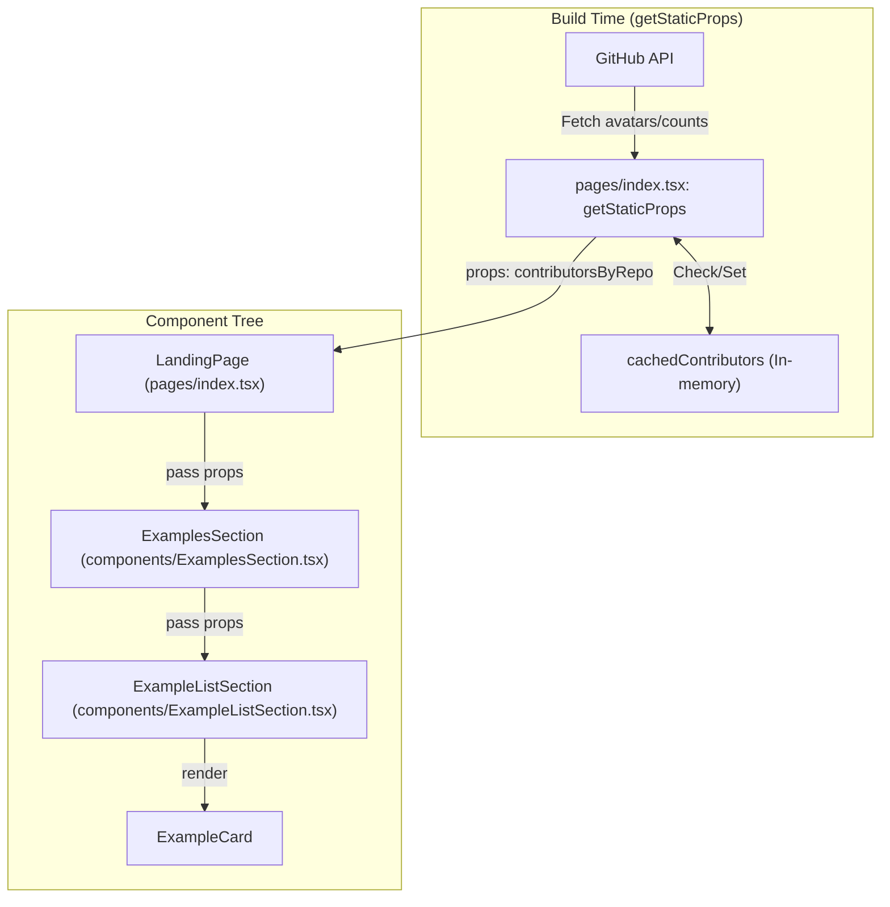

<!-- source: DeepWiki mcp.deepwiki.com · repo agentsmd/agents.md · page 4.4 Example List Section · fetched 2026-10-21 -->

# Example List Section

Relevant source files

The following files were used as context for generating this wiki page:

- [components/ExampleListSection.tsx](components/ExampleListSection.tsx)
- [components/ExamplesSection.tsx](components/ExamplesSection.tsx)
- [pages/index.tsx](pages/index.tsx)

This document describes the `ExampleListSection` component and its integration with the GitHub API via `getStaticProps`. The component displays a showcase grid of example repositories that have adopted the AGENTS.md format, providing visual proof of adoption through metadata, language badges, and contributor data.

## Purpose and Architecture

The `ExampleListSection` component serves as a social proof mechanism, demonstrating real-world adoption of the AGENTS.md specification. It displays hard-coded repository examples with responsive card layouts and dynamic data (avatars and contributor counts) fetched from the GitHub API during the build process.

**System Data Flow**

Sources: [pages/index.tsx:47-160](), [components/ExampleListSection.tsx:1-189](), [components/ExamplesSection.tsx:1-22]()

## Data Acquisition and Caching

The contributor data is fetched during the Next.js static generation phase to avoid client-side API calls and rate-limiting issues.

### GitHub API Integration
The `getStaticProps` function in `pages/index.tsx` performs two specific requests per repository:
1.  **Avatar Fetching**: Requests `https://api.github.com/repos/{name}/contributors?per_page=3` to retrieve the top three contributor profile images [pages/index.tsx:99-104]().
2.  **Total Count Calculation**: Requests `https://api.github.com/repos/{name}/contributors?per_page=1&anon=1` and parses the `Link` header. It looks for the `rel="last"` relation to determine the total number of contributor pages, which corresponds to the total contributor count [pages/index.tsx:115-127]().

### Authentication and Rate Limiting
To prevent build failures due to GitHub's secondary rate limits:
- **Auth Token**: If `process.env.GH_AUTH_TOKEN` is present, it is added to the `Authorization` header [pages/index.tsx:92-94]().
- **In-Memory Cache**: The `cachedContributors` variable stores results for 12 hours during the Node.js process lifetime, preventing redundant fetches during local development [pages/index.tsx:40-66]().
- **Revalidation**: In production, the page revalidates every 24 hours via `revalidate: 60 * 60 * 24` [pages/index.tsx:158]().

Sources: [pages/index.tsx:40-160]()

## Data Structure

### Repository Data Model
The component uses a hard-coded array of repository examples defined by the `RepoCardProps` interface and `REPOS` constant.

**Hard-Coded Examples**
The repositories displayed are:
- `openai/codex` (Rust)
- `apache/airflow` (Python)
- `temporalio/sdk-java` (Java)
- `PlutoLang/Pluto` (C++)

Sources: [components/ExampleListSection.tsx:12-45](), [pages/index.tsx:50-55]()

### Language Color Mapping
Language badges use colors defined in `LANG_BG_COLORS`:
- **TypeScript**: `#3178c6`
- **Java**: `#b07219`
- **Python**: `#3572a5`
- **Rust**: `#dea584`
- **C++**: `#f34b7d`

Sources: [components/ExampleListSection.tsx:4-10]()

## Component Hierarchy

### ExampleListSection
The root component accepts `contributorsByRepo` and a `standalone` flag. If `standalone` is true, it renders without the "Who uses AGENTS.md?" heading and specific section margins [components/ExampleListSection.tsx:85-105]().

### InnerGrid
Manages the responsive grid layout:
- `grid-cols-1 sm:grid-cols-2 md:grid-cols-3 lg:grid-cols-4` [components/ExampleListSection.tsx:58]().
- Includes a link to a GitHub search query targeting `path:AGENTS.md` to show the broader ecosystem [components/ExampleListSection.tsx:74-81]().

### ExampleCard
Each card is an `<a>` tag linking to the repository's `AGENTS.md` file [components/ExampleListSection.tsx:128-131]().

**Avatar Display Logic**
- The top 3 avatars are reversed (`avatars.slice(0, 3).reverse()`) so that the highest-ranked contributor appears on top of the stack visually [components/ExampleListSection.tsx:123]().
- If no data is available, three gray placeholder circles are rendered [components/ExampleListSection.tsx:171-177]().

Sources: [components/ExampleListSection.tsx:52-186]()

## Responsive Behavior

The component implements conditional visibility for cards to maintain a clean layout on smaller screens:
- **Card 4 (Index 3)**: Hidden on mobile and tablet, only visible on large screens (`lg:flex`) [components/ExampleListSection.tsx:64]().
- **Grid Layout**: Adjusts columns dynamically from 1 (mobile) to 4 (desktop) [components/ExampleListSection.tsx:58]().

**Visibility Matrix**

| Card Index | Mobile | Tablet | Desktop (LG) |
|------------|--------|--------|--------------|
| 0, 1, 2    | Visible| Visible| Visible      |
| 3          | Hidden | Hidden | Visible      |

Sources: [components/ExampleListSection.tsx:58-73](), [components/ExampleListSection.tsx:132-138]()

## Theme Support

The component utilizes Tailwind's `dark:` variant for theme-aware styling:
- **Card Surface**: `bg-white` / `dark:bg-black` with `border-gray-200` / `dark:border-gray-700` [components/ExampleListSection.tsx:132]().
- **Avatars**: Each image has a `ring-2 ring-white dark:ring-gray-900` to create a separation effect in the overlapping stack [components/ExampleListSection.tsx:168]().
- **Contributor Count**: Uses `bg-gray-200` / `dark:bg-gray-700` [components/ExampleListSection.tsx:179]().

Sources: [components/ExampleListSection.tsx:132-182]()

---

