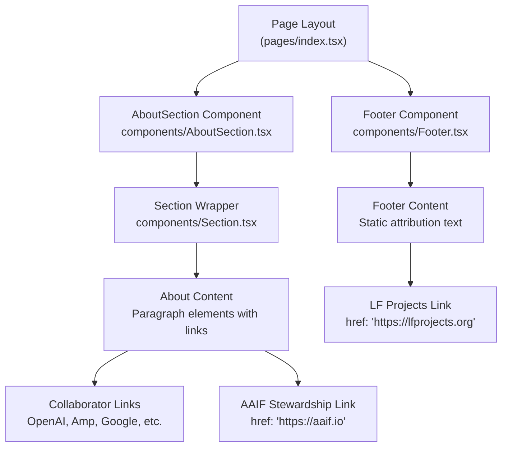
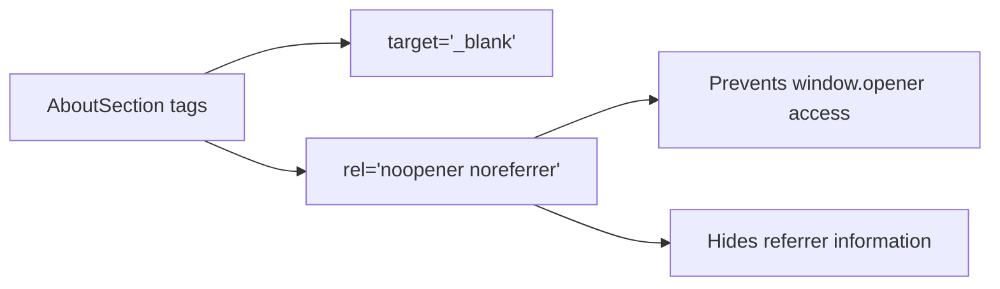

<!-- source: DeepWiki mcp.deepwiki.com · repo agentsmd/agents.md · page 4.5 Footer and About Components · fetched 2026-10-21 -->

# Footer and About Components

Relevant source files

The following files were used as context for generating this wiki page:

- [components/AboutSection.tsx](components/AboutSection.tsx)
- [components/Footer.tsx](components/Footer.tsx)
- [components/HowToUseSection.tsx](components/HowToUseSection.tsx)
- [components/Section.tsx](components/Section.tsx)
- [components/WhySection.tsx](components/WhySection.tsx)

## Purpose and Scope

This document covers the `Footer` and `AboutSection` components, which provide attribution and context at the bottom of the agents.md website. The `Footer` component displays legal information and stewardship attribution, while the `AboutSection` component explains the collaborative origins of the AGENTS.md specification and its current governance under the Linux Foundation.

## Component Overview

The footer system consists of two independent components rendered at the end of the page layout. Both components are purely presentational with static content and external hyperlinks.

| Component | File | Purpose | Complexity |
|-----------|------|---------|------------|
| `Footer` | [components/Footer.tsx:3-17]() | Copyright notice and project policy links | Minimal |
| `AboutSection` | [components/AboutSection.tsx:3-37]() | Project origin story and AAIF stewardship details | Low |

**Sources:** [components/Footer.tsx:1-17](), [components/AboutSection.tsx:1-37]()

## Component Hierarchy

The following diagram illustrates how these components fit into the page structure and their internal composition.

**Sources:** [components/Footer.tsx:1-17](), [components/AboutSection.tsx:1-37](), [components/Section.tsx:18-44]()

## Footer Component

### Structure and Implementation

The `Footer` component is a functional component that renders a `<footer>` HTML5 semantic element. It serves as the terminal element of the website layout.

**Component Definition:** [components/Footer.tsx:3-17]()

### Content and Legal Attribution
The footer displays the copyright notice for "AGENTS.md a Series of LF Projects, LLC" and provides a link to the Linux Foundation projects site for terms of use and trademark policies [components/Footer.tsx:7-14]().

**External Link Attributes:**
- `href`: `"https://lfprojects.org"` [components/Footer.tsx:10]()
- `target`: `"_blank"` (opens in new tab) [components/Footer.tsx:10]()
- `className`: `"underline hover:no-underline"` [components/Footer.tsx:10]()

### Styling Approach
The footer uses Tailwind CSS utility classes to ensure visual consistency and theme support:

| Category | Tailwind Classes | Purpose |
|----------|------------------|---------|
| Layout | `px-6 py-12 mt-24 text-center` | Spacing, vertical separation, and alignment |
| Typography | `text-sm text-gray-600 dark:text-gray-400` | Small text with theme-aware colors |
| Background | `bg-gray-50 dark:bg-gray-900/40` | Subtle background tint |
| Border | `border-t border-gray-100 dark:border-gray-800` | Top separator line |

**Sources:** [components/Footer.tsx:5]()

## AboutSection Component

### Structure and Implementation

The `AboutSection` component utilizes the shared `Section` wrapper to maintain consistent typography and layout with other page sections like `WhySection` or `HowToUseSection`.

**Component Definition:** [components/AboutSection.tsx:3-37]()

### Section Wrapper Configuration
The component passes specific props to the `Section` component to customize its appearance:
- `title`: `"About"` [components/AboutSection.tsx:4]()
- `className`: `"pb-0"` (removes bottom padding to sit closer to the footer) [components/AboutSection.tsx:4]()
- `center`: `true` (centers the heading and text) [components/AboutSection.tsx:4]()
- `maxWidthClass`: `"max-w-3xl"` (constrains the prose width for readability) [components/AboutSection.tsx:4]()

**Sources:** [components/AboutSection.tsx:4](), [components/Section.tsx:18-25]()

### Content and Collaborator Links
The section is divided into three primary paragraphs:

1.  **Origins:** Lists the ecosystem collaborators, including OpenAI Codex, Amp, Jules from Google, Cursor, and Factory [components/AboutSection.tsx:5-13]().
2.  **Mission:** States the commitment to maintaining AGENTS.md as an open format [components/AboutSection.tsx:15-18]().
3.  **Governance:** Documents the transition to the **Agentic AI Foundation (AAIF)** under the Linux Foundation [components/AboutSection.tsx:20-32]().

### External Link Security
The `AboutSection` implements enhanced security for its external links compared to the `Footer`:

**Links and Targets:**
- **OpenAI Codex:** `https://openai.com/codex/` [components/AboutSection.tsx:8]()
- **Amp:** `https://ampcode.com` [components/AboutSection.tsx:9]()
- **Jules (Google):** `https://jules.google` [components/AboutSection.tsx:10]()
- **Cursor:** `https://cursor.com` [components/AboutSection.tsx:11]()
- **Factory:** `https://factory.ai` [components/AboutSection.tsx:12]()
- **AAIF:** `https://aaif.io` [components/AboutSection.tsx:22]()
- **AAIF Announcement:** `https://openai.com/index/agentic-ai-foundation/` [components/AboutSection.tsx:27]()

**Sources:** [components/AboutSection.tsx:8-32]()

## Styling and Theme Support

Both components utilize Tailwind's `dark:` variant to ensure the site remains legible in dark mode.

### Visual Contrast Mapping

| Element | Light Mode | Dark Mode |
|---------|------------|-----------|
| Footer Background | `bg-gray-50` | `bg-gray-900/40` |
| Footer Text | `text-gray-600` | `text-gray-400` |
| Section Prose | `prose-neutral` | `dark:prose-invert` |
| Section Borders | `border-gray-100` | `border-gray-800` |

The `Section` component (used by `AboutSection`) automatically applies the `prose prose-neutral dark:prose-invert` classes to its children, which handles the typography styling for the paragraphs and links within the `AboutSection` [components/Section.tsx:38]().

**Sources:** [components/Footer.tsx:5](), [components/Section.tsx:38](), [components/AboutSection.tsx:4]()

---

