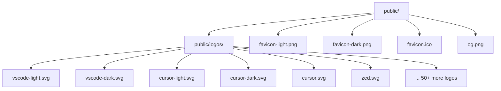
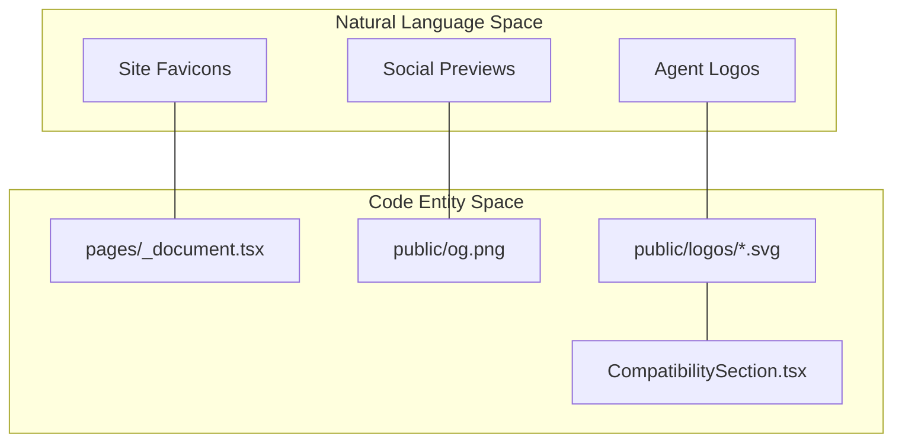
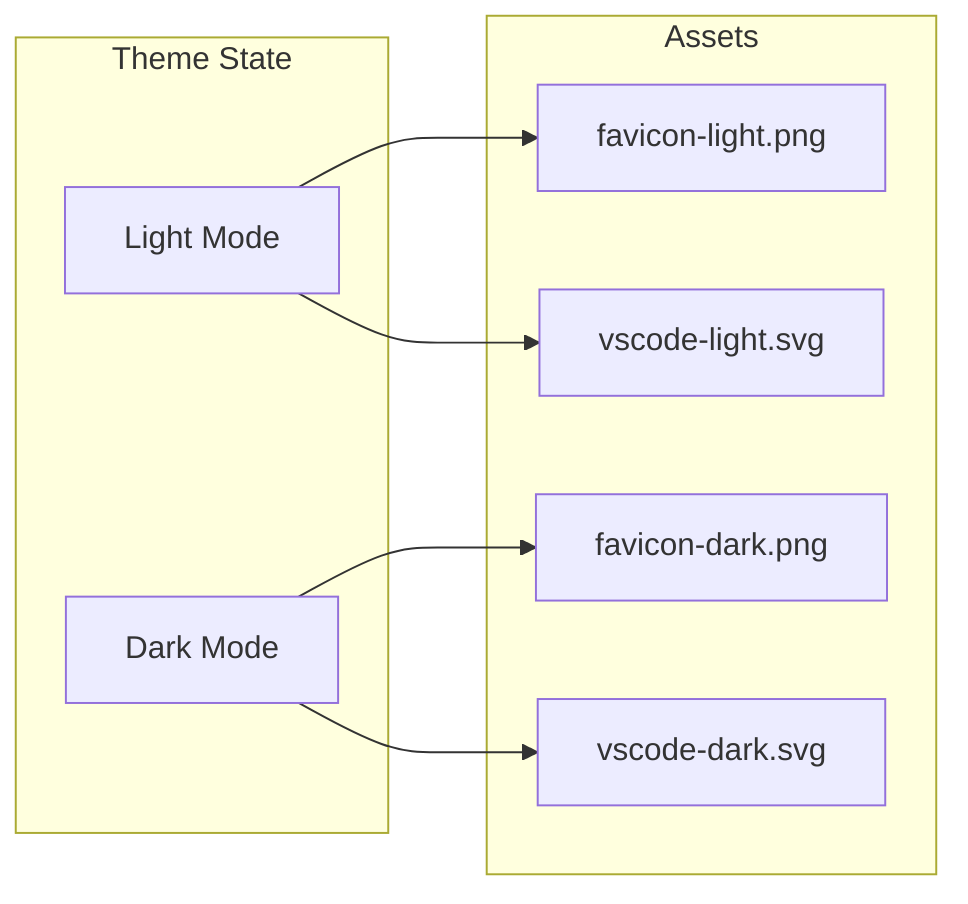

<!-- source: DeepWiki mcp.deepwiki.com · repo agentsmd/agents.md · page 5 Static Assets · fetched 2026-10-21 -->

# Static Assets

<details>
<summary>Relevant source files</summary>

The following files were used as context for generating this wiki page:

- [pages/_document.tsx](pages/_document.tsx)
- [public/favicon-dark.png](public/favicon-dark.png)
- [public/favicon-light.png](public/favicon-light.png)
- [public/favicon.ico](public/favicon.ico)
- [public/og.png](public/og.png)

</details>


This document provides a high-level overview of the static asset management system in the agents.md repository. Static assets include agent logos, favicons, and social media preview images, all organized within the `public/` directory and served directly by Next.js.

**Scope**: This page covers asset organization, naming conventions, and theme-aware rendering strategies. For detailed implementation guides, see the child pages listed below.

---

## Asset Directory Structure

The static asset system is organized into a flat structure within the `public/` directory, with agent logos grouped in a dedicated subdirectory.



**Sources**: [public/favicon-light.png:1-8](), [public/favicon-dark.png:1-9](), [public/favicon.ico:1-2](), [public/og.png:1-3]()

### Asset Categories

| Category | Path | Description |
|----------|------|-------------|
| **Agent Logos** | `public/logos/` | SVG files for 60+ AI coding agents and tools. |
| **Favicons** | `public/` | Theme-aware icons (`favicon-light.png`, `favicon-dark.png`) and fallback `favicon.ico`. |
| **Social Media** | `public/og.png` | Open Graph image (1200x630px) for rich link previews. |

---

## Asset Systems (Child Pages)

### 5.1 [Logo Asset System](#5.1)
The repository maintains a library of over 60 agent logos. These are primarily SVGs categorized into two types:
*   **Theme-Aware Pairs**: Agents like VS Code, Devin, and Windsurf use separate `-light.svg` and `-dark.svg` files to ensure high contrast against different backgrounds.
*   **Single-Variant Logos**: Agents like Zed and Goose use a single SVG file, often utilizing CSS masking or theme-agnostic colors.

For details on naming conventions and the full inventory, see [Logo Asset System](#5.1).

### 5.2 [Favicon System](#5.2)
The site implements a theme-aware favicon system. Using Next.js `Head` component in `_document.tsx`, the browser selects between `favicon-light.png` and `favicon-dark.png` based on the user's `prefers-color-scheme` media query.

**Implementation Detail**:
```tsx
<link rel="icon" href="/favicon-light.png" media="(prefers-color-scheme: light)" />
<link rel="icon" href="/favicon-dark.png" media="(prefers-color-scheme: dark)" />
```
[pages/_document.tsx:7-16]()

For details on favicon specifications and fallback logic, see [Favicon System](#5.2).

### 5.3 [Social Media Assets](#5.3)
The `og.png` file serves as the primary visual asset for social media platforms. It is referenced in the site's metadata to generate rich previews on Twitter, LinkedIn, and Facebook.

For details on metadata configuration and image dimensions, see [Social Media Assets](#5.3).

---

## System Integration

The following diagram bridges the "Natural Language Space" (Asset Types) to the "Code Entity Space" (Files and Components).



**Sources**: [pages/_document.tsx:7-16](), [public/og.png:1-3](), [public/favicon.ico:1-2]()

### Theme Selection Logic

The application logic determines which static asset to load based on the system theme state.



**Sources**: [pages/_document.tsx:7-16](), [public/favicon-light.png:1-8](), [public/favicon-dark.png:1-9]()

---

