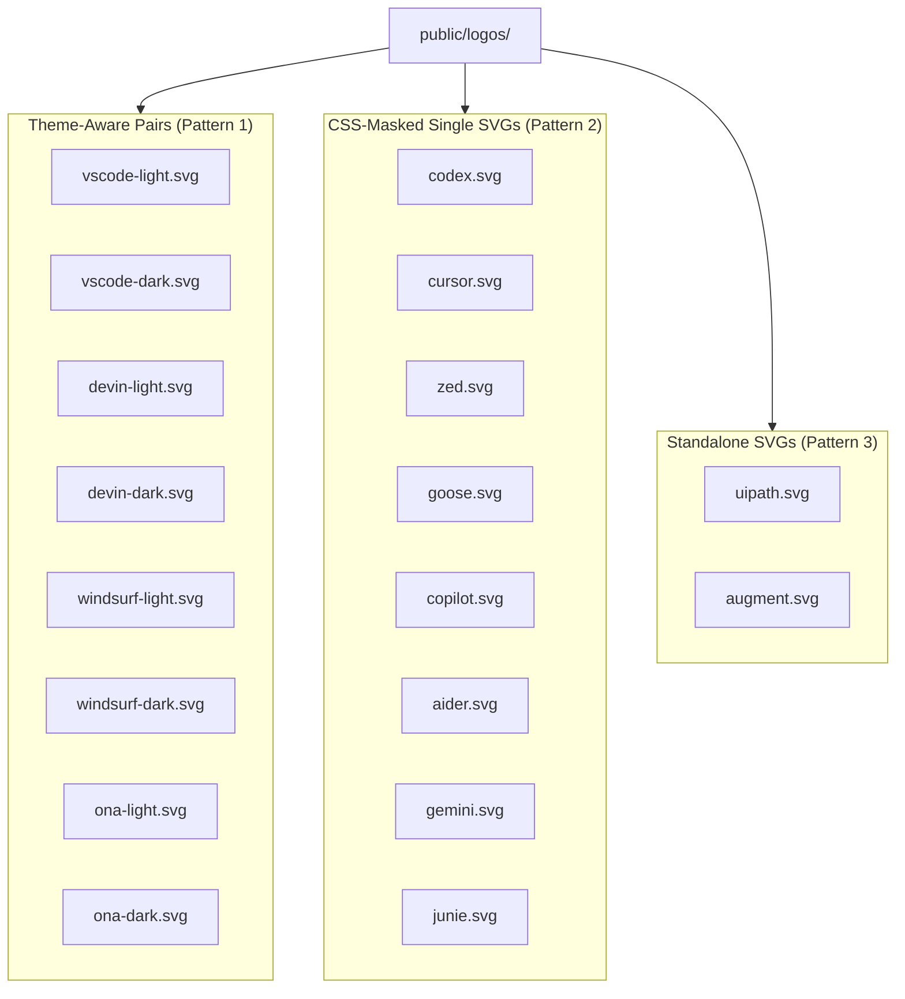
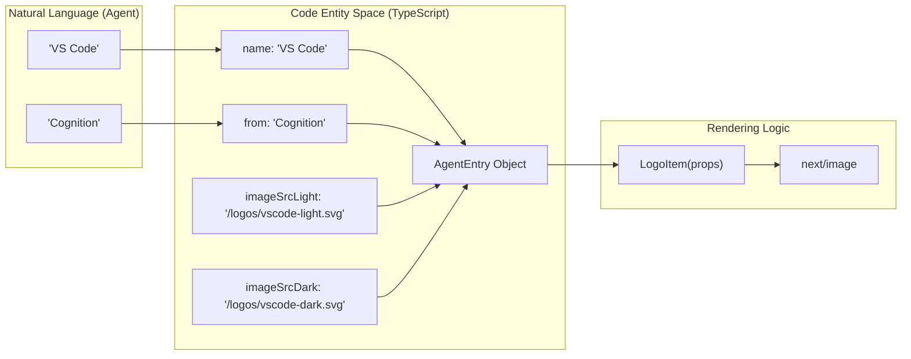
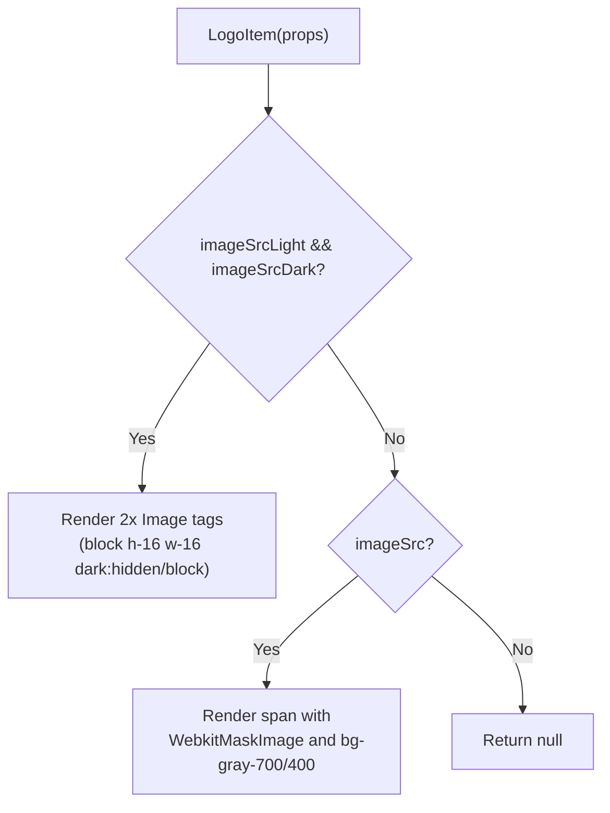

<!-- source: DeepWiki mcp.deepwiki.com · repo agentsmd/agents.md · page 5.1 Logo Asset System · fetched 2026-10-21 -->

# Logo Asset System

<details>
<summary>Relevant source files</summary>

The following files were used as context for generating this wiki page:

- [components/CompatibilitySection.tsx](components/CompatibilitySection.tsx)
- [public/logos/devin-dark.svg](public/logos/devin-dark.svg)
- [public/logos/devin-light.svg](public/logos/devin-light.svg)
- [public/logos/junie.svg](public/logos/junie.svg)
- [public/logos/ona-dark.svg](public/logos/ona-dark.svg)
- [public/logos/ona-light.svg](public/logos/ona-light.svg)
- [public/logos/vscode-dark.svg](public/logos/vscode-dark.svg)
- [public/logos/vscode-light.svg](public/logos/vscode-light.svg)
- [public/logos/windsurf-dark.svg](public/logos/windsurf-dark.svg)
- [public/logos/windsurf-light.svg](public/logos/windsurf-light.svg)
- [styles/globals.css](styles/globals.css)

</details>


This document describes the logo asset library used throughout the agents.md website. It covers the file organization, naming conventions, implementation patterns, and how these assets are integrated into the `CompatibilitySection` component for rendering.

For detailed technical breakdowns of specific logo types, see:
- [Theme-Aware Logo Pairs](#5.1.1) — Logos with separate light and dark variants.
- [Single-Variant Logos](#5.1.2) — Logos using CSS masking or standalone designs.
- [Additional Agent Logos](#5.1.3) — Documentation for the full ecosystem of supported agents.

## Purpose and Scope

The logo asset system provides visual branding for 21 AI coding agents and tools that support the AGENTS.md specification. These assets are stored in `public/logos/` and are primarily consumed by the `CompatibilitySection` component [components/CompatibilitySection.tsx:265-265](). The system supports three implementation patterns to accommodate different design requirements: paired light/dark variants for brand-specific color schemes, CSS-masked SVGs for dynamic theming, and standalone SVGs for universal designs.

## File Organization

All logo assets are stored as SVG files in the `public/logos/` directory. The system organizes logos into three categories based on their implementation pattern.

Title: Logo Asset File Organization

**Sources:** [components/CompatibilitySection.tsx:14-142](), [public/logos/vscode-light.svg:1-13](), [public/logos/junie.svg:1-5]()

## Logo Implementation Patterns

The system supports three distinct patterns for rendering logos within the `LogoItem` function [components/CompatibilitySection.tsx:157-157]().

### Pattern 1: Theme-Aware Pairs
Logos with separate light and dark variants use two distinct SVG files. These are used when the brand requires specific colors that differ significantly between themes, such as VS Code, Devin, Windsurf, and Ona [components/CompatibilitySection.tsx:100-124](). For implementation details, see [Theme-Aware Logo Pairs](#5.1.1).

### Pattern 2: CSS-Masked SVGs
Single SVG files rendered through CSS masking allow the logo shape to be filled with theme-appropriate colors dynamically using `WebkitMaskImage` [components/CompatibilitySection.tsx:201-201](). The background color is controlled via Tailwind classes like `bg-gray-700` for light mode and `bg-gray-400` for dark mode [components/CompatibilitySection.tsx:199-199](). For details, see [Single-Variant Logos](#5.1.2).

### Pattern 3: Standalone SVGs
Some logos include their own color definitions and render identically in both light and dark themes. These use the `imageSrc` property but are rendered without the CSS mask logic if the SVG contains its own fills, such as `uipath.svg` [components/CompatibilitySection.tsx:129-129]().

## Code Entity Mapping

This diagram bridges the visual assets to the TypeScript definitions used in the codebase.

Title: Natural Language Space to Code Entity Space Mapping

**Sources:** [components/CompatibilitySection.tsx:5-12](), [components/CompatibilitySection.tsx:157-165]()

## Agent Data Structure

All agents are defined in the `agents` array within `CompatibilitySection.tsx` [components/CompatibilitySection.tsx:14-142](). Each entry follows the `AgentEntry` type definition:

```typescript
type AgentEntry = {
  name: string;
  url: string;
  from?: string;
  imageSrc?: string;
  imageSrcLight?: string;
  imageSrcDark?: string;
};
```
**Sources:** [components/CompatibilitySection.tsx:5-12]()

## Rendering Logic Implementation

The `LogoItem` component handles the conditional logic for displaying these different patterns.

Title: LogoItem Rendering Logic

**Sources:** [components/CompatibilitySection.tsx:179-211]()

### Theme-Aware Pair Rendering
When both `imageSrcLight` and `imageSrcDark` are provided, the component renders two `next/image` components with Tailwind classes controlling visibility based on the user's theme [components/CompatibilitySection.tsx:181-194]().

### CSS-Masked Rendering
When only `imageSrc` is provided, a `<span>` element applies CSS masking. This is the primary method for agents like Cursor, Zed, and Goose [components/CompatibilitySection.tsx:196-210]().

## Integration and Usage

The logo system is integrated into two primary display modes within the `CompatibilitySection`:
1.  **Marquee Mode**: Uses `LogoMarqueeRow` to create a continuous scrolling animation [components/CompatibilitySection.tsx:228-228]().
2.  **Grid Mode**: Displays a static grid of all agents when toggled by the user [components/CompatibilitySection.tsx:331-337]().

For more information on the animation system, see the [Marquee Animation System](#4.1.2) section. For the full list of supported agents, see [Additional Agent Logos](#5.1.3).

**Sources:** [components/CompatibilitySection.tsx:228-263](), [styles/globals.css:113-126]()

---

