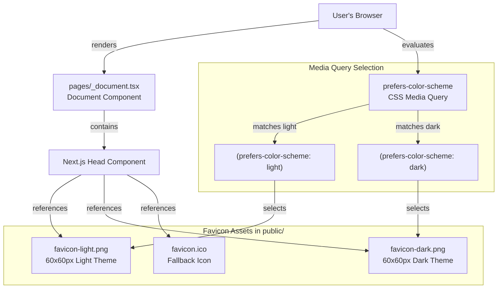
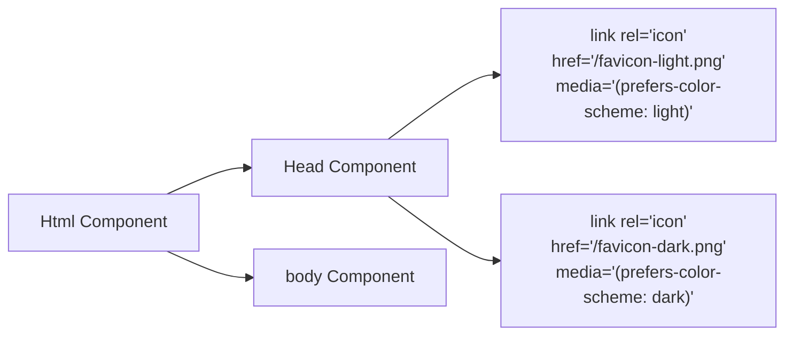
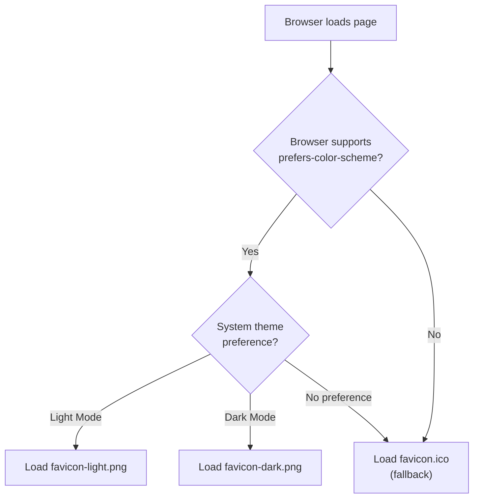
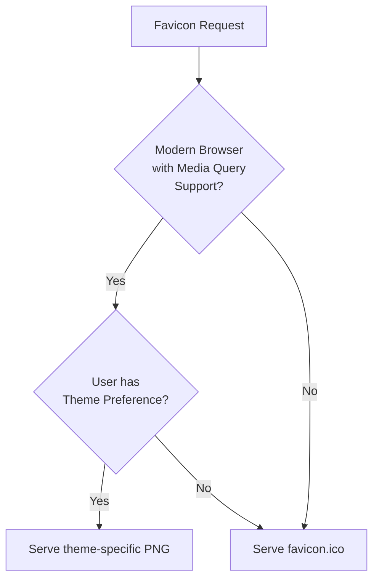
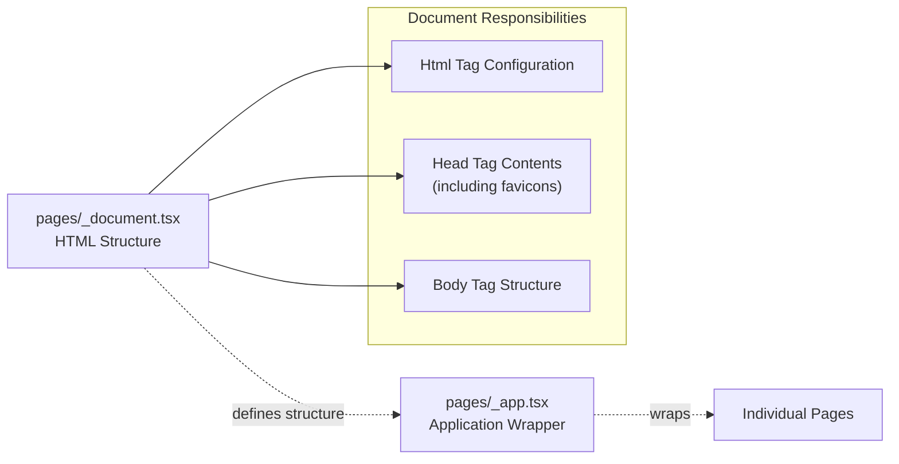

<!-- source: DeepWiki mcp.deepwiki.com · repo agentsmd/agents.md · page 5.2 Favicon System · fetched 2026-10-21 -->

# Favicon System

Relevant source files

The following files were used as context for generating this wiki page:

- [pages/_document.tsx](pages/_document.tsx)
- [public/favicon-dark.png](public/favicon-dark.png)
- [public/favicon-light.png](public/favicon-light.png)
- [public/favicon.ico](public/favicon.ico)

This document describes the theme-aware favicon implementation used by the agents.md website. The system dynamically displays different favicon images based on the user's operating system color scheme preference (light or dark mode).

For information about agent logo assets displayed in the compatibility section, see [Logo Asset System](#5.1). For social media preview images, see [Social Media Assets](#5.3).

---

## Purpose and Scope

The Favicon System provides a polished user experience by adapting the browser tab icon to match the user's system theme. This ensures visual consistency whether users browse in light mode or dark mode. The implementation uses CSS media queries in the HTML `<Head>` component to serve theme-specific PNG favicons, with a fallback ICO file for older browsers.

**Sources:** [pages/_document.tsx:1-24]()

---

## System Architecture

The following diagram illustrates how the favicon system integrates with Next.js document structure and browser media query evaluation:

### Favicon Integration Flow

**Sources:** [pages/_document.tsx:3-24](), [public/favicon-light.png](), [public/favicon-dark.png](), [public/favicon.ico]()

---

## Asset Organization

The favicon system consists of three static image files located in the `public/` directory:

| File | Dimensions | Purpose | Format |
|------|-----------|---------|--------|
| `favicon-light.png` | 60×60 pixels | Displayed when user's system is in light mode | PNG |
| `favicon-dark.png` | 60×60 pixels | Displayed when user's system is in dark mode | PNG |
| `favicon.ico` | Variable | Fallback for browsers without media query support | ICO (multi-resolution) |

Both PNG favicons are 60×60 pixels with appropriate visual designs for their respective color schemes. The light variant typically has darker elements for visibility on light backgrounds, while the dark variant has lighter elements for dark backgrounds.

**Sources:** [public/favicon-light.png](), [public/favicon-dark.png](), [public/favicon.ico]()

---

## Implementation Details

The favicon system is implemented in the `Document` component exported from `pages/_document.tsx`. This component defines the HTML document structure for all pages in the Next.js application.

### HTML Structure

The implementation uses two `<link>` tags within the `<Head>` component:

1. **Light Theme Link** ([pages/_document.tsx:7-11]())
   - `rel="icon"` - Specifies this is a favicon
   - `href="/favicon-light.png"` - Path to the light theme PNG
   - `media="(prefers-color-scheme: light)"` - Only applies when system prefers light mode

2. **Dark Theme Link** ([pages/_document.tsx:12-16]())
   - `rel="icon"` - Specifies this is a favicon
   - `href="/favicon-dark.png"` - Path to the dark theme PNG
   - `media="(prefers-color-scheme: dark)"` - Only applies when system prefers dark mode

**Sources:** [pages/_document.tsx:7-16]()

---

## Browser Selection Logic

The following diagram illustrates the decision flow browsers use to select the appropriate favicon:

### Browser Logic Decision Tree

### Selection Process

1. **Browser parses HTML** - The browser encounters the `<Head>` component containing multiple favicon `<link>` tags.
2. **Media query evaluation** - Modern browsers evaluate the `media` attribute on each link tag.
3. **Theme matching** - The browser checks the system's `prefers-color-scheme` setting.
4. **Asset loading** - Only the favicon matching the current theme is downloaded and displayed.
5. **Dynamic updates** - If the user changes their system theme, browsers automatically switch to the appropriate favicon.

### Media Query Syntax

The `media` attribute uses standard CSS media query syntax:
- `(prefers-color-scheme: light)` - Matches when user's system is set to light mode.
- `(prefers-color-scheme: dark)` - Matches when user's system is set to dark mode.

**Sources:** [pages/_document.tsx:7-16]()

---

## Fallback Strategy

While the system primarily relies on theme-aware PNG favicons, the presence of `favicon.ico` in the `public/` directory provides several fallback scenarios:

### Fallback Hierarchy

### When Fallback Applies

1. **Legacy browsers** - Browsers that don't support the `prefers-color-scheme` media query.
2. **Automatic requests** - Some browsers and tools automatically request `/favicon.ico` by convention.
3. **Bookmarks and shortcuts** - Certain systems may cache or prefer ICO format for saved links.
4. **No theme preference** - Users who haven't set a system-level color scheme preference.

The multi-resolution ICO file format allows the fallback to work across various display contexts (browser tabs, bookmarks bar, task switchers) at different sizes.

**Sources:** [public/favicon.ico]()

---

## Technical Characteristics

### File Specifications

| Attribute | Light PNG | Dark PNG | ICO Fallback |
|-----------|-----------|----------|--------------|
| Format | PNG-8/PNG-24 | PNG-8/PNG-24 | Multi-resolution ICO |
| Dimensions | 60×60 px | 60×60 px | Multiple (16×16, 32×32, 48×48, 64x64) |
| Color Space | sRGB | sRGB | sRGB |
| Transparency | Supported | Supported | Limited |
| File Size | ~2KB | ~2KB | ~30KB (Multi-layer) |

### Browser Compatibility

The media query approach is supported by:
- Chrome/Edge 76+
- Firefox 67+
- Safari 12.1+
- Opera 62+

Older browsers gracefully degrade to the ICO fallback without any functional issues.

**Sources:** [public/favicon-light.png](), [public/favicon-dark.png](), [public/favicon.ico]()

---

## Integration with Next.js

The favicon system leverages Next.js's special `_document.tsx` file, which allows customization of the HTML document structure:

The `Document` component is only rendered on the server and defines the outer document structure. The favicon links are included in the `<Head>` component, ensuring they're present in the initial HTML response for every page.

**Sources:** [pages/_document.tsx:3-24]()

---

## Summary

The Favicon System provides a clean, standards-based implementation of theme-aware favicons using:

1. **Two PNG assets** (60×60px) for light and dark themes.
2. **CSS media queries** in link tags to enable browser-native theme detection.
3. **Fallback ICO file** for legacy browser support.
4. **Next.js Document component** for centralized HTML structure management.

This approach requires no JavaScript, automatically responds to system theme changes, and degrades gracefully on older browsers. The system is self-contained within the document structure and requires no additional configuration or runtime logic.

**Sources:** [pages/_document.tsx:1-24](), [public/favicon-light.png](), [public/favicon-dark.png](), [public/favicon.ico]()

---

