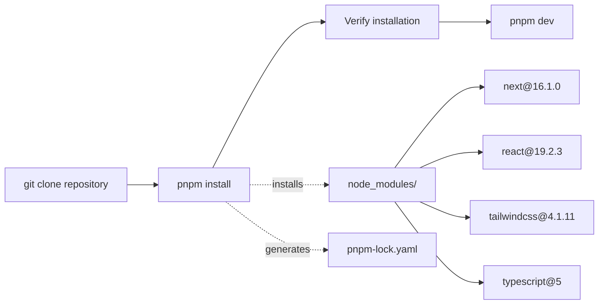
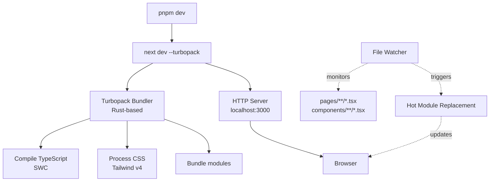
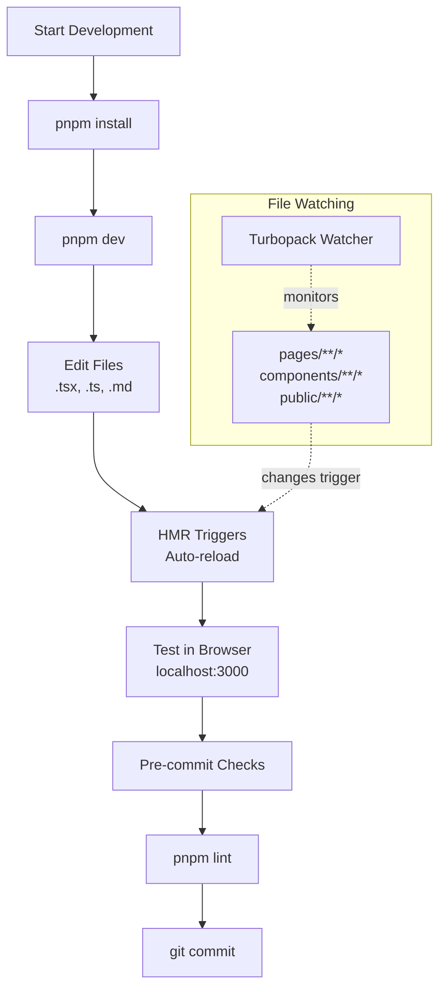
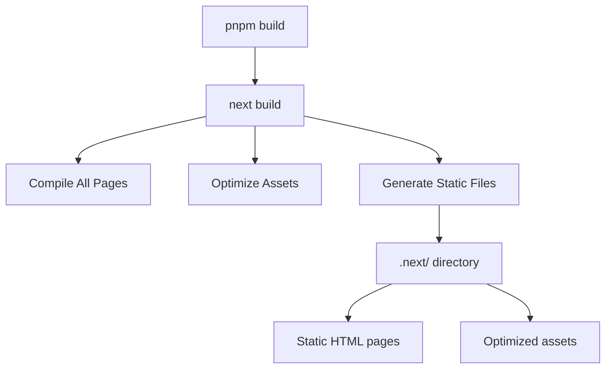

<!-- source: DeepWiki mcp.deepwiki.com · repo agentsmd/agents.md · page 6 Development Guide · fetched 2026-10-21 -->

# Development Guide

<details>
<summary>Relevant source files</summary>

The following files were used as context for generating this wiki page:

- [.gitignore](.gitignore)
- [LICENSE](LICENSE)
- [README.md](README.md)
- [package.json](package.json)

</details>


This page provides practical guidance for developers working on the agents.md website. It covers environment setup, available commands, development workflows, and best practices.

---

## Purpose and Scope

This guide is intended for developers who need to:
- Set up a local development environment.
- Run the development server with hot module replacement.
- Execute builds and linting.
- Understand the development workflow and project conventions.

---

## Prerequisites

The project requires the following tools:

| Tool | Version | Purpose |
|------|---------|---------|
| Node.js | ≥20 | JavaScript runtime (based on `@types/node` version) |
| pnpm | 9.15.1 | Package manager |
| Git | Any recent | Version control |

**Sources:** [package.json:21](), [package.json:26](), [README.md:41-49]()

---

## Installation and Setup

### Initial Setup



### Step-by-Step Instructions

1. **Clone the repository**
   ```bash
   git clone https://github.com/agentsmd/agents.md
   cd agents.md
   ```

2. **Install dependencies**
   ```bash
   pnpm install
   ```
   This reads [package.json:11-25]() and installs all dependencies.

3. **Verify installation**
   Check that `node_modules` is populated. The `.next` directory will be generated upon running the dev server or build.

**Sources:** [README.md:40-44](), [package.json:1-27](), [package.json:11-25]()

---

## Development Server

### Starting the Development Server

```bash
pnpm dev
```

This command executes [package.json:6]() which runs `next dev --turbopack`.



### Key Features

- **Turbopack**: Fast Rust-based bundler used via the `--turbopack` flag in the `dev` script [package.json:6]().
- **Hot Module Replacement (HMR)**: Instant updates without full page reload.
- **Tailwind CSS v4**: Uses `@tailwindcss/postcss` and `tailwindcss` version 4.1.11 [package.json:12-17]().
- **TypeScript**: Native support for TypeScript 5 [package.json:24]().

**Sources:** [package.json:6](), [package.json:12-17](), [README.md:45-49]()

---

## Available Commands

### Command Reference

| Command | Script | Purpose | When to Use |
|---------|--------|---------|-------------|
| `pnpm dev` | `next dev --turbopack` | Start development server with HMR | Active development |
| `pnpm build` | `next build` | Create production build | Pre-deployment, CI/CD |
| `pnpm start` | `next start` | Serve production build | Testing production build locally |
| `pnpm lint` | `next lint` | Run ESLint checks | Pre-commit, CI/CD |

**Sources:** [package.json:5-10]()

---

## Development Workflow



### Typical Development Session

1. **Start development server**: `pnpm dev`.
2. **Make changes**: Modify components or pages.
3. **Observe updates**: Changes appear instantly in the browser via HMR.
4. **Linting**: Run `pnpm lint` to ensure code quality [package.json:9]().
5. **Commit**: Push changes to the repository.

**Sources:** [README.md:40-49](), [package.json:5-10]()

---

## Building for Production



### Build Command

```bash
pnpm build
```

This command [package.json:7]() creates an optimized production build in the `.next` folder. This directory is ignored by git [.gitignore:78]().

### Production Server

After building, test the production build locally:
```bash
pnpm start
```

This serves the production build from `.next/` on port 3000 [package.json:8]().

**Sources:** [package.json:7-8](), [.gitignore:78](), [README.md:47-49]()

---

## Troubleshooting

### Port Conflicts
If port 3000 is in use, Next.js will typically try the next available port (e.g., 3001). Ensure no other `next dev` processes are running.

### Dependency Issues
If you encounter unexpected errors after a pull, clear `node_modules` and reinstall:
```bash
rm -rf node_modules
pnpm install
```

### Build Output in Git
The `.next`, `out`, and `build` directories are excluded from version control to prevent bloat and conflicts [.gitignore:78-83](), [.gitignore:142]().

**Sources:** [.gitignore:78-83](), [.gitignore:142]()

---

## Contribution Guidelines

1. **Code Style**: Run `pnpm lint` before committing [package.json:9]().
2. **Dependencies**: Use `pnpm` for all package management to maintain the `pnpm-lock.yaml` file [package.json:26]().
3. **TypeScript**: Ensure all new components are typed. Use `@types/react` and `@types/node` for standard definitions [package.json:21-22]().
4. **License**: All contributions fall under the MIT License [LICENSE:1-21]().

**Sources:** [package.json:9](), [package.json:21-22](), [package.json:26](), [LICENSE:1-21]()

---

