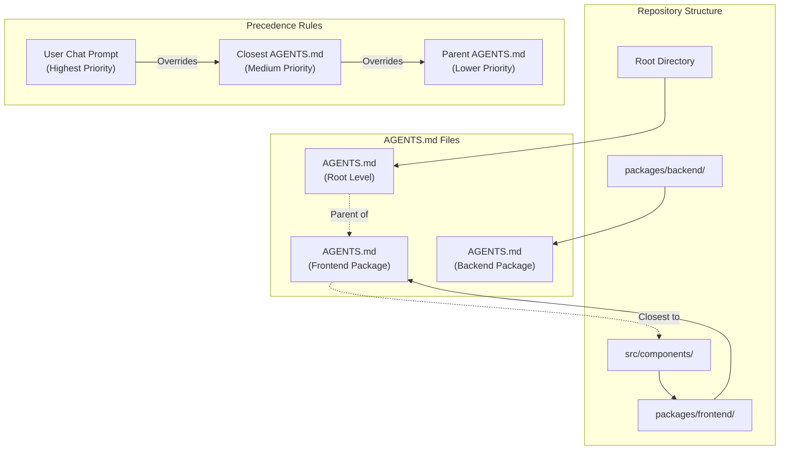
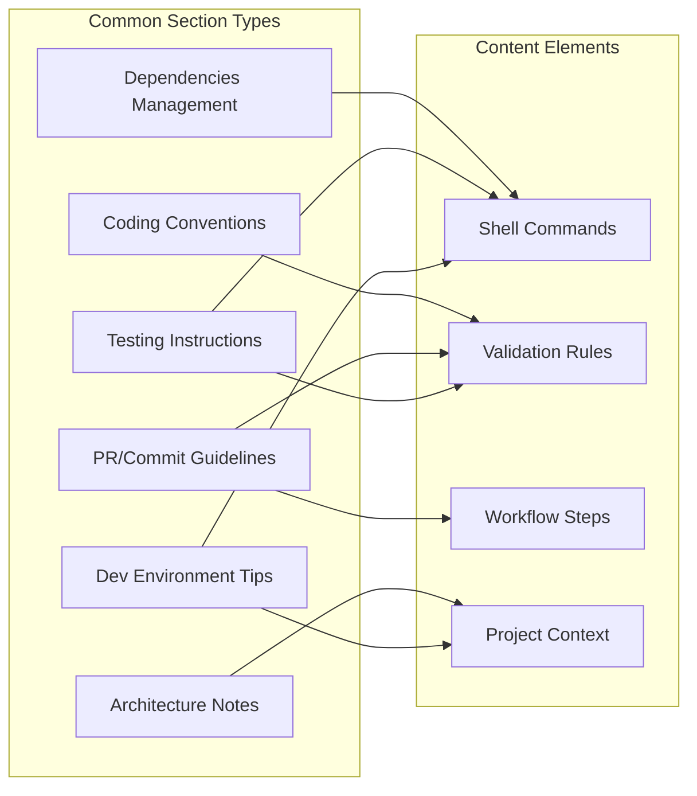
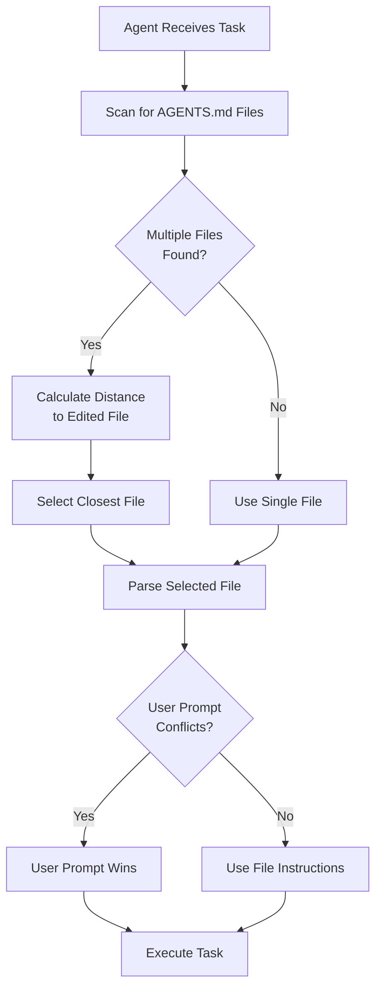
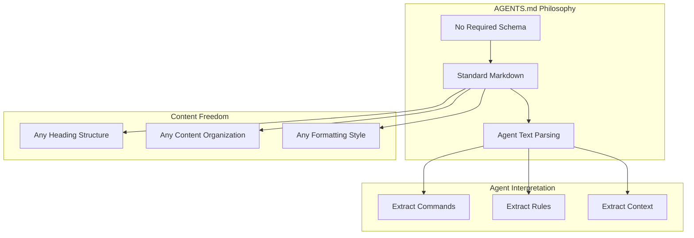

<!-- source: DeepWiki mcp.deepwiki.com · repo agentsmd/agents.md · page 7 AGENTS.md Specification · fetched 2026-10-21 -->

# AGENTS.md Specification

<details>
<summary>Relevant source files</summary>

The following files were used as context for generating this wiki page:

- [AGENTS.md](AGENTS.md)
- [README.md](README.md)
- [components/FAQSection.tsx](components/FAQSection.tsx)
- [components/HowToUseSection.tsx](components/HowToUseSection.tsx)

</details>


This document describes the AGENTS.md file format specification that AI coding agents use to understand project context, conventions, and instructions. AGENTS.md is a standardized Markdown file that serves as a "README for agents" - a dedicated, predictable location for providing guidance to AI-powered development tools.

For information about the website that promotes this specification, see [Overview](#1). For guidance on contributing to the website codebase, see [Development Guide](#6).

## Purpose and Scope

The AGENTS.md format provides a simple, open standard for communicating with AI coding agents. It enables developers to:

- Define project-specific conventions and workflows [AGENTS.md:24-29]()
- Specify testing and validation procedures [README.md:21-28]()
- Document environment setup requirements [README.md:15-19]()
- Guide agents through complex monorepo structures using nested files [components/HowToUseSection.tsx:35-41]()
- Provide context that helps agents make better decisions [README.md:7-9]()

The format imposes no required fields or rigid schema - it is standard Markdown that agents parse for relevant instructions [components/FAQSection.tsx:13-16]().

**Sources:** [README.md:1-33](), [AGENTS.md:1-44](), [components/FAQSection.tsx:13-16](), [components/HowToUseSection.tsx:35-41]()

## Format Overview

AGENTS.md files are plain Markdown documents placed in a repository. Agents discover and parse these files to extract contextual information before making code changes.

### Key Characteristics

| Characteristic | Description |
|---------------|-------------|
| **Format** | Standard Markdown (CommonMark compatible) [components/FAQSection.tsx:15-16]() |
| **Location** | Root directory or subdirectories of a repository [components/HowToUseSection.tsx:10-11]() |
| **Schema** | No required fields - freeform structure [components/FAQSection.tsx:13-16]() |
| **Parsing** | Agents extract text from any headings and sections [components/FAQSection.tsx:15-16]() |
| **Precedence** | Closest file to edited code takes priority [components/FAQSection.tsx:18-21]() |
| **Override** | User chat prompts always override file instructions [components/FAQSection.tsx:20-21]() |

**Sources:** [README.md:5-33](), [components/FAQSection.tsx:13-21](), [components/HowToUseSection.tsx:10-11]()



**Diagram: AGENTS.md File Precedence and Resolution**

**Sources:** [components/FAQSection.tsx:17-21](), [AGENTS.md:1-44](), [components/HowToUseSection.tsx:35-41]()

## Structure and Content Patterns

### Common Sections

While AGENTS.md has no required structure, common organizational patterns have emerged:



**Diagram: Typical AGENTS.md Content Organization**

**Sources:** [README.md:10-33](), [AGENTS.md:8-44](), [components/HowToUseSection.tsx:16-27]()

### Example Structure

The repository includes a reference implementation demonstrating typical section organization:

[README.md:12-33]() shows a minimal example with three main sections:

1. **Dev environment tips** - Navigation and setup commands
2. **Testing instructions** - Test execution and validation workflows  
3. **PR instructions** - Commit and merge requirements

[AGENTS.md:1-44]() provides a more specific example for the Next.js website itself:

1. **Use the Development Server** - Warns against running production builds [AGENTS.md:8-15]()
2. **Keep Dependencies in Sync** - Lockfile management instructions [AGENTS.md:17-22]()
3. **Coding Conventions** - TypeScript and organization preferences [AGENTS.md:24-28]()
4. **Useful Commands Recap** - Command reference table [AGENTS.md:30-37]()

**Sources:** [README.md:10-33](), [AGENTS.md:1-44]()

## Content Patterns and Best Practices

### Command Documentation

AGENTS.md files frequently include shell commands that agents can execute. These commands should be:

- **Specific**: Include exact paths and flags [README.md:16-18]()
- **Contextual**: Explain when to use each command [AGENTS.md:32-37]()
- **Testable**: Agents will attempt to run programmatic checks [components/FAQSection.tsx:23-26]()

**Example pattern from the specification:**

[README.md:16-17]() demonstrates package-specific command patterns:
```
Use `pnpm dlx turbo run where <project_name>` to jump to a package
Run `pnpm install --filter <project_name>` to add the package
```

[AGENTS.md:30-37]() shows command documentation in table format for clarity.

**Sources:** [README.md:15-28](), [AGENTS.md:30-37](), [components/FAQSection.tsx:23-26]()

### Testing Guidance

[components/FAQSection.tsx:23-26]() documents agent behavior regarding testing:

> "Will the agent run testing commands found in AGENTS.md automatically?"  
> "Yes—if you list them. The agent will attempt to execute relevant programmatic checks and fix failures before finishing the task."

Testing sections should specify:

- **Test discovery**: How to locate test configurations [README.md:22]()
- **Execution commands**: Exact commands to run tests [README.md:23-25]()
- **Validation criteria**: What constitutes passing [README.md:26-27]()
- **Debugging steps**: How to focus on specific failures [README.md:25]()

[README.md:22-28]() demonstrates this pattern with Vitest-specific instructions including test filtering and pattern matching.

**Sources:** [README.md:21-28](), [components/FAQSection.tsx:23-26]()

### Workflow Instructions

Agents benefit from explicit workflow documentation:

[README.md:30-33]() shows PR workflow requirements:
- Title formatting conventions
- Pre-commit validation steps
- Required checks before merging

[AGENTS.md:8-15]() provides process warnings about development vs. production builds.

**Sources:** [README.md:30-33](), [AGENTS.md:8-15]()

## Conflict Resolution



**Diagram: AGENTS.md Conflict Resolution Flow**

The specification defines clear precedence rules documented in [components/FAQSection.tsx:17-21]():

| Priority Level | Source | Behavior |
|---------------|--------|----------|
| **Highest** | User chat prompts | Always override file instructions [components/FAQSection.tsx:20-21]() |
| **Medium** | Closest AGENTS.md | File nearest to edited code wins [components/FAQSection.tsx:20]() |
| **Lowest** | Parent AGENTS.md | Inherited from parent directories [components/HowToUseSection.tsx:38-40]() |

**Sources:** [components/FAQSection.tsx:17-21](), [components/HowToUseSection.tsx:35-41]()

## Tool-Specific Integration

### Agent Configuration Patterns

Different AI coding tools support AGENTS.md through various configuration mechanisms:

#### Aider Configuration

[components/FAQSection.tsx:50-66]() documents Aider integration:

Configuration file: `.aider.conf.yml` [components/FAQSection.tsx:54]()

```yaml
read: AGENTS.md
```

This directs Aider to read and incorporate AGENTS.md content into its context window.

#### Gemini CLI Configuration  

[components/FAQSection.tsx:68-86]() shows Gemini CLI setup:

Configuration file: `.gemini/settings.json` [components/FAQSection.tsx:72]()

```json
{
  "context": {
    "fileName": "AGENTS.md"
  }
}
```

This configures Gemini CLI to use AGENTS.md as its primary context file.

**Sources:** [components/FAQSection.tsx:50-86]()

### Migration from Legacy Formats

[components/FAQSection.tsx:32-47]() provides migration guidance for projects using earlier conventions:

```bash
mv AGENT.md AGENTS.md && ln -s AGENTS.md AGENT.md
```

This approach:
1. Renames the file to the standard AGENTS.md format
2. Creates a symbolic link for backward compatibility
3. Allows gradual migration without breaking existing tooling

**Sources:** [components/FAQSection.tsx:32-47]()

## Living Documentation

[components/FAQSection.tsx:28-30]() emphasizes that AGENTS.md is not static:

> "Can I update it later?"  
> "Absolutely. Treat AGENTS.md as living documentation."

The specification encourages:

- **Continuous updates** as project conventions evolve [components/FAQSection.tsx:29]()
- **Version control** alongside code changes [components/HowToUseSection.tsx:32-33]()
- **Team collaboration** on content and structure
- **Iteration** based on agent behavior and outcomes

**Sources:** [components/FAQSection.tsx:28-30](), [components/HowToUseSection.tsx:31-33]()

## Schema Flexibility



**Diagram: AGENTS.md Schema-Free Architecture**

[components/FAQSection.tsx:13-16]() explicitly states:

> "Are there required fields?"  
> "No. AGENTS.md is just standard Markdown. Use any headings you like; the agent simply parses the text you provide."

This design philosophy prioritizes:

- **Developer flexibility** over rigid structure
- **Natural language** over machine-readable schemas
- **Context-specific** organization over universal templates
- **Readability** over programmatic validation

**Sources:** [components/FAQSection.tsx:13-16]()

## Implementation Examples

The repository contains two reference implementations:

### Repository Self-Documentation

[AGENTS.md:1-44]() serves as a working example, demonstrating:

- **Context-specific warnings** about Next.js build modes [AGENTS.md:8-15]()
- **Dependency management** instructions [AGENTS.md:17-22]()
- **Coding conventions** specific to the project [AGENTS.md:24-28]()
- **Command reference** in tabular format [AGENTS.md:30-37]()

### Generic Example

[README.md:12-33]() provides a minimal, portable example showing:

- **Monorepo navigation** with package-specific commands [README.md:16-19]()
- **Testing workflow** with CI integration [README.md:21-28]()
- **PR conventions** with validation requirements [README.md:30-33]()

Both examples demonstrate the format's flexibility while maintaining clarity and actionability.

**Sources:** [AGENTS.md:1-44](), [README.md:10-33]()

## Summary

The AGENTS.md specification defines a simple, flexible format for guiding AI coding agents:

| Aspect | Implementation |
|--------|----------------|
| **Format** | Standard Markdown with no required fields [components/FAQSection.tsx:15]() |
| **Location** | Root or subdirectories - closest file wins [components/FAQSection.tsx:20]() |
| **Override** | User prompts > closest file > parent files [components/FAQSection.tsx:20-21]() |
| **Testing** | Agents execute listed commands automatically [components/FAQSection.tsx:25-26]() |
| **Evolution** | Living documentation updated continuously [components/FAQSection.tsx:29]() |
| **Tool Support** | Aider, Gemini CLI, and 21+ other agents [components/FAQSection.tsx:50-86]() |
| **Migration** | Symlink strategy for backward compatibility [components/FAQSection.tsx:40]() |

The specification's success stems from its simplicity: developers write natural language instructions in Markdown, and agents parse them intelligently without requiring rigid schemas or validation.

**Sources:** [README.md:1-50](), [components/FAQSection.tsx:1-112](), [AGENTS.md:1-44]()

---

