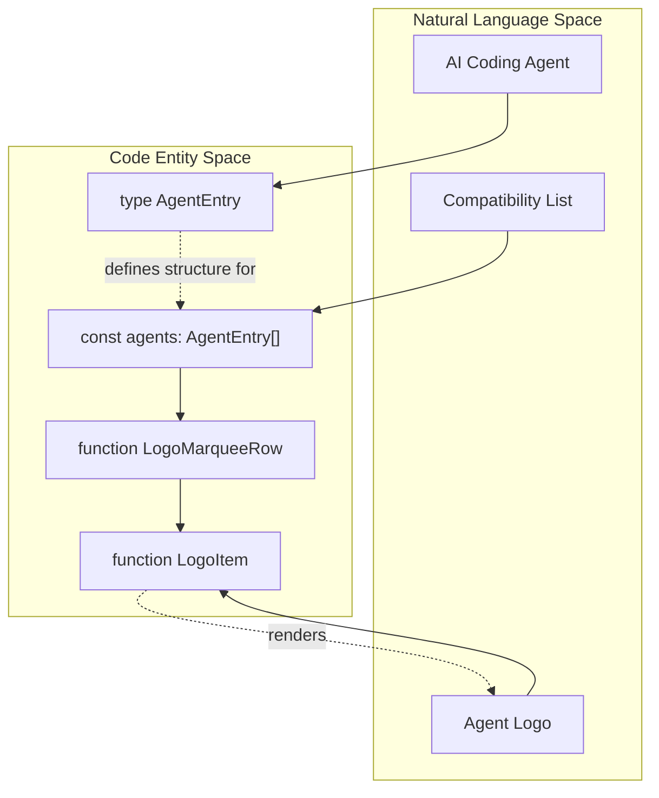
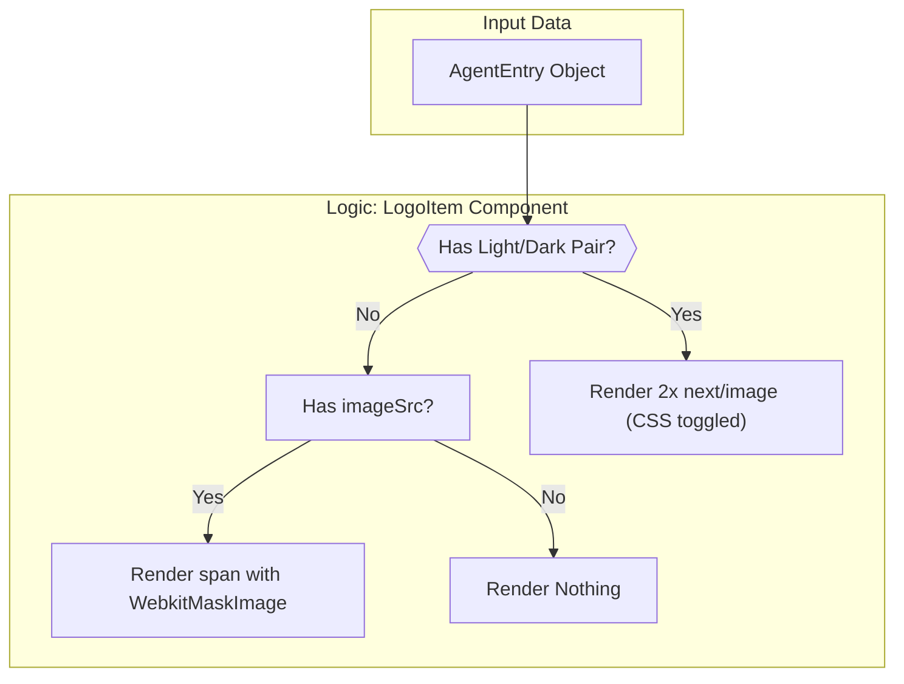

<!-- source: DeepWiki mcp.deepwiki.com · repo agentsmd/agents.md · page 8 Glossary · fetched 2026-10-21 -->

# Glossary

Relevant source files

The following files were used as context for generating this wiki page:

- [README.md](README.md)
- [components/CodeExample.tsx](components/CodeExample.tsx)
- [components/CompatibilitySection.tsx](components/CompatibilitySection.tsx)
- [components/FAQSection.tsx](components/FAQSection.tsx)
- [package.json](package.json)
- [pages/_document.tsx](pages/_document.tsx)
- [pnpm-lock.yaml](pnpm-lock.yaml)
- [public/favicon.ico](public/favicon.ico)
- [public/logos/junie.svg](public/logos/junie.svg)
- [styles/globals.css](styles/globals.css)

This page provides definitions for codebase-specific terminology, architectural patterns, and domain jargon used within the `agents.md` repository. It serves as a technical reference for onboarding engineers to understand how abstract concepts (like the "Marquee") map to specific code implementations.

## Core Terminology

### AGENTS.md Specification
The primary domain object. It is a standard Markdown file format designed to provide context and instructions to AI coding agents [README.md:5-9](). While the website is built with Next.js, the specification itself is tool-agnostic [components/FAQSection.tsx:13-15]().

### Agent Entry
A data structure representing an AI coding agent or IDE that supports (or is compatible with) the AGENTS.md format.
*   **Implementation**: Defined as the `AgentEntry` type [components/CompatibilitySection.tsx:5-12]().
*   **Properties**: Includes `name`, `url`, and optional `imageSrc` or theme-specific variants (`imageSrcLight`, `imageSrcDark`) [components/CompatibilitySection.tsx:6-11]().

### Logo Marquee
The animated, infinite-scrolling horizontal list of agent logos featured on the landing page.
*   **Implementation**: Managed by the `LogoMarqueeRow` component [components/CompatibilitySection.tsx:228-263]().
*   **Animation**: Powered by the `logo-marquee-scroll` CSS keyframe [styles/globals.css:119-126]().
*   **Optimization**: Uses `will-change: transform` for GPU acceleration [styles/globals.css:117]() and respects `prefers-reduced-motion` by disabling animation [styles/globals.css:128-132]().

---

## Technical Concepts & Implementation

### Theme-Aware Assets
The system supports dynamic asset switching based on the user's system preference (Light/Dark mode).

| Term | Implementation Detail | File Pointer |
| :--- | :--- | :--- |
| **Theme-Aware Favicon** | Uses `media` queries in the `<link>` tags within the document head. | [pages/_document.tsx:7-16]() |
| **Theme-Aware Logos** | The `LogoItem` component checks for `imageSrcLight` and `imageSrcDark` props. | [components/CompatibilitySection.tsx:179-194]() |
| **CSS Masking** | For single-variant logos, a `WebkitMaskImage` is used to allow the logo to inherit text colors. | [components/CompatibilitySection.tsx:197-210]() |

### Data Shuffling
To ensure fair visibility for all featured agents, the list is randomized on every page load.
*   **Function**: `shuffleAgents` [components/CompatibilitySection.tsx:144-151]().
*   **Usage**: Executed within a `useEffect` hook inside the `CompatibilitySection` to avoid hydration mismatches between server-rendered and client-rendered random states [components/CompatibilitySection.tsx:268-270]().

### Code Highlighting (Lightweight)
Instead of a heavy syntax highlighting library like Prism or Shiki, the project uses a custom, lightweight parser for Markdown code blocks.
*   **Function**: `parseMarkdown` [components/CodeExample.tsx:66-101]().
*   **Logic**: Splits text by lines and identifies headers (`#`), list items (`-`), and inline code backticks (`` ` ``) [components/CodeExample.tsx:74-117]().

---

## Architecture Diagrams

### Mapping Natural Language to Code Entities: Agent Rendering
This diagram shows how the conceptual "Agent" from the specification maps to specific React components and data structures in the code.

**Sources**: [components/CompatibilitySection.tsx:5-12](), [components/CompatibilitySection.tsx:14-142](), [components/CompatibilitySection.tsx:157-226](), [components/CompatibilitySection.tsx:228-263]()

### Data Flow: Asset Resolution
This diagram illustrates how the system decides which logo variant to render based on the provided data in `AgentEntry`.

**Sources**: [components/CompatibilitySection.tsx:178-212](), [styles/globals.css:88-93]()

---

## Jargon & Abbreviations

*   **AAIF**: AI Alliance Infrastructure Foundation (The organization behind the specification).
*   **Turbopack**: The incremental bundler used in development for fast HMR (Hot Module Replacement) [package.json:6]().
*   **SWC**: The Rust-based platform used for compilation and minification, replacing Babel in the Next.js pipeline.
*   **pnpm**: The performant package manager used for dependency management and workspace filtering [package.json:26](), [README.md:16-27]().

**Sources**: [package.json:1-27](), [README.md:1-33](), [components/CompatibilitySection.tsx:1-263](), [components/CodeExample.tsx:1-208]()