# Page: Overview

# Overview

<details>
<summary>Relevant source files</summary>

The following files were used as context for generating this wiki page:

- [AGENTS.md](AGENTS.md)
- [README.md](README.md)
- [pages/index.tsx](pages/index.tsx)

</details>


## Purpose and Scope

This document provides a high-level introduction to the agents.md repository, explaining its purpose, architecture, and organization. The repository serves as both a **marketing website** and **documentation hub** for the AGENTS.md specification, hosted at https://agents.md. It is built as a Next.js application that showcases AI coding agent adoption and explains the specification format.

For detailed information about specific subsystems:
- For installation and setup instructions, see [Getting Started](#2)
- For deep technical architecture details, see [Architecture](#3)
- For component implementation specifics, see [Components](#4)
- For the AGENTS.md specification itself, see [AGENTS.md Specification](#7)

**Sources:** [README.md:1-50](), [package.json:1-28]()

## What is AGENTS.md

AGENTS.md is a simple, open format for guiding coding agents. The specification defines a standardized markdown file format that provides context and instructions to help AI coding agents work effectively on software projects. Think of it as a README for agents—a dedicated, predictable place where developers can document:

- Development environment tips and workflows [README.md:15-20]()
- Testing instructions and CI/CD patterns [README.md:21-29]()
- Pull request conventions [README.md:30-33]()
- Project-specific guidance for AI assistants [AGENTS.md:1-44]()

The format is used by open-source repositories on GitHub and supports major AI coding tools including Cursor, VS Code with Copilot, Windsurf, Devin, and others.

**Sources:** [README.md:5-33](), [AGENTS.md:1-44]()

## Repository Structure

The repository follows a standard Next.js pages router structure with static assets and configuration files:

```
agents.md/
├── pages/              # Next.js page routes
│   ├── _app.tsx       # Global app wrapper with analytics
│   ├── _document.tsx  # HTML document structure
│   └── index.tsx      # Homepage (landing page) with getStaticProps
├── components/        # React components
├── public/            # Static assets
│   ├── logos/         # Agent logos
│   └── og.png         # Open Graph social preview
├── styles/            # Global CSS
├── package.json       # Dependencies and scripts
├── pnpm-lock.yaml     # pnpm lockfile
├── README.md          # Project documentation
└── AGENTS.md          # Development guidelines for this repo
```

**Sources:** [README.md:35-50](), [pages/index.tsx:1-35](), [AGENTS.md:1-44]()

## Technology Stack

The application uses a modern frontend stack:

| Technology | Purpose |
|-----------|---------|
| **Next.js** | React framework with SSR/SSG [package.json:13]() |
| **React** | UI library [package.json:15]() |
| **TypeScript** | Type safety [package.json:25]() |
| **Tailwind CSS** | Utility-first styling [package.json:23]() |
| **pnpm** | Package manager [README.md:43]() |
| **@vercel/analytics** | Usage tracking [package.json:11]() |

### Native Performance Tooling

The stack leverages Rust-based native binaries for performance:

- **SWC** - Rust-based JavaScript/TypeScript compiler.
- **Turbopack** - Fast development bundler [AGENTS.md:5-6]().
- **Oxide** - Native CSS processing engine for Tailwind.

**Sources:** [package.json:11-26](), [AGENTS.md:1-15](), [README.md:40-47]()

## High-Level System Architecture

The following diagram shows how the major systems interact in the application:

### Application Layer Architecture

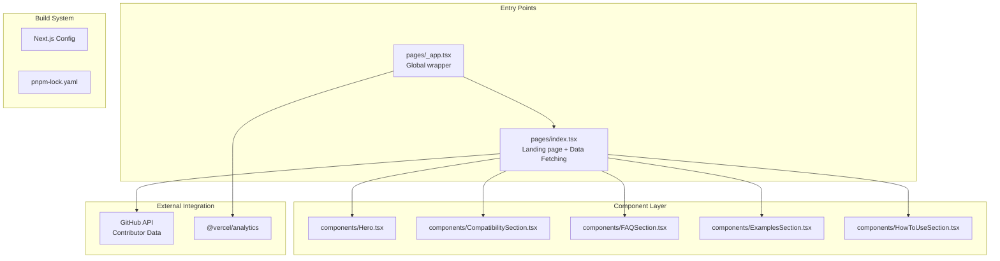

**Sources:** [pages/index.tsx:1-35](), [pages/index.tsx:47-160](), [package.json:1-28]()

### Code Entity Mapping

The following diagram maps natural language system names to specific code entities:

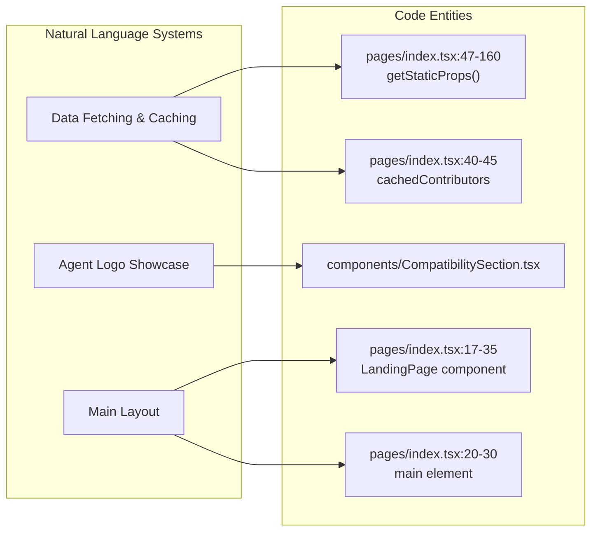

**Sources:** [pages/index.tsx:17-160](), [pages/index.tsx:1-12]()

## Core Application Flow

The application initialization and rendering flow follows this sequence, including the static data fetching process:

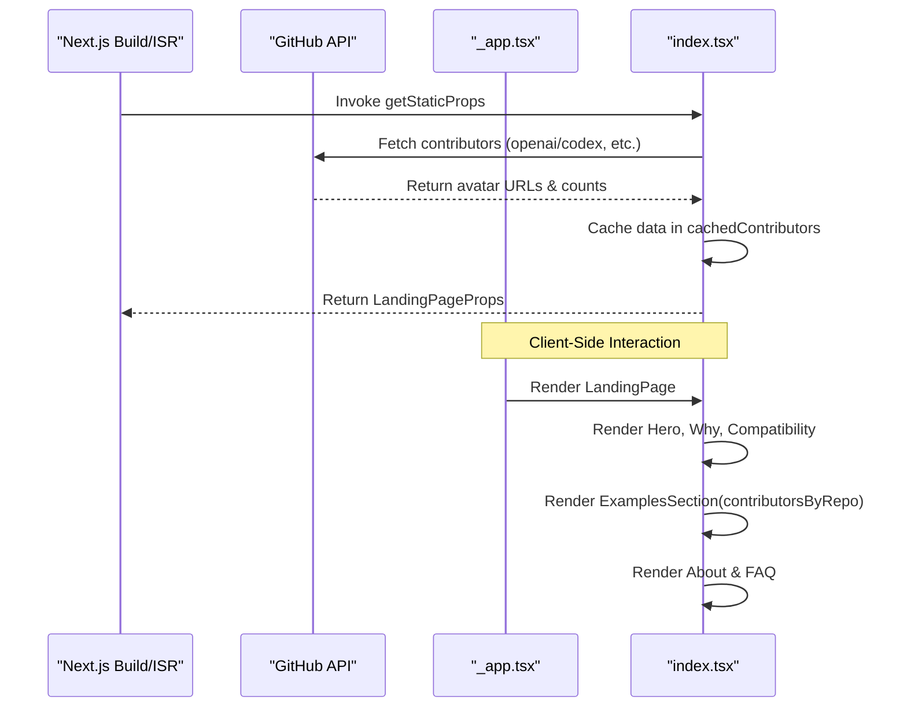

**Sources:** [pages/index.tsx:17-160](), [pages/index.tsx:47-55]()

## Key Systems Overview

The repository consists of several major systems:

| System | Primary Components | Purpose |
|--------|-------------------|---------|
| **Next.js Foundation** | `_app.tsx`, `index.tsx` | Application shell and page routing. |
| **Data Layer** | `getStaticProps` | Fetches contributor data from GitHub for specific repositories [pages/index.tsx:47-160](). |
| **Component System** | `Hero`, `CompatibilitySection`, `ExamplesSection` | UI components for content sections. |
| **Asset Management** | `public/logos/` | Static resources for agent tools. |
| **Build Pipeline** | `package.json`, pnpm | Development and production build tooling. |

### Data Fetching and Caching

The `pages/index.tsx` file implements a sophisticated `getStaticProps` function that:
- Fetches top 3 contributor avatars and total counts for featured repositories like `openai/codex` and `apache/airflow` [pages/index.tsx:50-55]().
- Uses an in-memory `cachedContributors` object to avoid hitting GitHub rate limits during development and build [pages/index.tsx:40-45]().
- Implements conditional `Authorization` headers if `GH_AUTH_TOKEN` is present [pages/index.tsx:92-94]().
- Sets a revalidation period of 24 hours in production [pages/index.tsx:158]().

**Sources:** [pages/index.tsx:40-160]()

## Development Commands

The repository provides standard scripts for development:

| Command | Purpose | Notes |
|---------|---------|-------|
| `pnpm dev` | Start development server | Recommended for iteration [AGENTS.md:10-11](). |
| `pnpm build` | Production build | Do not run during active agent sessions [AGENTS.md:12-15](). |
| `pnpm lint` | Run ESLint checks | Code quality validation [package.json:8](). |

**Important:** When working with AI coding agents, always use `pnpm dev` to maintain hot module replacement (HMR) functionality [AGENTS.md:8-16]().

**Sources:** [package.json:5-10](), [AGENTS.md:8-15](), [README.md:40-49]()

---

# Page: Getting Started

# Getting Started

<details>
<summary>Relevant source files</summary>

The following files were used as context for generating this wiki page:

- [README.md](README.md)
- [package.json](package.json)
- [pnpm-lock.yaml](pnpm-lock.yaml)

</details>


This document provides step-by-step instructions for setting up the development environment and running the agents.md website locally. For information about the overall architecture, see [Architecture](). For detailed component documentation, see [Components]().

---

## Purpose and Scope

This guide covers:
- Installing dependencies using `pnpm`
- Running the Next.js development server with Turbopack
- Understanding available npm scripts
- Navigating the technology stack

---

## Prerequisites

Before starting, ensure you have the following installed:

| Tool | Required Version | Purpose |
|------|------------------|---------|
| Node.js | `^18.18.0`, `^19.8.0`, or `>= 20.0.0` | JavaScript runtime |
| pnpm | `9.15.1` | Package manager |

**Sources:** [pnpm-lock.yaml:1](), [package.json:26]()

---

## Installation

### Step 1: Clone the Repository

```bash
git clone https://github.com/agentsmd/agents.md.git
cd agents.md
```

### Step 2: Install Dependencies

The project uses `pnpm` as its package manager [package.json:26](). Install all dependencies:

```bash
pnpm install
```

This command reads [package.json:1-27]() and installs:
- **Core framework:** `next: 16.1.0`, `react: 19.2.3`, `react-dom: 19.2.3` [package.json:14-16]()
- **Styling:** `tailwindcss: 4.1.11`, `@tailwindcss/postcss: 4.1.11` [package.json:12,17]()
- **Analytics:** `@vercel/analytics: ^1.5.0` [package.json:13]()
- **Development tools:** `typescript: 5`, `@types/node: 20`, `@types/react: 19`, `@types/react-dom: 19`, `@svgr/webpack: ^8.1.0` [package.json:20-24]()

The lockfile [pnpm-lock.yaml:1]() ensures deterministic, reproducible installs.

**Dependency Installation Flow:**

```mermaid
graph TD
    "Dev"["Developer runs<br/>pnpm install"] --> "ReadPackage"["Read package.json<br/>Dependencies & Scripts"]
    "ReadPackage" --> "ReadLock"["Read pnpm-lock.yaml<br/>Lockfile v6.0"]
    "ReadLock" --> "FetchPkgs"["Fetch packages from registry"]
    "FetchPkgs" --> "InstallNext"["Install next@16.1.0<br/>+ Turbopack/SWC binaries"]
    "FetchPkgs" --> "InstallReact"["Install react@19.2.3<br/>react-dom@19.2.3"]
    "FetchPkgs" --> "InstallTailwind"["Install tailwindcss@4.1.11<br/>+ PostCSS plugin"]
    "FetchPkgs" --> "InstallDevDeps"["Install TypeScript 5.9.2<br/>@svgr/webpack@8.1.0"]
    "InstallNext" --> "NodeModules"["Populate node_modules/"]
    "InstallReact" --> "NodeModules"
    "InstallTailwind" --> "NodeModules"
    "InstallDevDeps" --> "NodeModules"
    "NodeModules" --> "Ready"["Development environment ready"]
```

**Sources:** [package.json:11-27](), [pnpm-lock.yaml:1-43](), [README.md:41-44]()

---

## Running the Development Server

### Start the Server

Use the `dev` script to start the Next.js development server with Turbopack enabled [package.json:6]():

```bash
pnpm run dev
```

This executes the command:
```json
"dev": "next dev --turbopack"
```

**What happens when you run this command:**

```mermaid
graph LR
    "DevCmd"["pnpm run dev"] --> "NextDev"["next dev --turbopack"]
    "NextDev" --> "Turbopack"["Turbopack bundler<br/>Rust-based compilation"]
    "NextDev" --> "LoadConfig"["Load next.config.js<br/>Tailwind config"]
    "Turbopack" --> "CompilePages"["Compile pages/_app.tsx<br/>pages/_document.tsx"]
    "LoadConfig" --> "InitTailwind"["Initialize Tailwind CSS 4.1.11"]
    "CompilePages" --> "StartServer"["Start HTTP server<br/>on localhost:3000"]
    "InitTailwind" --> "StartServer"
    "StartServer" --> "HMR"["Enable Hot Module Replacement"]
    "StartServer" --> "Ready"["Open http://localhost:3000<br/>in browser"]
```

### Access the Application

Once the server is running, open your browser and navigate to:

```
http://localhost:3000
```

**Sources:** [README.md:45-49](), [package.json:6]()

---

## Available Scripts

The [package.json:5-10]() defines the following scripts:

| Script | Command | Purpose |
|--------|---------|---------|
| `pnpm dev` | `next dev --turbopack` | Start development server with Turbopack |
| `pnpm build` | `next build` | Build production-optimized static assets |
| `pnpm start` | `next start` | Serve the production build |
| `pnpm lint` | `next lint` | Run ESLint checks |

**Script Execution Flow:**

```mermaid
graph TD
    "DevFlow"["Development Workflow"]
    "ProdFlow"["Production Workflow"]
    
    "DevFlow" --> "PnpmDev"["pnpm run dev"]
    "PnpmDev" --> "DevServer"["next dev --turbopack<br/>Port 3000"]
    "DevServer" --> "IterDev"["Iterative development<br/>HMR updates"]
    
    "ProdFlow" --> "PnpmBuild"["pnpm run build"]
    "PnpmBuild" --> "NextBuild"["next build<br/>Optimizes assets"]
    "NextBuild" --> "PnpmStart"["pnpm run start"]
    "PnpmStart" --> "ProdServer"["Production server"]
```

**Sources:** [package.json:5-10](), [README.md:40-49]()

---

## Technology Stack

### Core Framework and Libraries

```mermaid
graph TB
    subgraph "Frontend Framework"
        "Next"["next@16.1.0"]
        "React"["react@19.2.3"]
        "ReactDOM"["react-dom@19.2.3"]
    end
    
    subgraph "Build & Performance"
        "Turbopack"["Turbopack<br/>Rust bundler"]
        "SWC"["SWC<br/>Rust compiler"]
    end
    
    subgraph "Styling System"
        "Tailwind"["tailwindcss@4.1.11"]
        "TailwindPost"["@tailwindcss/postcss@4.1.11"]
    end
    
    subgraph "Development Tools"
        "TS"["typescript@5.9.2"]
        "SVGR"["@svgr/webpack@8.1.0"]
    end
    
    "Next" --> "React"
    "Next" --> "ReactDOM"
    "Next" --> "Turbopack"
    "Next" --> "SWC"
    "Tailwind" --> "TailwindPost"
    "Next" --> "TS"
    "Next" --> "SVGR"
```

### Key Technologies Explained

| Technology | Version | Role |
|------------|---------|------|
| **Next.js** | 16.1.0 | Pages Router framework [package.json:14]() |
| **React** | 19.2.3 | UI library [package.json:15]() |
| **Turbopack** | Enabled | Rust-based bundler for development [package.json:6]() |
| **Tailwind CSS** | 4.1.11 | Utility-first CSS framework [package.json:17]() |
| **TypeScript** | 5.9.2 | Type-safe development [pnpm-lock.yaml:42]() |

**Sources:** [package.json:11-25](), [pnpm-lock.yaml:14-43]()

---

## Verification Steps

After starting the development server, verify the setup:

1. **Check Server Output:** Ensure Next.js reports "Ready" and "Turbopack enabled" [package.json:6]().
2. **Verify Page Loads:** Visit `http://localhost:3000` [README.md:49]().
3. **Test HMR:** Edit a component file; the browser should update without a full refresh.

**Sources:** [README.md:45-49](), [package.json:6]()

---

# Page: Architecture

# Architecture

<details>
<summary>Relevant source files</summary>

The following files were used as context for generating this wiki page:

- [next.config.ts](next.config.ts)
- [pages/_app.tsx](pages/_app.tsx)
- [pages/index.tsx](pages/index.tsx)

</details>


This document describes the high-level architecture of the agents.md Next.js application, including the page rendering pipeline, component organization, and build system structure. For detailed information about specific components, see [Components](#4). For build system specifics, see [Build System and Dependencies](#3.2). For static asset management, see [Static Assets](#5).

## Application Structure

The agents.md repository is a **Next.js 15.4.8** application using the **Pages Router** pattern. The architecture follows a standard Next.js marketing site structure with global wrappers, page components, and static assets.

### Directory Layout

```
agents.md/
├── pages/                    # Next.js pages
│   ├── _app.tsx             # Global application wrapper
│   ├── _document.tsx        # HTML document shell
│   └── index.tsx            # Main landing page
├── components/              # React components
│   ├── Hero.tsx
│   ├── CompatibilitySection.tsx
│   ├── FAQSection.tsx
│   ├── ExamplesSection.tsx
│   └── Footer.tsx
├── public/                  # Static assets
│   ├── logos/              # Agent logo images
│   ├── favicon-*.png       # Theme-aware favicons
│   └── og.png              # Social media preview
└── styles/                  # Global CSS
    └── globals.css
```

**Sources:** [package.json:1-27](), [pages/index.tsx:1-35](), [pages/_app.tsx:1-24]()

## Next.js Foundation Architecture

The application uses the Next.js Pages Router with two critical global files that wrap all page content:

### Global Application Flow

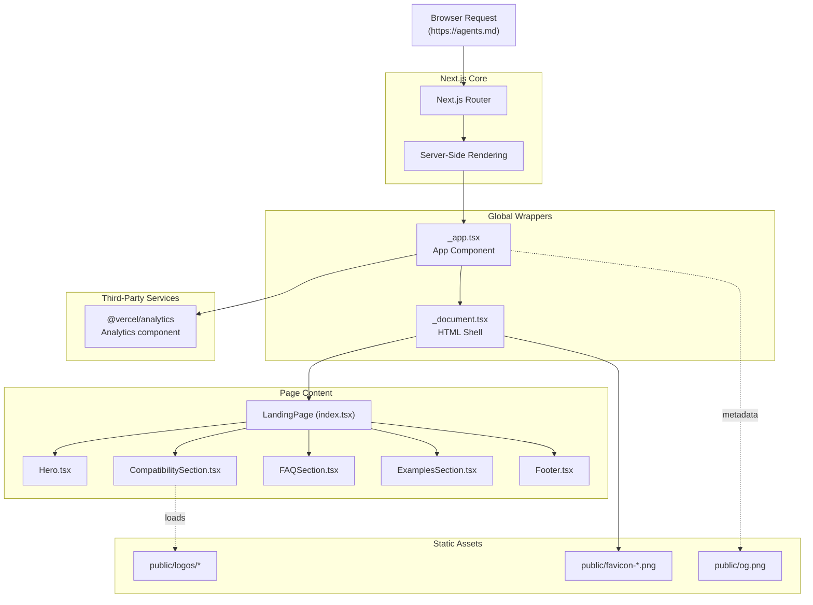

**Sources:** [pages/_app.tsx:1-24](), [pages/index.tsx:17-35](), [components/Hero.tsx:1-72]()

### `_app.tsx` - Global Application Wrapper

The `_app.tsx` file wraps every page and handles:

- **Global CSS imports**: `@/styles/globals.css` [pages/_app.tsx:1]()
- **SEO metadata**: Title, description, Open Graph tags, and Twitter Card metadata [pages/_app.tsx:7-20]()
- **Analytics integration**: Vercel Analytics component [pages/_app.tsx:4,22]()
- **Page props injection**: Passes `pageProps` to each page component [pages/_app.tsx:21]()

For more details on the global shell, see [Next.js Foundation](#3.1).

**Sources:** [pages/_app.tsx:1-24]()

## Page Rendering Pipeline

The rendering pipeline utilizes Next.js Static Site Generation (SSG) with `getStaticProps` to fetch data at build time:

### Data Fetching and Hydration

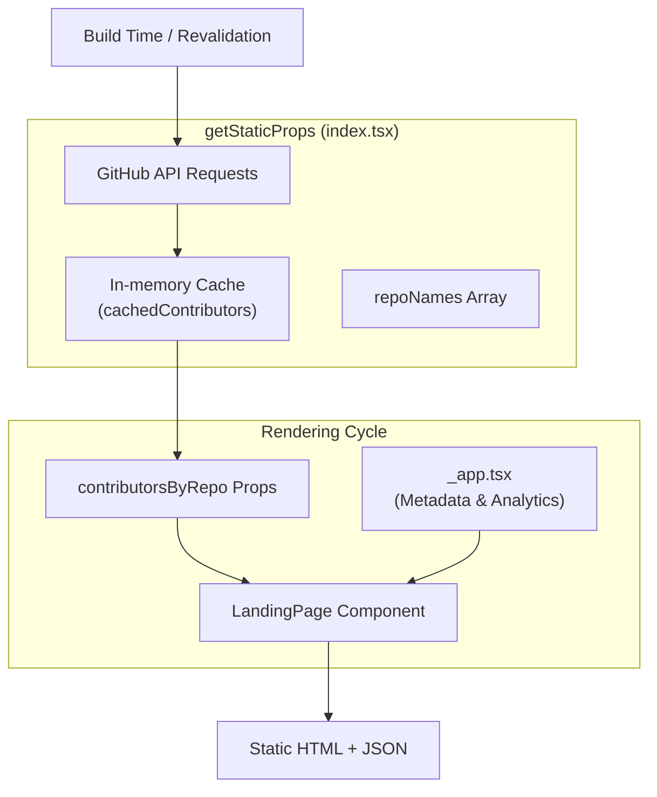

**Key Implementation Details:**
- **GitHub API Integration**: Fetches top 3 contributor avatars and total contributor counts for featured repositories [pages/index.tsx:96-145]().
- **Caching Strategy**: Implements an in-memory cache `cachedContributors` to prevent hitting GitHub rate limits during development and build processes [pages/index.tsx:40-45]().
- **Revalidation**: Configured to revalidate every 24 hours in production [pages/index.tsx:158]().

**Sources:** [pages/index.tsx:40-160]()

## Component Hierarchy

The landing page is composed of several major sections, each implemented as a standalone React component:

### Component Tree

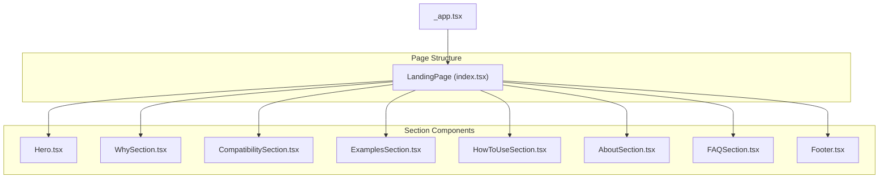

### Component Responsibilities

| Component | Purpose | Key Data | File Reference |
|-----------|---------|----------|----------------|
| `Hero` | Primary landing section with code preview | `HERO_AGENTS_MD` | [components/Hero.tsx:1-72]() |
| `CompatibilitySection` | Animated showcase of AI coding agents | `agents` array | [pages/index.tsx:23]() |
| `ExamplesSection` | Grid of example repositories | `contributorsByRepo` | [pages/index.tsx:24]() |
| `FAQSection` | Frequently Asked Questions | Static content | [pages/index.tsx:28]() |

**Sources:** [pages/index.tsx:17-35]()

## Build System Architecture

The build system uses modern JavaScript tooling with native Rust-based components for performance. For detailed documentation on the pipeline and native tooling, see [Build System and Dependencies](#3.2).

### Build Pipeline Components

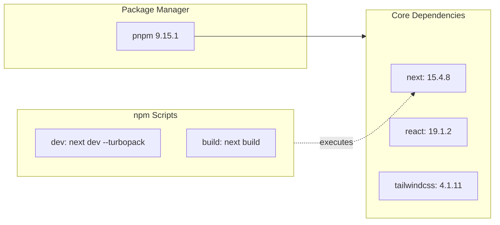

**Key Features:**
- **Turbopack**: Used in development for fast HMR [package.json:6]().
- **Strict Mode**: Enabled for React to catch potential issues [next.config.ts:5]().

**Sources:** [package.json:1-27](), [next.config.ts:1-8]()

---

# Page: Next.js Foundation

# Next.js Foundation

<details>
<summary>Relevant source files</summary>

The following files were used as context for generating this wiki page:

- [next-env.d.ts](next-env.d.ts)
- [pages/_app.tsx](pages/_app.tsx)
- [pages/_document.tsx](pages/_document.tsx)
- [public/favicon.ico](public/favicon.ico)
- [tsconfig.json](tsconfig.json)

</details>


This document describes the foundational Next.js configuration files that establish the global application wrapper, HTML document structure, metadata, and analytics integration for the agents.md marketing website. These files provide the structural foundation upon which all page components render.

For information about the build system and dependency management, see [Build System and Dependencies](). For information about individual page components, see [Components]().

---

## Application Architecture Overview

The Next.js foundation consists of two special files that wrap all page content and define the HTML structure:

**Next.js Foundation Structure**
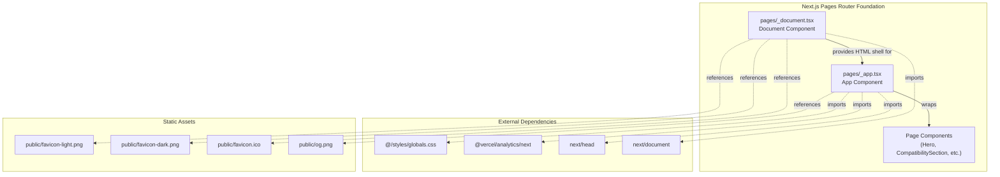

**Sources:** [pages/_app.tsx:1-24](), [pages/_document.tsx:1-25]()

---

## Global App Wrapper (_app.tsx)

The `App` component in [pages/_app.tsx:5-24]() serves as the global wrapper for all pages in the application. It receives two props from Next.js: `Component` (the active page component) and `pageProps` (data for that page).

### Component Structure

**App Component Data Flow**
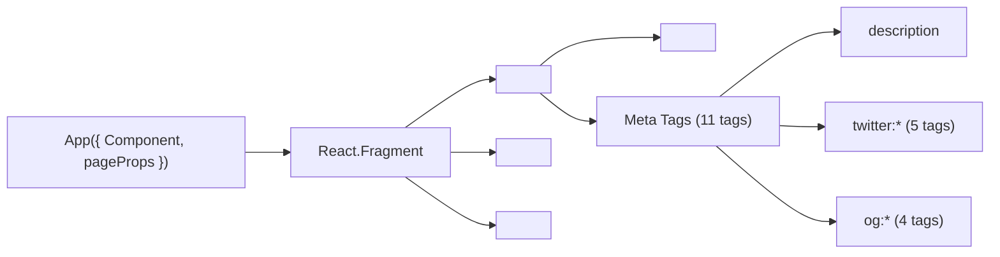

**Sources:** [pages/_app.tsx:5-24]()

### Metadata Configuration

The component defines comprehensive metadata for SEO and social media sharing:

| Metadata Type | Fields | Purpose |
|---------------|--------|---------|
| **Basic** | `<title>`, `description` | Page title and search engine description [pages/_app.tsx:8-9]() |
| **Twitter Card** | `twitter:card`, `twitter:title`, `twitter:description`, `twitter:image`, `twitter:domain`, `twitter:url` | Rich previews when shared on Twitter/X [pages/_app.tsx:10-15]() |
| **Open Graph** | `og:type`, `og:title`, `og:description`, `og:image` | Rich previews on Facebook, LinkedIn, etc. [pages/_app.tsx:16-19]() |

All social media metadata points to `https://agents.md/og.png` for the preview image [pages/_app.tsx:13](), [pages/_app.tsx:19]().

**Sources:** [pages/_app.tsx:7-20]()

### Analytics Integration

The component integrates Vercel Analytics by importing and rendering the `<Analytics />` component:

**Analytics Integration**
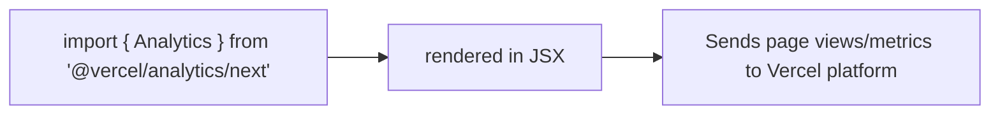

This provides automatic tracking of page views, Web Vitals, and other metrics without manual instrumentation.

**Sources:** [pages/_app.tsx:4](), [pages/_app.tsx:22]()

---

## HTML Document Shell (_document.tsx)

The `Document` component in [pages/_document.tsx:3-24]() defines the root HTML structure that wraps the entire application. Unlike `_app.tsx` which re-renders on navigation, `_document.tsx` only renders once on the server.

### HTML Structure

**Document Component Layout**
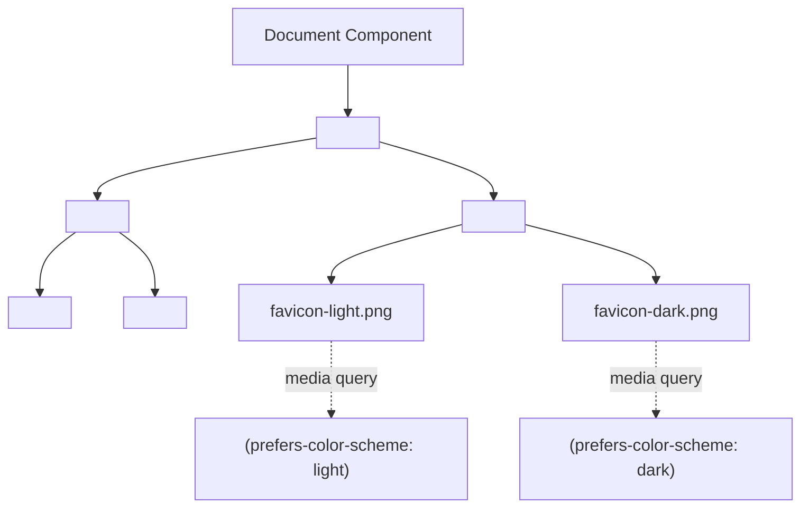

**Sources:** [pages/_document.tsx:1-25]()

### Theme-Aware Favicon System

The document implements a favicon system that responds to the user's system theme preference using CSS media queries:

**Theme-Aware Favicon Logic**
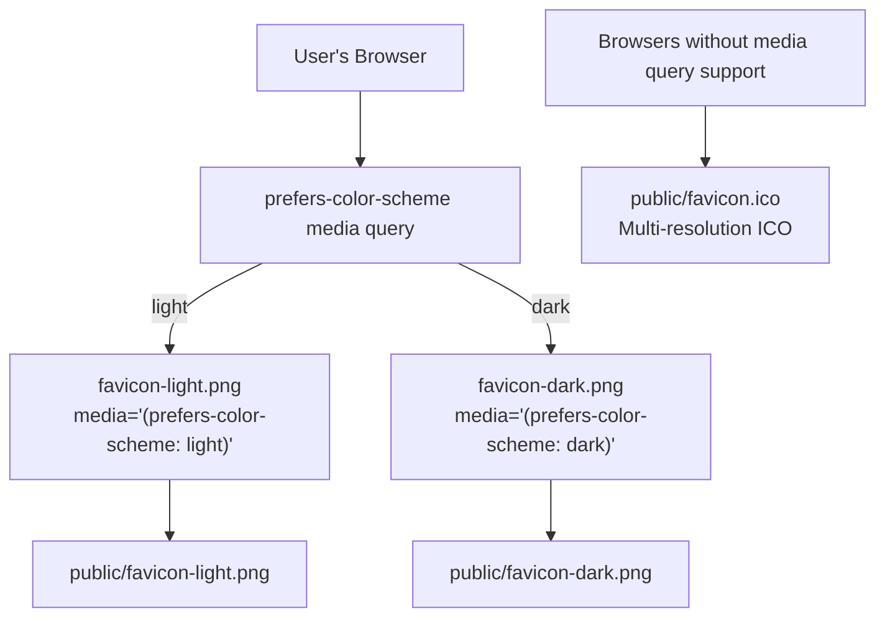

The implementation uses two `<link>` elements with different `media` attributes:

| Attribute | Value | File | Purpose |
|-----------|-------|------|---------|
| `rel` | `"icon"` | Both | Declares the link as a favicon [pages/_document.tsx:8](), [pages/_document.tsx:13]() |
| `href` | `"/favicon-light.png"` | Light | Path to light theme favicon [pages/_document.tsx:9]() |
| `href` | `"/favicon-dark.png"` | Dark | Path to dark theme favicon [pages/_document.tsx:14]() |
| `media` | `"(prefers-color-scheme: light)"` | Light | Only applies in light mode [pages/_document.tsx:10]() |
| `media` | `"(prefers-color-scheme: dark)"` | Dark | Only applies in dark mode [pages/_document.tsx:15]() |

**Sources:** [pages/_document.tsx:7-16]()

### Body Styling

The `<body>` element includes the `antialiased` class, which is a Tailwind CSS utility that applies font smoothing for improved text rendering [pages/_document.tsx:18]().

---

## Render Pipeline

The following diagram illustrates how these foundation components integrate into the Next.js server-side rendering pipeline:

**Next.js Foundation Render Sequence**
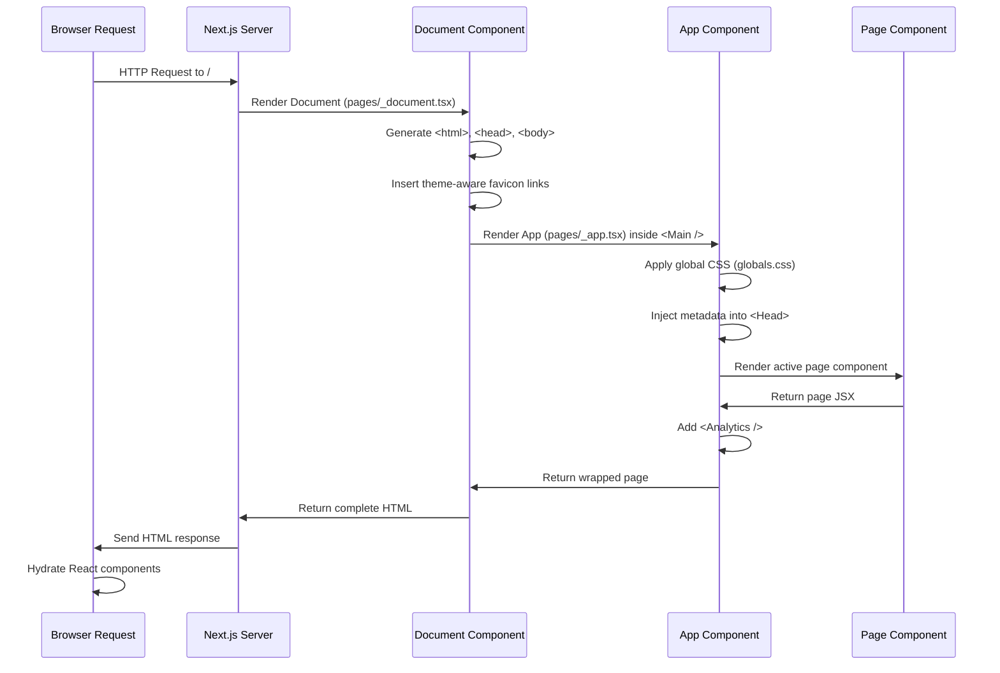

**Sources:** [pages/_document.tsx:3-24](), [pages/_app.tsx:5-24]()

---

## Key Imports and Dependencies

| Import | Source | Purpose |
|--------|--------|---------|
| `AppProps` | `next/app` | TypeScript type for App component props [pages/_app.tsx:2]() |
| `Head` | `next/head` | Component for modifying `<head>` content [pages/_app.tsx:3]() |
| `Html`, `Head`, `Main`, `NextScript` | `next/document` | Components for custom Document structure [pages/_document.tsx:1]() |
| `Analytics` | `@vercel/analytics/next` | Vercel analytics tracking [pages/_app.tsx:4]() |
| `globals.css` | `@/styles/globals.css` | Global Tailwind CSS styles [pages/_app.tsx:1]() |

**Sources:** [pages/_app.tsx:1-4](), [pages/_document.tsx:1]()

---

# Page: Build System and Dependencies

# Build System and Dependencies

<details>
<summary>Relevant source files</summary>

The following files were used as context for generating this wiki page:

- [next.config.ts](next.config.ts)
- [package.json](package.json)
- [pnpm-lock.yaml](pnpm-lock.yaml)
- [postcss.config.mjs](postcss.config.mjs)

</details>


This document describes the build system, dependency management, and native tooling infrastructure for the agents.md repository. It covers package management with pnpm, the Next.js 16 build pipeline, platform-specific native binaries, and development workflows.

For information about the Next.js application configuration and runtime behavior, see [Next.js Foundation](#3.1). For deployment and production builds, see [Development Guide](#6).

## Overview

The build system is based on **Next.js 16.1.0** with **pnpm 9.15.1** as the package manager. The project leverages modern Rust-based tooling for performance: Turbopack for development bundling, SWC for JavaScript/TypeScript compilation, and Oxide for CSS processing. All dependencies are locked to specific versions in [pnpm-lock.yaml:1-43]() using lockfile version 6.0.

**Sources:** [package.json:1-27](), [pnpm-lock.yaml:1-6]()

---

## Package Manager: pnpm

The project uses **pnpm 9.15.1** as specified in [package.json:26](). pnpm provides efficient disk space usage through content-addressable storage and strict dependency isolation.

### Lockfile Configuration

The lockfile uses version `6.0` with the following settings:

| Setting | Value | Purpose |
|---------|-------|---------|
| `lockfileVersion` | `6.0` | pnpm lockfile format |
| `autoInstallPeers` | `true` | Automatically install peer dependencies |
| `excludeLinksFromLockfile` | `false` | Include symlinked dependencies in lockfile |

The lockfile contains the resolved dependency tree with precise version resolutions and integrity hashes. The structure includes root `dependencies` and `devDependencies` sections.

**Lockfile Structure:**

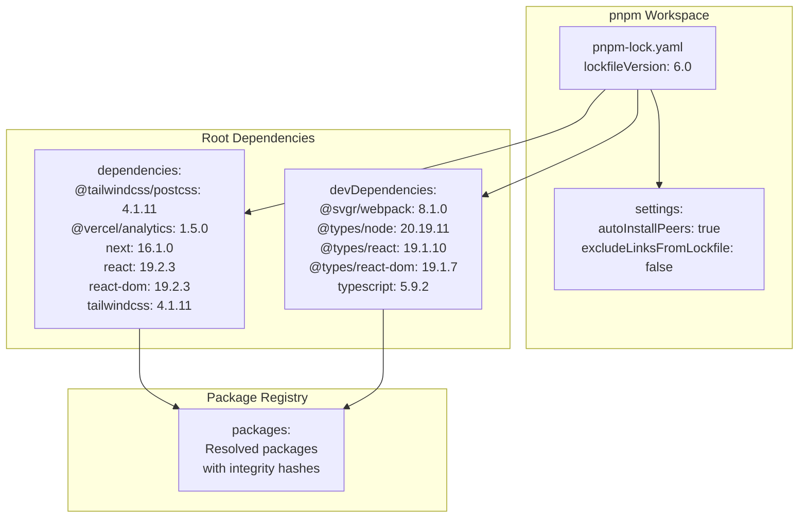

**Sources:** [pnpm-lock.yaml:1-45](), [package.json:26]()

---

## Core Dependencies

The application has **6 production dependencies** and **5 development dependencies** as defined in [package.json:11-25]().

### Production Dependencies

| Package | Version | Purpose |
|---------|---------|---------|
| `next` | `16.1.0` | React framework with SSR/SSG capabilities [package.json:14]() |
| `react` | `19.2.3` | UI library (React 19) [package.json:15]() |
| `react-dom` | `19.2.3` | React DOM renderer [package.json:16]() |
| `tailwindcss` | `4.1.11` | Utility-first CSS framework [package.json:17]() |
| `@tailwindcss/postcss` | `4.1.11` | PostCSS plugin for Tailwind [package.json:12]() |
| `@vercel/analytics` | `^1.5.0` | Web analytics tracking [package.json:13]() |

### Development Dependencies

| Package | Version | Purpose |
|---------|---------|---------|
| `typescript` | `5` (resolved to `5.9.2`) | TypeScript compiler [package.json:24]() |
| `@types/node` | `20` (resolved to `20.19.11`) | Node.js type definitions [package.json:21]() |
| `@types/react` | `19` (resolved to `19.1.10`) | React type definitions [package.json:22]() |
| `@types/react-dom` | `19` (resolved to `19.1.7`) | React DOM type definitions [package.json:23]() |
| `@svgr/webpack` | `^8.1.0` | Webpack loader for importing SVGs as React components [package.json:20]() |

**Version Resolution Flow:**

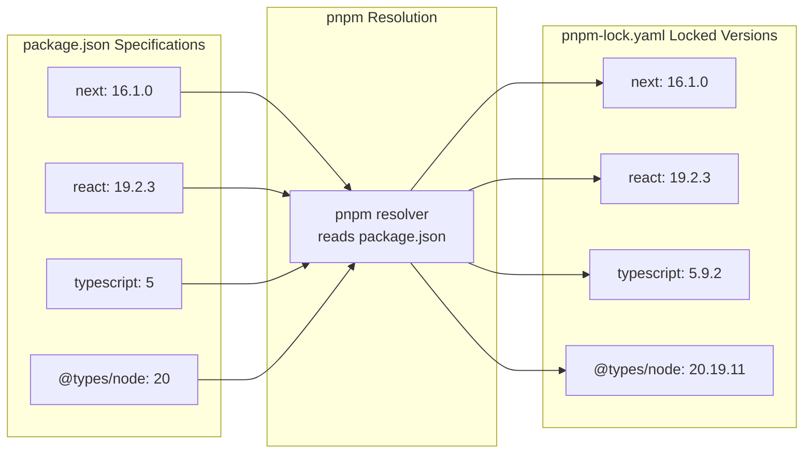

**Sources:** [package.json:11-25](), [pnpm-lock.yaml:7-43]()

---

## Native Tooling and Build Pipeline

The build system relies heavily on **Rust-based native binaries** provided by Next.js and Tailwind CSS for performance-critical operations.

### Next.js SWC and Turbopack

Next.js 16 uses **SWC (Speedy Web Compiler)** for JavaScript/TypeScript transpilation and **Turbopack** for the development bundler. These tools replace traditional JavaScript-based tools like Babel and Webpack with high-performance native binaries.

### Tailwind CSS v4 (Oxide)

The project uses Tailwind CSS 4.1.11, which introduces the **Oxide** engine. This is a high-performance engine written in Rust that handles CSS processing. The integration is managed via `@tailwindcss/postcss` in the PostCSS configuration [postcss.config.mjs:1-3]().

**Platform Binary Resolution:**

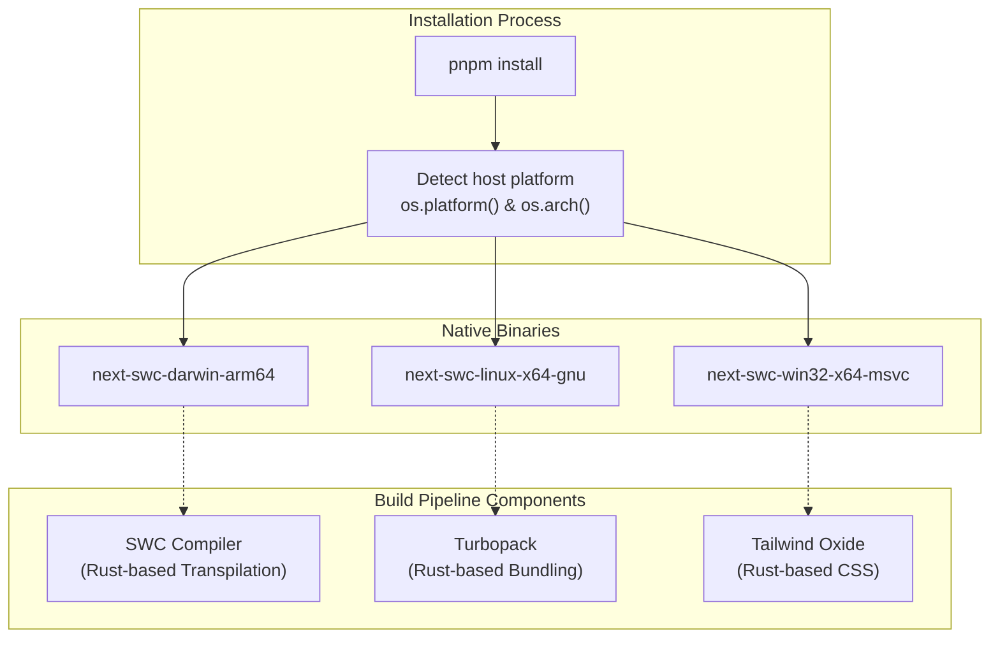

**Sources:** [package.json:6](), [package.json:12-17](), [postcss.config.mjs:1-3]()

---

## Build Scripts and Workflows

The project defines **4 npm scripts** in [package.json:5-9]() for development and production workflows.

### Available Scripts

| Script | Command | Purpose |
|--------|---------|---------|
| `dev` | `next dev --turbopack` | Start development server with Turbopack [package.json:6]() |
| `build` | `next build` | Build production-optimized bundle [package.json:7]() |
| `start` | `next start` | Start production server [package.json:8]() |
| `lint` | `next lint` | Run ESLint checks [package.json:9]() |

### Development Workflow

The development server uses **Turbopack**, Next.js's Rust-based bundler that provides significantly faster hot module replacement (HMR) and cold start times:

```bash
pnpm dev
# Runs: next dev --turbopack
```

Turbopack is explicitly enabled via the `--turbopack` flag in the `dev` script [package.json:6]().

### Production Build Workflow

The production build process involves:
1. **Compilation**: TypeScript to JavaScript via SWC.
2. **Bundling**: Code splitting and asset optimization.
3. **CSS Processing**: Tailwind CSS processing via the `@tailwindcss/postcss` plugin [postcss.config.mjs:2]().
4. **Static Generation**: Pre-rendering pages for optimal performance.

```bash
pnpm build
# Runs: next build
```

**Build Pipeline Flow:**

```mermaid
graph TD
    subgraph "Development Mode"
        DevCmd["pnpm dev"]
        Turbopack["Turbopack<br/>Rust bundler"]
        DevServer["Dev Server<br/>localhost:3000"]
    end
    
    subgraph "Source Files"
        TS["TypeScript/React<br/>next.config.ts"]
        CSS["Tailwind CSS<br/>postcss.config.mjs"]
    end
    
    subgraph "Build Pipeline (pnpm build)"
        NextBuild["next build"]
        SWC["SWC<br/>Native Compilation"]
        Oxide["Oxide Engine<br/>Tailwind v4"]
    end
    
    subgraph "Output"
        NextDir[".next/<br/>Production Build"]
    end
    
    DevCmd --> Turbopack
    Turbopack --> DevServer
    
    TS --> NextBuild
    CSS --> NextBuild
    
    NextBuild --> SWC
    NextBuild --> Oxide
    
    SWC --> NextDir
    Oxide --> NextDir
```

**Sources:** [package.json:5-10](), [postcss.config.mjs:1-5](), [next.config.ts:1-8]()

---

## Dependency Tree Overview

The dependency tree is managed by pnpm and resolved in [pnpm-lock.yaml]().

### Framework and UI
- **next@16.1.0**: Core framework [pnpm-lock.yaml:14]().
- **react@19.2.3**: UI library [pnpm-lock.yaml:17]().
- **react-dom@19.2.3**: DOM renderer [pnpm-lock.yaml:20]().

### Styling
- **tailwindcss@4.1.11**: Utility CSS [pnpm-lock.yaml:23]().
- **@tailwindcss/postcss@4.1.11**: PostCSS integration [pnpm-lock.yaml:8]().

### Transpilation and Types
- **typescript@5.9.2**: Language support [pnpm-lock.yaml:42]().
- **@babel/core@7.28.3**: Used by certain dependencies (like Next.js) for specific transformations [pnpm-lock.yaml:70]().

**Major Dependency Groups:**

```mermaid
graph TD
    subgraph "Application"
        App["agents.md"]
    end
    
    subgraph "Framework Layer"
        Next["next@16.1.0"]
        React["react@19.2.3"]
        ReactDOM["react-dom@19.2.3"]
    end
    
    subgraph "Styling Engine"
        Tailwind["tailwindcss@4.1.11"]
        PostCSS["@tailwindcss/postcss@4.1.11"]
    end
    
    subgraph "Development & Types"
        TS["typescript@5.9.2"]
        TypesNode["@types/node@20.19.11"]
        SVGR["@svgr/webpack@8.1.0"]
    end
    
    App --> Next
    App --> React
    App --> ReactDOM
    App --> Tailwind
    
    Next --> PostCSS
    Tailwind --> PostCSS
    
    Next --> SVGR
    TS --> App
```

**Sources:** [package.json:11-25](), [pnpm-lock.yaml:7-43]()

---

# Page: Components

# Components

<details>
<summary>Relevant source files</summary>

The following files were used as context for generating this wiki page:

- [components/CodeExample.tsx](components/CodeExample.tsx)
- [components/ExamplesSection.tsx](components/ExamplesSection.tsx)
- [components/HowToUseSection.tsx](components/HowToUseSection.tsx)
- [components/Section.tsx](components/Section.tsx)
- [components/WhySection.tsx](components/WhySection.tsx)
- [pages/index.tsx](pages/index.tsx)

</details>


This document provides an overview of the React components that comprise the user interface of the agents.md marketing website. Each component is responsible for rendering a specific section of the landing page, coordinated primarily within the main landing page file.

For detailed architecture of the Next.js application structure, see [Architecture](#3). For information about static assets used by components, see [Logo Asset System](#5.1). Detailed documentation of individual components is provided in the subsections below.

## Component Architecture

The website follows a modular structure where `pages/index.tsx` acts as the orchestrator for various functional sections. All components follow Next.js and React 19 conventions, using TypeScript for type safety and Tailwind CSS for styling.

### Component Hierarchy

```mermaid
graph TB
    subgraph "pages/index.tsx [LandingPage]"
        Index["LandingPage<br/>Main entry point"]
    end
    
    subgraph "Layout & Sections"
        Hero["Hero<br/>components/Hero.tsx"]
        Why["WhySection<br/>components/WhySection.tsx"]
        Compat["CompatibilitySection<br/>components/CompatibilitySection.tsx"]
        Examples["ExamplesSection<br/>components/ExamplesSection.tsx"]
        HowTo["HowToUseSection<br/>components/HowToUseSection.tsx"]
        About["AboutSection<br/>components/AboutSection.tsx"]
        FAQ["FAQSection<br/>components/FAQSection.tsx"]
        Footer["Footer<br/>components/Footer.tsx"]
    end
    
    subgraph "Shared UI primitives"
        Section["Section<br/>components/Section.tsx"]
        CodeExample["CodeExample<br/>components/CodeExample.tsx"]
    end
    
    Index --> Hero
    Index --> Why
    Index --> Compat
    Index --> Examples
    Index --> HowTo
    Index --> About
    Index --> FAQ
    Index --> Footer
    
    Why --> Section
    Compat --> Section
    Examples --> Section
    Examples --> ExampleListSection
    Examples --> CodeExample
    HowTo --> Section
    FAQ --> Section
    FAQ --> CodeExample
```

**Sources:** [pages/index.tsx:17-35](), [components/ExamplesSection.tsx:10-22]()

### Component-to-Code Entity Mapping

This diagram associates high-level UI sections with their specific implementation constants and functions in the codebase.

```mermaid
graph LR
    subgraph "Code Entities (Data)"
        HERO_MD["HERO_AGENTS_MD<br/>CodeExample.tsx"]
        AGENT_DATA["agents array<br/>CompatibilitySection.tsx"]
        FAQ_DATA["faqItems array<br/>FAQSection.tsx"]
        REPO_DATA["REPOS array<br/>ExampleListSection.tsx"]
    end
    
    subgraph "React Components"
        HeroComp["Hero"]
        CompatComp["CompatibilitySection"]
        FAQComp["FAQSection"]
        ExListComp["ExampleListSection"]
    end
    
    HERO_MD -.-> HeroComp
    AGENT_DATA -.-> CompatComp
    FAQ_DATA -.-> FAQComp
    REPO_DATA -.-> ExListComp
    
    subgraph "Logic & Helpers"
        Shuffle["shuffleAgents()<br/>Fisher-Yates logic"]
        ParseMD["parseMarkdown()<br/>Regex highlighting"]
        GetStatic["getStaticProps<br/>GitHub API fetching"]
    end
    
    CompatComp --> Shuffle
    HeroComp --> ParseMD
    ExListComp --> GetStatic
```

**Sources:** [components/CodeExample.tsx:22-32](), [components/CompatibilitySection.tsx:14-131](), [components/FAQSection.tsx:11-87](), [pages/index.tsx:47-160]()

## Component Registry

The following table lists the core components, their file locations, and primary responsibilities:

| Component | File Path | Responsibility |
|-----------|-----------|----------------|
| `LandingPage` | `pages/index.tsx` | Main page assembly and GitHub data fetching via `getStaticProps` |
| `Hero` | `components/Hero.tsx` | Landing page hero section with CTA and code preview |
| `WhySection` | `components/WhySection.tsx` | Explains the rationale for separating AGENTS.md from README.md |
| `CompatibilitySection` | `components/CompatibilitySection.tsx` | Animated marquee/grid of 21 AI coding agents |
| `ExamplesSection` | `components/ExamplesSection.tsx` | Container for the example code block and repository cards |
| `ExampleListSection` | `components/ExampleListSection.tsx` | Grid of repository examples with dynamic contributor data |
| `HowToUseSection` | `components/HowToUseSection.tsx` | Step-by-step guide for implementing AGENTS.md |
| `FAQSection` | `components/FAQSection.tsx` | Frequently asked questions with tool-specific code snippets |
| `Section` | `components/Section.tsx` | Reusable layout wrapper with title and `prose` styling |
| `CodeExample` | `components/CodeExample.tsx` | Markdown-aware code block with copy-to-clipboard functionality |

**Sources:** [pages/index.tsx:1-35](), [components/Section.tsx:18-44](), [components/CodeExample.tsx:126-207]()

## Data Flow and Fetching

The application uses Next.js `getStaticProps` in the root page to fetch social proof data at build time.

1.  **GitHub API Integration**: `getStaticProps` in `pages/index.tsx` iterates through a list of repository names [pages/index.tsx:50-55]().
2.  **Caching**: It implements an in-memory cache with a 12-hour TTL to avoid rate-limiting during development [pages/index.tsx:40-45]().
3.  **Data Propagation**: The fetched `contributorsByRepo` object is passed as a prop to `LandingPage`, which forwards it to `ExamplesSection` [pages/index.tsx:24](), and finally to `ExampleListSection` [components/ExamplesSection.tsx:19]().

**Sources:** [pages/index.tsx:47-160](), [components/ExamplesSection.tsx:10-22]()

## Component Overview Summaries

### Hero Component
The `Hero` component serves as the initial entry point, featuring the project's primary value proposition and a code preview using `CodeExample`.
For details, see [Hero Component](#4.2).

### CompatibilitySection Component
This is the most complex component in the UI, featuring an animated marquee of agent logos that transitions to a grid on demand.
For details, see [CompatibilitySection Component](#4.1).

### FAQ Section Component
A structured list of questions and answers, including specific technical instructions for tools like Aider or Gemini.
For details, see [FAQ Section Component](#4.3).

### Example List Section
Displays real-world adoption of the specification. It renders repository cards with metadata and contributor avatars fetched from the GitHub API.
For details, see [Example List Section](#4.4).

### Footer and About Components
The `AboutSection` provides historical context regarding the project's origins at AAIF, while the `Footer` provides navigation and attribution.
For details, see [Footer and About Components](#4.5).

### Shared Components

#### Section
The `Section` component [components/Section.tsx:18-44]() is a standardized wrapper that ensures consistent vertical spacing (`gap-6`), typography via Tailwind's `prose` class [components/Section.tsx:38](), and responsive max-width constraints.

#### CodeExample
The `CodeExample` component [components/CodeExample.tsx:126-207]() provides a "pseudo-highlighted" Markdown preview. It uses `parseMarkdown` [components/CodeExample.tsx:66-101]() and `renderLineWithInlineCode` [components/CodeExample.tsx:106-121]() to style headers and backticked code without the overhead of a full Markdown parser. It includes a copy-to-clipboard feature using the `navigator.clipboard` API [components/CodeExample.tsx:136-144]().

**Sources:** [components/Section.tsx:1-45](), [components/CodeExample.tsx:1-207]()

---

# Page: CompatibilitySection Component

# CompatibilitySection Component

<details>
<summary>Relevant source files</summary>

The following files were used as context for generating this wiki page:

- [components/CompatibilitySection.tsx](components/CompatibilitySection.tsx)
- [public/logos/junie.svg](public/logos/junie.svg)
- [styles/globals.css](styles/globals.css)

</details>


**Purpose**: The `CompatibilitySection` component is the primary visual showcase on the agents.md website, displaying 21 AI coding agents and tools that support the AGENTS.md specification format. With an importance score of 31.60, it is the most critical component in the codebase, providing social proof of ecosystem adoption through an animated dual-marquee display or static grid layout.

**Scope**: This page covers the complete implementation of the `CompatibilitySection`, including its data structures, rendering modes, animation system, and logo handling. For information about individual logo assets and their file organization, see [Logo Asset System](#5.1). For other page components, see [Components](#4).

## Component Architecture

The `CompatibilitySection` component is organized into three main sub-components that work together to create the agent showcase:

```mermaid
graph TB
    CompatibilitySection["CompatibilitySection<br/>(Main Component)"]
    Section["Section<br/>(Layout Wrapper)"]
    LogoMarqueeRow["LogoMarqueeRow<br/>(Animated Row)"]
    LogoItem["LogoItem<br/>(Individual Agent)"]
    
    CompatibilitySection --> Section
    Section --> LogoMarqueeRow
    Section --> LogoItem
    LogoMarqueeRow --> LogoItem
    
    subgraph "Data Layer"
        agents["agents: AgentEntry[]<br/>(21 predefined entries)"]
        shuffledAgents["shuffledAgents: AgentEntry[]<br/>(randomized state)"]
        topRow["topRow: AgentEntry[]<br/>(even indices)"]
        bottomRow["bottomRow: AgentEntry[]<br/>(odd indices)"]
    end
    
    subgraph "State Management"
        isInView["isInView: boolean<br/>(animation control)"]
        showGrid["showGrid: boolean<br/>(mode toggle)"]
    end
    
    agents --> shuffledAgents
    shuffledAgents --> topRow
    shuffledAgents --> bottomRow
    
    CompatibilitySection --> agents
    CompatibilitySection --> shuffledAgents
    CompatibilitySection --> isInView
    CompatibilitySection --> showGrid
    
    topRow --> LogoMarqueeRow
    bottomRow --> LogoMarqueeRow
    isInView --> LogoMarqueeRow
```

**Sources**: [components/CompatibilitySection.tsx:1-367]()

## Data Model

### AgentEntry Type

The `AgentEntry` type defines the structure for each AI coding agent displayed in the component:

```mermaid
classDiagram
    class AgentEntry {
        +string name
        +string url
        +string? from
        +string? imageSrc
        +string? imageSrcLight
        +string? imageSrcDark
    }
    
    class LogoItemProps {
        <<extends AgentEntry>>
        +variant?: "marquee" | "grid"
    }
    
    AgentEntry <|-- LogoItemProps
```

| Property | Type | Required | Description |
|----------|------|----------|-------------|
| `name` | `string` | Yes | Display name of the agent/tool |
| `url` | `string` | Yes | External link to agent's documentation or homepage |
| `from` | `string` | No | Organization name (e.g., "OpenAI", "Google", "Cognition") |
| `imageSrc` | `string` | No | Single SVG logo path for CSS masking |
| `imageSrcLight` | `string` | No | Light theme variant logo path |
| `imageSrcDark` | `string` | No | Dark theme variant logo path |

**Logo Path Patterns**: An agent must provide either `imageSrc` OR both `imageSrcLight` and `imageSrcDark`. The `LogoItem` component uses this to determine rendering strategy.

**Sources**: [components/CompatibilitySection.tsx:5-12]()

### Agents Array

The `agents` constant contains 21 predefined entries representing the complete ecosystem of AGENTS.md-compatible tools:

```mermaid
graph LR
    subgraph "Theme-Aware Pairs (4 agents)"
        VSCode["VS Code<br/>imageSrcLight + imageSrcDark"]
        Ona["Ona<br/>imageSrcLight + imageSrcDark"]
        Devin["Devin<br/>imageSrcLight + imageSrcDark"]
        Windsurf["Windsurf<br/>imageSrcLight + imageSrcDark"]
    end
    
    subgraph "CSS-Masked SVGs (17 agents)"
        Codex["Codex<br/>imageSrc"]
        Amp["Amp<br/>imageSrc"]
        Jules["Jules<br/>imageSrc"]
        Cursor["Cursor<br/>imageSrc"]
        Others["+ 13 more agents<br/>imageSrc"]
    end
    
    agents["agents: AgentEntry[]<br/>(21 total)"] --> VSCode
    agents --> Ona
    agents --> Devin
    agents --> Windsurf
    agents --> Codex
    agents --> Amp
    agents --> Jules
    agents --> Cursor
    agents --> Others
```

**Representative Examples**:

| Agent Name | Organization | Logo Type | File Path |
|------------|--------------|-----------|-----------|
| Codex | OpenAI | Single SVG | `/logos/codex.svg` |
| VS Code | (none) | Light/Dark Pair | `/logos/vscode-light.svg`, `/logos/vscode-dark.svg` |
| Devin | Cognition | Light/Dark Pair | `/logos/devin-light.svg`, `/logos/devin-dark.svg` |
| Cursor | (none) | Single SVG | `/logos/cursor.svg` |
| Windsurf | Cognition | Light/Dark Pair | `/logos/windsurf-light.svg`, `/logos/windsurf-dark.svg` |

**Sources**: [components/CompatibilitySection.tsx:14-142]()

### Agent Shuffling

The `shuffleAgents` function randomizes agent order on component mount to provide visual variety across page loads. For details, see [Agent Data and Shuffling](#4.1.1).

**Sources**: [components/CompatibilitySection.tsx:144-151](), [components/CompatibilitySection.tsx:271-274]()

## Rendering Modes

The component supports two display modes controlled by the `showGrid` state variable:

### Marquee Mode (Default)

```mermaid
graph TB
    Container["containerRef<br/>(Intersection Observer target)"]
    TopRow["LogoMarqueeRow<br/>(topRow agents, 70s duration)"]
    BottomRow["LogoMarqueeRow<br/>(bottomRow agents, 80s duration, -35s offset)"]
    
    Container --> TopRow
    Container --> BottomRow
    
    TopRow --> Logo1["LogoItem"]
    TopRow --> Logo2["LogoItem"]
    TopRow --> Logo3["LogoItem"]
    TopRow --> LogoN["LogoItem × N"]
    
    BottomRow --> Logo4["LogoItem"]
    BottomRow --> Logo5["LogoItem"]
    BottomRow --> Logo6["LogoItem"]
    BottomRow --> LogoM["LogoItem × M"]
    
    subgraph "Animation Control"
        isInView["isInView: boolean"]
        Observer["IntersectionObserver"]
    end
    
    Observer --> isInView
    isInView --> TopRow
    isInView --> BottomRow
```

**Characteristics**:
- **Two horizontal rows**: Agents split evenly between top and bottom rows (even/odd indices).
- **Continuous scrolling**: CSS animations move logos from right to left.
- **Performance optimization**: Animations pause when component is out of viewport.
- **Staggered timing**: Bottom row has -35s offset to create visual variety.

For details, see [Marquee Animation System](#4.1.2).

**Sources**: [components/CompatibilitySection.tsx:340-352]()

### Grid Mode

| Property | Value |
|----------|-------|
| Layout | CSS Grid |
| Columns | `grid-cols-2` (mobile), `md:grid-cols-3` (desktop) |
| Gap | `gap-8` |
| Animation | None (static display) |
| Variant | `variant="grid"` passed to `LogoItem` |

Grid mode displays all 21 agents simultaneously in a responsive grid, useful for users who want to browse the full list at once. For details, see [Grid View Toggle](#4.1.4).

**Sources**: [components/CompatibilitySection.tsx:330-338]()

### Mode Toggle Button

```mermaid
stateDiagram-v2
    [*] --> MarqueeMode: Initial state
    MarqueeMode --> GridMode: Click "View all supported agents"
    GridMode --> MarqueeMode: Click "Collapse supported agents"
    
    note right of MarqueeMode
        showGrid = false
        isInView managed by IntersectionObserver
    end note
    
    note right of GridMode
        showGrid = true
        isInView forced to false
    end note
```

The toggle button is implemented at [components/CompatibilitySection.tsx:354-364]() with ARIA attributes for accessibility:
- `aria-controls="supported-agents"` links to the agent display container.
- `aria-expanded={showGrid}` indicates current state.

**Sources**: [components/CompatibilitySection.tsx:269-366]()

## LogoItem Component

The `LogoItem` component renders individual agent logos with theme-aware image handling. For details, see [LogoItem Rendering](#4.1.3).

### Theme-Aware Logo Strategies

The component implements two distinct rendering strategies based on available image properties:

#### Strategy 1: Separate Light/Dark Images

When both `imageSrcLight` and `imageSrcDark` are provided, it uses the standard Next.js `<Image>` component with theme-aware CSS classes.

**Implementation**: [components/CompatibilitySection.tsx:179-195]()

#### Strategy 2: CSS Mask with Single SVG

When only `imageSrc` is provided, it uses a CSS mask technique to allow the logo color to be controlled by the theme's background color.

**Implementation**: [components/CompatibilitySection.tsx:196-211]()

**Sources**: [components/CompatibilitySection.tsx:157-226]()

## LogoMarqueeRow Component

The `LogoMarqueeRow` component creates the infinite scrolling animation effect by doubling the agent list and applying CSS animations. For details, see [Marquee Animation System](#4.1.2).

### Agent Doubling Strategy

To create seamless infinite scrolling, the component duplicates the agent array:

```
Original:  [A, B, C]
Doubled:   [A, B, C, A, B, C]
```

**Implementation**: [components/CompatibilitySection.tsx:239]()

**Sources**: [components/CompatibilitySection.tsx:228-263]()

## Animation System

### CSS Keyframes

The marquee animation is defined in the global stylesheet using CSS custom properties.

**CSS Implementation**: [styles/globals.css:113-126]()

### Intersection Observer

The component uses the Intersection Observer API to pause animations when the component is not visible, improving performance.

**Implementation**: [components/CompatibilitySection.tsx:276-299]()

### Reduced Motion Support

The CSS includes a media query to disable animations for users who prefer reduced motion.

**Sources**: [styles/globals.css:128-132]()

## State Management

The component maintains state for viewport visibility, agent ordering, and display mode toggling. For details, see [Agent Data and Shuffling](#4.1.1).

**Sources**: [components/CompatibilitySection.tsx:266-269]()

## Section Integration

The component wraps its content in a `Section` component with dynamic configuration based on the current display mode.

**Sources**: [components/CompatibilitySection.tsx:316-329]()

---

# Page: Agent Data and Shuffling

# Agent Data and Shuffling

<details>
<summary>Relevant source files</summary>

The following files were used as context for generating this wiki page:

- [components/CompatibilitySection.tsx](components/CompatibilitySection.tsx)
- [public/logos/junie.svg](public/logos/junie.svg)
- [styles/globals.css](styles/globals.css)

</details>


## Purpose and Scope

This document describes the agent data structure, randomization algorithm, and data initialization flow within the `CompatibilitySection` component. It covers the `AgentEntry` type definition, the hardcoded `agents` array containing 23 AI coding agent definitions, and the `shuffleAgents` function that randomizes agent display order on page load.

For information about how this data is rendered in the marquee animation system, see 4.1.2. For details on the logo rendering implementation, see 4.1.3.

---

## AgentEntry Type Definition

The `AgentEntry` type defines the structure for each agent in the compatibility showcase. It supports both single-source logos and theme-aware logo pairs.

```mermaid
graph TB
    AgentEntry["AgentEntry Type"]
    
    AgentEntry --> name["name: string<br/>(Required)"]
    AgentEntry --> url["url: string<br/>(Required)"]
    AgentEntry --> from["from?: string<br/>(Optional organization)"]
    AgentEntry --> imageSrc["imageSrc?: string<br/>(Single logo path)"]
    AgentEntry --> imageSrcLight["imageSrcLight?: string<br/>(Light theme logo)"]
    AgentEntry --> imageSrcDark["imageSrcDark?: string<br/>(Dark theme logo)"]
    
    note1["Mutually Exclusive:<br/>Use either imageSrc OR<br/>(imageSrcLight + imageSrcDark)"]
    
    imageSrc -.-> note1
    imageSrcLight -.-> note1
    imageSrcDark -.-> note1
```

**Type Structure:**

| Field | Type | Required | Description |
|-------|------|----------|-------------|
| `name` | `string` | Yes | Display name of the agent or tool |
| `url` | `string` | Yes | Documentation or homepage URL |
| `from` | `string` | No | Organization name (displays as "from X") |
| `imageSrc` | `string` | No | Path to single logo (used with CSS masking) |
| `imageSrcLight` | `string` | No | Path to light theme variant |
| `imageSrcDark` | `string` | No | Path to dark theme variant |

**Sources:** [components/CompatibilitySection.tsx:5-12]()

---

## Agents Array Data

The `agents` constant is a hardcoded array of 23 `AgentEntry` objects representing AI coding agents that support the AGENTS.md specification.

### Agent Data Table

| Index | Name | Organization | Logo Type | URL Type |
|-------|------|--------------|-----------|----------|
| 0 | Codex | OpenAI | Single | Product page |
| 1 | Amp | - | Single | Product page |
| 2 | Jules | Google | Single | Product page |
| 3 | Cursor | - | Single | Product page |
| 4 | Factory | - | Single | Product page |
| 5 | RooCode | - | Single | Product page |
| 6 | Aider | - | Single | Documentation |
| 7 | Gemini CLI | Google | Single | GitHub docs |
| 8 | goose | - | Single | GitHub repo |
| 9 | Kilo Code | - | Single | Product page |
| 10 | opencode | - | Single | Documentation |
| 11 | Phoenix | - | Single | Product page |
| 12 | Zed | - | Single | Documentation |
| 13 | Semgrep | - | Single | Product page |
| 14 | Warp | - | Single | Documentation |
| 15 | Coding agent | GitHub Copilot | Single | Documentation |
| 16 | VS Code | - | Theme pair | Documentation |
| 17 | Ona | - | Theme pair | Product page |
| 18 | Devin | Cognition | Theme pair | Product page |
| 19 | Windsurf | Cognition | Theme pair | Product page |
| 20 | Autopilot & Coded Agents | UiPath | Single | Documentation |
| 21 | Augment Code | - | Single | Documentation |
| 22 | Junie | JetBrains | Single | Product page |

### Logo Path Patterns

The array follows three logo path patterns:

1. **Single SVG with CSS masking** (18 agents): `/logos/{name}.svg`
   - Used for agents like Cursor, Aider, Zed, Goose, Junie [public/logos/junie.svg:1-5]()
   - Rendered with color overlay via CSS mask [components/CompatibilitySection.tsx:197-210]()

2. **Theme-aware pairs** (5 agents): `/logos/{name}-light.svg` and `/logos/{name}-dark.svg`
   - VS Code, Ona, Devin, Windsurf
   - Different logo designs for light/dark modes [components/CompatibilitySection.tsx:181-194]()

3. **Incorrect entry** (1 case): Windsurf incorrectly lists "from: Cognition" (should be Codeium) [components/CompatibilitySection.tsx:119-124]()

**Sources:** [components/CompatibilitySection.tsx:14-142](), [public/logos/junie.svg:1-5]()

---

## Shuffle Algorithm

### shuffleAgents Function

```mermaid
graph TB
    Input["Input: items<br/>(AgentEntry[])"]
    
    Input --> Copy["Create shallow copy:<br/>copy = [...items]"]
    Copy --> Loop["Fisher-Yates Shuffle:<br/>for i = length-1 to 1"]
    
    Loop --> Random["Generate random j:<br/>j = floor(random * (i+1))"]
    Random --> Swap["Swap elements:<br/>[copy[i], copy[j]] =<br/>[copy[j], copy[i]]"]
    Swap --> Continue{More items?}
    
    Continue -->|Yes| Loop
    Continue -->|No| Return["Return shuffled copy"]
    
    Return --> Output["Output: shuffled<br/>AgentEntry[]"]
```

The `shuffleAgents` function implements the Fisher-Yates (Knuth) shuffle algorithm, which guarantees uniform random permutation in O(n) time complexity.

**Algorithm Steps:**

1. **Create copy** [components/CompatibilitySection.tsx:145](): Creates shallow copy to avoid mutating input
2. **Iterate backwards** [components/CompatibilitySection.tsx:146](): Loop from last index to 1
3. **Generate random index** [components/CompatibilitySection.tsx:147](): Random integer from 0 to i (inclusive)
4. **Swap elements** [components/CompatibilitySection.tsx:148](): Exchange elements at positions i and j using destructuring assignment
5. **Return result** [components/CompatibilitySection.tsx:150](): Returns shuffled array

**Properties:**
- **Time complexity:** O(n)
- **Space complexity:** O(n) for the copy
- **Probability:** Each permutation has equal 1/n! probability
- **Purity:** No side effects on input array

**Sources:** [components/CompatibilitySection.tsx:144-151]()

---

## Data Flow and Initialization

### Component State Management

```mermaid
graph TB
    Initial["Initial State:<br/>agents (constant array)"]
    
    Initial --> ComponentMount["Component Mount:<br/>CompatibilitySection renders"]
    
    ComponentMount --> StateInit["State Initialization:<br/>useState(agents)"]
    
    StateInit --> FirstRender["First Render:<br/>shuffledAgents = agents<br/>(unshuffled)"]
    
    FirstRender --> UseEffect["useEffect Hook Executes:<br/>dependency []"]
    
    UseEffect --> Shuffle["Call shuffleAgents(agents):<br/>Fisher-Yates algorithm"]
    
    Shuffle --> SetState["setShuffledAgents(result):<br/>Trigger re-render"]
    
    SetState --> SecondRender["Second Render:<br/>shuffledAgents = randomized"]
    
    SecondRender --> Split["useMemo splits into rows:<br/>topRow (even indices)<br/>bottomRow (odd indices)"]
    
    Split --> Marquee["Pass to LogoMarqueeRow:<br/>Animate shuffled agents"]
```

### State Hook Usage

The component uses two state variables related to agent data:

| State Variable | Type | Initial Value | Purpose |
|----------------|------|---------------|---------|
| `shuffledAgents` | `AgentEntry[]` | `agents` | Stores randomized agent order |
| `showGrid` | `boolean` | `false` | Controls grid vs marquee display |

### Initialization Sequence

1. **Component Declaration** [components/CompatibilitySection.tsx:265]()
   - `CompatibilitySection` function component starts

2. **State Initialization** [components/CompatibilitySection.tsx:268]()
   - `useState<AgentEntry[]>(agents)` initializes with unshuffled array

3. **Effect Hook** [components/CompatibilitySection.tsx:271-273]()
   - `useEffect` with empty dependency array `[]` runs once after mount
   - Calls `shuffleAgents(agents)` to randomize order
   - Updates state with `setShuffledAgents(result)`

4. **Row Distribution** [components/CompatibilitySection.tsx:312-325]()
   - `useMemo` splits `shuffledAgents` based on even/odd indices
   - Even indices (0, 2, 4...) → `topRow`
   - Odd indices (1, 3, 5...) → `bottomRow`
   - Re-computes when `shuffledAgents` changes

**Sources:** [components/CompatibilitySection.tsx:265-325]()

---

## Data Flow Through Component Hierarchy

```mermaid
graph TB
    agents["agents constant<br/>(23 entries)"]
    
    agents --> shuffleAgents["shuffleAgents()<br/>Fisher-Yates"]
    
    shuffleAgents --> shuffledAgents["shuffledAgents state<br/>(randomized order)"]
    
    shuffledAgents --> useMemo["useMemo<br/>row splitter"]
    
    useMemo --> topRow["topRow<br/>(even indices)"]
    useMemo --> bottomRow["bottomRow<br/>(odd indices)"]
    
    showGrid{"showGrid state"}
    
    showGrid -->|false| topRow
    showGrid -->|false| bottomRow
    showGrid -->|true| gridRender["Grid Render:<br/>agents (original order)"]
    
    topRow --> LogoMarqueeRow1["LogoMarqueeRow<br/>(duration: 70s)"]
    bottomRow --> LogoMarqueeRow2["LogoMarqueeRow<br/>(duration: 80s, offset: -35s)"]
    
    LogoMarqueeRow1 --> LogoItems1["Multiple LogoItem<br/>components"]
    LogoMarqueeRow2 --> LogoItems2["Multiple LogoItem<br/>components"]
    
    gridRender --> GridLogoItems["LogoItem with<br/>variant='grid'"]
```

### Key Observations

1. **Shuffle timing:** Randomization occurs after mount via `useEffect`, not on every render.
2. **Memoization:** Row splitting is memoized via `useMemo` to prevent unnecessary recalculations [components/CompatibilitySection.tsx:312-325]().
3. **Grid bypass:** When `showGrid` is true, the original `agents` array is used (unshuffled) for the grid display [components/CompatibilitySection.tsx:370-376]().
4. **Row distribution:** Ensures roughly equal agent counts in top/bottom marquees.
5. **Animation Track:** `LogoMarqueeRow` doubles the agent list to create a seamless loop [components/CompatibilitySection.tsx:239]().

**Sources:** [components/CompatibilitySection.tsx:228-378]()

---

## Example Agent Entries

### Single Logo Entry

```typescript
{
  name: "Cursor",
  url: "https://cursor.com",
  imageSrc: "/logos/cursor.svg",
}
```

This entry uses a single SVG rendered via CSS masking, suitable for monochromatic logos [components/CompatibilitySection.tsx:197-210]().

### Theme-Aware Entry

```typescript
{
  name: "VS Code",
  url: "https://code.visualstudio.com/docs/editor/artificial-intelligence",
  imageSrcLight: "/logos/vscode-light.svg",
  imageSrcDark: "/logos/vscode-dark.svg",
}
```

This entry provides separate logos optimized for light and dark themes [components/CompatibilitySection.tsx:181-194]().

### Entry with Organization

```typescript
{
  name: "Codex",
  url: "https://openai.com/codex/",
  from: "OpenAI",
  imageSrc: "/logos/codex.svg",
}
```

This entry includes the `from` field, displaying "from OpenAI" beneath the agent name [components/CompatibilitySection.tsx:217-222]().

**Sources:** [components/CompatibilitySection.tsx:14-222]()

---

# Page: Marquee Animation System

# Marquee Animation System

<details>
<summary>Relevant source files</summary>

The following files were used as context for generating this wiki page:

- [components/CompatibilitySection.tsx](components/CompatibilitySection.tsx)
- [public/logos/junie.svg](public/logos/junie.svg)
- [styles/globals.css](styles/globals.css)

</details>


This document describes the CSS-based marquee animation system that powers the horizontal scrolling logo displays in the `CompatibilitySection` component. The system uses CSS keyframe animations, intersection observers for viewport-aware playback control, and a dual-row configuration with staggered timing to create a continuous scrolling effect showcasing 21 AI coding agents.

For information about the agent data structure and shuffling logic, see [4.1.1 Agent Data and Shuffling](). For details on how individual logos are rendered with theme support, see [4.1.3 LogoItem Rendering]().

## System Architecture

The marquee system consists of three layers: CSS animation definitions, the `LogoMarqueeRow` component that applies animations to agent logos, and an intersection observer that controls playback based on viewport visibility.

```mermaid
graph TB
    subgraph CSSLayer["CSS Layer (styles/globals.css)"]
        KeyframeAnim["@keyframes logo-marquee-scroll<br/>translateX(0) → translateX(-50%)"]
        MarqueeTrack[".logo-marquee-track class<br/>animation: logo-marquee-scroll"]
        CustomProp["--marquee-duration CSS variable"]
    end
    
    subgraph ComponentLayer["Component Layer (components/CompatibilitySection.tsx)"]
        LogoMarqueeRow["LogoMarqueeRow component<br/>lines 228-263"]
        DoubledAgents["doubledAgents array<br/>[...agents, ...agents]"]
        TrackStyle["trackStyle object<br/>animationPlayState, animationDelay"]
    end
    
    subgraph ObserverLayer["Viewport Control Layer"]
        IntersectionObs["IntersectionObserver<br/>lines 275-282"]
        IsInView["isInView state<br/>boolean"]
        ContainerRef["containerRef<br/>HTMLDivElement"]
    end
    
    LogoMarqueeRow --> MarqueeTrack
    LogoMarqueeRow --> CustomProp
    LogoMarqueeRow --> KeyframeAnim
    LogoMarqueeRow --> DoubledAgents
    LogoMarqueeRow --> TrackStyle
    
    IntersectionObs --> ContainerRef
    IntersectionObs --> IsInView
    IsInView --> TrackStyle
    
    TrackStyle -->|"animationPlayState:<br/>running or paused"| MarqueeTrack
```

**Sources:** [components/CompatibilitySection.tsx:228-263](), [components/CompatibilitySection.tsx:275-282](), [styles/globals.css:113-126]()

## CSS Animation Foundation

The marquee animation is defined in [styles/globals.css:113-126]() and consists of a CSS class and keyframe definition:

```mermaid
graph LR
    subgraph Keyframes["@keyframes logo-marquee-scroll"]
        From["from: translateX(0)"]
        To["to: translateX(-50%)"]
    end
    
    subgraph CSSClass[".logo-marquee-track"]
        Width["width: max-content"]
        Animation["animation: logo-marquee-scroll"]
        Duration["var(--marquee-duration, 70s)"]
        Timing["linear infinite"]
        WillChange["will-change: transform"]
    end
    
    From --> To
    Animation --> Keyframes
    Duration --> Animation
    
    subgraph AccessibilityLayer["Accessibility"]
        ReducedMotion["@media (prefers-reduced-motion: reduce)"]
        DisableAnim["animation: none"]
    end
    
    ReducedMotion --> DisableAnim
```

**Key Properties:**

| Property | Value | Purpose |
|----------|-------|---------|
| `width` | `max-content` | Ensures track expands to fit all content [styles/globals.css:114]() |
| `animation` | `logo-marquee-scroll` | References the keyframe animation [styles/globals.css:115]() |
| `--marquee-duration` | Variable (default 70s) | Customizable animation duration via CSS custom property [styles/globals.css:115]() |
| `animation-timing-function` | `linear` | Creates smooth, consistent scrolling [styles/globals.css:115]() |
| `animation-iteration-count` | `infinite` | Loops continuously [styles/globals.css:115]() |
| `will-change` | `transform` | Hints browser to optimize animation performance [styles/globals.css:116]() |
| `transform` | `translateX(0)` → `translateX(-50%)` | Scrolls left by half (content is doubled) [styles/globals.css:119-126]() |

The animation translates by exactly -50% because the content array is doubled in [components/CompatibilitySection.tsx:239](). When the second copy reaches the start position, it seamlessly loops back to create infinite scrolling.

**Sources:** [styles/globals.css:113-132](), [components/CompatibilitySection.tsx:239-243]()

## LogoMarqueeRow Component

The `LogoMarqueeRow` component [components/CompatibilitySection.tsx:228-263]() applies the CSS animation to a row of agent logos and manages animation control.

```mermaid
graph TD
    Props["LogoMarqueeRow Props"]
    
    subgraph InputProps["Input Props"]
        AgentsArray["agents: AgentEntry[]"]
        IsActive["isActive: boolean"]
        DurationProp["duration: number"]
        OffsetProp["offset?: number"]
    end
    
    Props --> InputProps
    
    subgraph ProcessingLogic["Processing Logic"]
        UseMemoHook["useMemo hook<br/>line 239"]
        DoubleAgents["doubledAgents = [...agents, ...agents]<br/>Creates seamless loop"]
    end
    
    AgentsArray --> UseMemoHook
    UseMemoHook --> DoubleAgents
    
    subgraph StyleGeneration["Style Generation"]
        TrackStyleObj["trackStyle object<br/>lines 245-249"]
        PlayState["animationPlayState<br/>running or paused"]
        Delay["animationDelay<br/>offset in seconds"]
        DurationVar["--marquee-duration<br/>CSS custom property"]
    end
    
    IsActive -->|"determines"| PlayState
    OffsetProp -->|"if provided"| Delay
    DurationProp --> DurationVar
    PlayState --> TrackStyleObj
    Delay --> TrackStyleObj
    DurationVar --> TrackStyleObj
    
    subgraph Rendering["Rendering"]
        Container["div.w-full.overflow-hidden"]
        Track["div.logo-marquee-track"]
        MapLogos["doubledAgents.map()<br/>lines 257-259"]
        LogoItemComp["LogoItem components"]
    end
    
    Container --> Track
    Track --> MapLogos
    TrackStyleObj -->|"applied to"| Track
    MapLogos --> LogoItemComp
    DoubleAgents --> MapLogos
```

**Component Implementation:**

| Aspect | Implementation | Line Reference |
|--------|----------------|----------------|
| Content Doubling | `const doubledAgents = useMemo(() => [...agents, ...agents], [agents])` | [239]() |
| Play State Control | `animationPlayState: isActive ? "running" : "paused"` | [246]() |
| Offset Timing | `animationDelay: offset ? \`${offset}s\` : undefined` | [247]() |
| Duration Injection | `"--marquee-duration": \`${duration}s\`` | [248]() |
| CSS Class | `className="logo-marquee-track flex items-center gap-8 py-3"` | [254]() |
| Key Generation | `key={\`${agent.name}-${index}\`}` | [258]() |

The component doubles the agents array using `useMemo` to create seamless looping. The CSS animation scrolls exactly -50%, which brings the second copy of the content into view just as the first copy exits, creating the illusion of infinite scrolling.

**Sources:** [components/CompatibilitySection.tsx:228-263]()

## Intersection Observer Management

The marquee animation is controlled by an `IntersectionObserver` [components/CompatibilitySection.tsx:275-282]() that pauses animations when the component is not visible in the viewport, reducing CPU usage.

```mermaid
graph TB
    subgraph StateManagement["State Management"]
        ContainerRefDef["containerRef: useRef<HTMLDivElement>"]
        IsInViewState["isInView: useState<boolean>"]
    end
    
    subgraph UseEffectHook["useEffect Hook (lines 265-300)"]
        GridCheck["if (showGrid) return<br/>Skip observer in grid mode"]
        NodeCheck["if (!node) return<br/>Validate ref exists"]
        
        subgraph ObserverSetup["Observer Setup"]
            CreateObs["new IntersectionObserver"]
            Callback["([entry]) => callback"]
            Options["{ threshold: 0 }"]
            ObserveNode["observer.observe(node)"]
        end
        
        subgraph InitialCheck["Initial Visibility Check"]
            GetRect["node.getBoundingClientRect()"]
            CheckBounds["rect.bottom >= 0 &&<br/>rect.right >= 0 &&<br/>rect.left <= window.innerWidth &&<br/>rect.top <= window.innerHeight"]
            SetVisible["setIsInView(isVisible)"]
        end
        
        Cleanup["return () => observer.disconnect()"]
    end
    
    GridCheck -->|"not grid"| NodeCheck
    NodeCheck -->|"node exists"| CreateObs
    CreateObs --> Callback
    CreateObs --> Options
    CreateObs --> ObserveNode
    ObserveNode --> GetRect
    GetRect --> CheckBounds
    CheckBounds --> SetVisible
    
    subgraph ObserverCallback["Observer Callback (lines 276-278)"]
        EntryCheck["entry.isIntersecting &&<br/>entry.intersectionRatio > 0"]
        UpdateState["setIsInView(true/false)"]
    end
    
    Callback --> EntryCheck
    EntryCheck --> UpdateState
```

**Observer Configuration:**

| Configuration | Value | Purpose |
|---------------|-------|---------|
| Threshold | `0` | Trigger as soon as any part of element is visible [components/CompatibilitySection.tsx:275]() |
| Callback Condition | `entry.isIntersecting && entry.intersectionRatio > 0` | Ensures both intersection and non-zero visibility [components/CompatibilitySection.tsx:276]() |
| Initial Check | `getBoundingClientRect()` with manual bounds check | Sets correct state on mount before observer fires [components/CompatibilitySection.tsx:285-294]() |
| Cleanup | `observer.disconnect()` | Prevents memory leaks on unmount [components/CompatibilitySection.tsx:298]() |
| Grid Mode Bypass | `if (showGrid) { setIsInView(false); return; }` | Disables observer when in static grid view [components/CompatibilitySection.tsx:266-269]() |

The observer monitors the `containerRef` element [components/CompatibilitySection.tsx:341]() which wraps both marquee rows. When the container enters the viewport, `isInView` becomes `true`, which propagates to both `LogoMarqueeRow` components via the `isActive` prop.

**Sources:** [components/CompatibilitySection.tsx:264-300](), [components/CompatibilitySection.tsx:341-352]()

## Dual-Row Configuration

The `CompatibilitySection` renders two `LogoMarqueeRow` instances with staggered timing to create visual interest and prevent synchronized scrolling [components/CompatibilitySection.tsx:340-352]().

```mermaid
graph TD
    subgraph AgentSplitting["Agent Distribution (lines 302-315)"]
        ShuffledAgents["shuffledAgents array<br/>21 agents"]
        ForEachLoop["shuffledAgents.forEach((agent, index))"]
        EvenCheck["index % 2 === 0"]
        TopRowArr["first: AgentEntry[]<br/>~11 agents"]
        BottomRowArr["second: AgentEntry[]<br/>~10 agents"]
        
        ShuffledAgents --> ForEachLoop
        ForEachLoop --> EvenCheck
        EvenCheck -->|"true"| TopRowArr
        EvenCheck -->|"false"| BottomRowArr
    end
    
    subgraph TopRowConfig["Top Row Configuration"]
        TopRow["LogoMarqueeRow"]
        TopAgents["agents={topRow}"]
        TopActive["isActive={isInView}"]
        TopDuration["duration={70}"]
        TopOffset["offset={undefined}"]
        
        TopRow --> TopAgents
        TopRow --> TopActive
        TopRow --> TopDuration
        TopRow --> TopOffset
    end
    
    subgraph BottomRowConfig["Bottom Row Configuration"]
        BottomRow["LogoMarqueeRow"]
        BottomAgents["agents={bottomRow}"]
        BottomActive["isActive={isInView}"]
        BottomDuration["duration={80}"]
        BottomOffset["offset={-35}"]
        
        BottomRow --> BottomAgents
        BottomRow --> BottomActive
        BottomRow --> BottomDuration
        BottomRow --> BottomOffset
    end
    
    TopRowArr --> TopAgents
    BottomRowArr --> BottomAgents
```

**Timing Configuration:**

| Row | Duration | Offset | Speed | Agent Count |
|-----|----------|--------|-------|-------------|
| Top | 70 seconds | None (0s) | Faster | ~11 agents (even indices) |
| Bottom | 80 seconds | -35 seconds | Slower | ~10 agents (odd indices) |

**Offset Calculation:**

The `-35` second offset on the bottom row [components/CompatibilitySection.tsx:350]() starts the animation at nearly half completion. This creates visual asymmetry between the rows, making the animation feel more organic.

**Agent Distribution:**

The agents are split using modulo arithmetic [components/CompatibilitySection.tsx:306-312]():
- **Even indices** (0, 2, 4, ...) → `first` array (Top row)
- **Odd indices** (1, 3, 5, ...) → `second` array (Bottom row)

Since the agents are shuffled via `shuffleAgents()` on mount [components/CompatibilitySection.tsx:261](), the distribution varies on each page load while maintaining roughly equal row sizes.

**Sources:** [components/CompatibilitySection.tsx:302-352]()

## Performance Optimizations

The marquee system implements several performance optimizations:

- **GPU Acceleration**: The `transform` property moves animation to the GPU compositor thread, avoiding layout recalculations [styles/globals.css:115-126]().
- **will-change hint**: The `will-change: transform` property informs the browser to promote the track to its own compositor layer [styles/globals.css:116]().
- **Conditional Playback**: Animation pauses completely via `animationPlayState` when `isInView` is `false`, reducing CPU/GPU overhead when the section is not visible [components/CompatibilitySection.tsx:246]().
- **Array Memoization**: `useMemo` prevents creating new doubled arrays unless the agent list actually changes, reducing memory allocations during re-renders [components/CompatibilitySection.tsx:239]().
- **Accessibility**: Respects the `prefers-reduced-motion` media query by disabling the animation entirely [styles/globals.css:128-132]().

**Sources:** [styles/globals.css:113-132](), [components/CompatibilitySection.tsx:239-246](), [components/CompatibilitySection.tsx:264-300]()

---

# Page: LogoItem Rendering

# LogoItem Rendering

<details>
<summary>Relevant source files</summary>

The following files were used as context for generating this wiki page:

- [components/CompatibilitySection.tsx](components/CompatibilitySection.tsx)
- [public/logos/junie.svg](public/logos/junie.svg)
- [public/logos/vscode-dark.svg](public/logos/vscode-dark.svg)
- [public/logos/vscode-light.svg](public/logos/vscode-light.svg)
- [styles/globals.css](styles/globals.css)

</details>


The `LogoItem` component is the primary unit for displaying agent information and branding within the `CompatibilitySection`. It implements a theme-aware rendering system that handles two distinct logo patterns: separate light/dark image variants and single SVG files using CSS masking. This ensures high-contrast visibility across both system color schemes while maintaining consistent typography and layout.

**Sources:** [components/CompatibilitySection.tsx:157-226]()

## Component Interface

The `LogoItem` component is a functional React component that consumes the `LogoItemProps` type. This type extends the core `AgentEntry` definition with an optional display variant.

| Property | Type | Required | Description |
|----------|------|----------|-------------|
| `name` | `string` | Yes | Agent display name (e.g., "VS Code") |
| `url` | `string` | Yes | Target link for the agent's documentation or site |
| `from` | `string` | No | Parent organization (e.g., "GitHub Copilot") |
| `imageSrc` | `string` | No | Path to a single SVG used for CSS masking |
| `imageSrcLight` | `string` | No | Path to the light-theme specific image |
| `imageSrcDark` | `string` | No | Path to the dark-theme specific image |
| `variant` | `"marquee" \| "grid"` | No | Layout style (default: `"marquee"`) |

**Sources:** [components/CompatibilitySection.tsx:5-12](), [components/CompatibilitySection.tsx:153-165]()

## Rendering Decision Flow

The component uses conditional rendering to determine how to display the logo asset. It prioritizes explicit light/dark pairs over the single-source masking technique.

```mermaid
graph TD
    "LogoItem(props)"["LogoItem Component"]
    "CheckPairs"{"imageSrcLight && imageSrcDark?"}
    "RenderDual"["Render Two Image Components"]
    "CheckSingle"{"imageSrc?"}
    "RenderMask"["Render CSS Masked Span"]
    "RenderNull"["Render null"]
    
    "TailwindToggle"["Toggle visibility via 'dark:hidden' and 'dark:block'"]
    "MaskLogic"["Apply bg-gray-700 (light) or bg-gray-400 (dark)"]

    "LogoItem(props)" --> "CheckPairs"
    "CheckPairs" -- "Yes" --> "RenderDual"
    "CheckPairs" -- "No" --> "CheckSingle"
    "CheckSingle" -- "Yes" --> "RenderMask"
    "CheckSingle" -- "No" --> "RenderNull"
    
    "RenderDual" --> "TailwindToggle"
    "RenderMask" --> "MaskLogic"
```

**Sources:** [components/CompatibilitySection.tsx:179-211]()

## Theme-Aware Logo Patterns

### 1. Dual-Image Variants
For logos that require specific color adjustments beyond simple fills (like VS Code or Windsurf), the system uses two separate files. Both are rendered, but one is hidden based on the CSS `dark` class.

*   **Light Mode:** The `imageSrcLight` asset is displayed using `block`, while `imageSrcDark` is `hidden`.
*   **Dark Mode:** The `imageSrcLight` asset is hidden using `dark:hidden`, while `imageSrcDark` is shown using `dark:block`.

**Example Entry:**
[components/CompatibilitySection.tsx:100-104]()
```typescript
{
  name: "VS Code",
  url: "...",
  imageSrcLight: "/logos/vscode-light.svg",
  imageSrcDark: "/logos/vscode-dark.svg",
}
```

**Sources:** [components/CompatibilitySection.tsx:181-194](), [public/logos/vscode-light.svg:1-13](), [public/logos/vscode-dark.svg:1-20]()

### 2. CSS Masked SVGs
For single-color logos (like Cursor or Zed), the component uses the SVG as a mask. This allows the website to control the logo's color via standard Tailwind background utilities.

*   **Light Mode:** The background is `bg-gray-700`.
*   **Dark Mode:** The background is `dark:bg-gray-400`.
*   **Masking:** The SVG path defines where the background color shows through using `maskImage` and `WebkitMaskImage`.

**Sources:** [components/CompatibilitySection.tsx:196-210]()

## Layout and Styling

The `LogoItem` adapts its container styles based on whether it is rendered within the scrolling marquee or the static grid view.

```mermaid
graph TD
    "LogoItemProps.variant"["LogoItemProps.variant"]
    "MarqueeStyle"["'flex h-20 min-w-[280px] items-center gap-4 pr-10'"]
    "GridStyle"["'flex h-full w-full min-w-0 items-center gap-4'"]
    "BaseLayout"["Anchor Tag (a)"]
    
    "LogoItemProps.variant" -- "marquee" --> "MarqueeStyle"
    "LogoItemProps.variant" -- "grid" --> "GridStyle"
    "MarqueeStyle" --> "BaseLayout"
    "GridStyle" --> "BaseLayout"

    subgraph "Internal Structure"
        "BaseLayout" --> "LogoContainer"["div (h-16 w-16)"]
        "BaseLayout" --> "TextContainer"["div (flex-col)"]
        "TextContainer" --> "Name"["span (text-xl font-semibold)"]
        "TextContainer" --> "From"["span (text-sm font-light)"]
    end
```

### Visual Hierarchy
1.  **Logo Container:** A fixed `64x64px` (`h-16 w-16`) area that centers the image or mask. [components/CompatibilitySection.tsx:178]()
2.  **Name:** Rendered in `text-xl` with `font-semibold`. The color shifts from `text-gray-700` (light) to `text-gray-300` (dark). [components/CompatibilitySection.tsx:214-216]()
3.  **Origin ("from"):** If provided, displayed in `text-sm` below the name. [components/CompatibilitySection.tsx:217-222]()

**Sources:** [components/CompatibilitySection.tsx:166-169](), [components/CompatibilitySection.tsx:213-223]()

## Integration and Performance

The component is optimized for both visual fidelity and performance:
*   **Next.js Image:** Uses the `next/image` component for dual-variant logos, benefiting from automatic optimization and lazy loading. [components/CompatibilitySection.tsx:2]()
*   **CSS Masking:** Single-variant logos are rendered as simple `span` elements, reducing the number of network requests and DOM nodes compared to full inline SVGs. [components/CompatibilitySection.tsx:197]()
*   **Typography:** Utilizes the custom `OpenAI Sans` font family defined in the global styles. [styles/globals.css:78]()

**Sources:** [components/CompatibilitySection.tsx:181-194](), [styles/globals.css:3-79]()

---

# Page: Grid View Toggle

# Grid View Toggle

<details>
<summary>Relevant source files</summary>

The following files were used as context for generating this wiki page:

- [components/CompatibilitySection.tsx](components/CompatibilitySection.tsx)
- [public/logos/junie.svg](public/logos/junie.svg)
- [styles/globals.css](styles/globals.css)

</details>


This document describes the alternative static grid display mode for the `CompatibilitySection` component and the toggle mechanism that switches between animated marquee mode and static grid mode. For information about the marquee animation system, see [4.1.2](). For information about agent data structure, see [4.1.1]().

## Purpose and Scope

The Grid View Toggle provides users with an alternative way to view the supported AI coding agents. Instead of the default animated marquee display, users can toggle to a static grid layout that presents all agents in an organized, scannable format. This feature addresses user preferences for reduced motion and provides better accessibility for users who prefer static content.

**Sources:** [components/CompatibilitySection.tsx:254-367]()

## Toggle State Management

The toggle functionality is implemented using a single boolean state variable `showGrid` that controls the display mode. The initial state is `false`, defaulting to marquee mode.

### State Transition Diagram

```mermaid
stateDiagram-v2
    [*] --> MarqueeMode: "Initial load (showGrid=false)"
    MarqueeMode --> GridMode: "User clicks toggle button"
    GridMode --> MarqueeMode: "User clicks toggle button"
    
    state MarqueeMode {
        [*] --> AnimatedMarquee
        AnimatedMarquee --> IntersectionObserverActive
        IntersectionObserverActive --> MarqueeAnimations
    }
    
    state GridMode {
        [*] --> StaticGrid
        StaticGrid --> IntersectionObserverDisabled
        IntersectionObserverDisabled --> NoAnimations
    }
```

### State Declaration and Toggle Handler

The `showGrid` state is declared in the `CompatibilitySection` component and controls multiple aspects of the rendering:

*   **State Variable:** [components/CompatibilitySection.tsx:258]() - `const [showGrid, setShowGrid] = useState(false);`
*   **Toggle Button:** [components/CompatibilitySection.tsx:355-363]() - Button element with `onClick` handler that toggles the state.

The toggle button includes accessibility attributes:
*   `aria-controls="supported-agents"`: Links the button to the controlled content [components/CompatibilitySection.tsx:359]().
*   `aria-expanded={showGrid}`: Indicates the current state to screen readers [components/CompatibilitySection.tsx:360]().
*   Dynamic button text: "View all supported agents" when collapsed, "Collapse supported agents" when expanded [components/CompatibilitySection.tsx:362]().

**Sources:** [components/CompatibilitySection.tsx:258](), [components/CompatibilitySection.tsx:355-363]()

## Display Mode Switching

The component uses conditional rendering to switch between marquee and grid layouts based on the `showGrid` state.

### Component Logic Mapping

```mermaid
graph TD
    showGrid{{"showGrid state"}}
    
    showGrid -->|false| MarqueeMode["Marquee Mode<br/>(lines 340-352)"]
    showGrid -->|true| GridMode["Grid Mode<br/>(lines 330-338)"]
    
    MarqueeMode --> ContainerRef["containerRef attached<br/>for intersection observer"]
    MarqueeMode --> TwoMarqueeRows["Two LogoMarqueeRow<br/>components rendered"]
    MarqueeMode --> MarqueeVariant["LogoItem variant='marquee'"]
    MarqueeMode --> MaxWidthNone["maxWidthClass='max-w-none'"]
    
    GridMode --> NoContainerRef["No containerRef<br/>(observer disabled)"]
    GridMode --> GridLayout["Grid container with<br/>agents.map()"]
    GridMode --> GridVariant["LogoItem variant='grid'"]
    GridMode --> MaxWidth3xl["maxWidthClass='max-w-3xl'"]
```

**Sources:** [components/CompatibilitySection.tsx:330-352]()

## Grid Layout Implementation

When `showGrid` is `true`, the component renders a static grid of all agents in their original (un-shuffled) order.

### Grid Container Structure

The grid container uses Tailwind CSS Grid classes for responsive layout:

| Breakpoint | Grid Columns | CSS Class |
| :--- | :--- | :--- |
| Mobile (default) | 2 columns | `grid-cols-2` |
| Medium (md) and up | 3 columns | `md:grid-cols-3` |

```mermaid
graph TB
    subgraph GridContainer["Grid Container (div#supported-agents)"]
        direction TB
        
        GridClasses["CSS Classes:<br/>mt-6 grid w-full<br/>grid-cols-2 gap-8<br/>md:grid-cols-3"]
        
        subgraph AgentsLoop["agents.map() iteration"]
            Agent1["LogoItem<br/>key=agent.name<br/>variant='grid'"]
            Agent2["LogoItem"]
            Agent3["LogoItem"]
            Dots1["..."]
            Agent21["LogoItem"]
        end
    end
    
    GridContainer --> GridClasses
    GridClasses --> AgentsLoop
```

**Key Characteristics:**
*   Uses the original `agents` array, not the `shuffledAgents` state [components/CompatibilitySection.tsx:335]().
*   Each agent renders as a `LogoItem` with `variant="grid"` prop [components/CompatibilitySection.tsx:336]().
*   Gap between items is 8 units (`gap-8`) [components/CompatibilitySection.tsx:333]().
*   Full width (`w-full`) with top margin of 6 units (`mt-6`) [components/CompatibilitySection.tsx:333]().

**Sources:** [components/CompatibilitySection.tsx:330-338]()

## LogoItem Grid Variant

The `LogoItem` component adapts its styling based on the `variant` prop, which can be either `"marquee"` or `"grid"`.

### Styling Differences

```mermaid
graph LR
    LogoItemProps["LogoItemProps<br/>(line 153-155)"]
    
    LogoItemProps -->|variant?| VariantCheck{{"variant value"}}
    
    VariantCheck -->|"'marquee'"| MarqueeStyles["baseClasses:<br/>flex h-20 min-w-[280px]<br/>items-center gap-4 pr-10"]
    VariantCheck -->|"'grid'"| GridStyles["baseClasses:<br/>flex h-full w-full min-w-0<br/>items-center gap-4"]
    VariantCheck -->|undefined| MarqueeStyles
    
    MarqueeStyles --> FixedSize["Fixed minimum width<br/>280px with right padding"]
    GridStyles --> FlexibleSize["Fills container<br/>min-w-0 for proper truncation"]
```

| Aspect | Marquee Variant | Grid Variant |
| :--- | :--- | :--- |
| **Height** | `h-20` (5rem, 80px) | `h-full` (fills parent) |
| **Width** | `min-w-[280px]` (fixed minimum) | `w-full` (100% of container) |
| **Min Width** | 280px | `min-w-0` (allows shrinking) |
| **Right Padding** | `pr-10` (spacing between items) | None |

The grid variant uses `min-w-0` [components/CompatibilitySection.tsx:168]() to allow flexbox to properly shrink the container, which is essential for text truncation to work correctly in CSS Grid layouts.

**Sources:** [components/CompatibilitySection.tsx:153-155](), [components/CompatibilitySection.tsx:166-169]()

## Container Width Management

The `Section` component's maximum width changes based on the display mode to optimize layout for each view type.

```mermaid
graph TB
    SectionComponent["Section component<br/>(line 317-323)"]
    
    SectionComponent --> MaxWidthProp{{"maxWidthClass prop"}}
    
    MaxWidthProp -->|showGrid=true| Constrained["maxWidthClass='max-w-3xl'"]
    MaxWidthProp -->|showGrid=false| Unconstrained["maxWidthClass='max-w-none'"]
    
    Constrained --> GridReason["Rationale:<br/>- Centers grid layout<br/>- Maintains readable column widths"]
    
    Unconstrained --> MarqueeReason["Rationale:<br/>- Allows marquee to use full viewport<br/>- Enables edge-to-edge scrolling"]
```

The `Section` component also conditionally applies padding based on the display mode via the `className` prop:
*   `py-12 px-0 ${showGrid ? "" : "!px-0"}` [components/CompatibilitySection.tsx:320]().

**Sources:** [components/CompatibilitySection.tsx:317-323]()

## Interaction with Intersection Observer

The grid mode disables the intersection observer to prevent unnecessary animation state management when animations are not active.

### Observer Lifecycle Based on Display Mode

```mermaid
sequenceDiagram
    participant User
    participant ToggleButton
    participant showGrid as "showGrid state"
    participant useEffect as "useEffect (lines 264-299)"
    participant Observer as "IntersectionObserver"
    participant isInView as "isInView state"
    
    User->>ToggleButton: "Clicks View all supported agents"
    ToggleButton->>showGrid: "setShowGrid(true)"
    showGrid->>useEffect: "Triggers re-run"
    
    alt showGrid === true
        useEffect->>isInView: "setIsInView(false)"
        useEffect->>useEffect: "Early return (line 266-268)"
        Note over Observer: "Observer never created in grid mode"
    end
    
    User->>ToggleButton: "Clicks Collapse supported agents"
    ToggleButton->>showGrid: "setShowGrid(false)"
    showGrid->>useEffect: "Triggers re-run"
    
    alt showGrid === false
        useEffect->>Observer: "Create IntersectionObserver"
        Observer->>containerRef: "observe(containerRef.current)"
        Observer->>isInView: "Updates based on visibility"
    end
```

**Early Return Logic:**
[components/CompatibilitySection.tsx:266-269]() - The `useEffect` hook checks if `showGrid` is true; if so, it sets `isInView` to false and returns early, bypassing the observer logic.

**Sources:** [components/CompatibilitySection.tsx:264-299]()

## Accessibility Considerations

The toggle implementation includes several accessibility features:

| Feature | Implementation | Purpose |
| :--- | :--- | :--- |
| **Button Type** | `type="button"` | Prevents form submission context issues |
| **ARIA Controls** | `aria-controls="supported-agents"` | Links button to the element it controls |
| **ARIA Expanded** | `aria-expanded={showGrid}` | Announces state to screen readers |
| **Semantic Button** | `<button>` element | Ensures keyboard navigation works |
| **Descriptive Text** | Dynamic button label | Indicates current and next state |

The toggle button text changes based on the current state:
*   Collapsed (marquee mode): "View all supported agents" [components/CompatibilitySection.tsx:362]().
*   Expanded (grid mode): "Collapse supported agents" [components/CompatibilitySection.tsx:362]().

**Sources:** [components/CompatibilitySection.tsx:355-363]()

---

# Page: Hero Component

# Hero Component

<details>
<summary>Relevant source files</summary>

The following files were used as context for generating this wiki page:

- [components/CodeExample.tsx](components/CodeExample.tsx)
- [components/Hero.tsx](components/Hero.tsx)

</details>


The Hero component serves as the primary landing section of the agents.md marketing website. It provides an introduction to the AGENTS.md format, displays usage statistics, and offers call-to-action buttons for exploring examples and viewing the GitHub repository. This component also renders a code sample through the `CodeExample` component to visually demonstrate what an AGENTS.md file looks like.

**Sources:** [components/Hero.tsx:1-72]()

## Component Architecture

The Hero component is a self-contained functional React component with no props or internal state. It relies on imported components and constants for rendering its interactive elements and code preview.

### Component Relationship Diagram

```mermaid
graph TB
    subgraph "Hero Component Space"
        Hero["Hero Component<br/>(components/Hero.tsx)"]
    end
    
    subgraph "Supporting Code Entities"
        CodeExample["CodeExample Component<br/>(components/CodeExample.tsx)"]
        HERO_AGENTS_MD["HERO_AGENTS_MD constant<br/>(components/CodeExample.tsx)"]
        GitHubIcon["GitHubIcon Component<br/>(components/icons/GitHubIcon.tsx)"]
    end
    
    Hero -->|"imports and renders"| CodeExample
    Hero -->|"imports constant"| HERO_AGENTS_MD
    Hero -->|"imports icon"| GitHubIcon
    
    CodeExample -->|"receives as code prop"| HERO_AGENTS_MD
    
    TailwindCSS["Tailwind CSS classes"]
    Hero -->|"styled with"| TailwindCSS
    
    subgraph "External Destinations"
        GitHubSearch["GitHub Search API<br/>60k+ repositories"]
        GitHubRepo["agentsmd/agents.md Repo"]
        ExampleRepo["openai/codex Example"]
    end
    
    Hero -->|"links to"| GitHubSearch
    Hero -->|"links to"| GitHubRepo
    CodeExample -->|"links to"| ExampleRepo
```

**Sources:** [components/Hero.tsx:1-4](), [components/Hero.tsx:5-71](), [components/CodeExample.tsx:22-32]()

## Layout Structure

The Hero component implements a responsive two-column grid layout that adapts between mobile and desktop viewports. On large screens, the text content and code example appear side-by-side; on smaller screens, they stack vertically.

### Grid System and Hierarchy

```mermaid
graph LR
    header["header element<br/>className: px-6 py-20"]
    
    container["div container<br/>max-w-6xl mx-auto"]
    
    grid["grid container<br/>grid-cols-1 lg:grid-cols-2 gap-10"]
    
    leftCol["Left Column (div)<br/>flex flex-col items-start"]
    rightCol["Right Column (div)<br/>w-full md:max-w-none"]
    
    header --> container
    container --> grid
    grid --> leftCol
    grid --> rightCol
    
    leftContent["Text Content:<br/>h1, p, p"]
    ctaRow["CTA Buttons Row<br/>mt-6 flex gap-4"]
    
    leftCol --> leftContent
    leftCol --> ctaRow
    
    codeExample["CodeExample component"]
    rightCol --> codeExample
```

The grid uses `grid-cols-1 lg:grid-cols-2` [components/Hero.tsx:8]() to create a single column on mobile and two columns on large screens. The `gap-10` utility provides spacing between columns.

**Sources:** [components/Hero.tsx:7-8](), [components/Hero.tsx:17-59](), [components/Hero.tsx:60-67]()

### Responsive Breakpoints

| Element | Mobile (< lg) | Large (≥ lg) |
|---------|---------------|--------------|
| Grid Columns | 1 column (stacked) | 2 columns (side-by-side) |
| Left Column Alignment | `items-start` | `items-start` |
| CTA Button Layout | `flex-col` (stacked) | `flex-row` (horizontal) |
| Heading Size | `text-5xl` | `text-6xl` |

**Sources:** [components/Hero.tsx:8](), [components/Hero.tsx:17-18](), [components/Hero.tsx:40]()

## Content Elements

### Heading and Description Text

The component renders three text blocks in the left column:

1. **Main Heading** (`h1`): "AGENTS.md" - Large, bold title using `text-5xl md:text-6xl font-bold tracking-tight` [components/Hero.tsx:18]().
2. **Primary Description** (`p`): Introduces the format as "simple, open" and highlights "60k open-source projects" [components/Hero.tsx:20-33]().
3. **Secondary Description** (`p`): Explains the concept as "README for agents" with inline `<strong>` emphasis [components/Hero.tsx:35-38]().

The GitHub search link points to a specific query [components/Hero.tsx:25]() to showcase real-world adoption.

**Sources:** [components/Hero.tsx:18](), [components/Hero.tsx:20-33](), [components/Hero.tsx:35-38]()

### Call-to-Action Buttons

Two CTA buttons are rendered in a flex container with `gap-4` spacing:

| Button | Type | Destination | Visual Style |
|--------|------|-------------|--------------|
| "Explore Examples" | Internal anchor link | `#examples` | Solid background (black/white inverted for dark mode) |
| "View on GitHub" | External link | `github.com/agentsmd/agents.md` | Outlined border with icon |

The primary button uses `rounded-full bg-black text-white dark:bg-white dark:text-black` [components/Hero.tsx:44]() for maximum contrast. The secondary button uses `border border-gray-300 dark:border-gray-600` [components/Hero.tsx:53]() with an inline-flex layout to accommodate the `GitHubIcon`.

**Sources:** [components/Hero.tsx:40-58]()

### Code Example Display

The right column renders a `CodeExample` component with specific props:

| Prop | Value | Purpose |
|------|-------|---------|
| `compact` | `true` | Enables compact rendering mode [components/CodeExample.tsx:193-195]() |
| `heightClass` | `"min-h-[160px] max-h-[300px]"` | Constrains vertical size [components/Hero.tsx:63]() |
| `code` | `HERO_AGENTS_MD` | The markdown content to display [components/CodeExample.tsx:22-32]() |
| `href` | `"https://github.com/openai/codex/blob/main/AGENTS.md"` | External link to full example [components/Hero.tsx:65]() |

**Sources:** [components/Hero.tsx:60-67](), [components/CodeExample.tsx:22-32]()

## Responsive Design Strategy

The component employs a mobile-first responsive approach using Tailwind's breakpoint prefixes:

```mermaid
graph TB
    mobile["Mobile Layout<br/>< lg breakpoint"]
    desktop["Desktop Layout<br/>≥ lg breakpoint"]
    
    mobileGrid["Single column<br/>grid-cols-1"]
    mobileStack["Stacked elements<br/>text → code"]
    mobileButtons["Vertical buttons<br/>flex-col"]
    
    desktopGrid["Two columns<br/>lg:grid-cols-2"]
    desktopSide["Side-by-side<br/>text | code"]
    desktopButtons["Horizontal buttons<br/>flex-row"]
    
    mobile --> mobileGrid
    mobile --> mobileStack
    mobile --> mobileButtons
    
    desktop --> desktopGrid
    desktop --> desktopSide
    desktop --> desktopButtons
```

### Breakpoint-Specific Classes

- **Typography**: `text-5xl md:text-6xl` [components/Hero.tsx:18]() increases heading size.
- **Grid**: `grid-cols-1 lg:grid-cols-2` [components/Hero.tsx:8]() switches from single to two-column layout.
- **Button Row**: `flex-col sm:flex-row` [components/Hero.tsx:40]() transitions from vertical to horizontal at the small breakpoint.
- **Button Width**: `w-full sm:w-auto` [components/Hero.tsx:40]() allows full-width buttons on mobile.
- **Line Break**: `hidden sm:block` [components/Hero.tsx:22]() on the `<br>` tag controls text wrapping for different screen widths.

**Sources:** [components/Hero.tsx:8](), [components/Hero.tsx:17-18](), [components/Hero.tsx:22](), [components/Hero.tsx:40]()

## Styling and Theme Support

The Hero component supports light and dark themes through Tailwind's `dark:` modifier system:

| Element | Light Mode | Dark Mode |
|---------|------------|-----------|
| Background | `bg-gray-50` | `dark:bg-gray-900/40` |
| Border | `border-gray-100` | `dark:border-gray-800` |
| Body Text | `text-gray-700` | `dark:text-gray-300` |
| Primary Button | `bg-black text-white` | `dark:bg-white dark:text-black` |
| Secondary Button Border | `border-gray-300` | `dark:border-gray-600` |
| Secondary Button Text | `text-gray-900` | `dark:text-gray-100` |

**Sources:** [components/Hero.tsx:7](), [components/Hero.tsx:20](), [components/Hero.tsx:35](), [components/Hero.tsx:44-45](), [components/Hero.tsx:53]()

## Implementation Notes

### Flexbox Alignment Strategy

The left column uses a flexbox strategy documented in code comments [components/Hero.tsx:9-16]() to align CTA buttons with the bottom edge of the code block on large screens. This is achieved through `flex flex-col` [components/Hero.tsx:17]() on the container, which allows for natural stacking on mobile while providing structure for alignment on desktop.

### Accessibility and Security

- **External Links**: All external links include `target="_blank"` with `rel="noopener noreferrer"` [components/Hero.tsx:27-28](), [components/Hero.tsx:51-52]().
- **Semantic HTML**: Uses proper `<header>` [components/Hero.tsx:7](), `<h1>` [components/Hero.tsx:18](), and `<a>` [components/Hero.tsx:42]() elements.
- **Interactive Elements**: Buttons and links have hover states like `hover:opacity-80` [components/Hero.tsx:44]() or `hover:bg-gray-100` [components/Hero.tsx:53]().

**Sources:** [components/Hero.tsx:7-58]()

---

# Page: FAQ Section Component

# FAQ Section Component

<details>
<summary>Relevant source files</summary>

The following files were used as context for generating this wiki page:

- [components/CodeExample.tsx](components/CodeExample.tsx)
- [components/FAQSection.tsx](components/FAQSection.tsx)

</details>


## Purpose and Scope

The FAQ Section Component (`FAQSection.tsx`) displays frequently asked questions about the AGENTS.md specification. It provides 7 curated question-answer pairs that address common user concerns about required fields, conflict resolution, testing automation, documentation updates, file migration, and tool-specific configuration for Aider and Gemini CLI [components/FAQSection.tsx:11-89](). The component integrates embedded code examples for practical configuration guidance using the `CodeExample` component [components/FAQSection.tsx:3-3]().

For information about the Hero component that introduces the AGENTS.md specification, see [Hero Component](#4.2). For details about the repository showcase, see [Example List Section](#4.4).

**Sources:** [components/FAQSection.tsx:1-114](), [components/CodeExample.tsx:1-207]()

---

## Component Architecture

```mermaid
graph TB
    FAQSection["FAQSection.tsx<br/>Default Export: FAQ"]
    Section["Section Component<br/>Layout Wrapper"]
    CodeExample["CodeExample Component<br/>Syntax-Highlighted Code"]
    FAQItem["FAQItem Interface<br/>question: string<br/>answer: ReactNode"]
    
    FAQSection -->|"wraps content in"| Section
    FAQSection -->|"maps over"| faqItems["faqItems Array<br/>7 FAQ Entries"]
    faqItems -->|"conforms to"| FAQItem
    faqItems -->|"contains"| CodeExample
    
    Section -->|"props"| SectionProps["id: 'faq'<br/>title: 'FAQ'<br/>className: 'py-20'<br/>center: true<br/>maxWidthClass: 'max-w-3xl'"]
    
    CodeExample -->|"used in 3 FAQ items"| ToolConfig["Tool Configuration<br/>FAQ Items 5, 6, 7"]
    
    subgraph "Rendered Output"
        Question["h3.text-xl.font-semibold<br/>Question Text"]
        Answer["div.text-gray-600<br/>Answer Content"]
        Question -.displayed with.-> Answer
    end
    
    FAQSection -->|renders| Question
    FAQSection -->|renders| Answer
```

**Diagram: FAQSection Component Hierarchy**

This diagram shows how `FAQSection` integrates with the `Section` wrapper and `CodeExample` components. The component iterates over a statically-defined `faqItems` array to generate question-answer pairs [components/FAQSection.tsx:100-109]().

**Sources:** [components/FAQSection.tsx:1-114](), [components/CodeExample.tsx:126-207]()

---

## Data Structure

### FAQItem Interface

The component defines a `FAQItem` interface that structures each question-answer pair:

| Property | Type | Description |
|----------|------|-------------|
| `question` | `string` | The question text displayed as the heading |
| `answer` | `React.ReactNode` | The answer content (plain text or JSX elements) |

**Sources:** [components/FAQSection.tsx:5-8]()

### faqItems Array Structure

```mermaid
graph TB
    faqItems["faqItems: FAQItem[]<br/>Line 11"]
    
    subgraph "Simple Text Answers (4 items)"
        FAQ1["Index 0<br/>Required fields?"]
        FAQ2["Index 1<br/>Instruction conflicts?"]
        FAQ3["Index 2<br/>Automatic testing?"]
        FAQ4["Index 3<br/>Update later?"]
    end
    
    subgraph "JSX with CodeExample (3 items)"
        FAQ5["Index 4<br/>Migrate existing docs?<br/>mv + ln command"]
        FAQ6["Index 5<br/>Configure Aider?<br/>.aider.conf.yml"]
        FAQ7["Index 6<br/>Configure Gemini CLI?<br/>.gemini/settings.json"]
    end
    
    faqItems -->|contains| FAQ1
    faqItems -->|contains| FAQ2
    faqItems -->|contains| FAQ3
    faqItems -->|contains| FAQ4
    faqItems -->|contains| FAQ5
    faqItems -->|contains| FAQ6
    faqItems -->|contains| FAQ7
    
    FAQ5 -->|renders| CE1["CodeExample<br/>Shell Command"]
    FAQ6 -->|renders| CE2["CodeExample<br/>YAML Config"]
    FAQ7 -->|renders| CE3["CodeExample<br/>JSON Config"]
```

**Diagram: FAQ Items Data Flow**

The `faqItems` array contains 7 entries, with items 0-3 using plain text answers and items 4-6 using JSX that embeds `CodeExample` components [components/FAQSection.tsx:11-89]().

**Sources:** [components/FAQSection.tsx:11-89]()

---

## FAQ Content Breakdown

| Index | Question | Answer Type | Code Example |
|-------|----------|-------------|--------------|
| 0 | "Are there required fields?" | Plain text | No |
| 1 | "What if instructions conflict?" | Plain text | No |
| 2 | "Will the agent run testing commands found in AGENTS.md automatically?" | Plain text | No |
| 3 | "Can I update it later?" | Plain text | No |
| 4 | "How do I migrate existing docs to AGENTS.md?" | JSX with paragraph + code | Shell command: `mv` and `ln -s` |
| 5 | "How do I configure Aider?" | JSX with paragraph + code | YAML: `read: AGENTS.md` |
| 6 | "How do I configure Gemini CLI?" | JSX with paragraph + code | JSON: `{"context": {"fileName": "AGENTS.md"}}` |

**Sources:** [components/FAQSection.tsx:11-89]()

### Plain Text FAQ Items

The first four FAQ items (indices 0-3) provide straightforward text answers:

- **Required fields:** Explains that AGENTS.md has no mandatory fields and uses standard Markdown [components/FAQSection.tsx:13-16]().
- **Conflict resolution:** States that the nearest AGENTS.md wins, with explicit user chat prompts overriding everything [components/FAQSection.tsx:18-21]().
- **Testing automation:** Confirms agents will execute relevant programmatic checks listed in AGENTS.md [components/FAQSection.tsx:23-26]().
- **Documentation updates:** Encourages treating AGENTS.md as living documentation [components/FAQSection.tsx:28-30]().

**Sources:** [components/FAQSection.tsx:13-30]()

### JSX-Based FAQ Items with Code Examples

The last three FAQ items (indices 4-6) use JSX to structure more complex answers with embedded code examples:

#### Migration FAQ (Index 4)

```mermaid
graph LR
    FAQ4["FAQ Item 4<br/>Line 32-48"]
    Fragment["React Fragment<br/><></>"]
    Para["Paragraph<br/>className: mb-2"]
    Wrapper["div.w-full.flex.justify-center"]
    CE["CodeExample Component"]
    
    FAQ4 -->|answer| Fragment
    Fragment -->|contains| Para
    Fragment -->|contains| Wrapper
    Wrapper -->|contains| CE
    
    CE -->|props| Props["code: mv + ln command<br/>compact: true<br/>heightClass: min-h-[48px]<br/>centerVertically: true"]
```

**Diagram: Migration FAQ Structure**

The migration FAQ demonstrates renaming `AGENT.md` to `AGENTS.md` and creating a symbolic link for backward compatibility using the command `mv AGENT.md AGENTS.md && ln -s AGENTS.md AGENT.md` [components/FAQSection.tsx:32-48]().

**Sources:** [components/FAQSection.tsx:32-48]()

#### Aider Configuration FAQ (Index 5)

Provides YAML configuration for Aider's `.aider.conf.yml` file, instructing it to read `AGENTS.md` as context. The code example displays `read: AGENTS.md` [components/FAQSection.tsx:50-66]().

**Sources:** [components/FAQSection.tsx:50-66]()

#### Gemini CLI Configuration FAQ (Index 6)

Provides JSON configuration for Gemini CLI's `.gemini/settings.json` file. The code example provides a specific JSON structure to set the filename for context [components/FAQSection.tsx:68-88]():
```json
{
  "context": {
    "fileName": "AGENTS.md"
  }
}
```

**Sources:** [components/FAQSection.tsx:68-88]()

---

## CodeExample Integration

```mermaid
graph TB
    CodeExample["CodeExample Component"]
    
    subgraph "Common Props Pattern"
        compact["compact: true<br/>Minimal padding"]
        heightClass["heightClass: 'min-h-[48px]'<br/>Fixed minimum height"]
        centerVertically["centerVertically: true<br/>Vertical alignment"]
    end
    
    subgraph "FAQ-Specific Code Content"
        Shell["Shell Command<br/>FAQ 4<br/>mv AGENT.md AGENTS.md && ln -s..."]
        YAML["YAML Config<br/>FAQ 5<br/>read: AGENTS.md"]
        JSON["JSON Config<br/>FAQ 6<br/>context object"]
    end
    
    CodeExample -->|receives| compact
    CodeExample -->|receives| heightClass
    CodeExample -->|receives| centerVertically
    
    CodeExample -->|renders| Shell
    CodeExample -->|renders| YAML
    CodeExample -->|renders| JSON
```

**Diagram: CodeExample Props in FAQ Items**

All three `CodeExample` instances in the FAQ section share identical layout props to maintain visual consistency:
- `compact`: Renders the code block without the outer section wrapper [components/CodeExample.tsx:11]().
- `heightClass="min-h-[48px]"`: Overrides default height for the `<pre>` block [components/CodeExample.tsx:13]().
- `centerVertically`: Vertically centers content and the copy button for single-line commands [components/CodeExample.tsx:19]().

**Sources:** [components/FAQSection.tsx:38-84](), [components/CodeExample.tsx:5-20]()

---

## Rendering and Layout

### Section Wrapper Configuration

The `FAQ` component renders within a `Section` wrapper with specific configuration:

| Prop | Value | Purpose |
|------|-------|---------|
| `id` | `"faq"` | Enables anchor linking to this section [components/FAQSection.tsx:93]() |
| `title` | `"FAQ"` | Displays as the section heading [components/FAQSection.tsx:94]() |
| `className` | `"py-20"` | Vertical padding (5rem top/bottom) [components/FAQSection.tsx:95]() |
| `center` | `true` | Centers content horizontally [components/FAQSection.tsx:96]() |
| `maxWidthClass` | `"max-w-3xl"` | Constrains width of the section content [components/FAQSection.tsx:97]() |

**Sources:** [components/FAQSection.tsx:91-98]()

### FAQ Item Rendering

```mermaid
graph TB
    Container["div.space-y-8.max-w-4xl.mx-auto<br/>Line 99"]
    Map["faqItems.map Line 100"]
    
    subgraph "Each FAQ Item Wrapper"
        Wrapper["div<br/>key: index"]
        Question["h3.text-xl.font-semibold<br/>Line 102-104"]
        Answer["div.text-gray-600<br/>Line 105-107"]
    end
    
    Container -->|iterates| Map
    Map -->|renders| Wrapper
    Wrapper -->|contains| Question
    Wrapper -->|contains| Answer
    
    Question -->|text| QuestionText["item.question"]
    Answer -->|content| AnswerContent["item.answer"]
    
    subgraph "Theme-Aware Styling"
        QuestionDark["dark:text-white"]
        AnswerDark["dark:text-gray-400"]
        Question -.dark mode.-> QuestionDark
        Answer -.dark mode.-> AnswerDark
    end
```

**Diagram: FAQ Item Rendering Flow**

Each FAQ item renders as a `div` containing an `h3` question heading and a `div` answer container. The component uses `map()` to iterate over the `faqItems` array [components/FAQSection.tsx:100-109]().

**Sources:** [components/FAQSection.tsx:99-110]()

### Typography and Spacing

| Element | Classes | Computed Style |
|---------|---------|----------------|
| Container | `space-y-8 max-w-4xl mx-auto` | 2rem vertical gap between items, 64rem max width, centered [components/FAQSection.tsx:99]() |
| Question | `text-xl font-semibold text-gray-900 dark:text-white mb-2` | 1.25rem font, semi-bold, 0.5rem bottom margin [components/FAQSection.tsx:102]() |
| Answer | `text-gray-600 dark:text-gray-400 leading-relaxed` | Gray text, 1.625 line height [components/FAQSection.tsx:105]() |

The component uses Tailwind's utility classes for consistent spacing and typography. Dark mode variants ensure readability in both themes.

**Sources:** [components/FAQSection.tsx:99-110]()

---

## Component Export and Usage

The component exports a default function named `FAQ`:

```typescript
export default function FAQ() { ... }
```

This naming convention suggests the component is imported elsewhere (typically in the main landing page) as `FAQSection` via aliased import statements, maintaining semantic clarity at the import site while keeping the internal function name concise [components/FAQSection.tsx:10]().

**Sources:** [components/FAQSection.tsx:10-113]()

---

# Page: Example List Section

# Example List Section

<details>
<summary>Relevant source files</summary>

The following files were used as context for generating this wiki page:

- [components/ExampleListSection.tsx](components/ExampleListSection.tsx)
- [components/ExamplesSection.tsx](components/ExamplesSection.tsx)
- [pages/index.tsx](pages/index.tsx)

</details>


This document describes the `ExampleListSection` component and its integration with the GitHub API via `getStaticProps`. The component displays a showcase grid of example repositories that have adopted the AGENTS.md format, providing visual proof of adoption through metadata, language badges, and contributor data.

## Purpose and Architecture

The `ExampleListSection` component serves as a social proof mechanism, demonstrating real-world adoption of the AGENTS.md specification. It displays hard-coded repository examples with responsive card layouts and dynamic data (avatars and contributor counts) fetched from the GitHub API during the build process.

**System Data Flow**

```mermaid
graph TD
    subgraph "Build Time (getStaticProps)"
        GH_API["GitHub API"]
        GSP["pages/index.tsx: getStaticProps"]
        Cache["cachedContributors (In-memory)"]
    end

    subgraph "Component Tree"
        Landing["LandingPage (pages/index.tsx)"]
        ExSection["ExamplesSection (components/ExamplesSection.tsx)"]
        ELS["ExampleListSection (components/ExampleListSection.tsx)"]
        Card["ExampleCard"]
    end

    GH_API -->|"Fetch avatars/counts"| GSP
    GSP <-->|"Check/Set"| Cache
    GSP -->|"props: contributorsByRepo"| Landing
    Landing -->|"pass props"| ExSection
    ExSection -->|"pass props"| ELS
    ELS -->|"render"| Card
```

Sources: [pages/index.tsx:47-160](), [components/ExampleListSection.tsx:1-189](), [components/ExamplesSection.tsx:1-22]()

## Data Acquisition and Caching

The contributor data is fetched during the Next.js static generation phase to avoid client-side API calls and rate-limiting issues.

### GitHub API Integration
The `getStaticProps` function in `pages/index.tsx` performs two specific requests per repository:
1.  **Avatar Fetching**: Requests `https://api.github.com/repos/{name}/contributors?per_page=3` to retrieve the top three contributor profile images [pages/index.tsx:99-104]().
2.  **Total Count Calculation**: Requests `https://api.github.com/repos/{name}/contributors?per_page=1&anon=1` and parses the `Link` header. It looks for the `rel="last"` relation to determine the total number of contributor pages, which corresponds to the total contributor count [pages/index.tsx:115-127]().

### Authentication and Rate Limiting
To prevent build failures due to GitHub's secondary rate limits:
- **Auth Token**: If `process.env.GH_AUTH_TOKEN` is present, it is added to the `Authorization` header [pages/index.tsx:92-94]().
- **In-Memory Cache**: The `cachedContributors` variable stores results for 12 hours during the Node.js process lifetime, preventing redundant fetches during local development [pages/index.tsx:40-66]().
- **Revalidation**: In production, the page revalidates every 24 hours via `revalidate: 60 * 60 * 24` [pages/index.tsx:158]().

Sources: [pages/index.tsx:40-160]()

## Data Structure

### Repository Data Model
The component uses a hard-coded array of repository examples defined by the `RepoCardProps` interface and `REPOS` constant.

**Hard-Coded Examples**
The repositories displayed are:
- `openai/codex` (Rust)
- `apache/airflow` (Python)
- `temporalio/sdk-java` (Java)
- `PlutoLang/Pluto` (C++)

Sources: [components/ExampleListSection.tsx:12-45](), [pages/index.tsx:50-55]()

### Language Color Mapping
Language badges use colors defined in `LANG_BG_COLORS`:
- **TypeScript**: `#3178c6`
- **Java**: `#b07219`
- **Python**: `#3572a5`
- **Rust**: `#dea584`
- **C++**: `#f34b7d`

Sources: [components/ExampleListSection.tsx:4-10]()

## Component Hierarchy

### ExampleListSection
The root component accepts `contributorsByRepo` and a `standalone` flag. If `standalone` is true, it renders without the "Who uses AGENTS.md?" heading and specific section margins [components/ExampleListSection.tsx:85-105]().

### InnerGrid
Manages the responsive grid layout:
- `grid-cols-1 sm:grid-cols-2 md:grid-cols-3 lg:grid-cols-4` [components/ExampleListSection.tsx:58]().
- Includes a link to a GitHub search query targeting `path:AGENTS.md` to show the broader ecosystem [components/ExampleListSection.tsx:74-81]().

### ExampleCard
Each card is an `<a>` tag linking to the repository's `AGENTS.md` file [components/ExampleListSection.tsx:128-131]().

**Avatar Display Logic**
- The top 3 avatars are reversed (`avatars.slice(0, 3).reverse()`) so that the highest-ranked contributor appears on top of the stack visually [components/ExampleListSection.tsx:123]().
- If no data is available, three gray placeholder circles are rendered [components/ExampleListSection.tsx:171-177]().

Sources: [components/ExampleListSection.tsx:52-186]()

## Responsive Behavior

The component implements conditional visibility for cards to maintain a clean layout on smaller screens:
- **Card 4 (Index 3)**: Hidden on mobile and tablet, only visible on large screens (`lg:flex`) [components/ExampleListSection.tsx:64]().
- **Grid Layout**: Adjusts columns dynamically from 1 (mobile) to 4 (desktop) [components/ExampleListSection.tsx:58]().

**Visibility Matrix**

| Card Index | Mobile | Tablet | Desktop (LG) |
|------------|--------|--------|--------------|
| 0, 1, 2    | Visible| Visible| Visible      |
| 3          | Hidden | Hidden | Visible      |

Sources: [components/ExampleListSection.tsx:58-73](), [components/ExampleListSection.tsx:132-138]()

## Theme Support

The component utilizes Tailwind's `dark:` variant for theme-aware styling:
- **Card Surface**: `bg-white` / `dark:bg-black` with `border-gray-200` / `dark:border-gray-700` [components/ExampleListSection.tsx:132]().
- **Avatars**: Each image has a `ring-2 ring-white dark:ring-gray-900` to create a separation effect in the overlapping stack [components/ExampleListSection.tsx:168]().
- **Contributor Count**: Uses `bg-gray-200` / `dark:bg-gray-700` [components/ExampleListSection.tsx:179]().

Sources: [components/ExampleListSection.tsx:132-182]()

---

# Page: Footer and About Components

# Footer and About Components

<details>
<summary>Relevant source files</summary>

The following files were used as context for generating this wiki page:

- [components/AboutSection.tsx](components/AboutSection.tsx)
- [components/Footer.tsx](components/Footer.tsx)
- [components/HowToUseSection.tsx](components/HowToUseSection.tsx)
- [components/Section.tsx](components/Section.tsx)
- [components/WhySection.tsx](components/WhySection.tsx)

</details>


## Purpose and Scope

This document covers the `Footer` and `AboutSection` components, which provide attribution and context at the bottom of the agents.md website. The `Footer` component displays legal information and stewardship attribution, while the `AboutSection` component explains the collaborative origins of the AGENTS.md specification and its current governance under the Linux Foundation.

## Component Overview

The footer system consists of two independent components rendered at the end of the page layout. Both components are purely presentational with static content and external hyperlinks.

| Component | File | Purpose | Complexity |
|-----------|------|---------|------------|
| `Footer` | [components/Footer.tsx:3-17]() | Copyright notice and project policy links | Minimal |
| `AboutSection` | [components/AboutSection.tsx:3-37]() | Project origin story and AAIF stewardship details | Low |

**Sources:** [components/Footer.tsx:1-17](), [components/AboutSection.tsx:1-37]()

## Component Hierarchy

The following diagram illustrates how these components fit into the page structure and their internal composition.

```mermaid
graph TB
    Page["Page Layout<br/>(pages/index.tsx)"]
    
    AboutSection["AboutSection Component<br/>components/AboutSection.tsx"]
    Section["Section Wrapper<br/>components/Section.tsx"]
    AboutContent["About Content<br/>Paragraph elements with links"]
    
    Footer["Footer Component<br/>components/Footer.tsx"]
    FooterContent["Footer Content<br/>Static attribution text"]
    LFLink["LF Projects Link<br/>href: 'https://lfprojects.org'"]
    
    Page --> AboutSection
    Page --> Footer
    
    AboutSection --> Section
    Section --> AboutContent
    
    AboutContent --> Collaborators["Collaborator Links<br/>OpenAI, Amp, Google, etc."]
    AboutContent --> AAIFLink["AAIF Stewardship Link<br/>href: 'https://aaif.io'"]
    
    Footer --> FooterContent
    FooterContent --> LFLink
```

**Sources:** [components/Footer.tsx:1-17](), [components/AboutSection.tsx:1-37](), [components/Section.tsx:18-44]()

## Footer Component

### Structure and Implementation

The `Footer` component is a functional component that renders a `<footer>` HTML5 semantic element. It serves as the terminal element of the website layout.

**Component Definition:** [components/Footer.tsx:3-17]()

### Content and Legal Attribution
The footer displays the copyright notice for "AGENTS.md a Series of LF Projects, LLC" and provides a link to the Linux Foundation projects site for terms of use and trademark policies [components/Footer.tsx:7-14]().

**External Link Attributes:**
- `href`: `"https://lfprojects.org"` [components/Footer.tsx:10]()
- `target`: `"_blank"` (opens in new tab) [components/Footer.tsx:10]()
- `className`: `"underline hover:no-underline"` [components/Footer.tsx:10]()

### Styling Approach
The footer uses Tailwind CSS utility classes to ensure visual consistency and theme support:

| Category | Tailwind Classes | Purpose |
|----------|------------------|---------|
| Layout | `px-6 py-12 mt-24 text-center` | Spacing, vertical separation, and alignment |
| Typography | `text-sm text-gray-600 dark:text-gray-400` | Small text with theme-aware colors |
| Background | `bg-gray-50 dark:bg-gray-900/40` | Subtle background tint |
| Border | `border-t border-gray-100 dark:border-gray-800` | Top separator line |

**Sources:** [components/Footer.tsx:5]()

## AboutSection Component

### Structure and Implementation

The `AboutSection` component utilizes the shared `Section` wrapper to maintain consistent typography and layout with other page sections like `WhySection` or `HowToUseSection`.

**Component Definition:** [components/AboutSection.tsx:3-37]()

### Section Wrapper Configuration
The component passes specific props to the `Section` component to customize its appearance:
- `title`: `"About"` [components/AboutSection.tsx:4]()
- `className`: `"pb-0"` (removes bottom padding to sit closer to the footer) [components/AboutSection.tsx:4]()
- `center`: `true` (centers the heading and text) [components/AboutSection.tsx:4]()
- `maxWidthClass`: `"max-w-3xl"` (constrains the prose width for readability) [components/AboutSection.tsx:4]()

**Sources:** [components/AboutSection.tsx:4](), [components/Section.tsx:18-25]()

### Content and Collaborator Links
The section is divided into three primary paragraphs:

1.  **Origins:** Lists the ecosystem collaborators, including OpenAI Codex, Amp, Jules from Google, Cursor, and Factory [components/AboutSection.tsx:5-13]().
2.  **Mission:** States the commitment to maintaining AGENTS.md as an open format [components/AboutSection.tsx:15-18]().
3.  **Governance:** Documents the transition to the **Agentic AI Foundation (AAIF)** under the Linux Foundation [components/AboutSection.tsx:20-32]().

### External Link Security
The `AboutSection` implements enhanced security for its external links compared to the `Footer`:

```mermaid
graph LR
    AboutLink["AboutSection <a> tags"]
    TargetAttr["target='_blank'"]
    RelAttr["rel='noopener noreferrer'"]
    
    AboutLink --> TargetAttr
    AboutLink --> RelAttr
    
    RelAttr --> NoOpener["Prevents window.opener access"]
    RelAttr --> NoReferrer["Hides referrer information"]
```

**Links and Targets:**
- **OpenAI Codex:** `https://openai.com/codex/` [components/AboutSection.tsx:8]()
- **Amp:** `https://ampcode.com` [components/AboutSection.tsx:9]()
- **Jules (Google):** `https://jules.google` [components/AboutSection.tsx:10]()
- **Cursor:** `https://cursor.com` [components/AboutSection.tsx:11]()
- **Factory:** `https://factory.ai` [components/AboutSection.tsx:12]()
- **AAIF:** `https://aaif.io` [components/AboutSection.tsx:22]()
- **AAIF Announcement:** `https://openai.com/index/agentic-ai-foundation/` [components/AboutSection.tsx:27]()

**Sources:** [components/AboutSection.tsx:8-32]()

## Styling and Theme Support

Both components utilize Tailwind's `dark:` variant to ensure the site remains legible in dark mode.

### Visual Contrast Mapping

| Element | Light Mode | Dark Mode |
|---------|------------|-----------|
| Footer Background | `bg-gray-50` | `bg-gray-900/40` |
| Footer Text | `text-gray-600` | `text-gray-400` |
| Section Prose | `prose-neutral` | `dark:prose-invert` |
| Section Borders | `border-gray-100` | `border-gray-800` |

The `Section` component (used by `AboutSection`) automatically applies the `prose prose-neutral dark:prose-invert` classes to its children, which handles the typography styling for the paragraphs and links within the `AboutSection` [components/Section.tsx:38]().

**Sources:** [components/Footer.tsx:5](), [components/Section.tsx:38](), [components/AboutSection.tsx:4]()

---

# Page: Static Assets

# Static Assets

<details>
<summary>Relevant source files</summary>

The following files were used as context for generating this wiki page:

- [pages/_document.tsx](pages/_document.tsx)
- [public/favicon-dark.png](public/favicon-dark.png)
- [public/favicon-light.png](public/favicon-light.png)
- [public/favicon.ico](public/favicon.ico)
- [public/og.png](public/og.png)

</details>


This document provides a high-level overview of the static asset management system in the agents.md repository. Static assets include agent logos, favicons, and social media preview images, all organized within the `public/` directory and served directly by Next.js.

**Scope**: This page covers asset organization, naming conventions, and theme-aware rendering strategies. For detailed implementation guides, see the child pages listed below.

---

## Asset Directory Structure

The static asset system is organized into a flat structure within the `public/` directory, with agent logos grouped in a dedicated subdirectory.

```mermaid
graph TD
    public["public/"]
    logos["public/logos/"]
    
    public --> logos
    public --> favicon_light["favicon-light.png"]
    public --> favicon_dark["favicon-dark.png"]
    public --> favicon_ico["favicon.ico"]
    public --> og["og.png"]
    
    logos --> vscode_light["vscode-light.svg"]
    logos --> vscode_dark["vscode-dark.svg"]
    logos --> cursor_light["cursor-light.svg"]
    logos --> cursor_dark["cursor-dark.svg"]
    logos --> cursor_single["cursor.svg"]
    logos --> zed["zed.svg"]
    logos --> others["... 50+ more logos"]
```

**Sources**: [public/favicon-light.png:1-8](), [public/favicon-dark.png:1-9](), [public/favicon.ico:1-2](), [public/og.png:1-3]()

### Asset Categories

| Category | Path | Description |
|----------|------|-------------|
| **Agent Logos** | `public/logos/` | SVG files for 60+ AI coding agents and tools. |
| **Favicons** | `public/` | Theme-aware icons (`favicon-light.png`, `favicon-dark.png`) and fallback `favicon.ico`. |
| **Social Media** | `public/og.png` | Open Graph image (1200x630px) for rich link previews. |

---

## Asset Systems (Child Pages)

### 5.1 [Logo Asset System](#5.1)
The repository maintains a library of over 60 agent logos. These are primarily SVGs categorized into two types:
*   **Theme-Aware Pairs**: Agents like VS Code, Devin, and Windsurf use separate `-light.svg` and `-dark.svg` files to ensure high contrast against different backgrounds.
*   **Single-Variant Logos**: Agents like Zed and Goose use a single SVG file, often utilizing CSS masking or theme-agnostic colors.

For details on naming conventions and the full inventory, see [Logo Asset System](#5.1).

### 5.2 [Favicon System](#5.2)
The site implements a theme-aware favicon system. Using Next.js `Head` component in `_document.tsx`, the browser selects between `favicon-light.png` and `favicon-dark.png` based on the user's `prefers-color-scheme` media query.

**Implementation Detail**:
```tsx
<link rel="icon" href="/favicon-light.png" media="(prefers-color-scheme: light)" />
<link rel="icon" href="/favicon-dark.png" media="(prefers-color-scheme: dark)" />
```
[pages/_document.tsx:7-16]()

For details on favicon specifications and fallback logic, see [Favicon System](#5.2).

### 5.3 [Social Media Assets](#5.3)
The `og.png` file serves as the primary visual asset for social media platforms. It is referenced in the site's metadata to generate rich previews on Twitter, LinkedIn, and Facebook.

For details on metadata configuration and image dimensions, see [Social Media Assets](#5.3).

---

## System Integration

The following diagram bridges the "Natural Language Space" (Asset Types) to the "Code Entity Space" (Files and Components).

```mermaid
graph TB
    subgraph "Natural Language Space"
        L1["Agent Logos"]
        F1["Site Favicons"]
        S1["Social Previews"]
    end

    subgraph "Code Entity Space"
        C1["CompatibilitySection.tsx"]
        D1["pages/_document.tsx"]
        P1["public/og.png"]
        L2["public/logos/*.svg"]
    end

    L1 --- L2
    L2 --- C1
    F1 --- D1
    S1 --- P1
```

**Sources**: [pages/_document.tsx:7-16](), [public/og.png:1-3](), [public/favicon.ico:1-2]()

### Theme Selection Logic

The application logic determines which static asset to load based on the system theme state.

```mermaid
graph LR
    subgraph "Theme State"
        Light["Light Mode"]
        Dark["Dark Mode"]
    end

    subgraph "Assets"
        FL["favicon-light.png"]
        FD["favicon-dark.png"]
        VL["vscode-light.svg"]
        VD["vscode-dark.svg"]
    end

    Light --> FL
    Light --> VL
    Dark --> FD
    Dark --> VD
```

**Sources**: [pages/_document.tsx:7-16](), [public/favicon-light.png:1-8](), [public/favicon-dark.png:1-9]()

---

# Page: Logo Asset System

# Logo Asset System

<details>
<summary>Relevant source files</summary>

The following files were used as context for generating this wiki page:

- [components/CompatibilitySection.tsx](components/CompatibilitySection.tsx)
- [public/logos/devin-dark.svg](public/logos/devin-dark.svg)
- [public/logos/devin-light.svg](public/logos/devin-light.svg)
- [public/logos/junie.svg](public/logos/junie.svg)
- [public/logos/ona-dark.svg](public/logos/ona-dark.svg)
- [public/logos/ona-light.svg](public/logos/ona-light.svg)
- [public/logos/vscode-dark.svg](public/logos/vscode-dark.svg)
- [public/logos/vscode-light.svg](public/logos/vscode-light.svg)
- [public/logos/windsurf-dark.svg](public/logos/windsurf-dark.svg)
- [public/logos/windsurf-light.svg](public/logos/windsurf-light.svg)
- [styles/globals.css](styles/globals.css)

</details>


This document describes the logo asset library used throughout the agents.md website. It covers the file organization, naming conventions, implementation patterns, and how these assets are integrated into the `CompatibilitySection` component for rendering.

For detailed technical breakdowns of specific logo types, see:
- [Theme-Aware Logo Pairs](#5.1.1) — Logos with separate light and dark variants.
- [Single-Variant Logos](#5.1.2) — Logos using CSS masking or standalone designs.
- [Additional Agent Logos](#5.1.3) — Documentation for the full ecosystem of supported agents.

## Purpose and Scope

The logo asset system provides visual branding for 21 AI coding agents and tools that support the AGENTS.md specification. These assets are stored in `public/logos/` and are primarily consumed by the `CompatibilitySection` component [components/CompatibilitySection.tsx:265-265](). The system supports three implementation patterns to accommodate different design requirements: paired light/dark variants for brand-specific color schemes, CSS-masked SVGs for dynamic theming, and standalone SVGs for universal designs.

## File Organization

All logo assets are stored as SVG files in the `public/logos/` directory. The system organizes logos into three categories based on their implementation pattern.

Title: Logo Asset File Organization
```mermaid
graph TB
    LogosDir["public/logos/"]
    
    subgraph ThemeAware["Theme-Aware Pairs (Pattern 1)"]
        VSCodeL["vscode-light.svg"]
        VSCodeD["vscode-dark.svg"]
        DevinL["devin-light.svg"]
        DevinD["devin-dark.svg"]
        WindsurfL["windsurf-light.svg"]
        WindsurfD["windsurf-dark.svg"]
        OnaL["ona-light.svg"]
        OnaD["ona-dark.svg"]
    end
    
    subgraph MaskedSVG["CSS-Masked Single SVGs (Pattern 2)"]
        Codex["codex.svg"]
        Cursor["cursor.svg"]
        Zed["zed.svg"]
        Goose["goose.svg"]
        Copilot["copilot.svg"]
        Aider["aider.svg"]
        Gemini["gemini.svg"]
        Junie["junie.svg"]
    end
    
    subgraph Standalone["Standalone SVGs (Pattern 3)"]
        UiPath["uipath.svg"]
        Augment["augment.svg"]
    end
    
    LogosDir --> ThemeAware
    LogosDir --> MaskedSVG
    LogosDir --> Standalone
```
**Sources:** [components/CompatibilitySection.tsx:14-142](), [public/logos/vscode-light.svg:1-13](), [public/logos/junie.svg:1-5]()

## Logo Implementation Patterns

The system supports three distinct patterns for rendering logos within the `LogoItem` function [components/CompatibilitySection.tsx:157-157]().

### Pattern 1: Theme-Aware Pairs
Logos with separate light and dark variants use two distinct SVG files. These are used when the brand requires specific colors that differ significantly between themes, such as VS Code, Devin, Windsurf, and Ona [components/CompatibilitySection.tsx:100-124](). For implementation details, see [Theme-Aware Logo Pairs](#5.1.1).

### Pattern 2: CSS-Masked SVGs
Single SVG files rendered through CSS masking allow the logo shape to be filled with theme-appropriate colors dynamically using `WebkitMaskImage` [components/CompatibilitySection.tsx:201-201](). The background color is controlled via Tailwind classes like `bg-gray-700` for light mode and `bg-gray-400` for dark mode [components/CompatibilitySection.tsx:199-199](). For details, see [Single-Variant Logos](#5.1.2).

### Pattern 3: Standalone SVGs
Some logos include their own color definitions and render identically in both light and dark themes. These use the `imageSrc` property but are rendered without the CSS mask logic if the SVG contains its own fills, such as `uipath.svg` [components/CompatibilitySection.tsx:129-129]().

## Code Entity Mapping

This diagram bridges the visual assets to the TypeScript definitions used in the codebase.

Title: Natural Language Space to Code Entity Space Mapping
```mermaid
graph LR
    subgraph "Natural Language (Agent)"
        AgentName["'VS Code'"]
        AgentCompany["'Cognition'"]
    end

    subgraph "Code Entity Space (TypeScript)"
        Entry["AgentEntry Object"]
        NameProp["name: 'VS Code'"]
        FromProp["from: 'Cognition'"]
        SrcLight["imageSrcLight: '/logos/vscode-light.svg'"]
        SrcDark["imageSrcDark: '/logos/vscode-dark.svg'"]
    end

    subgraph "Rendering Logic"
        Component["LogoItem(props)"]
        ImageTag["next/image"]
    end

    AgentName --> NameProp
    AgentCompany --> FromProp
    NameProp --> Entry
    FromProp --> Entry
    SrcLight --> Entry
    SrcDark --> Entry
    Entry --> Component
    Component --> ImageTag
```
**Sources:** [components/CompatibilitySection.tsx:5-12](), [components/CompatibilitySection.tsx:157-165]()

## Agent Data Structure

All agents are defined in the `agents` array within `CompatibilitySection.tsx` [components/CompatibilitySection.tsx:14-142](). Each entry follows the `AgentEntry` type definition:

```typescript
type AgentEntry = {
  name: string;
  url: string;
  from?: string;
  imageSrc?: string;
  imageSrcLight?: string;
  imageSrcDark?: string;
};
```
**Sources:** [components/CompatibilitySection.tsx:5-12]()

## Rendering Logic Implementation

The `LogoItem` component handles the conditional logic for displaying these different patterns.

Title: LogoItem Rendering Logic
```mermaid
graph TD
    Start["LogoItem(props)"] --> CheckPair{"imageSrcLight && imageSrcDark?"}
    CheckPair -- "Yes" --> RenderPair["Render 2x Image tags<br/>(block h-16 w-16 dark:hidden/block)"]
    CheckPair -- "No" --> CheckSingle{"imageSrc?"}
    CheckSingle -- "Yes" --> RenderMask["Render span with<br/>WebkitMaskImage and bg-gray-700/400"]
    CheckSingle -- "No" --> RenderNull["Return null"]
```
**Sources:** [components/CompatibilitySection.tsx:179-211]()

### Theme-Aware Pair Rendering
When both `imageSrcLight` and `imageSrcDark` are provided, the component renders two `next/image` components with Tailwind classes controlling visibility based on the user's theme [components/CompatibilitySection.tsx:181-194]().

### CSS-Masked Rendering
When only `imageSrc` is provided, a `<span>` element applies CSS masking. This is the primary method for agents like Cursor, Zed, and Goose [components/CompatibilitySection.tsx:196-210]().

## Integration and Usage

The logo system is integrated into two primary display modes within the `CompatibilitySection`:
1.  **Marquee Mode**: Uses `LogoMarqueeRow` to create a continuous scrolling animation [components/CompatibilitySection.tsx:228-228]().
2.  **Grid Mode**: Displays a static grid of all agents when toggled by the user [components/CompatibilitySection.tsx:331-337]().

For more information on the animation system, see the [Marquee Animation System](#4.1.2) section. For the full list of supported agents, see [Additional Agent Logos](#5.1.3).

**Sources:** [components/CompatibilitySection.tsx:228-263](), [styles/globals.css:113-126]()

---

# Page: Theme-Aware Logo Pairs

# Theme-Aware Logo Pairs

<details>
<summary>Relevant source files</summary>

The following files were used as context for generating this wiki page:

- [public/logos/devin-dark.svg](public/logos/devin-dark.svg)
- [public/logos/devin-light.svg](public/logos/devin-light.svg)
- [public/logos/ona-dark.svg](public/logos/ona-dark.svg)
- [public/logos/ona-light.svg](public/logos/ona-light.svg)
- [public/logos/vscode-dark.svg](public/logos/vscode-dark.svg)
- [public/logos/vscode-light.svg](public/logos/vscode-light.svg)
- [public/logos/windsurf-dark.svg](public/logos/windsurf-dark.svg)
- [public/logos/windsurf-light.svg](public/logos/windsurf-light.svg)

</details>


## Purpose and Scope

This document details the logo assets that exist in both light and dark variants to support theme-aware rendering. These paired SVG files ensure agent logos remain visible and aesthetically appropriate across both light and dark color schemes. For information about single-variant logos and CSS-masked assets, see [Single-Variant Logos](#5.1.2). For the complete logo library overview, see [Logo Asset System](#5.1).

## Overview

Theme-aware logo pairs consist of two separate SVG files per agent, distinguished by `-light` and `-dark` suffixes in their filenames. Each pair uses different fill colors to optimize visibility and contrast against their respective background themes. The primary difference between variants is the SVG `fill` attribute value, which determines the logo's color.

Five agents currently maintain paired logo variants: VS Code, Cursor (note: also has a single-variant version), Devin, Windsurf, and Ona. These logos are rendered by the `LogoItem` component, which dynamically selects the appropriate variant based on the user's system theme preference.

Sources: [public/logos/vscode-light.svg:1-12](), [public/logos/vscode-dark.svg:1-19](), [public/logos/windsurf-light.svg:1-3](), [public/logos/windsurf-dark.svg:1-3](), [public/logos/devin-light.svg:1-2](), [public/logos/devin-dark.svg:1-2](), [public/logos/ona-light.svg:1-3](), [public/logos/ona-dark.svg:1-3]()

## File Organization and Naming Convention

All paired logo files reside in `public/logos/` and follow a strict naming pattern:

```
{agent-name}-light.svg  // For light backgrounds (darker fills)
{agent-name}-dark.svg   // For dark backgrounds (lighter fills)
```

The naming convention enables programmatic theme detection in the `LogoItem` component, which constructs file paths dynamically based on the current theme state.

```mermaid
graph TB
    subgraph "public/logos/"
        ["vscode-light.svg"] -- "Black fill: #000" --> VSCL["vscode-light"]
        ["vscode-dark.svg"] -- "Gray fill: #99A1AF" --> VSCD["vscode-dark"]
        
        ["windsurf-light.svg"] -- "Dark fill: #0B100F" --> WSL["windsurf-light"]
        ["windsurf-dark.svg"] -- "White fill: white" --> WSD["windsurf-dark"]
        
        ["devin-light.svg"] -- "Dark gray: #364152" --> DL["devin-light"]
        ["devin-dark.svg"] -- "Light gray: #98a1af" --> DD["devin-dark"]
        
        ["ona-light.svg"] -- "Dark gray: #364153" --> OL["ona-light"]
        ["ona-dark.svg"] -- "Light gray: #99A1AF" --> OD["ona-dark"]
    end
    
    subgraph "Browser Theme Detection"
        ["prefers-color-scheme: light"] --> PL["Light Mode"]
        ["prefers-color-scheme: dark"] --> PD["Dark Mode"]
    end
    
    PL -->|"selects"| VSCL
    PL -->|"selects"| WSL
    PL -->|"selects"| DL
    PL -->|"selects"| OL
    
    PD -->|"selects"| VSCD
    PD -->|"selects"| WSD
    PD -->|"selects"| DD
    PD -->|"selects"| OD
```

Sources: [public/logos/vscode-light.svg:1-12](), [public/logos/vscode-dark.svg:1-19](), [public/logos/windsurf-light.svg:1-3](), [public/logos/windsurf-dark.svg:1-3](), [public/logos/devin-light.svg:1-2](), [public/logos/devin-dark.svg:1-2](), [public/logos/ona-light.svg:1-3](), [public/logos/ona-dark.svg:1-3]()

## Paired Logo Inventory

The following table documents all agents with paired logo assets and their respective color values:

| Agent | Light Variant File | Light Fill Color | Dark Variant File | Dark Fill Color | Color Contrast Strategy |
|-------|-------------------|------------------|-------------------|-----------------|------------------------|
| **VS Code** | `vscode-light.svg` | `#000` (Black) | `vscode-dark.svg` | `#99A1AF` (Gray) | Dark on light / Gray on dark |
| **Windsurf** | `windsurf-light.svg` | `#0B100F` (Near-black) | `windsurf-dark.svg` | `white` | Dark on light / White on dark |
| **Devin** | `devin-light.svg` | `#364152` (Dark blue-gray) | `devin-dark.svg` | `#98a1af` (Light blue-gray) | Dark blue on light / Light blue on dark |
| **Ona** | `ona-light.svg` | `#364153` (Dark blue-gray) | `ona-dark.svg` | `#99A1AF` (Light gray) | Dark blue on light / Light gray on dark |

Sources: [public/logos/vscode-light.svg:3-8](), [public/logos/vscode-dark.svg:5-10](), [public/logos/windsurf-light.svg:2-2](), [public/logos/windsurf-dark.svg:2-2](), [public/logos/devin-light.svg:1-1](), [public/logos/devin-dark.svg:1-1](), [public/logos/ona-light.svg:2-2](), [public/logos/ona-dark.svg:2-2]()

## Color Scheme Analysis

Each logo pair employs a specific color strategy to maintain visibility and brand consistency across themes:

### VS Code Color Strategy

VS Code uses pure black for light mode and a medium gray for dark mode. This provides maximum contrast in light mode while avoiding harsh pure black on dark backgrounds.

- **Light variant**: `fill="#000"` at [public/logos/vscode-light.svg:3]()
- **Dark variant**: `fill="#99A1AF"` at [public/logos/vscode-dark.svg:5]()

The VS Code logo structure includes `mask` elements and complex `clipPath` definitions that remain identical between variants—only the fill color changes.

### Windsurf Color Strategy

Windsurf employs the most extreme contrast approach, using near-black in light mode and pure white in dark mode.

- **Light variant**: `fill="#0B100F"` at [public/logos/windsurf-light.svg:2]()
- **Dark variant**: `fill="white"` at [public/logos/windsurf-dark.svg:2]()

Both variants share identical SVG path geometry (a complex wave-like pattern) with only the `fill` attribute differentiating them.

### Devin and Ona Color Strategy

Both Devin and Ona use blue-gray tones, shifting from darker shades in light mode to lighter shades in dark mode. This creates softer, less stark transitions compared to VS Code or Windsurf.

**Devin:**
- **Light variant**: `fill: #364152` defined in CSS class `.cls-1` at [public/logos/devin-light.svg:1]()
- **Dark variant**: `fill: #98a1af` defined in CSS class `.cls-1` at [public/logos/devin-dark.svg:1]()

**Ona:**
- **Light variant**: `fill="#364153"` at [public/logos/ona-light.svg:2]()
- **Dark variant**: `fill="#99A1AF"` at [public/logos/ona-dark.svg:2]()

Sources: [public/logos/vscode-light.svg:3-8](), [public/logos/vscode-dark.svg:5-10](), [public/logos/windsurf-light.svg:2-2](), [public/logos/windsurf-dark.svg:2-2](), [public/logos/devin-light.svg:1-1](), [public/logos/devin-dark.svg:1-1](), [public/logos/ona-light.svg:2-2](), [public/logos/ona-dark.svg:2-2]()

## SVG Structure Patterns

All paired logos maintain identical SVG structure between their light and dark variants, with only fill color values changing:

```mermaid
graph LR
    subgraph "VS Code Structure"
        VSG["SVG path geometry<br/>mask + clipPath"]
        VSL_F["Light: fill=#000"]
        VSD_F["Dark: fill=#99A1AF"]
        
        VSG --> VSL_F
        VSG --> VSD_F
    end
    
    subgraph "Windsurf Structure"
        WSG["SVG path geometry<br/>single path element"]
        WSL_F["Light: fill=#0B100F"]
        WSD_F["Dark: fill=white"]
        
        WSG --> WSL_F
        WSG --> WSD_F
    end
    
    subgraph "Devin Structure"
        DG["SVG path geometry<br/>3 separate paths"]
        DL_F["Light: fill=#364152"]
        DD_F["Dark: fill=#98a1af"]
        
        DG --> DL_F
        DG --> DD_F
    end
    
    subgraph "Ona Structure"
        OG["SVG path geometry<br/>single path element"]
        OL_F["Light: fill=#364153"]
        OD_F["Dark: fill=#99A1AF"]
        
        OG --> OL_F
        OG --> OD_F
    end
```

### VS Code Structure Details

VS Code logos use complex masking with `maskUnits="userSpaceOnUse"` at [public/logos/vscode-light.svg:2]() and [public/logos/vscode-dark.svg:4](). The mask defines the shape, while multiple `<path>` elements within the masked group receive the fill color. The dark variant includes a `clipPath` with `id="clip0"` at [public/logos/vscode-dark.svg:15]().

### Windsurf, Devin, and Ona Structure Details

These logos use simpler SVG structures. Windsurf contains a single `<path>` element at [public/logos/windsurf-light.svg:2](). Devin contains three `<path>` elements representing different parts of its geometric pattern, using a `<style>` block for the fill color at [public/logos/devin-light.svg:1](). Ona uses a single `<path>` with octagon-like geometry at [public/logos/ona-light.svg:2]().

Sources: [public/logos/vscode-light.svg:1-12](), [public/logos/vscode-dark.svg:1-19](), [public/logos/windsurf-light.svg:1-3](), [public/logos/windsurf-dark.svg:1-3](), [public/logos/devin-light.svg:1-2](), [public/logos/devin-dark.svg:1-2](), [public/logos/ona-light.svg:1-3](), [public/logos/ona-dark.svg:1-3]()

## Integration with Component System

The `LogoItem` component (referenced in the CompatibilitySection, see [LogoItem Rendering](#4.1.3)) handles theme-aware logo selection. The component:

1. Detects the current theme preference via `prefers-color-scheme` media query.
2. Constructs the appropriate file path: `/logos/{agent-name}-{theme}.svg`.
3. Renders the selected SVG via an `` element or inline SVG.

```mermaid
graph TD
    ["Browser / User Agent"] -->|"prefers-color-scheme"| LI["LogoItem Component"]
    
    LI -->|"theme: light"| CL["Construct path:<br/>/logos/{name}-light.svg"]
    LI -->|"theme: dark"| CD["Construct path:<br>/logos/{name}-dark.svg"]
    
    CL --> RL["Render light variant SVG"]
    CD --> RD["Render dark variant SVG"]
    
    subgraph "public/logos/"
        L_SVGS["vscode-light.svg<br/>windsurf-light.svg<br/>devin-light.svg<br/>ona-light.svg"]
        D_SVGS["vscode-dark.svg<br/>windsurf-dark.svg<br/>devin-dark.svg<br/>ona-dark.svg"]
    end
    
    RL -.-> L_SVGS
    RD -.-> D_SVGS
```

Sources: [public/logos/vscode-light.svg:1-12](), [public/logos/vscode-dark.svg:1-19](), [public/logos/windsurf-light.svg:1-3](), [public/logos/windsurf-dark.svg:1-3](), [public/logos/devin-light.svg:1-2](), [public/logos/devin-dark.svg:1-2](), [public/logos/ona-light.svg:1-3](), [public/logos/ona-dark.svg:1-3]()

## Design Rationale

Paired logos exist for agents whose brand colors or logo designs do not provide sufficient contrast on both light and dark backgrounds using a single asset. This approach offers several advantages:

1. **Optimal Contrast**: Each variant is tuned for maximum readability on its target background.
2. **Brand Consistency**: Colors can be selected to match official brand guidelines for each theme.
3. **Simplicity**: No runtime CSS manipulation or SVG filtering required for these specific assets.
4. **Performance**: Browser caches both variants; switching themes requires only a different file request.

The alternative approach (single logos with CSS masking or filters) is used by other agents and documented in [Single-Variant Logos](#5.1.2).

Sources: [public/logos/vscode-light.svg:1-12](), [public/logos/vscode-dark.svg:1-19](), [public/logos/windsurf-light.svg:1-3](), [public/logos/windsurf-dark.svg:1-3](), [public/logos/devin-light.svg:1-2](), [public/logos/devin-dark.svg:1-2](), [public/logos/ona-light.svg:1-3](), [public/logos/ona-dark.svg:1-3]()

---

# Page: Single-Variant Logos

# Single-Variant Logos

<details>
<summary>Relevant source files</summary>

The following files were used as context for generating this wiki page:

- [public/logos/augment.svg](public/logos/augment.svg)
- [public/logos/copilot.svg](public/logos/copilot.svg)
- [public/logos/cursor.svg](public/logos/cursor.svg)
- [public/logos/goose.svg](public/logos/goose.svg)
- [public/logos/warp.svg](public/logos/warp.svg)
- [public/logos/zed.svg](public/logos/zed.svg)

</details>


## Purpose and Scope

This document describes the single-variant logo assets in the `public/logos/` directory that use either CSS masking techniques or standalone color schemes. These logos differ from theme-aware logo pairs (see [Theme-Aware Logo Pairs](#5.1.1)) by using a single SVG file that either adapts to theme changes through CSS manipulation or maintains consistent branding regardless of theme.

Single-variant logos fall into two categories:
1. **CSS-maskable logos**: SVG files with a single fill color designed to be recolored via CSS `mask-image` property.
2. **Standalone logos**: SVG files with embedded brand colors that remain constant across themes.

For additional agent logos with lower importance scores, see [Additional Agent Logos](#5.1.3). For rendering implementation details, see [LogoItem Rendering](#4.1.3).

---

## Asset Organization

Single-variant logos follow a simplified naming convention without light/dark suffixes:

| Agent | File Path | Primary Fill | Implementation Type |
| :--- | :--- | :--- | :--- |
| **Zed** | `public/logos/zed.svg` | `white` | CSS-Maskable |
| **Cursor** | `public/logos/cursor.svg` | `#26251e` | CSS-Maskable |
| **Goose** | `public/logos/goose.svg` | `black` | CSS-Maskable |
| **Copilot** | `public/logos/copilot.svg` | Implicit black | CSS-Maskable |
| **Warp** | `public/logos/warp.svg` | `black` | CSS-Maskable (Scaled) |
| **Augment** | `public/logos/augment.svg` | `#000` | CSS-Maskable |

**Sources:** [public/logos/zed.svg:1-4](), [public/logos/cursor.svg:1-15](), [public/logos/goose.svg:1-12](), [public/logos/copilot.svg:1-1](), [public/logos/warp.svg:1-8](), [public/logos/augment.svg:1-8]()

---

## Logo Asset Structure

This diagram maps the relationship between the physical SVG files and the logical rendering paths within the Next.js application.

**Logo Data Flow Diagram**
```mermaid
graph TB
    subgraph "Public Asset Space (public/logos/)"
        ZedFile["zed.svg"]
        CursorFile["cursor.svg"]
        AugmentFile["augment.svg"]
        WarpFile["warp.svg"]
    end
    
    subgraph "Code Entity Space (LogoItem Rendering)"
        LogoItem["LogoItem Component"]
        MaskLogic["CSS mask-image logic"]
        StaticLogic["Direct SVG Injection"]
    end
    
    ZedFile --> LogoItem
    CursorFile --> LogoItem
    AugmentFile --> LogoItem
    WarpFile --> LogoItem
    
    LogoItem --> MaskLogic
    LogoItem --> StaticLogic
    
    subgraph "Output States"
        LightTheme["Light Theme (Dark Fill)"]
        DarkTheme["Dark Theme (Light Fill)"]
    end
    
    MaskLogic --> LightTheme
    MaskLogic --> DarkTheme
```

**Sources:** [public/logos/zed.svg:1-4](), [public/logos/cursor.svg:1-15](), [public/logos/augment.svg:1-8](), [public/logos/warp.svg:1-8]()

---

## CSS-Maskable Logos

CSS-maskable logos are designed with a single fill color and simple path structures that allow the `LogoItem` component to apply CSS masking for theme-aware recoloring.

### Zed Editor
The Zed logo uses a white fill with complex path geometry representing the "Z" letterform. It utilizes `fill-rule="evenodd"` and `clip-rule="evenodd"` to handle the complex overlapping segments of the vector.

**Key characteristics:**
- **File:** `public/logos/zed.svg` [public/logos/zed.svg:1-4]()
- **Viewbox:** `0 0 260 260`
- **Fill color:** `white` [public/logos/zed.svg:2]()

### Cursor IDE
The Cursor logo uses a dark fill (`#26251e`) defined within an internal `<style>` block. It applies a global transform to the path group for alignment.

**Key characteristics:**
- **File:** `public/logos/cursor.svg` [public/logos/cursor.svg:1-15]()
- **Fill color:** `#26251e` [public/logos/cursor.svg:7]()
- **Structure:** Uses a `.st0` class for the fill property [public/logos/cursor.svg:12-13]()

### Augment
The Augment logo consists of multiple paths all sharing a `#000` (black) fill. It represents a bracketed design with interior circular elements.

**Key characteristics:**
- **File:** `public/logos/augment.svg` [public/logos/augment.svg:1-8]()
- **Path Count:** 6 distinct `<path>` elements [public/logos/augment.svg:2-7]()
- **Fill color:** `#000`

### Goose
The Goose logo uses a specialized clipping path for its silhouette.

**Key characteristics:**
- **File:** `public/logos/goose.svg` [public/logos/goose.svg:1-12]()
- **Structure:** Defines a `<clipPath>` with ID `clip0_2096_5193` [public/logos/goose.svg:8-10]()
- **Fill color:** `black` [public/logos/goose.svg:5]()

### Warp Terminal
The Warp logo includes a transform scale adjustment to ensure visual weight consistency with other icons in the marquee.

**Key characteristics:**
- **File:** `public/logos/warp.svg` [public/logos/warp.svg:1-8]()
- **Transform:** `scale(0.82)` applied to the main group [public/logos/warp.svg:3]()
- **Optimization:** Explicitly scaled down to reduce visual weight [public/logos/warp.svg:2]()

---

## SVG Implementation Comparison

The following table details the technical properties of the primary single-variant logos.

| Agent | Viewbox | Path Count | Masking Method | Fill Value |
| :--- | :--- | :--- | :--- | :--- |
| **Zed** | `0 0 260 260` | 1 | Compound Path | `white` |
| **Augment** | `0 0 512 512` | 6 | Multi-path | `#000` |
| **Goose** | `0 0 24 24` | 1 | ClipPath Group | `black` |
| **Cursor** | `0 0 680 720` | 1 | CSS Class | `#26251e` |
| **Copilot** | `0 0 24 24` | 2 | Standard Paths | Implicit |

**Sources:** [public/logos/zed.svg:1-2](), [public/logos/augment.svg:1-7](), [public/logos/goose.svg:3-6](), [public/logos/cursor.svg:2-13](), [public/logos/copilot.svg:1]()

---

## Technical Implementation Details

### Transform and Scaling Logic
Some logos, specifically Warp, require manual scaling within the SVG to match the visual footprint of surrounding logos in the `Marquee` system.

**Warp Transform Detail:**
```xml
<g transform="translate(32 32) scale(0.82) translate(-32 -32)">
  <!-- Path data -->
</g>
```
The sequence `translate(32 32) -> scale(0.82) -> translate(-32 -32)` performs a "scale-from-center" operation, reducing the icon size to 82% of its original viewbox footprint.

**Sources:** [public/logos/warp.svg:3-6]()

### Component Association Diagram
This diagram bridges the natural language names of the agents to their specific code representations and asset paths.

```mermaid
graph LR
    subgraph "Natural Language Space"
        AgentName1["'Zed Editor'"]
        AgentName2["'Cursor'"]
        AgentName3["'Warp Terminal'"]
    end

    subgraph "Code Entity Space (CompatibilitySection.tsx)"
        AgentObj1["{ name: 'Zed', logo: 'zed' }"]
        AgentObj2["{ name: 'Cursor', logo: 'cursor' }"]
        AgentObj3["{ name: 'Warp', logo: 'warp' }"]
    end

    subgraph "Asset Space (public/logos/)"
        ZedSVG["zed.svg"]
        CursorSVG["cursor.svg"]
        WarpSVG["warp.svg"]
    end

    AgentName1 --- AgentObj1
    AgentName2 --- AgentObj2
    AgentName3 --- AgentObj3

    AgentObj1 --> ZedSVG
    AgentObj2 --> CursorSVG
    AgentObj3 --> WarpSVG
```

**Sources:** [public/logos/zed.svg:1](), [public/logos/cursor.svg:1](), [public/logos/warp.svg:1]()

### Complexity and Rendering
- **Zed:** High path complexity (~800 characters of path data) requiring `evenodd` fill rules [public/logos/zed.svg:2]().
- **Augment:** High element count (6 paths) with precise coordinate positioning [public/logos/augment.svg:2-7]().
- **Copilot:** Low complexity, using standard 24x24 viewbox typical of UI icon sets [public/logos/copilot.svg:1]().

**Sources:** [public/logos/zed.svg:2](), [public/logos/augment.svg:2-7](), [public/logos/copilot.svg:1]()

---

# Page: Additional Agent Logos

# Additional Agent Logos

<details>
<summary>Relevant source files</summary>

The following files were used as context for generating this wiki page:

- [public/logos/aider.svg](public/logos/aider.svg)
- [public/logos/amp.svg](public/logos/amp.svg)
- [public/logos/codex.svg](public/logos/codex.svg)
- [public/logos/factory.svg](public/logos/factory.svg)
- [public/logos/gemini.svg](public/logos/gemini.svg)
- [public/logos/jules.svg](public/logos/jules.svg)
- [public/logos/kilo-code.svg](public/logos/kilo-code.svg)
- [public/logos/opencode.svg](public/logos/opencode.svg)
- [public/logos/phoenix.svg](public/logos/phoenix.svg)
- [public/logos/roocode.svg](public/logos/roocode.svg)
- [public/logos/semgrep.svg](public/logos/semgrep.svg)
- [public/logos/uipath.svg](public/logos/uipath.svg)

</details>


## Purpose and Scope

This page documents the remaining agent logos in the `public/logos/` directory that complete the ecosystem of AI coding agents displayed in the `CompatibilitySection` component. These logos represent specialized or emerging agents that support the AGENTS.md specification. Unlike the primary logos covered in [Theme-Aware Logo Pairs]() and [Single-Variant Logos](), these assets often feature unique internal structures—ranging from simple monochromatic paths to complex gradients and multi-path groupings.

## Logo Inventory

The following table lists the additional agent logos covered by this page:

| Agent Name | File Path | SVG Structure | Key Feature |
|------------|-----------|---------------|-------------|
| **UiPath** | `public/logos/uipath.svg` | Multi-path | Large canvas (`165x173`), white fill |
| **Semgrep** | `public/logos/semgrep.svg` | Multi-path | Branding color `#13bf95`, horizontal layout |
| **Aider** | `public/logos/aider.svg` | Single path | Geometric Inkscape design |
| **Gemini** | `public/logos/gemini.svg` | Path + Rect | Internal symbol within a frame |
| **Kilo Code** | `public/logos/kilo-code.svg` | Single path | Grid-based pixel design |
| **OpenCode** | `public/logos/opencode.svg` | Single path | Intricate overlapping geometry |
| **Phoenix** | `public/logos/phoenix.svg` | Gradient path | Linear gradient with stop-colors |
| **AMP** | `public/logos/amp.svg` | Multi-path | Abstract lightning/arrow symbols |
| **Codex** | `public/logos/codex.svg` | Multi-path | Circular emblem with internal glyphs |
| **Factory** | `public/logos/factory.svg` | Multi-path | Highly complex 12-path structure |
| **Jules** | `public/logos/jules.svg` | Single path | Stylized character/robot face |
| **Roo Code** | `public/logos/roocode.svg` | Single path | Abstract kangaroo/geometric shape |

Sources: [public/logos/uipath.svg:1-6](), [public/logos/semgrep.svg:1-7](), [public/logos/aider.svg:1-16](), [public/logos/gemini.svg:1-27](), [public/logos/kilo-code.svg:1-43](), [public/logos/opencode.svg:1-40](), [public/logos/phoenix.svg:1-44](), [public/logos/amp.svg:1-5](), [public/logos/codex.svg:1-3](), [public/logos/factory.svg:1-3](), [public/logos/jules.svg:1-3](), [public/logos/roocode.svg:1-3]()

## Code-to-Asset Mapping

The following diagram bridges the high-level agent identities defined in the system to their specific SVG code entities stored in `public/logos/`.

```mermaid
graph LR
    subgraph "Natural Language Space"
        Agent1["UiPath"]
        Agent2["Semgrep"]
        Agent3["Phoenix"]
        Agent4["Factory"]
    end

    subgraph "Code Entity Space (public/logos/)"
        UiPathSVG["uipath.svg<br/>(viewBox: 0 0 165 173)"]
        SemgrepSVG["semgrep.svg<br/>(fill: #13bf95)"]
        PhoenixSVG["phoenix.svg<br/>(id: _Linear1-8)"]
        FactorySVG["factory.svg<br/>(viewBox: 0 0 10 11)"]
    end

    Agent1 --> UiPathSVG
    Agent2 --> SemgrepSVG
    Agent3 --> PhoenixSVG
    Agent4 --> FactorySVG
```

Sources: [public/logos/uipath.svg:1](), [public/logos/semgrep.svg:2](), [public/logos/phoenix.svg:17](), [public/logos/factory.svg:1]()

## Technical Implementation Details

### Complex Path Geometry
Unlike standard icons, several of these logos utilize highly specific path data to maintain brand fidelity:
- **UiPath**: Uses four distinct `<path>` elements with `fill="white"` [public/logos/uipath.svg:2-5]().
- **Semgrep**: Features a unique horizontal aspect ratio (`viewBox="0 0 512 200"`) and hardcoded branding color `#13bf95` [public/logos/semgrep.svg:1-3]().
- **Factory**: Contains 12 distinct path definitions within a tiny `10x11` coordinate system [public/logos/factory.svg:2]().

### Gradient and Visual Effects
The **Phoenix** logo is the most technically advanced in this group, utilizing a `linearGradient` for its visual depth:
- **Gradient ID**: `_Linear1-8` [public/logos/phoenix.svg:17]().
- **Color Stops**: Transitions from `#878787` (offset 0) to `#101010` (offset 1) [public/logos/phoenix.svg:24-33]().
- **Application**: Applied via `fill="url(#_Linear1)"` on the main path [public/logos/phoenix.svg:40]().

### Coordinate Systems and Scaling
The repository manages various coordinate systems to ensure they render correctly within the `LogoItem` component:
- **Standard (24x24)**: `aider.svg`, `gemini.svg`, `kilo-code.svg`, `opencode.svg`, `phoenix.svg` [public/logos/aider.svg:5](), [public/logos/gemini.svg:5](), [public/logos/kilo-code.svg:5](), [public/logos/opencode.svg:5](), [public/logos/phoenix.svg:3]().
- **Micro (10x11)**: `amp.svg`, `codex.svg`, `factory.svg`, `jules.svg` [public/logos/amp.svg:1](), [public/logos/codex.svg:1](), [public/logos/factory.svg:1](), [public/logos/jules.svg:1]().
- **Wide (512x200)**: `semgrep.svg` [public/logos/semgrep.svg:1]().

## Data Flow into UI

The following diagram illustrates how these specific SVG files are processed by the Next.js application layer and displayed in the `CompatibilitySection`.

```mermaid
graph TD
    subgraph "Asset Storage"
        SVGs["public/logos/*.svg"]
    end

    subgraph "Component Logic (CompatibilitySection.tsx)"
        AgentConfig["AgentConfig Object"]
        LogoProp["logo: string (e.g., 'uipath')"]
    end

    subgraph "Rendering (LogoItem.tsx)"
        LogoItem["LogoItem Component"]
        NextImg["next/image or img tag"]
        ResolvedPath["/logos/uipath.svg"]
    end

    SVGs -.-> ResolvedPath
    AgentConfig --> LogoProp
    LogoProp --> LogoItem
    LogoItem --> NextImg
    NextImg --> ResolvedPath
```

Sources: [public/logos/uipath.svg:1-6](), [public/logos/semgrep.svg:1-7](), [public/logos/phoenix.svg:1-44]()

## Design Tool Integration
Several logos retain metadata from their creation tools, which is useful for maintenance:
- **Inkscape**: `aider.svg`, `kilo-code.svg`, `opencode.svg` include `sodipodi` and `inkscape` namespace declarations [public/logos/kilo-code.svg:9-17](), [public/logos/opencode.svg:9-15]().
- **Layering**: `semgrep.svg` uses grouped elements (`<g id="semgrep-ellipsis">`) to manage the icon's distinct circles [public/logos/semgrep.svg:2]().

Sources: [public/logos/semgrep.svg:2](), [public/logos/kilo-code.svg:9-17](), [public/logos/opencode.svg:9-15]()

---

# Page: Favicon System

# Favicon System

<details>
<summary>Relevant source files</summary>

The following files were used as context for generating this wiki page:

- [pages/_document.tsx](pages/_document.tsx)
- [public/favicon-dark.png](public/favicon-dark.png)
- [public/favicon-light.png](public/favicon-light.png)
- [public/favicon.ico](public/favicon.ico)

</details>


This document describes the theme-aware favicon implementation used by the agents.md website. The system dynamically displays different favicon images based on the user's operating system color scheme preference (light or dark mode).

For information about agent logo assets displayed in the compatibility section, see [Logo Asset System](#5.1). For social media preview images, see [Social Media Assets](#5.3).

---

## Purpose and Scope

The Favicon System provides a polished user experience by adapting the browser tab icon to match the user's system theme. This ensures visual consistency whether users browse in light mode or dark mode. The implementation uses CSS media queries in the HTML `<Head>` component to serve theme-specific PNG favicons, with a fallback ICO file for older browsers.

**Sources:** [pages/_document.tsx:1-24]()

---

## System Architecture

The following diagram illustrates how the favicon system integrates with Next.js document structure and browser media query evaluation:

### Favicon Integration Flow
```mermaid
graph TB
    Browser["User's Browser"]
    Document["pages/_document.tsx<br/>Document Component"]
    Head["Next.js Head Component"]
    
    subgraph "Favicon Assets in public/"
        FavLight["favicon-light.png<br/>60x60px Light Theme"]
        FavDark["favicon-dark.png<br/>60x60px Dark Theme"]
        FavICO["favicon.ico<br/>Fallback Icon"]
    end
    
    subgraph "Media Query Selection"
        MediaQuery["prefers-color-scheme<br/>CSS Media Query"]
        LightMatch["(prefers-color-scheme: light)"]
        DarkMatch["(prefers-color-scheme: dark)"]
    end
    
    Browser -->|renders| Document
    Document -->|contains| Head
    Head -->|references| FavLight
    Head -->|references| FavDark
    Head -->|references| FavICO
    
    Browser -->|evaluates| MediaQuery
    MediaQuery -->|matches light| LightMatch
    MediaQuery -->|matches dark| DarkMatch
    
    LightMatch -->|selects| FavLight
    DarkMatch -->|selects| FavDark
```

**Sources:** [pages/_document.tsx:3-24](), [public/favicon-light.png](), [public/favicon-dark.png](), [public/favicon.ico]()

---

## Asset Organization

The favicon system consists of three static image files located in the `public/` directory:

| File | Dimensions | Purpose | Format |
|------|-----------|---------|--------|
| `favicon-light.png` | 60×60 pixels | Displayed when user's system is in light mode | PNG |
| `favicon-dark.png` | 60×60 pixels | Displayed when user's system is in dark mode | PNG |
| `favicon.ico` | Variable | Fallback for browsers without media query support | ICO (multi-resolution) |

Both PNG favicons are 60×60 pixels with appropriate visual designs for their respective color schemes. The light variant typically has darker elements for visibility on light backgrounds, while the dark variant has lighter elements for dark backgrounds.

**Sources:** [public/favicon-light.png](), [public/favicon-dark.png](), [public/favicon.ico]()

---

## Implementation Details

The favicon system is implemented in the `Document` component exported from `pages/_document.tsx`. This component defines the HTML document structure for all pages in the Next.js application.

### HTML Structure

```mermaid
graph LR
    Html["Html Component"]
    Head["Head Component"]
    Link1["link rel='icon'<br/>href='/favicon-light.png'<br/>media='(prefers-color-scheme: light)'"]
    Link2["link rel='icon'<br/>href='/favicon-dark.png'<br/>media='(prefers-color-scheme: dark)'"]
    Body["body Component"]
    
    Html --> Head
    Html --> Body
    Head --> Link1
    Head --> Link2
```

The implementation uses two `<link>` tags within the `<Head>` component:

1. **Light Theme Link** ([pages/_document.tsx:7-11]())
   - `rel="icon"` - Specifies this is a favicon
   - `href="/favicon-light.png"` - Path to the light theme PNG
   - `media="(prefers-color-scheme: light)"` - Only applies when system prefers light mode

2. **Dark Theme Link** ([pages/_document.tsx:12-16]())
   - `rel="icon"` - Specifies this is a favicon
   - `href="/favicon-dark.png"` - Path to the dark theme PNG
   - `media="(prefers-color-scheme: dark)"` - Only applies when system prefers dark mode

**Sources:** [pages/_document.tsx:7-16]()

---

## Browser Selection Logic

The following diagram illustrates the decision flow browsers use to select the appropriate favicon:

### Browser Logic Decision Tree
```mermaid
flowchart TD
    Start["Browser loads page"]
    CheckSupport{"Browser supports<br/>prefers-color-scheme?"}
    CheckTheme{"System theme<br/>preference?"}
    
    LoadLight["Load favicon-light.png"]
    LoadDark["Load favicon-dark.png"]
    LoadICO["Load favicon.ico<br/>(fallback)"]
    
    Start --> CheckSupport
    CheckSupport -->|Yes| CheckTheme
    CheckSupport -->|No| LoadICO
    
    CheckTheme -->|Light Mode| LoadLight
    CheckTheme -->|Dark Mode| LoadDark
    CheckTheme -->|No preference| LoadICO
```

### Selection Process

1. **Browser parses HTML** - The browser encounters the `<Head>` component containing multiple favicon `<link>` tags.
2. **Media query evaluation** - Modern browsers evaluate the `media` attribute on each link tag.
3. **Theme matching** - The browser checks the system's `prefers-color-scheme` setting.
4. **Asset loading** - Only the favicon matching the current theme is downloaded and displayed.
5. **Dynamic updates** - If the user changes their system theme, browsers automatically switch to the appropriate favicon.

### Media Query Syntax

The `media` attribute uses standard CSS media query syntax:
- `(prefers-color-scheme: light)` - Matches when user's system is set to light mode.
- `(prefers-color-scheme: dark)` - Matches when user's system is set to dark mode.

**Sources:** [pages/_document.tsx:7-16]()

---

## Fallback Strategy

While the system primarily relies on theme-aware PNG favicons, the presence of `favicon.ico` in the `public/` directory provides several fallback scenarios:

### Fallback Hierarchy

```mermaid
graph TD
    Request["Favicon Request"]
    Modern{"Modern Browser<br/>with Media Query<br/>Support?"}
    Theme{"User has<br/>Theme Preference?"}
    
    PNG["Serve theme-specific PNG"]
    ICO["Serve favicon.ico"]
    
    Request --> Modern
    Modern -->|Yes| Theme
    Modern -->|No| ICO
    
    Theme -->|Yes| PNG
    Theme -->|No| ICO
```

### When Fallback Applies

1. **Legacy browsers** - Browsers that don't support the `prefers-color-scheme` media query.
2. **Automatic requests** - Some browsers and tools automatically request `/favicon.ico` by convention.
3. **Bookmarks and shortcuts** - Certain systems may cache or prefer ICO format for saved links.
4. **No theme preference** - Users who haven't set a system-level color scheme preference.

The multi-resolution ICO file format allows the fallback to work across various display contexts (browser tabs, bookmarks bar, task switchers) at different sizes.

**Sources:** [public/favicon.ico]()

---

## Technical Characteristics

### File Specifications

| Attribute | Light PNG | Dark PNG | ICO Fallback |
|-----------|-----------|----------|--------------|
| Format | PNG-8/PNG-24 | PNG-8/PNG-24 | Multi-resolution ICO |
| Dimensions | 60×60 px | 60×60 px | Multiple (16×16, 32×32, 48×48, 64x64) |
| Color Space | sRGB | sRGB | sRGB |
| Transparency | Supported | Supported | Limited |
| File Size | ~2KB | ~2KB | ~30KB (Multi-layer) |

### Browser Compatibility

The media query approach is supported by:
- Chrome/Edge 76+
- Firefox 67+
- Safari 12.1+
- Opera 62+

Older browsers gracefully degrade to the ICO fallback without any functional issues.

**Sources:** [public/favicon-light.png](), [public/favicon-dark.png](), [public/favicon.ico]()

---

## Integration with Next.js

The favicon system leverages Next.js's special `_document.tsx` file, which allows customization of the HTML document structure:

```mermaid
graph LR
    App["pages/_app.tsx<br/>Application Wrapper"]
    Document["pages/_document.tsx<br/>HTML Structure"]
    Page["Individual Pages"]
    
    Document -.defines structure.-> App
    App -.wraps.-> Page
    
    subgraph "Document Responsibilities"
        HTML["Html Tag Configuration"]
        HEAD["Head Tag Contents<br/>(including favicons)"]
        BODY["Body Tag Structure"]
    end
    
    Document --> HTML
    Document --> HEAD
    Document --> BODY
```

The `Document` component is only rendered on the server and defines the outer document structure. The favicon links are included in the `<Head>` component, ensuring they're present in the initial HTML response for every page.

**Sources:** [pages/_document.tsx:3-24]()

---

## Summary

The Favicon System provides a clean, standards-based implementation of theme-aware favicons using:

1. **Two PNG assets** (60×60px) for light and dark themes.
2. **CSS media queries** in link tags to enable browser-native theme detection.
3. **Fallback ICO file** for legacy browser support.
4. **Next.js Document component** for centralized HTML structure management.

This approach requires no JavaScript, automatically responds to system theme changes, and degrades gracefully on older browsers. The system is self-contained within the document structure and requires no additional configuration or runtime logic.

**Sources:** [pages/_document.tsx:1-24](), [public/favicon-light.png](), [public/favicon-dark.png](), [public/favicon.ico]()

---

# Page: Social Media Assets

# Social Media Assets

<details>
<summary>Relevant source files</summary>

The following files were used as context for generating this wiki page:

- [pages/_app.tsx](pages/_app.tsx)
- [public/og.png](public/og.png)

</details>


This document describes the social media assets and metadata configuration used to generate rich link previews when the agents.md website is shared on platforms like Twitter, LinkedIn, Facebook, Slack, and Discord. These assets ensure the website displays with an attractive preview card rather than a plain text link.

For information about agent logos used within the website interface, see [Logo Asset System](#5.1). For favicon configuration, see [Favicon System](#5.2).

## Purpose and Scope

Social media assets enable rich link previews that display when users share https://agents.md on social platforms. This system consists of two components:

1.  **Static Image Asset**: The `og.png` file that serves as the visual preview thumbnail.
2.  **Metadata Configuration**: HTML meta tags in `_app.tsx` that describe the image, title, and description.

These work together to implement the Open Graph Protocol and Twitter Card specifications, allowing social platforms to extract structured information about the page.

## Asset Overview

| Asset Type | File Path | Purpose | Dimensions | Format |
| :--- | :--- | :--- | :--- | :--- |
| Open Graph Image | `public/og.png` | Visual preview thumbnail for social shares | 3600x2359 (derived from IHDR) | PNG |
| Metadata Config | `pages/_app.tsx` | HTML meta tags for Open Graph and Twitter Card | N/A | JSX/HTML |

Sources: [pages/_app.tsx:1-25](), [public/og.png:1-3]()

## Open Graph Image

The primary social media asset is `og.png`, stored in the `public/` directory. This image serves as the visual thumbnail when the website URL is shared on any platform that supports the Open Graph Protocol.

**File Location**: `public/og.png`

**Reference URL**: `https://agents.md/og.png`

The image is a PNG file with an IHDR (Image Header) specifying a width of 3600 pixels and a height of 2359 pixels [public/og.png:3](). It is referenced in two separate metadata contexts:
*   Twitter Card metadata: [pages/_app.tsx:13]()
*   Open Graph metadata: [pages/_app.tsx:19]()

The image is optimized with an sRGB color profile [public/og.png:3]() to ensure consistent color rendering across different devices and social media platforms.

Sources: [pages/_app.tsx:13](), [pages/_app.tsx:19](), [public/og.png:1-3]()

## Social Media Metadata Configuration

All social media metadata is configured in the `App` function within the `_app.tsx` global wrapper component [pages/_app.tsx:5](). The metadata is placed in a `<Head>` component to inject tags into the HTML `<head>` section.

### Twitter Card Metadata

Twitter Card meta tags enable rich previews when the URL is shared on Twitter/X. The configuration uses the `summary_large_image` card type to display a large image banner.

| Property | Value | Code Reference |
| :--- | :--- | :--- |
| `twitter:card` | `"summary_large_image"` | [pages/_app.tsx:10]() |
| `twitter:title` | `"AGENTS.md"` | [pages/_app.tsx:11]() |
| `twitter:description` | `"AGENTS.md is a simple, open format for guiding coding agents..."` | [pages/_app.tsx:12]() |
| `twitter:image` | `"https://agents.md/og.png"` | [pages/_app.tsx:13]() |
| `twitter:domain` | `"agents.md"` | [pages/_app.tsx:14]() |
| `twitter:url` | `"https://agents.md"` | [pages/_app.tsx:15]() |

The `summary_large_image` card type displays the image prominently above the title and description, providing maximum visual impact in Twitter timelines.

Sources: [pages/_app.tsx:10-15]()

### Open Graph Protocol Metadata

Open Graph (OG) meta tags are the standard protocol used by Facebook, LinkedIn, Slack, Discord, and most other platforms. These tags provide structured information about the page content.

| Property | Value | Code Reference |
| :--- | :--- | :--- |
| `og:type` | `"website"` | [pages/_app.tsx:16]() |
| `og:title` | `"AGENTS.md"` | [pages/_app.tsx:17]() |
| `og:description` | `"AGENTS.md is a simple, open format for guiding coding agents..."` | [pages/_app.tsx:18]() |
| `og:image` | `"https://agents.md/og.png"` | [pages/_app.tsx:19]() |

The `og:type` property is set to `"website"` to indicate this is a general website rather than an article, product, or other specific content type.

Sources: [pages/_app.tsx:16-19]()

## Metadata Flow Architecture

```mermaid
graph TB
    "User"["User shares https://agents.md"]
    
    subgraph "Next_js_Application"
        "App_Component"["_app.tsx Component"]
        "Head_Component"["Head Component"]
        
        subgraph "Metadata_Tags"
            "TwitterMeta"["Twitter Card Meta Tags<br/>lines 10-15"]
            "OGMeta"["Open Graph Meta Tags<br/>lines 16-19"]
        end
        
        "App_Component" --> "Head_Component"
        "Head_Component" --> "TwitterMeta"
        "Head_Component" --> "OGMeta"
    end
    
    subgraph "Static_Asset"
        "OGImage"["public/og.png<br/>Preview Thumbnail"]
    end
    
    "TwitterMeta" -. "references" .-> "OGImage"
    "OGMeta" -. "references" .-> "OGImage"
    
    subgraph "Social_Platform"
        "Platform"["Twitter/Facebook/LinkedIn/Slack"]
        "Crawler"["Platform Web Crawler"]
        "RichPreview"["Rich Link Preview Card"]
    end
    
    "User" --> "Platform"
    "Platform" --> "Crawler"
    "Crawler" -->| "fetches" | "TwitterMeta"
    "Crawler" -->| "fetches" | "OGMeta"
    "Crawler" -->| "downloads" | "OGImage"
    "Crawler" --> "RichPreview"
    "RichPreview" --> "User"
```

**Metadata Flow Diagram**: Shows how social platforms extract metadata and assets when a user shares the URL.

Sources: [pages/_app.tsx:7-20]()

## Code Entity Integration

```mermaid
graph LR
    subgraph "pages_app_tsx"
        "AppFunction"["App() function<br/>lines 5-24"]
        "HeadComponent"["Head JSX element<br/>lines 7-20"]
        
        subgraph "Meta_Tags_Array"
            "MetaDesc"["meta name='description'<br/>line 9"]
            "TwitterCard"["meta name='twitter:card'<br/>line 10"]
            "TwitterTitle"["meta name='twitter:title'<br/>line 11"]
            "TwitterDesc"["meta name='twitter:description'<br/>line 12"]
            "TwitterImage"["meta name='twitter:image'<br/>line 13"]
            "TwitterDomain"["meta name='twitter:domain'<br/>line 14"]
            "TwitterURL"["meta name='twitter:url'<br/>line 15"]
            "OGType"["meta property='og:type'<br/>line 16"]
            "OGTitle"["meta property='og:title'<br/>line 17"]
            "OGDesc"["meta property='og:description'<br/>line 18"]
            "OGImage"["meta property='og:image'<br/>line 19"]
        end
        
        "AppFunction" --> "HeadComponent"
        "HeadComponent" --> "MetaDesc"
        "HeadComponent" --> "TwitterCard"
        "HeadComponent" --> "TwitterTitle"
        "HeadComponent" --> "TwitterDesc"
        "HeadComponent" --> "TwitterImage"
        "HeadComponent" --> "TwitterDomain"
        "HeadComponent" --> "TwitterURL"
        "HeadComponent" --> "OGType"
        "HeadComponent" --> "OGTitle"
        "HeadComponent" --> "OGDesc"
        "HeadComponent" --> "OGImage"
    end
    
    subgraph "Static_Asset_Reference"
        "ImageURL"["'https://agents.md/og.png'<br/>String Literal"]
    end
    
    "TwitterImage" -. "content attribute" .-> "ImageURL"
    "OGImage" -. "content attribute" .-> "ImageURL"
    
    subgraph "File_System"
        "PublicDir"["public/ directory"]
        "OGFile"["og.png file"]
        
        "PublicDir" --> "OGFile"
    end
    
    "ImageURL" -. "maps to" .-> "OGFile"
```

**Code Entity Mapping**: Shows the relationship between JSX code entities in `_app.tsx` and the static asset file.

Sources: [pages/_app.tsx:7-20]()

## Implementation Details

### Global Scope

The metadata is configured in the `App` component at [pages/_app.tsx:5-24](), which wraps all pages in the application. This ensures the social media metadata is present on every page, not just the homepage.

### Next.js Head Component

The `<Head>` component from `next/head` (imported at [pages/_app.tsx:3]()) is used to inject meta tags into the document `<head>`. This is the standard Next.js approach for managing document metadata.

### Absolute URLs

Both image references use absolute URLs (`https://agents.md/og.png`) [pages/_app.tsx:13,19]() rather than relative paths. This is required by the Open Graph Protocol specification, as social platform crawlers need fully-qualified URLs to download the image.

### Content Consistency

The title and description content is duplicated across three contexts:
1.  Standard `<meta name="description">` tag: [pages/_app.tsx:9]()
2.  Twitter Card tags: [pages/_app.tsx:11-12]()
3.  Open Graph tags: [pages/_app.tsx:17-18]()

This ensures consistent messaging regardless of which platform or fallback mechanism is used.

Sources: [pages/_app.tsx:1-25]()

## Asset Characteristics

The `og.png` asset is a high-resolution PNG image with the following technical specifications extracted from the file header:
*   **Dimensions**: 3600 x 2359 pixels [public/og.png:3]()
*   **Bit Depth**: 8-bit Color [public/og.png:3]()
*   **Color Type**: RGBA (Truecolor with alpha) [public/og.png:3]()
*   **Color Profile**: sRGB [public/og.png:3]()

While the standard recommended dimension for Open Graph images is 1200x630, this asset uses a much higher resolution to maintain clarity on high-DPI screens and when zoomed.

Sources: [public/og.png:1-3]()

---

# Page: Development Guide

# Development Guide

<details>
<summary>Relevant source files</summary>

The following files were used as context for generating this wiki page:

- [.gitignore](.gitignore)
- [LICENSE](LICENSE)
- [README.md](README.md)
- [package.json](package.json)

</details>


This page provides practical guidance for developers working on the agents.md website. It covers environment setup, available commands, development workflows, and best practices.

---

## Purpose and Scope

This guide is intended for developers who need to:
- Set up a local development environment.
- Run the development server with hot module replacement.
- Execute builds and linting.
- Understand the development workflow and project conventions.

---

## Prerequisites

The project requires the following tools:

| Tool | Version | Purpose |
|------|---------|---------|
| Node.js | ≥20 | JavaScript runtime (based on `@types/node` version) |
| pnpm | 9.15.1 | Package manager |
| Git | Any recent | Version control |

**Sources:** [package.json:21](), [package.json:26](), [README.md:41-49]()

---

## Installation and Setup

### Initial Setup

```mermaid
graph LR
    Clone["git clone repository"] --> Install["pnpm install"]
    Install --> Verify["Verify installation"]
    Verify --> Dev["pnpm dev"]
    
    Install -.installs.-> Dependencies["node_modules/"]
    Install -.generates.-> Lock["pnpm-lock.yaml"]
    
    Dependencies --> Next["next@16.1.0"]
    Dependencies --> React["react@19.2.3"]
    Dependencies --> Tailwind["tailwindcss@4.1.11"]
    Dependencies --> TypeScript["typescript@5"]
```

### Step-by-Step Instructions

1. **Clone the repository**
   ```bash
   git clone https://github.com/agentsmd/agents.md
   cd agents.md
   ```

2. **Install dependencies**
   ```bash
   pnpm install
   ```
   This reads [package.json:11-25]() and installs all dependencies.

3. **Verify installation**
   Check that `node_modules` is populated. The `.next` directory will be generated upon running the dev server or build.

**Sources:** [README.md:40-44](), [package.json:1-27](), [package.json:11-25]()

---

## Development Server

### Starting the Development Server

```bash
pnpm dev
```

This command executes [package.json:6]() which runs `next dev --turbopack`.

```mermaid
graph TD
    Command["pnpm dev"] --> NextDev["next dev --turbopack"]
    NextDev --> Turbopack["Turbopack Bundler<br/>Rust-based"]
    NextDev --> Server["HTTP Server<br/>localhost:3000"]
    
    Turbopack --> Compile["Compile TypeScript<br/>SWC"]
    Turbopack --> ProcessCSS["Process CSS<br/>Tailwind v4"]
    Turbopack --> Bundle["Bundle modules"]
    
    Server --> Browser["Browser"]
    
    Watch["File Watcher"] -.monitors.-> Files["pages/**/*.tsx<br/>components/**/*.tsx"]
    Watch -.triggers.-> HMR["Hot Module Replacement"]
    HMR -.updates.-> Browser
```

### Key Features

- **Turbopack**: Fast Rust-based bundler used via the `--turbopack` flag in the `dev` script [package.json:6]().
- **Hot Module Replacement (HMR)**: Instant updates without full page reload.
- **Tailwind CSS v4**: Uses `@tailwindcss/postcss` and `tailwindcss` version 4.1.11 [package.json:12-17]().
- **TypeScript**: Native support for TypeScript 5 [package.json:24]().

**Sources:** [package.json:6](), [package.json:12-17](), [README.md:45-49]()

---

## Available Commands

### Command Reference

| Command | Script | Purpose | When to Use |
|---------|--------|---------|-------------|
| `pnpm dev` | `next dev --turbopack` | Start development server with HMR | Active development |
| `pnpm build` | `next build` | Create production build | Pre-deployment, CI/CD |
| `pnpm start` | `next start` | Serve production build | Testing production build locally |
| `pnpm lint` | `next lint` | Run ESLint checks | Pre-commit, CI/CD |

**Sources:** [package.json:5-10]()

---

## Development Workflow

```mermaid
graph TD
    Start["Start Development"] --> Install["pnpm install"]
    Install --> DevServer["pnpm dev"]
    
    DevServer --> Code["Edit Files<br/>.tsx, .ts, .md"]
    Code --> HMR["HMR Triggers<br/>Auto-reload"]
    HMR --> Test["Test in Browser<br/>localhost:3000"]
    
    Test --> PreCommit["Pre-commit Checks"]
    PreCommit --> LintCmd["pnpm lint"]
    LintCmd --> Commit["git commit"]
    
    subgraph "File Watching"
        Watch["Turbopack Watcher"] -.monitors.-> Files["pages/**/*<br/>components/**/*<br/>public/**/*"]
    end
    
    Files -.changes trigger.-> HMR
```

### Typical Development Session

1. **Start development server**: `pnpm dev`.
2. **Make changes**: Modify components or pages.
3. **Observe updates**: Changes appear instantly in the browser via HMR.
4. **Linting**: Run `pnpm lint` to ensure code quality [package.json:9]().
5. **Commit**: Push changes to the repository.

**Sources:** [README.md:40-49](), [package.json:5-10]()

---

## Building for Production

```mermaid
graph TD
    BuildCmd["pnpm build"] --> NextBuild["next build"]
    NextBuild --> Compile["Compile All Pages"]
    NextBuild --> Optimize["Optimize Assets"]
    NextBuild --> Generate["Generate Static Files"]
    
    Generate --> NextDir[".next/ directory"]
    NextDir --> Static["Static HTML pages"]
    NextDir --> Assets["Optimized assets"]
```

### Build Command

```bash
pnpm build
```

This command [package.json:7]() creates an optimized production build in the `.next` folder. This directory is ignored by git [.gitignore:78]().

### Production Server

After building, test the production build locally:
```bash
pnpm start
```

This serves the production build from `.next/` on port 3000 [package.json:8]().

**Sources:** [package.json:7-8](), [.gitignore:78](), [README.md:47-49]()

---

## Troubleshooting

### Port Conflicts
If port 3000 is in use, Next.js will typically try the next available port (e.g., 3001). Ensure no other `next dev` processes are running.

### Dependency Issues
If you encounter unexpected errors after a pull, clear `node_modules` and reinstall:
```bash
rm -rf node_modules
pnpm install
```

### Build Output in Git
The `.next`, `out`, and `build` directories are excluded from version control to prevent bloat and conflicts [.gitignore:78-83](), [.gitignore:142]().

**Sources:** [.gitignore:78-83](), [.gitignore:142]()

---

## Contribution Guidelines

1. **Code Style**: Run `pnpm lint` before committing [package.json:9]().
2. **Dependencies**: Use `pnpm` for all package management to maintain the `pnpm-lock.yaml` file [package.json:26]().
3. **TypeScript**: Ensure all new components are typed. Use `@types/react` and `@types/node` for standard definitions [package.json:21-22]().
4. **License**: All contributions fall under the MIT License [LICENSE:1-21]().

**Sources:** [package.json:9](), [package.json:21-22](), [package.json:26](), [LICENSE:1-21]()

---

# Page: AGENTS.md Specification

# AGENTS.md Specification

<details>
<summary>Relevant source files</summary>

The following files were used as context for generating this wiki page:

- [AGENTS.md](AGENTS.md)
- [README.md](README.md)
- [components/FAQSection.tsx](components/FAQSection.tsx)
- [components/HowToUseSection.tsx](components/HowToUseSection.tsx)

</details>


This document describes the AGENTS.md file format specification that AI coding agents use to understand project context, conventions, and instructions. AGENTS.md is a standardized Markdown file that serves as a "README for agents" - a dedicated, predictable location for providing guidance to AI-powered development tools.

For information about the website that promotes this specification, see [Overview](#1). For guidance on contributing to the website codebase, see [Development Guide](#6).

## Purpose and Scope

The AGENTS.md format provides a simple, open standard for communicating with AI coding agents. It enables developers to:

- Define project-specific conventions and workflows [AGENTS.md:24-29]()
- Specify testing and validation procedures [README.md:21-28]()
- Document environment setup requirements [README.md:15-19]()
- Guide agents through complex monorepo structures using nested files [components/HowToUseSection.tsx:35-41]()
- Provide context that helps agents make better decisions [README.md:7-9]()

The format imposes no required fields or rigid schema - it is standard Markdown that agents parse for relevant instructions [components/FAQSection.tsx:13-16]().

**Sources:** [README.md:1-33](), [AGENTS.md:1-44](), [components/FAQSection.tsx:13-16](), [components/HowToUseSection.tsx:35-41]()

## Format Overview

AGENTS.md files are plain Markdown documents placed in a repository. Agents discover and parse these files to extract contextual information before making code changes.

### Key Characteristics

| Characteristic | Description |
|---------------|-------------|
| **Format** | Standard Markdown (CommonMark compatible) [components/FAQSection.tsx:15-16]() |
| **Location** | Root directory or subdirectories of a repository [components/HowToUseSection.tsx:10-11]() |
| **Schema** | No required fields - freeform structure [components/FAQSection.tsx:13-16]() |
| **Parsing** | Agents extract text from any headings and sections [components/FAQSection.tsx:15-16]() |
| **Precedence** | Closest file to edited code takes priority [components/FAQSection.tsx:18-21]() |
| **Override** | User chat prompts always override file instructions [components/FAQSection.tsx:20-21]() |

**Sources:** [README.md:5-33](), [components/FAQSection.tsx:13-21](), [components/HowToUseSection.tsx:10-11]()

```mermaid
graph TB
    subgraph "Repository Structure"
        Root["Root Directory"]
        SubA["packages/frontend/"]
        SubB["packages/backend/"]
        FileA["src/components/"]
    end
    
    subgraph "AGENTS.md Files"
        RootAgents["AGENTS.md<br/>(Root Level)"]
        FrontendAgents["AGENTS.md<br/>(Frontend Package)"]
        BackendAgents["AGENTS.md<br/>(Backend Package)"]
    end
    
    subgraph "Precedence Rules"
        UserPrompt["User Chat Prompt<br/>(Highest Priority)"]
        ClosestFile["Closest AGENTS.md<br/>(Medium Priority)"]
        ParentFile["Parent AGENTS.md<br/>(Lower Priority)"]
    end
    
    Root --> RootAgents
    SubA --> FrontendAgents
    SubB --> BackendAgents
    
    FileA --> SubA
    
    UserPrompt -->|"Overrides"| ClosestFile
    ClosestFile -->|"Overrides"| ParentFile
    
    FrontendAgents -.->|"Closest to"| FileA
    RootAgents -.->|"Parent of"| FrontendAgents
```

**Diagram: AGENTS.md File Precedence and Resolution**

**Sources:** [components/FAQSection.tsx:17-21](), [AGENTS.md:1-44](), [components/HowToUseSection.tsx:35-41]()

## Structure and Content Patterns

### Common Sections

While AGENTS.md has no required structure, common organizational patterns have emerged:

```mermaid
graph LR
    subgraph "Common Section Types"
        DevEnv["Dev Environment Tips"]
        Testing["Testing Instructions"]
        PR["PR/Commit Guidelines"]
        Arch["Architecture Notes"]
        Deps["Dependencies Management"]
        Conv["Coding Conventions"]
    end
    
    subgraph "Content Elements"
        Commands["Shell Commands"]
        Rules["Validation Rules"]
        Workflows["Workflow Steps"]
        Context["Project Context"]
    end
    
    DevEnv --> Commands
    DevEnv --> Context
    Testing --> Commands
    Testing --> Rules
    PR --> Workflows
    PR --> Rules
    Arch --> Context
    Deps --> Commands
    Conv --> Rules
```

**Diagram: Typical AGENTS.md Content Organization**

**Sources:** [README.md:10-33](), [AGENTS.md:8-44](), [components/HowToUseSection.tsx:16-27]()

### Example Structure

The repository includes a reference implementation demonstrating typical section organization:

[README.md:12-33]() shows a minimal example with three main sections:

1. **Dev environment tips** - Navigation and setup commands
2. **Testing instructions** - Test execution and validation workflows  
3. **PR instructions** - Commit and merge requirements

[AGENTS.md:1-44]() provides a more specific example for the Next.js website itself:

1. **Use the Development Server** - Warns against running production builds [AGENTS.md:8-15]()
2. **Keep Dependencies in Sync** - Lockfile management instructions [AGENTS.md:17-22]()
3. **Coding Conventions** - TypeScript and organization preferences [AGENTS.md:24-28]()
4. **Useful Commands Recap** - Command reference table [AGENTS.md:30-37]()

**Sources:** [README.md:10-33](), [AGENTS.md:1-44]()

## Content Patterns and Best Practices

### Command Documentation

AGENTS.md files frequently include shell commands that agents can execute. These commands should be:

- **Specific**: Include exact paths and flags [README.md:16-18]()
- **Contextual**: Explain when to use each command [AGENTS.md:32-37]()
- **Testable**: Agents will attempt to run programmatic checks [components/FAQSection.tsx:23-26]()

**Example pattern from the specification:**

[README.md:16-17]() demonstrates package-specific command patterns:
```
Use `pnpm dlx turbo run where <project_name>` to jump to a package
Run `pnpm install --filter <project_name>` to add the package
```

[AGENTS.md:30-37]() shows command documentation in table format for clarity.

**Sources:** [README.md:15-28](), [AGENTS.md:30-37](), [components/FAQSection.tsx:23-26]()

### Testing Guidance

[components/FAQSection.tsx:23-26]() documents agent behavior regarding testing:

> "Will the agent run testing commands found in AGENTS.md automatically?"  
> "Yes—if you list them. The agent will attempt to execute relevant programmatic checks and fix failures before finishing the task."

Testing sections should specify:

- **Test discovery**: How to locate test configurations [README.md:22]()
- **Execution commands**: Exact commands to run tests [README.md:23-25]()
- **Validation criteria**: What constitutes passing [README.md:26-27]()
- **Debugging steps**: How to focus on specific failures [README.md:25]()

[README.md:22-28]() demonstrates this pattern with Vitest-specific instructions including test filtering and pattern matching.

**Sources:** [README.md:21-28](), [components/FAQSection.tsx:23-26]()

### Workflow Instructions

Agents benefit from explicit workflow documentation:

[README.md:30-33]() shows PR workflow requirements:
- Title formatting conventions
- Pre-commit validation steps
- Required checks before merging

[AGENTS.md:8-15]() provides process warnings about development vs. production builds.

**Sources:** [README.md:30-33](), [AGENTS.md:8-15]()

## Conflict Resolution

```mermaid
graph TD
    Agent["Agent Receives Task"]
    
    Agent --> FindFiles["Scan for AGENTS.md Files"]
    
    FindFiles --> Multiple{"Multiple Files<br/>Found?"}
    
    Multiple -->|"Yes"| Distance["Calculate Distance<br/>to Edited File"]
    Multiple -->|"No"| Single["Use Single File"]
    
    Distance --> Closest["Select Closest File"]
    
    Closest --> Parse["Parse Selected File"]
    Single --> Parse
    
    Parse --> UserPrompt{"User Prompt<br/>Conflicts?"}
    
    UserPrompt -->|"Yes"| UsePrompt["User Prompt Wins"]
    UserPrompt -->|"No"| UseFile["Use File Instructions"]
    
    UsePrompt --> Execute["Execute Task"]
    UseFile --> Execute
```

**Diagram: AGENTS.md Conflict Resolution Flow**

The specification defines clear precedence rules documented in [components/FAQSection.tsx:17-21]():

| Priority Level | Source | Behavior |
|---------------|--------|----------|
| **Highest** | User chat prompts | Always override file instructions [components/FAQSection.tsx:20-21]() |
| **Medium** | Closest AGENTS.md | File nearest to edited code wins [components/FAQSection.tsx:20]() |
| **Lowest** | Parent AGENTS.md | Inherited from parent directories [components/HowToUseSection.tsx:38-40]() |

**Sources:** [components/FAQSection.tsx:17-21](), [components/HowToUseSection.tsx:35-41]()

## Tool-Specific Integration

### Agent Configuration Patterns

Different AI coding tools support AGENTS.md through various configuration mechanisms:

#### Aider Configuration

[components/FAQSection.tsx:50-66]() documents Aider integration:

Configuration file: `.aider.conf.yml` [components/FAQSection.tsx:54]()

```yaml
read: AGENTS.md
```

This directs Aider to read and incorporate AGENTS.md content into its context window.

#### Gemini CLI Configuration  

[components/FAQSection.tsx:68-86]() shows Gemini CLI setup:

Configuration file: `.gemini/settings.json` [components/FAQSection.tsx:72]()

```json
{
  "context": {
    "fileName": "AGENTS.md"
  }
}
```

This configures Gemini CLI to use AGENTS.md as its primary context file.

**Sources:** [components/FAQSection.tsx:50-86]()

### Migration from Legacy Formats

[components/FAQSection.tsx:32-47]() provides migration guidance for projects using earlier conventions:

```bash
mv AGENT.md AGENTS.md && ln -s AGENTS.md AGENT.md
```

This approach:
1. Renames the file to the standard AGENTS.md format
2. Creates a symbolic link for backward compatibility
3. Allows gradual migration without breaking existing tooling

**Sources:** [components/FAQSection.tsx:32-47]()

## Living Documentation

[components/FAQSection.tsx:28-30]() emphasizes that AGENTS.md is not static:

> "Can I update it later?"  
> "Absolutely. Treat AGENTS.md as living documentation."

The specification encourages:

- **Continuous updates** as project conventions evolve [components/FAQSection.tsx:29]()
- **Version control** alongside code changes [components/HowToUseSection.tsx:32-33]()
- **Team collaboration** on content and structure
- **Iteration** based on agent behavior and outcomes

**Sources:** [components/FAQSection.tsx:28-30](), [components/HowToUseSection.tsx:31-33]()

## Schema Flexibility

```mermaid
graph TB
    subgraph "AGENTS.md Philosophy"
        NoSchema["No Required Schema"]
        Markdown["Standard Markdown"]
        AgentParse["Agent Text Parsing"]
    end
    
    subgraph "Content Freedom"
        AnyHeadings["Any Heading Structure"]
        AnyContent["Any Content Organization"]
        AnyFormat["Any Formatting Style"]
    end
    
    subgraph "Agent Interpretation"
        ExtractCommands["Extract Commands"]
        ExtractRules["Extract Rules"]
        ExtractContext["Extract Context"]
    end
    
    NoSchema --> Markdown
    Markdown --> AgentParse
    
    Markdown --> AnyHeadings
    Markdown --> AnyContent
    Markdown --> AnyFormat
    
    AgentParse --> ExtractCommands
    AgentParse --> ExtractRules
    AgentParse --> ExtractContext
```

**Diagram: AGENTS.md Schema-Free Architecture**

[components/FAQSection.tsx:13-16]() explicitly states:

> "Are there required fields?"  
> "No. AGENTS.md is just standard Markdown. Use any headings you like; the agent simply parses the text you provide."

This design philosophy prioritizes:

- **Developer flexibility** over rigid structure
- **Natural language** over machine-readable schemas
- **Context-specific** organization over universal templates
- **Readability** over programmatic validation

**Sources:** [components/FAQSection.tsx:13-16]()

## Implementation Examples

The repository contains two reference implementations:

### Repository Self-Documentation

[AGENTS.md:1-44]() serves as a working example, demonstrating:

- **Context-specific warnings** about Next.js build modes [AGENTS.md:8-15]()
- **Dependency management** instructions [AGENTS.md:17-22]()
- **Coding conventions** specific to the project [AGENTS.md:24-28]()
- **Command reference** in tabular format [AGENTS.md:30-37]()

### Generic Example

[README.md:12-33]() provides a minimal, portable example showing:

- **Monorepo navigation** with package-specific commands [README.md:16-19]()
- **Testing workflow** with CI integration [README.md:21-28]()
- **PR conventions** with validation requirements [README.md:30-33]()

Both examples demonstrate the format's flexibility while maintaining clarity and actionability.

**Sources:** [AGENTS.md:1-44](), [README.md:10-33]()

## Summary

The AGENTS.md specification defines a simple, flexible format for guiding AI coding agents:

| Aspect | Implementation |
|--------|----------------|
| **Format** | Standard Markdown with no required fields [components/FAQSection.tsx:15]() |
| **Location** | Root or subdirectories - closest file wins [components/FAQSection.tsx:20]() |
| **Override** | User prompts > closest file > parent files [components/FAQSection.tsx:20-21]() |
| **Testing** | Agents execute listed commands automatically [components/FAQSection.tsx:25-26]() |
| **Evolution** | Living documentation updated continuously [components/FAQSection.tsx:29]() |
| **Tool Support** | Aider, Gemini CLI, and 21+ other agents [components/FAQSection.tsx:50-86]() |
| **Migration** | Symlink strategy for backward compatibility [components/FAQSection.tsx:40]() |

The specification's success stems from its simplicity: developers write natural language instructions in Markdown, and agents parse them intelligently without requiring rigid schemas or validation.

**Sources:** [README.md:1-50](), [components/FAQSection.tsx:1-112](), [AGENTS.md:1-44]()

---

# Page: Glossary

# Glossary

<details>
<summary>Relevant source files</summary>

The following files were used as context for generating this wiki page:

- [README.md](README.md)
- [components/CodeExample.tsx](components/CodeExample.tsx)
- [components/CompatibilitySection.tsx](components/CompatibilitySection.tsx)
- [components/FAQSection.tsx](components/FAQSection.tsx)
- [package.json](package.json)
- [pages/_document.tsx](pages/_document.tsx)
- [pnpm-lock.yaml](pnpm-lock.yaml)
- [public/favicon.ico](public/favicon.ico)
- [public/logos/junie.svg](public/logos/junie.svg)
- [styles/globals.css](styles/globals.css)

</details>


This page provides definitions for codebase-specific terminology, architectural patterns, and domain jargon used within the `agents.md` repository. It serves as a technical reference for onboarding engineers to understand how abstract concepts (like the "Marquee") map to specific code implementations.

## Core Terminology

### AGENTS.md Specification
The primary domain object. It is a standard Markdown file format designed to provide context and instructions to AI coding agents [README.md:5-9](). While the website is built with Next.js, the specification itself is tool-agnostic [components/FAQSection.tsx:13-15]().

### Agent Entry
A data structure representing an AI coding agent or IDE that supports (or is compatible with) the AGENTS.md format.
*   **Implementation**: Defined as the `AgentEntry` type [components/CompatibilitySection.tsx:5-12]().
*   **Properties**: Includes `name`, `url`, and optional `imageSrc` or theme-specific variants (`imageSrcLight`, `imageSrcDark`) [components/CompatibilitySection.tsx:6-11]().

### Logo Marquee
The animated, infinite-scrolling horizontal list of agent logos featured on the landing page.
*   **Implementation**: Managed by the `LogoMarqueeRow` component [components/CompatibilitySection.tsx:228-263]().
*   **Animation**: Powered by the `logo-marquee-scroll` CSS keyframe [styles/globals.css:119-126]().
*   **Optimization**: Uses `will-change: transform` for GPU acceleration [styles/globals.css:117]() and respects `prefers-reduced-motion` by disabling animation [styles/globals.css:128-132]().

---

## Technical Concepts & Implementation

### Theme-Aware Assets
The system supports dynamic asset switching based on the user's system preference (Light/Dark mode).

| Term | Implementation Detail | File Pointer |
| :--- | :--- | :--- |
| **Theme-Aware Favicon** | Uses `media` queries in the `<link>` tags within the document head. | [pages/_document.tsx:7-16]() |
| **Theme-Aware Logos** | The `LogoItem` component checks for `imageSrcLight` and `imageSrcDark` props. | [components/CompatibilitySection.tsx:179-194]() |
| **CSS Masking** | For single-variant logos, a `WebkitMaskImage` is used to allow the logo to inherit text colors. | [components/CompatibilitySection.tsx:197-210]() |

### Data Shuffling
To ensure fair visibility for all featured agents, the list is randomized on every page load.
*   **Function**: `shuffleAgents` [components/CompatibilitySection.tsx:144-151]().
*   **Usage**: Executed within a `useEffect` hook inside the `CompatibilitySection` to avoid hydration mismatches between server-rendered and client-rendered random states [components/CompatibilitySection.tsx:268-270]().

### Code Highlighting (Lightweight)
Instead of a heavy syntax highlighting library like Prism or Shiki, the project uses a custom, lightweight parser for Markdown code blocks.
*   **Function**: `parseMarkdown` [components/CodeExample.tsx:66-101]().
*   **Logic**: Splits text by lines and identifies headers (`#`), list items (`-`), and inline code backticks (`` ` ``) [components/CodeExample.tsx:74-117]().

---

## Architecture Diagrams

### Mapping Natural Language to Code Entities: Agent Rendering
This diagram shows how the conceptual "Agent" from the specification maps to specific React components and data structures in the code.

```mermaid
graph TD
    subgraph "Natural Language Space"
        A["AI Coding Agent"]
        B["Agent Logo"]
        C["Compatibility List"]
    end

    subgraph "Code Entity Space"
        A1["type AgentEntry"]
        B1["function LogoItem"]
        C1["const agents: AgentEntry[]"]
        D1["function LogoMarqueeRow"]
    end

    A --> A1
    B --> B1
    C --> C1
    C1 --> D1
    D1 --> B1
    A1 -.->|defines structure for| C1
    B1 -.->|renders| B
```
**Sources**: [components/CompatibilitySection.tsx:5-12](), [components/CompatibilitySection.tsx:14-142](), [components/CompatibilitySection.tsx:157-226](), [components/CompatibilitySection.tsx:228-263]()

### Data Flow: Asset Resolution
This diagram illustrates how the system decides which logo variant to render based on the provided data in `AgentEntry`.

```mermaid
graph TD
    subgraph "Input Data"
        Entry["AgentEntry Object"]
    end

    subgraph "Logic: LogoItem Component"
        Check{{"Has Light/Dark Pair?"}}
        Single["Has imageSrc?"]
        
        RenderPair["Render 2x next/image (CSS toggled)"]
        RenderMask["Render span with WebkitMaskImage"]
        RenderNull["Render Nothing"]
    end

    Entry --> Check
    Check -- "Yes" --> RenderPair
    Check -- "No" --> Single
    Single -- "Yes" --> RenderMask
    Single -- "No" --> RenderNull
```
**Sources**: [components/CompatibilitySection.tsx:178-212](), [styles/globals.css:88-93]()

---

## Jargon & Abbreviations

*   **AAIF**: AI Alliance Infrastructure Foundation (The organization behind the specification).
*   **Turbopack**: The incremental bundler used in development for fast HMR (Hot Module Replacement) [package.json:6]().
*   **SWC**: The Rust-based platform used for compilation and minification, replacing Babel in the Next.js pipeline.
*   **pnpm**: The performant package manager used for dependency management and workspace filtering [package.json:26](), [README.md:16-27]().

**Sources**: [package.json:1-27](), [README.md:1-33](), [components/CompatibilitySection.tsx:1-263](), [components/CodeExample.tsx:1-208]()