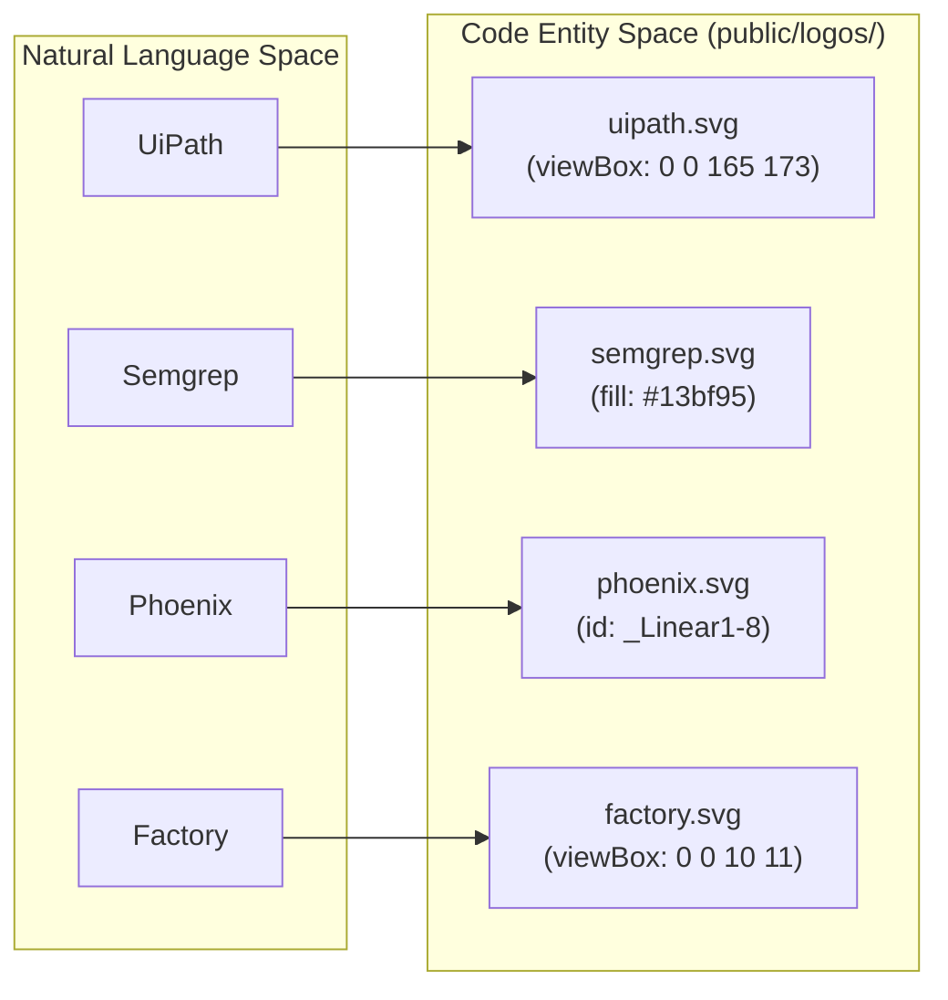
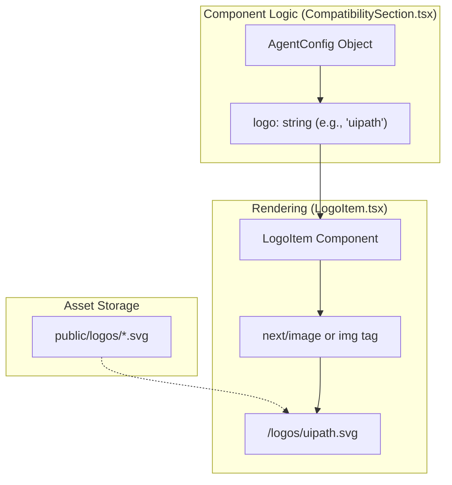

<!-- source: DeepWiki mcp.deepwiki.com · repo agentsmd/agents.md · extra page Additional Agent Logos · fetched 2026-10-21 -->

# Additional Agent Logos

Relevant source files

The following files were used as context for generating this wiki page:

- [public/logos/aider.svg](public/logos/aider.svg)
- [public/logos/amp.svg](public/logos/amp.svg)
- [public/logos/codex.svg](public/logos/codex.svg)
- [public/logos/factory.svg](public/logos/factory.svg)
- [public/logos/gemini.svg](public/logos/gemini.svg)
- [public/logos/jules.svg](public/logos/jules.svg)
- [public/logos/kilo-code.svg](public/logos/kilo-code.svg)
- [public/logos/opencode.svg](public/logos/opencode.svg)
- [public/logos/phoenix.svg](public/logos/phoenix.svg)
- [public/logos/roocode.svg](public/logos/roocode.svg)
- [public/logos/semgrep.svg](public/logos/semgrep.svg)
- [public/logos/uipath.svg](public/logos/uipath.svg)

## Purpose and Scope

This page documents the remaining agent logos in the `public/logos/` directory that complete the ecosystem of AI coding agents displayed in the `CompatibilitySection` component. These logos represent specialized or emerging agents that support the AGENTS.md specification. Unlike the primary logos covered in [Theme-Aware Logo Pairs]() and [Single-Variant Logos](), these assets often feature unique internal structures—ranging from simple monochromatic paths to complex gradients and multi-path groupings.

## Logo Inventory

The following table lists the additional agent logos covered by this page:

| Agent Name | File Path | SVG Structure | Key Feature |
|------------|-----------|---------------|-------------|
| **UiPath** | `public/logos/uipath.svg` | Multi-path | Large canvas (`165x173`), white fill |
| **Semgrep** | `public/logos/semgrep.svg` | Multi-path | Branding color `#13bf95`, horizontal layout |
| **Aider** | `public/logos/aider.svg` | Single path | Geometric Inkscape design |
| **Gemini** | `public/logos/gemini.svg` | Path + Rect | Internal symbol within a frame |
| **Kilo Code** | `public/logos/kilo-code.svg` | Single path | Grid-based pixel design |
| **OpenCode** | `public/logos/opencode.svg` | Single path | Intricate overlapping geometry |
| **Phoenix** | `public/logos/phoenix.svg` | Gradient path | Linear gradient with stop-colors |
| **AMP** | `public/logos/amp.svg` | Multi-path | Abstract lightning/arrow symbols |
| **Codex** | `public/logos/codex.svg` | Multi-path | Circular emblem with internal glyphs |
| **Factory** | `public/logos/factory.svg` | Multi-path | Highly complex 12-path structure |
| **Jules** | `public/logos/jules.svg` | Single path | Stylized character/robot face |
| **Roo Code** | `public/logos/roocode.svg` | Single path | Abstract kangaroo/geometric shape |

Sources: [public/logos/uipath.svg:1-6](), [public/logos/semgrep.svg:1-7](), [public/logos/aider.svg:1-16](), [public/logos/gemini.svg:1-27](), [public/logos/kilo-code.svg:1-43](), [public/logos/opencode.svg:1-40](), [public/logos/phoenix.svg:1-44](), [public/logos/amp.svg:1-5](), [public/logos/codex.svg:1-3](), [public/logos/factory.svg:1-3](), [public/logos/jules.svg:1-3](), [public/logos/roocode.svg:1-3]()

## Code-to-Asset Mapping

The following diagram bridges the high-level agent identities defined in the system to their specific SVG code entities stored in `public/logos/`.

Sources: [public/logos/uipath.svg:1](), [public/logos/semgrep.svg:2](), [public/logos/phoenix.svg:17](), [public/logos/factory.svg:1]()

## Technical Implementation Details

### Complex Path Geometry
Unlike standard icons, several of these logos utilize highly specific path data to maintain brand fidelity:
- **UiPath**: Uses four distinct `<path>` elements with `fill="white"` [public/logos/uipath.svg:2-5]().
- **Semgrep**: Features a unique horizontal aspect ratio (`viewBox="0 0 512 200"`) and hardcoded branding color `#13bf95` [public/logos/semgrep.svg:1-3]().
- **Factory**: Contains 12 distinct path definitions within a tiny `10x11` coordinate system [public/logos/factory.svg:2]().

### Gradient and Visual Effects
The **Phoenix** logo is the most technically advanced in this group, utilizing a `linearGradient` for its visual depth:
- **Gradient ID**: `_Linear1-8` [public/logos/phoenix.svg:17]().
- **Color Stops**: Transitions from `#878787` (offset 0) to `#101010` (offset 1) [public/logos/phoenix.svg:24-33]().
- **Application**: Applied via `fill="url(#_Linear1)"` on the main path [public/logos/phoenix.svg:40]().

### Coordinate Systems and Scaling
The repository manages various coordinate systems to ensure they render correctly within the `LogoItem` component:
- **Standard (24x24)**: `aider.svg`, `gemini.svg`, `kilo-code.svg`, `opencode.svg`, `phoenix.svg` [public/logos/aider.svg:5](), [public/logos/gemini.svg:5](), [public/logos/kilo-code.svg:5](), [public/logos/opencode.svg:5](), [public/logos/phoenix.svg:3]().
- **Micro (10x11)**: `amp.svg`, `codex.svg`, `factory.svg`, `jules.svg` [public/logos/amp.svg:1](), [public/logos/codex.svg:1](), [public/logos/factory.svg:1](), [public/logos/jules.svg:1]().
- **Wide (512x200)**: `semgrep.svg` [public/logos/semgrep.svg:1]().

## Data Flow into UI

The following diagram illustrates how these specific SVG files are processed by the Next.js application layer and displayed in the `CompatibilitySection`.

Sources: [public/logos/uipath.svg:1-6](), [public/logos/semgrep.svg:1-7](), [public/logos/phoenix.svg:1-44]()

## Design Tool Integration
Several logos retain metadata from their creation tools, which is useful for maintenance:
- **Inkscape**: `aider.svg`, `kilo-code.svg`, `opencode.svg` include `sodipodi` and `inkscape` namespace declarations [public/logos/kilo-code.svg:9-17](), [public/logos/opencode.svg:9-15]().
- **Layering**: `semgrep.svg` uses grouped elements (`<g id="semgrep-ellipsis">`) to manage the icon's distinct circles [public/logos/semgrep.svg:2]().

Sources: [public/logos/semgrep.svg:2](), [public/logos/kilo-code.svg:9-17](), [public/logos/opencode.svg:9-15]()

---

