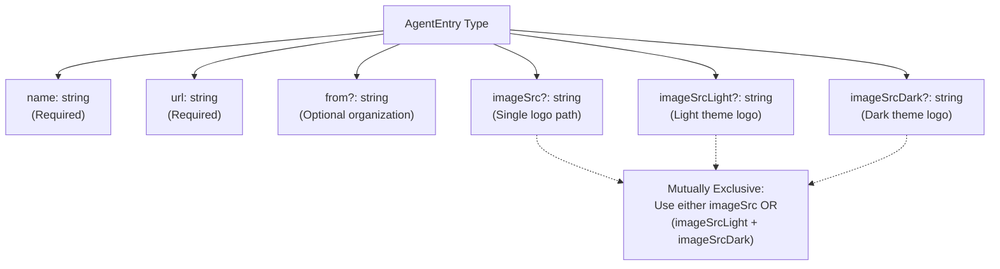
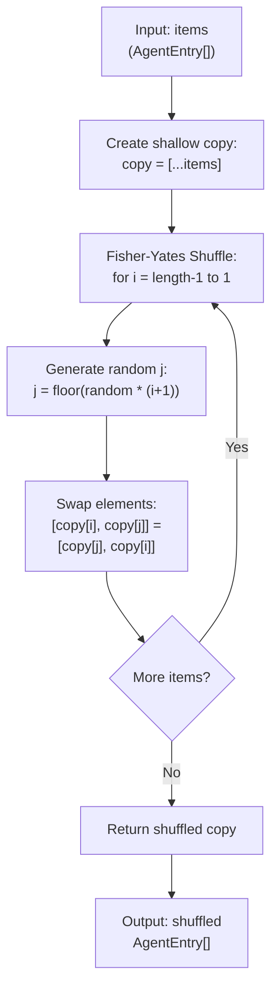
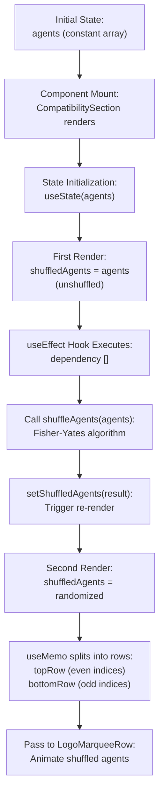
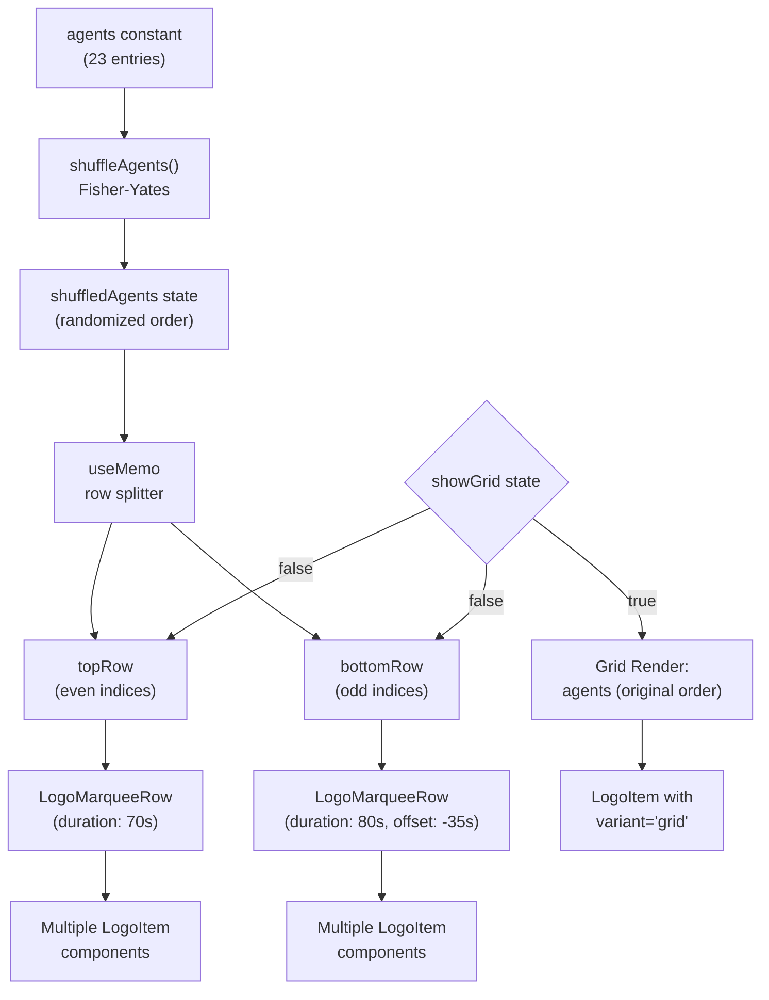

<!-- source: DeepWiki mcp.deepwiki.com · repo agentsmd/agents.md · extra page Agent Data and Shuffling · fetched 2026-10-21 -->

# Agent Data and Shuffling

<details>
<summary>Relevant source files</summary>

The following files were used as context for generating this wiki page:

- [components/CompatibilitySection.tsx](components/CompatibilitySection.tsx)
- [public/logos/junie.svg](public/logos/junie.svg)
- [styles/globals.css](styles/globals.css)

</details>


## Purpose and Scope

This document describes the agent data structure, randomization algorithm, and data initialization flow within the `CompatibilitySection` component. It covers the `AgentEntry` type definition, the hardcoded `agents` array containing 23 AI coding agent definitions, and the `shuffleAgents` function that randomizes agent display order on page load.

For information about how this data is rendered in the marquee animation system, see 4.1.2. For details on the logo rendering implementation, see 4.1.3.

---

## AgentEntry Type Definition

The `AgentEntry` type defines the structure for each agent in the compatibility showcase. It supports both single-source logos and theme-aware logo pairs.



**Type Structure:**

| Field | Type | Required | Description |
|-------|------|----------|-------------|
| `name` | `string` | Yes | Display name of the agent or tool |
| `url` | `string` | Yes | Documentation or homepage URL |
| `from` | `string` | No | Organization name (displays as "from X") |
| `imageSrc` | `string` | No | Path to single logo (used with CSS masking) |
| `imageSrcLight` | `string` | No | Path to light theme variant |
| `imageSrcDark` | `string` | No | Path to dark theme variant |

**Sources:** [components/CompatibilitySection.tsx:5-12]()

---

## Agents Array Data

The `agents` constant is a hardcoded array of 23 `AgentEntry` objects representing AI coding agents that support the AGENTS.md specification.

### Agent Data Table

| Index | Name | Organization | Logo Type | URL Type |
|-------|------|--------------|-----------|----------|
| 0 | Codex | OpenAI | Single | Product page |
| 1 | Amp | - | Single | Product page |
| 2 | Jules | Google | Single | Product page |
| 3 | Cursor | - | Single | Product page |
| 4 | Factory | - | Single | Product page |
| 5 | RooCode | - | Single | Product page |
| 6 | Aider | - | Single | Documentation |
| 7 | Gemini CLI | Google | Single | GitHub docs |
| 8 | goose | - | Single | GitHub repo |
| 9 | Kilo Code | - | Single | Product page |
| 10 | opencode | - | Single | Documentation |
| 11 | Phoenix | - | Single | Product page |
| 12 | Zed | - | Single | Documentation |
| 13 | Semgrep | - | Single | Product page |
| 14 | Warp | - | Single | Documentation |
| 15 | Coding agent | GitHub Copilot | Single | Documentation |
| 16 | VS Code | - | Theme pair | Documentation |
| 17 | Ona | - | Theme pair | Product page |
| 18 | Devin | Cognition | Theme pair | Product page |
| 19 | Windsurf | Cognition | Theme pair | Product page |
| 20 | Autopilot & Coded Agents | UiPath | Single | Documentation |
| 21 | Augment Code | - | Single | Documentation |
| 22 | Junie | JetBrains | Single | Product page |

### Logo Path Patterns

The array follows three logo path patterns:

1. **Single SVG with CSS masking** (18 agents): `/logos/{name}.svg`
   - Used for agents like Cursor, Aider, Zed, Goose, Junie [public/logos/junie.svg:1-5]()
   - Rendered with color overlay via CSS mask [components/CompatibilitySection.tsx:197-210]()

2. **Theme-aware pairs** (5 agents): `/logos/{name}-light.svg` and `/logos/{name}-dark.svg`
   - VS Code, Ona, Devin, Windsurf
   - Different logo designs for light/dark modes [components/CompatibilitySection.tsx:181-194]()

3. **Incorrect entry** (1 case): Windsurf incorrectly lists "from: Cognition" (should be Codeium) [components/CompatibilitySection.tsx:119-124]()

**Sources:** [components/CompatibilitySection.tsx:14-142](), [public/logos/junie.svg:1-5]()

---

## Shuffle Algorithm

### shuffleAgents Function



The `shuffleAgents` function implements the Fisher-Yates (Knuth) shuffle algorithm, which guarantees uniform random permutation in O(n) time complexity.

**Algorithm Steps:**

1. **Create copy** [components/CompatibilitySection.tsx:145](): Creates shallow copy to avoid mutating input
2. **Iterate backwards** [components/CompatibilitySection.tsx:146](): Loop from last index to 1
3. **Generate random index** [components/CompatibilitySection.tsx:147](): Random integer from 0 to i (inclusive)
4. **Swap elements** [components/CompatibilitySection.tsx:148](): Exchange elements at positions i and j using destructuring assignment
5. **Return result** [components/CompatibilitySection.tsx:150](): Returns shuffled array

**Properties:**
- **Time complexity:** O(n)
- **Space complexity:** O(n) for the copy
- **Probability:** Each permutation has equal 1/n! probability
- **Purity:** No side effects on input array

**Sources:** [components/CompatibilitySection.tsx:144-151]()

---

## Data Flow and Initialization

### Component State Management



### State Hook Usage

The component uses two state variables related to agent data:

| State Variable | Type | Initial Value | Purpose |
|----------------|------|---------------|---------|
| `shuffledAgents` | `AgentEntry[]` | `agents` | Stores randomized agent order |
| `showGrid` | `boolean` | `false` | Controls grid vs marquee display |

### Initialization Sequence

1. **Component Declaration** [components/CompatibilitySection.tsx:265]()
   - `CompatibilitySection` function component starts

2. **State Initialization** [components/CompatibilitySection.tsx:268]()
   - `useState<AgentEntry[]>(agents)` initializes with unshuffled array

3. **Effect Hook** [components/CompatibilitySection.tsx:271-273]()
   - `useEffect` with empty dependency array `[]` runs once after mount
   - Calls `shuffleAgents(agents)` to randomize order
   - Updates state with `setShuffledAgents(result)`

4. **Row Distribution** [components/CompatibilitySection.tsx:312-325]()
   - `useMemo` splits `shuffledAgents` based on even/odd indices
   - Even indices (0, 2, 4...) → `topRow`
   - Odd indices (1, 3, 5...) → `bottomRow`
   - Re-computes when `shuffledAgents` changes

**Sources:** [components/CompatibilitySection.tsx:265-325]()

---

## Data Flow Through Component Hierarchy



### Key Observations

1. **Shuffle timing:** Randomization occurs after mount via `useEffect`, not on every render.
2. **Memoization:** Row splitting is memoized via `useMemo` to prevent unnecessary recalculations [components/CompatibilitySection.tsx:312-325]().
3. **Grid bypass:** When `showGrid` is true, the original `agents` array is used (unshuffled) for the grid display [components/CompatibilitySection.tsx:370-376]().
4. **Row distribution:** Ensures roughly equal agent counts in top/bottom marquees.
5. **Animation Track:** `LogoMarqueeRow` doubles the agent list to create a seamless loop [components/CompatibilitySection.tsx:239]().

**Sources:** [components/CompatibilitySection.tsx:228-378]()

---

## Example Agent Entries

### Single Logo Entry

```typescript
{
  name: "Cursor",
  url: "https://cursor.com",
  imageSrc: "/logos/cursor.svg",
}
```

This entry uses a single SVG rendered via CSS masking, suitable for monochromatic logos [components/CompatibilitySection.tsx:197-210]().

### Theme-Aware Entry

```typescript
{
  name: "VS Code",
  url: "https://code.visualstudio.com/docs/editor/artificial-intelligence",
  imageSrcLight: "/logos/vscode-light.svg",
  imageSrcDark: "/logos/vscode-dark.svg",
}
```

This entry provides separate logos optimized for light and dark themes [components/CompatibilitySection.tsx:181-194]().

### Entry with Organization

```typescript
{
  name: "Codex",
  url: "https://openai.com/codex/",
  from: "OpenAI",
  imageSrc: "/logos/codex.svg",
}
```

This entry includes the `from` field, displaying "from OpenAI" beneath the agent name [components/CompatibilitySection.tsx:217-222]().

**Sources:** [components/CompatibilitySection.tsx:14-222]()

---

