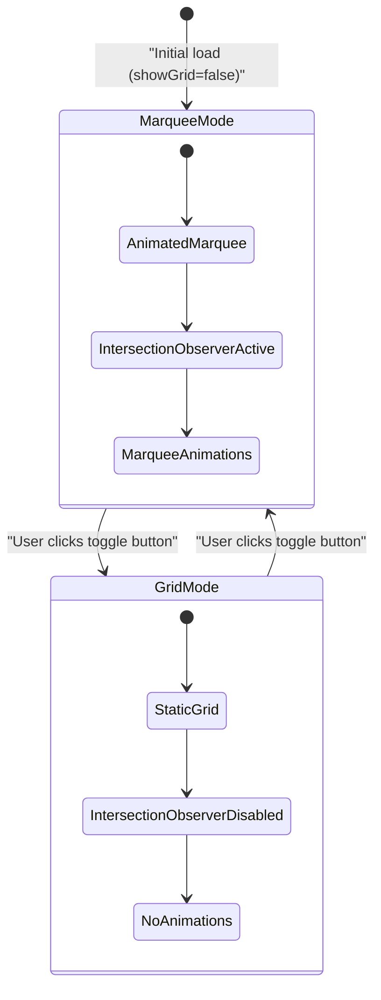
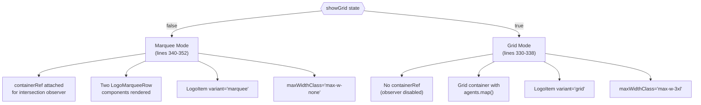
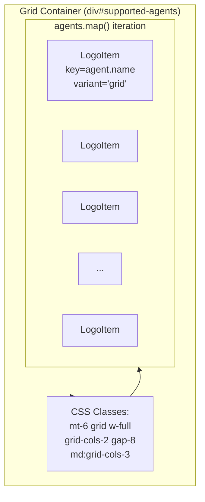
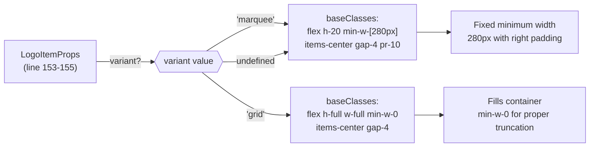
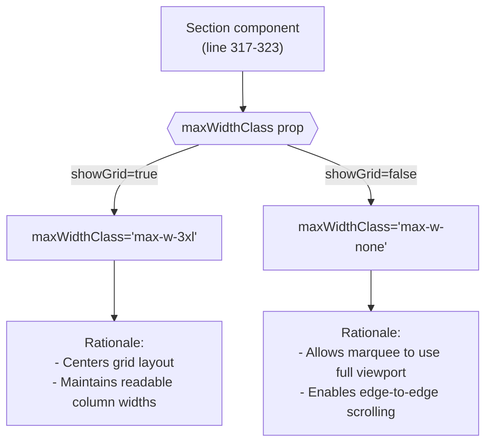
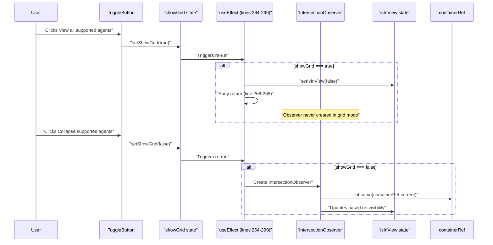

<!-- source: DeepWiki mcp.deepwiki.com · repo agentsmd/agents.md · extra page Grid View Toggle · fetched 2026-10-21 -->

# Grid View Toggle

Relevant source files

The following files were used as context for generating this wiki page:

- [components/CompatibilitySection.tsx](components/CompatibilitySection.tsx)
- [public/logos/junie.svg](public/logos/junie.svg)
- [styles/globals.css](styles/globals.css)

This document describes the alternative static grid display mode for the `CompatibilitySection` component and the toggle mechanism that switches between animated marquee mode and static grid mode. For information about the marquee animation system, see [4.1.2](). For information about agent data structure, see [4.1.1]().

## Purpose and Scope

The Grid View Toggle provides users with an alternative way to view the supported AI coding agents. Instead of the default animated marquee display, users can toggle to a static grid layout that presents all agents in an organized, scannable format. This feature addresses user preferences for reduced motion and provides better accessibility for users who prefer static content.

**Sources:** [components/CompatibilitySection.tsx:254-367]()

## Toggle State Management

The toggle functionality is implemented using a single boolean state variable `showGrid` that controls the display mode. The initial state is `false`, defaulting to marquee mode.

### State Transition Diagram

### State Declaration and Toggle Handler

The `showGrid` state is declared in the `CompatibilitySection` component and controls multiple aspects of the rendering:

*   **State Variable:** [components/CompatibilitySection.tsx:258]() - `const [showGrid, setShowGrid] = useState(false);`
*   **Toggle Button:** [components/CompatibilitySection.tsx:355-363]() - Button element with `onClick` handler that toggles the state.

The toggle button includes accessibility attributes:
*   `aria-controls="supported-agents"`: Links the button to the controlled content [components/CompatibilitySection.tsx:359]().
*   `aria-expanded={showGrid}`: Indicates the current state to screen readers [components/CompatibilitySection.tsx:360]().
*   Dynamic button text: "View all supported agents" when collapsed, "Collapse supported agents" when expanded [components/CompatibilitySection.tsx:362]().

**Sources:** [components/CompatibilitySection.tsx:258](), [components/CompatibilitySection.tsx:355-363]()

## Display Mode Switching

The component uses conditional rendering to switch between marquee and grid layouts based on the `showGrid` state.

### Component Logic Mapping

**Sources:** [components/CompatibilitySection.tsx:330-352]()

## Grid Layout Implementation

When `showGrid` is `true`, the component renders a static grid of all agents in their original (un-shuffled) order.

### Grid Container Structure

The grid container uses Tailwind CSS Grid classes for responsive layout:

| Breakpoint | Grid Columns | CSS Class |
| :--- | :--- | :--- |
| Mobile (default) | 2 columns | `grid-cols-2` |
| Medium (md) and up | 3 columns | `md:grid-cols-3` |

**Key Characteristics:**
*   Uses the original `agents` array, not the `shuffledAgents` state [components/CompatibilitySection.tsx:335]().
*   Each agent renders as a `LogoItem` with `variant="grid"` prop [components/CompatibilitySection.tsx:336]().
*   Gap between items is 8 units (`gap-8`) [components/CompatibilitySection.tsx:333]().
*   Full width (`w-full`) with top margin of 6 units (`mt-6`) [components/CompatibilitySection.tsx:333]().

**Sources:** [components/CompatibilitySection.tsx:330-338]()

## LogoItem Grid Variant

The `LogoItem` component adapts its styling based on the `variant` prop, which can be either `"marquee"` or `"grid"`.

### Styling Differences

| Aspect | Marquee Variant | Grid Variant |
| :--- | :--- | :--- |
| **Height** | `h-20` (5rem, 80px) | `h-full` (fills parent) |
| **Width** | `min-w-[280px]` (fixed minimum) | `w-full` (100% of container) |
| **Min Width** | 280px | `min-w-0` (allows shrinking) |
| **Right Padding** | `pr-10` (spacing between items) | None |

The grid variant uses `min-w-0` [components/CompatibilitySection.tsx:168]() to allow flexbox to properly shrink the container, which is essential for text truncation to work correctly in CSS Grid layouts.

**Sources:** [components/CompatibilitySection.tsx:153-155](), [components/CompatibilitySection.tsx:166-169]()

## Container Width Management

The `Section` component's maximum width changes based on the display mode to optimize layout for each view type.

The `Section` component also conditionally applies padding based on the display mode via the `className` prop:
*   `py-12 px-0 ${showGrid ? "" : "!px-0"}` [components/CompatibilitySection.tsx:320]().

**Sources:** [components/CompatibilitySection.tsx:317-323]()

## Interaction with Intersection Observer

The grid mode disables the intersection observer to prevent unnecessary animation state management when animations are not active.

### Observer Lifecycle Based on Display Mode

**Early Return Logic:**
[components/CompatibilitySection.tsx:266-269]() - The `useEffect` hook checks if `showGrid` is true; if so, it sets `isInView` to false and returns early, bypassing the observer logic.

**Sources:** [components/CompatibilitySection.tsx:264-299]()

## Accessibility Considerations

The toggle implementation includes several accessibility features:

| Feature | Implementation | Purpose |
| :--- | :--- | :--- |
| **Button Type** | `type="button"` | Prevents form submission context issues |
| **ARIA Controls** | `aria-controls="supported-agents"` | Links button to the element it controls |
| **ARIA Expanded** | `aria-expanded={showGrid}` | Announces state to screen readers |
| **Semantic Button** | `<button>` element | Ensures keyboard navigation works |
| **Descriptive Text** | Dynamic button label | Indicates current and next state |

The toggle button text changes based on the current state:
*   Collapsed (marquee mode): "View all supported agents" [components/CompatibilitySection.tsx:362]().
*   Expanded (grid mode): "Collapse supported agents" [components/CompatibilitySection.tsx:362]().

**Sources:** [components/CompatibilitySection.tsx:355-363]()

---

