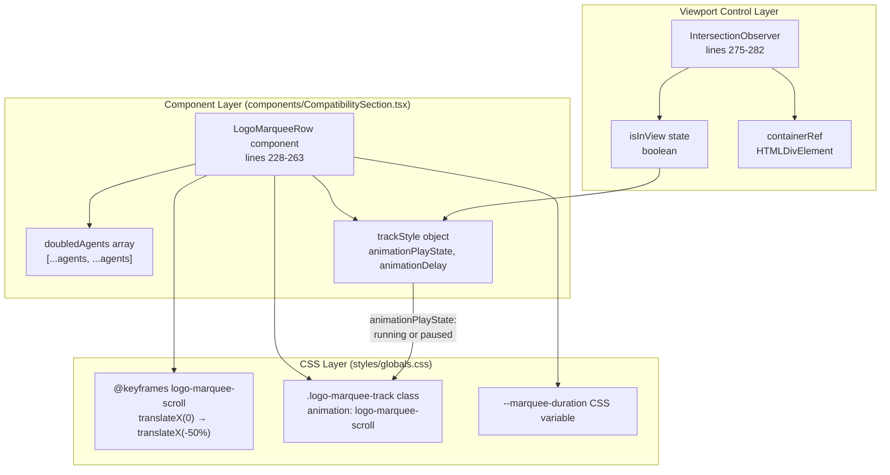
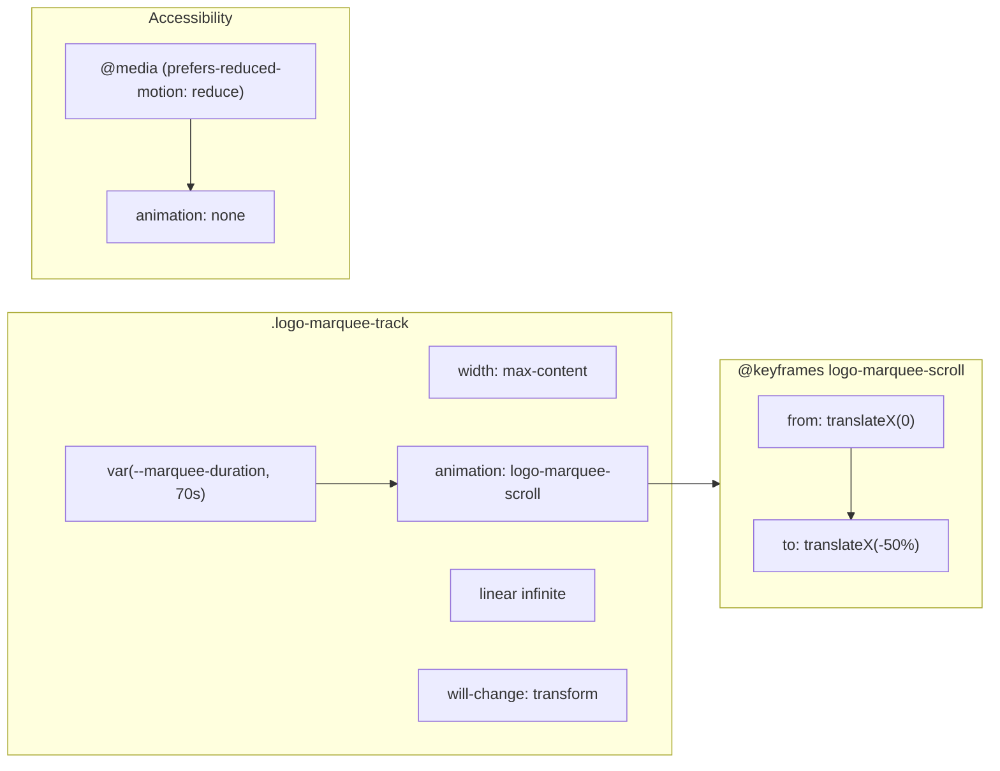
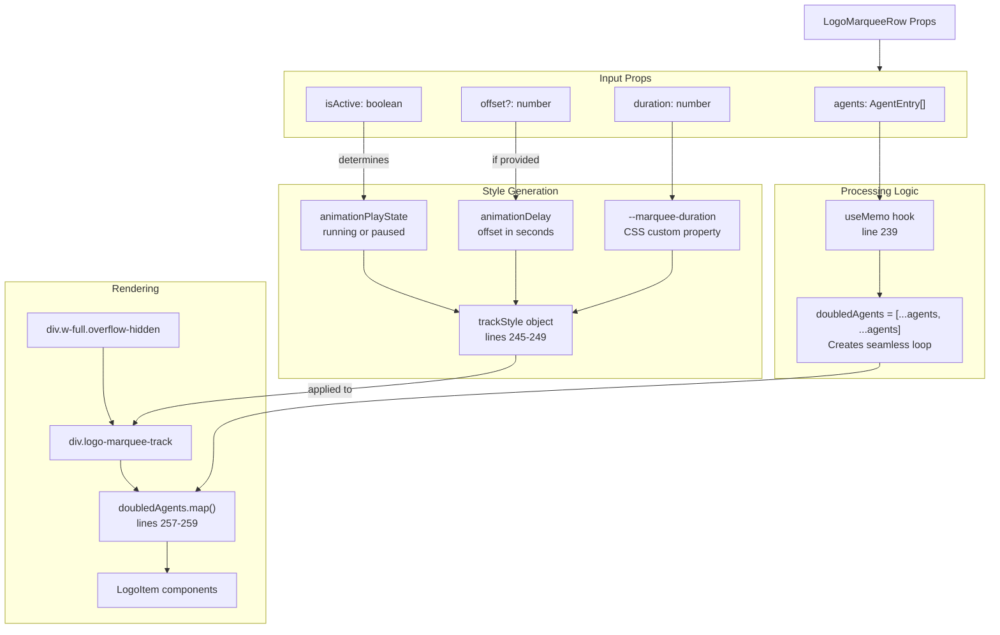
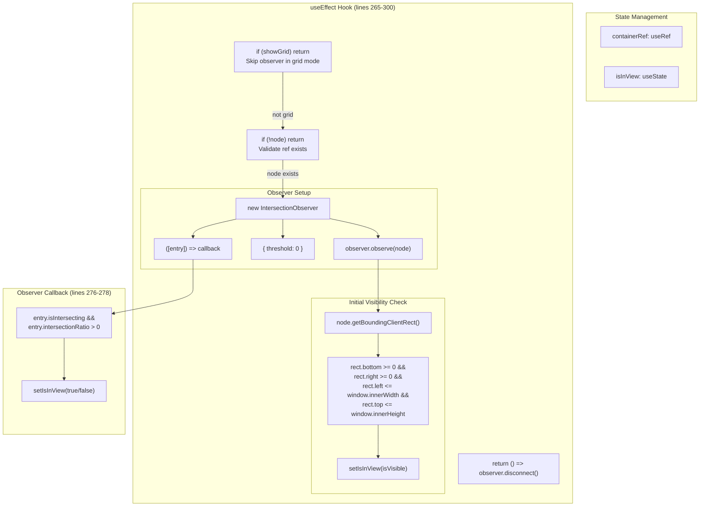
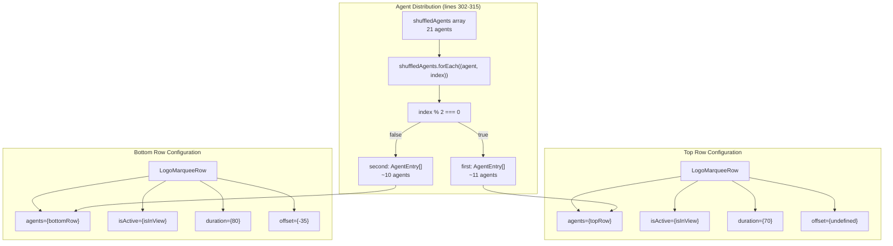

<!-- source: DeepWiki mcp.deepwiki.com · repo agentsmd/agents.md · extra page Marquee Animation System · fetched 2026-10-21 -->

# Marquee Animation System

Relevant source files

The following files were used as context for generating this wiki page:

- [components/CompatibilitySection.tsx](components/CompatibilitySection.tsx)
- [public/logos/junie.svg](public/logos/junie.svg)
- [styles/globals.css](styles/globals.css)

This document describes the CSS-based marquee animation system that powers the horizontal scrolling logo displays in the `CompatibilitySection` component. The system uses CSS keyframe animations, intersection observers for viewport-aware playback control, and a dual-row configuration with staggered timing to create a continuous scrolling effect showcasing 21 AI coding agents.

For information about the agent data structure and shuffling logic, see [4.1.1 Agent Data and Shuffling](). For details on how individual logos are rendered with theme support, see [4.1.3 LogoItem Rendering]().

## System Architecture

The marquee system consists of three layers: CSS animation definitions, the `LogoMarqueeRow` component that applies animations to agent logos, and an intersection observer that controls playback based on viewport visibility.

**Sources:** [components/CompatibilitySection.tsx:228-263](), [components/CompatibilitySection.tsx:275-282](), [styles/globals.css:113-126]()

## CSS Animation Foundation

The marquee animation is defined in [styles/globals.css:113-126]() and consists of a CSS class and keyframe definition:

**Key Properties:**

| Property | Value | Purpose |
|----------|-------|---------|
| `width` | `max-content` | Ensures track expands to fit all content [styles/globals.css:114]() |
| `animation` | `logo-marquee-scroll` | References the keyframe animation [styles/globals.css:115]() |
| `--marquee-duration` | Variable (default 70s) | Customizable animation duration via CSS custom property [styles/globals.css:115]() |
| `animation-timing-function` | `linear` | Creates smooth, consistent scrolling [styles/globals.css:115]() |
| `animation-iteration-count` | `infinite` | Loops continuously [styles/globals.css:115]() |
| `will-change` | `transform` | Hints browser to optimize animation performance [styles/globals.css:116]() |
| `transform` | `translateX(0)` → `translateX(-50%)` | Scrolls left by half (content is doubled) [styles/globals.css:119-126]() |

The animation translates by exactly -50% because the content array is doubled in [components/CompatibilitySection.tsx:239](). When the second copy reaches the start position, it seamlessly loops back to create infinite scrolling.

**Sources:** [styles/globals.css:113-132](), [components/CompatibilitySection.tsx:239-243]()

## LogoMarqueeRow Component

The `LogoMarqueeRow` component [components/CompatibilitySection.tsx:228-263]() applies the CSS animation to a row of agent logos and manages animation control.

**Component Implementation:**

| Aspect | Implementation | Line Reference |
|--------|----------------|----------------|
| Content Doubling | `const doubledAgents = useMemo(() => [...agents, ...agents], [agents])` | [239]() |
| Play State Control | `animationPlayState: isActive ? "running" : "paused"` | [246]() |
| Offset Timing | `animationDelay: offset ? \`${offset}s\` : undefined` | [247]() |
| Duration Injection | `"--marquee-duration": \`${duration}s\`` | [248]() |
| CSS Class | `className="logo-marquee-track flex items-center gap-8 py-3"` | [254]() |
| Key Generation | `key={\`${agent.name}-${index}\`}` | [258]() |

The component doubles the agents array using `useMemo` to create seamless looping. The CSS animation scrolls exactly -50%, which brings the second copy of the content into view just as the first copy exits, creating the illusion of infinite scrolling.

**Sources:** [components/CompatibilitySection.tsx:228-263]()

## Intersection Observer Management

The marquee animation is controlled by an `IntersectionObserver` [components/CompatibilitySection.tsx:275-282]() that pauses animations when the component is not visible in the viewport, reducing CPU usage.

**Observer Configuration:**

| Configuration | Value | Purpose |
|---------------|-------|---------|
| Threshold | `0` | Trigger as soon as any part of element is visible [components/CompatibilitySection.tsx:275]() |
| Callback Condition | `entry.isIntersecting && entry.intersectionRatio > 0` | Ensures both intersection and non-zero visibility [components/CompatibilitySection.tsx:276]() |
| Initial Check | `getBoundingClientRect()` with manual bounds check | Sets correct state on mount before observer fires [components/CompatibilitySection.tsx:285-294]() |
| Cleanup | `observer.disconnect()` | Prevents memory leaks on unmount [components/CompatibilitySection.tsx:298]() |
| Grid Mode Bypass | `if (showGrid) { setIsInView(false); return; }` | Disables observer when in static grid view [components/CompatibilitySection.tsx:266-269]() |

The observer monitors the `containerRef` element [components/CompatibilitySection.tsx:341]() which wraps both marquee rows. When the container enters the viewport, `isInView` becomes `true`, which propagates to both `LogoMarqueeRow` components via the `isActive` prop.

**Sources:** [components/CompatibilitySection.tsx:264-300](), [components/CompatibilitySection.tsx:341-352]()

## Dual-Row Configuration

The `CompatibilitySection` renders two `LogoMarqueeRow` instances with staggered timing to create visual interest and prevent synchronized scrolling [components/CompatibilitySection.tsx:340-352]().

**Timing Configuration:**

| Row | Duration | Offset | Speed | Agent Count |
|-----|----------|--------|-------|-------------|
| Top | 70 seconds | None (0s) | Faster | ~11 agents (even indices) |
| Bottom | 80 seconds | -35 seconds | Slower | ~10 agents (odd indices) |

**Offset Calculation:**

The `-35` second offset on the bottom row [components/CompatibilitySection.tsx:350]() starts the animation at nearly half completion. This creates visual asymmetry between the rows, making the animation feel more organic.

**Agent Distribution:**

The agents are split using modulo arithmetic [components/CompatibilitySection.tsx:306-312]():
- **Even indices** (0, 2, 4, ...) → `first` array (Top row)
- **Odd indices** (1, 3, 5, ...) → `second` array (Bottom row)

Since the agents are shuffled via `shuffleAgents()` on mount [components/CompatibilitySection.tsx:261](), the distribution varies on each page load while maintaining roughly equal row sizes.

**Sources:** [components/CompatibilitySection.tsx:302-352]()

## Performance Optimizations

The marquee system implements several performance optimizations:

- **GPU Acceleration**: The `transform` property moves animation to the GPU compositor thread, avoiding layout recalculations [styles/globals.css:115-126]().
- **will-change hint**: The `will-change: transform` property informs the browser to promote the track to its own compositor layer [styles/globals.css:116]().
- **Conditional Playback**: Animation pauses completely via `animationPlayState` when `isInView` is `false`, reducing CPU/GPU overhead when the section is not visible [components/CompatibilitySection.tsx:246]().
- **Array Memoization**: `useMemo` prevents creating new doubled arrays unless the agent list actually changes, reducing memory allocations during re-renders [components/CompatibilitySection.tsx:239]().
- **Accessibility**: Respects the `prefers-reduced-motion` media query by disabling the animation entirely [styles/globals.css:128-132]().

**Sources:** [styles/globals.css:113-132](), [components/CompatibilitySection.tsx:239-246](), [components/CompatibilitySection.tsx:264-300]()

---

