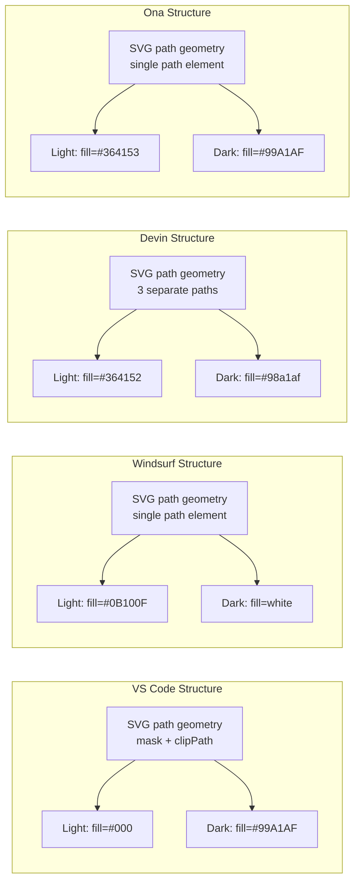

<!-- source: DeepWiki mcp.deepwiki.com · repo agentsmd/agents.md · extra page Theme-Aware Logo Pairs · fetched 2026-10-21 -->

# Theme-Aware Logo Pairs

<details>
<summary>Relevant source files</summary>

The following files were used as context for generating this wiki page:

- [public/logos/devin-dark.svg](public/logos/devin-dark.svg)
- [public/logos/devin-light.svg](public/logos/devin-light.svg)
- [public/logos/ona-dark.svg](public/logos/ona-dark.svg)
- [public/logos/ona-light.svg](public/logos/ona-light.svg)
- [public/logos/vscode-dark.svg](public/logos/vscode-dark.svg)
- [public/logos/vscode-light.svg](public/logos/vscode-light.svg)
- [public/logos/windsurf-dark.svg](public/logos/windsurf-dark.svg)
- [public/logos/windsurf-light.svg](public/logos/windsurf-light.svg)

</details>


## Purpose and Scope

This document details the logo assets that exist in both light and dark variants to support theme-aware rendering. These paired SVG files ensure agent logos remain visible and aesthetically appropriate across both light and dark color schemes. For information about single-variant logos and CSS-masked assets, see [Single-Variant Logos](#5.1.2). For the complete logo library overview, see [Logo Asset System](#5.1).

## Overview

Theme-aware logo pairs consist of two separate SVG files per agent, distinguished by `-light` and `-dark` suffixes in their filenames. Each pair uses different fill colors to optimize visibility and contrast against their respective background themes. The primary difference between variants is the SVG `fill` attribute value, which determines the logo's color.

Five agents currently maintain paired logo variants: VS Code, Cursor (note: also has a single-variant version), Devin, Windsurf, and Ona. These logos are rendered by the `LogoItem` component, which dynamically selects the appropriate variant based on the user's system theme preference.

Sources: [public/logos/vscode-light.svg:1-12](), [public/logos/vscode-dark.svg:1-19](), [public/logos/windsurf-light.svg:1-3](), [public/logos/windsurf-dark.svg:1-3](), [public/logos/devin-light.svg:1-2](), [public/logos/devin-dark.svg:1-2](), [public/logos/ona-light.svg:1-3](), [public/logos/ona-dark.svg:1-3]()

## File Organization and Naming Convention

All paired logo files reside in `public/logos/` and follow a strict naming pattern:

```
{agent-name}-light.svg  // For light backgrounds (darker fills)
{agent-name}-dark.svg   // For dark backgrounds (lighter fills)
```

The naming convention enables programmatic theme detection in the `LogoItem` component, which constructs file paths dynamically based on the current theme state.

```mermaid
graph TB
    subgraph "public/logos/"
        ["vscode-light.svg"] -- "Black fill: #000" --> VSCL["vscode-light"]
        ["vscode-dark.svg"] -- "Gray fill: #99A1AF" --> VSCD["vscode-dark"]
        
        ["windsurf-light.svg"] -- "Dark fill: #0B100F" --> WSL["windsurf-light"]
        ["windsurf-dark.svg"] -- "White fill: white" --> WSD["windsurf-dark"]
        
        ["devin-light.svg"] -- "Dark gray: #364152" --> DL["devin-light"]
        ["devin-dark.svg"] -- "Light gray: #98a1af" --> DD["devin-dark"]
        
        ["ona-light.svg"] -- "Dark gray: #364153" --> OL["ona-light"]
        ["ona-dark.svg"] -- "Light gray: #99A1AF" --> OD["ona-dark"]
    end
    
    subgraph "Browser Theme Detection"
        ["prefers-color-scheme: light"] --> PL["Light Mode"]
        ["prefers-color-scheme: dark"] --> PD["Dark Mode"]
    end
    
    PL -->|"selects"| VSCL
    PL -->|"selects"| WSL
    PL -->|"selects"| DL
    PL -->|"selects"| OL
    
    PD -->|"selects"| VSCD
    PD -->|"selects"| WSD
    PD -->|"selects"| DD
    PD -->|"selects"| OD
```

Sources: [public/logos/vscode-light.svg:1-12](), [public/logos/vscode-dark.svg:1-19](), [public/logos/windsurf-light.svg:1-3](), [public/logos/windsurf-dark.svg:1-3](), [public/logos/devin-light.svg:1-2](), [public/logos/devin-dark.svg:1-2](), [public/logos/ona-light.svg:1-3](), [public/logos/ona-dark.svg:1-3]()

## Paired Logo Inventory

The following table documents all agents with paired logo assets and their respective color values:

| Agent | Light Variant File | Light Fill Color | Dark Variant File | Dark Fill Color | Color Contrast Strategy |
|-------|-------------------|------------------|-------------------|-----------------|------------------------|
| **VS Code** | `vscode-light.svg` | `#000` (Black) | `vscode-dark.svg` | `#99A1AF` (Gray) | Dark on light / Gray on dark |
| **Windsurf** | `windsurf-light.svg` | `#0B100F` (Near-black) | `windsurf-dark.svg` | `white` | Dark on light / White on dark |
| **Devin** | `devin-light.svg` | `#364152` (Dark blue-gray) | `devin-dark.svg` | `#98a1af` (Light blue-gray) | Dark blue on light / Light blue on dark |
| **Ona** | `ona-light.svg` | `#364153` (Dark blue-gray) | `ona-dark.svg` | `#99A1AF` (Light gray) | Dark blue on light / Light gray on dark |

Sources: [public/logos/vscode-light.svg:3-8](), [public/logos/vscode-dark.svg:5-10](), [public/logos/windsurf-light.svg:2-2](), [public/logos/windsurf-dark.svg:2-2](), [public/logos/devin-light.svg:1-1](), [public/logos/devin-dark.svg:1-1](), [public/logos/ona-light.svg:2-2](), [public/logos/ona-dark.svg:2-2]()

## Color Scheme Analysis

Each logo pair employs a specific color strategy to maintain visibility and brand consistency across themes:

### VS Code Color Strategy

VS Code uses pure black for light mode and a medium gray for dark mode. This provides maximum contrast in light mode while avoiding harsh pure black on dark backgrounds.

- **Light variant**: `fill="#000"` at [public/logos/vscode-light.svg:3]()
- **Dark variant**: `fill="#99A1AF"` at [public/logos/vscode-dark.svg:5]()

The VS Code logo structure includes `mask` elements and complex `clipPath` definitions that remain identical between variants—only the fill color changes.

### Windsurf Color Strategy

Windsurf employs the most extreme contrast approach, using near-black in light mode and pure white in dark mode.

- **Light variant**: `fill="#0B100F"` at [public/logos/windsurf-light.svg:2]()
- **Dark variant**: `fill="white"` at [public/logos/windsurf-dark.svg:2]()

Both variants share identical SVG path geometry (a complex wave-like pattern) with only the `fill` attribute differentiating them.

### Devin and Ona Color Strategy

Both Devin and Ona use blue-gray tones, shifting from darker shades in light mode to lighter shades in dark mode. This creates softer, less stark transitions compared to VS Code or Windsurf.

**Devin:**
- **Light variant**: `fill: #364152` defined in CSS class `.cls-1` at [public/logos/devin-light.svg:1]()
- **Dark variant**: `fill: #98a1af` defined in CSS class `.cls-1` at [public/logos/devin-dark.svg:1]()

**Ona:**
- **Light variant**: `fill="#364153"` at [public/logos/ona-light.svg:2]()
- **Dark variant**: `fill="#99A1AF"` at [public/logos/ona-dark.svg:2]()

Sources: [public/logos/vscode-light.svg:3-8](), [public/logos/vscode-dark.svg:5-10](), [public/logos/windsurf-light.svg:2-2](), [public/logos/windsurf-dark.svg:2-2](), [public/logos/devin-light.svg:1-1](), [public/logos/devin-dark.svg:1-1](), [public/logos/ona-light.svg:2-2](), [public/logos/ona-dark.svg:2-2]()

## SVG Structure Patterns

All paired logos maintain identical SVG structure between their light and dark variants, with only fill color values changing:



### VS Code Structure Details

VS Code logos use complex masking with `maskUnits="userSpaceOnUse"` at [public/logos/vscode-light.svg:2]() and [public/logos/vscode-dark.svg:4](). The mask defines the shape, while multiple `<path>` elements within the masked group receive the fill color. The dark variant includes a `clipPath` with `id="clip0"` at [public/logos/vscode-dark.svg:15]().

### Windsurf, Devin, and Ona Structure Details

These logos use simpler SVG structures. Windsurf contains a single `<path>` element at [public/logos/windsurf-light.svg:2](). Devin contains three `<path>` elements representing different parts of its geometric pattern, using a `<style>` block for the fill color at [public/logos/devin-light.svg:1](). Ona uses a single `<path>` with octagon-like geometry at [public/logos/ona-light.svg:2]().

Sources: [public/logos/vscode-light.svg:1-12](), [public/logos/vscode-dark.svg:1-19](), [public/logos/windsurf-light.svg:1-3](), [public/logos/windsurf-dark.svg:1-3](), [public/logos/devin-light.svg:1-2](), [public/logos/devin-dark.svg:1-2](), [public/logos/ona-light.svg:1-3](), [public/logos/ona-dark.svg:1-3]()

## Integration with Component System

The `LogoItem` component (referenced in the CompatibilitySection, see [LogoItem Rendering](#4.1.3)) handles theme-aware logo selection. The component:

1. Detects the current theme preference via `prefers-color-scheme` media query.
2. Constructs the appropriate file path: `/logos/{agent-name}-{theme}.svg`.
3. Renders the selected SVG via an `` element or inline SVG.

```mermaid
graph TD
    ["Browser / User Agent"] -->|"prefers-color-scheme"| LI["LogoItem Component"]
    
    LI -->|"theme: light"| CL["Construct path:<br/>/logos/{name}-light.svg"]
    LI -->|"theme: dark"| CD["Construct path:<br>/logos/{name}-dark.svg"]
    
    CL --> RL["Render light variant SVG"]
    CD --> RD["Render dark variant SVG"]
    
    subgraph "public/logos/"
        L_SVGS["vscode-light.svg<br/>windsurf-light.svg<br/>devin-light.svg<br/>ona-light.svg"]
        D_SVGS["vscode-dark.svg<br/>windsurf-dark.svg<br/>devin-dark.svg<br/>ona-dark.svg"]
    end
    
    RL -.-> L_SVGS
    RD -.-> D_SVGS
```

Sources: [public/logos/vscode-light.svg:1-12](), [public/logos/vscode-dark.svg:1-19](), [public/logos/windsurf-light.svg:1-3](), [public/logos/windsurf-dark.svg:1-3](), [public/logos/devin-light.svg:1-2](), [public/logos/devin-dark.svg:1-2](), [public/logos/ona-light.svg:1-3](), [public/logos/ona-dark.svg:1-3]()

## Design Rationale

Paired logos exist for agents whose brand colors or logo designs do not provide sufficient contrast on both light and dark backgrounds using a single asset. This approach offers several advantages:

1. **Optimal Contrast**: Each variant is tuned for maximum readability on its target background.
2. **Brand Consistency**: Colors can be selected to match official brand guidelines for each theme.
3. **Simplicity**: No runtime CSS manipulation or SVG filtering required for these specific assets.
4. **Performance**: Browser caches both variants; switching themes requires only a different file request.

The alternative approach (single logos with CSS masking or filters) is used by other agents and documented in [Single-Variant Logos](#5.1.2).

Sources: [public/logos/vscode-light.svg:1-12](), [public/logos/vscode-dark.svg:1-19](), [public/logos/windsurf-light.svg:1-3](), [public/logos/windsurf-dark.svg:1-3](), [public/logos/devin-light.svg:1-2](), [public/logos/devin-dark.svg:1-2](), [public/logos/ona-light.svg:1-3](), [public/logos/ona-dark.svg:1-3]()

---

