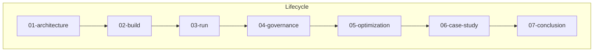
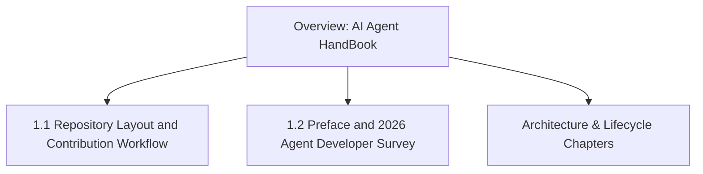

<!-- source: DeepWiki mcp.deepwiki.com · repo aliyun/ai-agent-handbook · page 1 Overview: AI Agent HandBook · fetched 2026-10-29 -->

# Overview: AI Agent HandBook

Relevant source files

The following files were used as context for generating this wiki page:

- [.gitignore](.gitignore)
- [00-preface/00-preface.md](00-preface/00-preface.md)
- [LICENSE](LICENSE)
- [README.md](README.md)
- [README_EN.md](README_EN.md)

## Purpose and Scope

The `ai-agent-handbook` repository provides a comprehensive technical reference for designing, building, running, governing, and optimizing enterprise-grade AI agents [README.md:5-10]. As the industry transitions from probabilistic experimentation to reliable production productivity, this whitepaper addresses key engineering, scaling, and organizational challenges [README.md:17-22]. It outlines a systematic approach to moving from basic Chatbot and Copilot iterations toward autonomous `Agent` and `Managed Agent` architectures capable of executing complex multi-step workflows [00-preface/00-preface.md:17-20].

Sources: `README.md:5-27`, `00-preface/00-preface.md:37-52`

---

## Lifecycle Structure and Reading Guide

The repository is structured around the complete application lifecycle of agentic systems, spanning architecture, harness construction, runtime execution, security governance, data optimization, and real-world industrial case studies [README.md:52-65]. 

Sources: `README.md:52-64`

### Lifecycle Phases Overview

- **Architecture (Part 1, Ch. 1–2)**: Defines AI-native application forms, determinism requirements, and layered reference architectures separating model capabilities from system harnesses [README.md:70-71].
- **Build (Part 2, Ch. 3–6)**: Focuses on `Harness` engineering, task state machines, context builders, memory assets, and controlled tool execution via `MCP` and `Function Calling` [README.md:72-75].
- **Run (Part 3, Ch. 7–12)**: Covers execution sandboxes, event logs, `AI Gateway` traffic governance, asynchronous task pipelines, and distributed multi-agent communication [README.md:76-81].
- **Governance (Part 4, Ch. 13–16)**: Implements observability traces, prompt injection defense, asset registries, and pre-release behavior simulation [README.md:82-85].
- **Optimization (Part 5, Ch. 17–24)**: Establishes a data flywheel using trajectory capture, golden datasets, badcase loops, and controlled self-evolution [README.md:86-93].
- **Case Studies (Part 6, Ch. 25–29)**: Examines real-world deployments across R&D efficiency, design engineering (`GenUI`), enterprise IT, and open-source infrastructure [README.md:94-98].

Sources: `README.md:52-99`

---

## Child Pages & Core Sections

This parent page coordinates access to detailed sub-topics. Refer to the designated child pages for granular architectural specifications and contributor guidelines:

- **1.1 Repository Layout and Contribution Workflow**: Details directory conventions (`00-preface` through `07-conclusion`, asset storage under `assets/imgs/chapter-NN`), bilingual documentation (`README.md` and `README_EN.md`), `.gitignore` rules, and Apache 2.0 licensing [README.md:1-65, .gitignore:1-7, LICENSE:2-126]. For details, see [Repository Layout and Contribution Workflow](#1.1).
- **1.2 Preface and 2026 Agent Developer Survey**: Analyzes the shift from `Chatbot` to `Copilot` to `Agent`, alongside enterprise developer survey findings and production metrics [00-preface/00-preface.md:1-91]. For details, see [Preface and 2026 Agent Developer Survey](#1.2).

Sources: `README.md:1-116`, `00-preface/00-preface.md:1-91`

---

