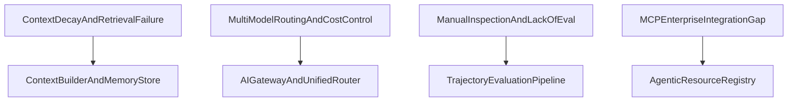

<!-- source: DeepWiki mcp.deepwiki.com · repo aliyun/ai-agent-handbook · page 1.2 Preface and 2026 Agent Developer Survey · fetched 2026-10-29 -->

# Preface and 2026 Agent Developer Survey

<details>
<summary>Relevant source files</summary>

The following files were used as context for generating this wiki page:

- [00-preface/00-preface.md](00-preface/00-preface.md)
- [2026-agent-survey-report.md](2026-agent-survey-report.md)

</details>


## Purpose and Scope
This page establishes the foundational framing of the AI Agent Handbook whitepaper and analyzes empirical data from the 2026 Enterprise Agent Developer Survey (`1906` valid responses). It bridges the macroeconomic shift from conversational AI to autonomous agentic systems (`Chatbot → Copilot → Agent`) with the concrete engineering bottlenecks reported by industry practitioners, mapping them directly to the whitepaper's architectural lifecycle (`00-preface/00-preface.md:1-35`, `2026-agent-survey-report.md:1-4`).

---

## 1. The Paradigm Evolution: Chatbot to Managed Agent
The whitepaper frames the maturation of AI-native applications through an evolutionary trajectory categorized by autonomy, determinism requirements, and human-in-the-loop (`HITL`) depth (`00-preface/00-preface.md:17-20`). 

As cognitive processing costs decline, application architectures shift from reactive text generation to goal-directed autonomous execution:
* **Chatbot Stage**: Reactive, stateless interactions where models answer questions based on immediate prompt context.
* **Copilot Stage**: Human-led, model-assisted execution where users perform actions while the model provides suggestions or draft code.
* **Agent & Managed Agent Stage**: Autonomous execution where the system takes responsibility for an entire task, workflow, or job function, requiring deterministic runtime guarantees, sandboxing, and explicit authorization boundaries.

```mermaid
graph TD
    "ChatbotPhase" --> "CopilotPhase"
    "CopilotPhase" --> "AgentPhase"
    "AgentPhase" --> "ManagedAgentPhase"
```

Sources: `[00-preface/00-preface.md:17-32]()`

---

## 2. From Model-Centricity to Harness Engineering
A core thesis of the whitepaper is that raw base models no longer constitute the center of application architecture (`00-preface/00-preface.md:29-32`). Instead, production readiness relies heavily on **Harness Engineering**—the system architecture wrapping around the base model to constrain, feed, and govern its behavior.

```mermaid
graph TD
    "BaseModelLayer" --> "HarnessEngineeringLayer"
    "HarnessEngineeringLayer" --> "RuntimeAndSandbox"
    "HarnessEngineeringLayer" --> "AIGateway"
    "HarnessEngineeringLayer" --> "MemoryAndSkillAssets"
    "HarnessEngineeringLayer" --> "ObservabilityAndEvaluation"
```

Sources: `[00-preface/00-preface.md:29-35]()`

---

## 3. 2026 Agent Developer Survey Findings
The 2026 enterprise survey (`1906` technical decision-makers, architects, and engineers) highlights a major dichotomy between investment intent and production deployment (`2026-agent-survey-report.md:1-10`):

1. **Investment vs. Production Disconnect**: While `46%` of organizations are actively developing or have completed agent projects, only `18%` have successfully deployed agents into live production environments (`2026-agent-survey-report.md:7-10`).
2. **Architectural Coexistence**: Single-Agent (`40%`), Multi-Agent (`42%`), and Human-in-the-Loop (`15%`) architectures coexist as adjustable parameters of autonomy rather than mutually exclusive generational technologies (`2026-agent-survey-report.md:11-14`).
3. **Coding as the Scaled Baseline**: AI Coding tools (such as Claude Code, Cursor, and Qoder) represent the primary commercialized breakout market (`57%` adoption) due to clear verification signals, strict workspace sandboxing, and well-defined compiler/test feedback loops (`2026-agent-survey-report.md:15-18`).
4. **Core Infrastructure Bottlenecks**: Enterprises identify context/memory decay, multi-model cost governance, and automated trajectory evaluation as their top unresolved engineering hurdles (`2026-agent-survey-report.md:19-22`).

Sources: `[2026-agent-survey-report.md:1-30]()`

---

## 4. Mapping Survey Pain Points to System Architecture
To bridge natural language survey feedback with concrete codebase entities, industry pain points map directly to specific architectural components within the handbook:



* **Context Decay (`54%` retrieval failure rate)**: Addressed via persistent state storage, vector indexing, and structured memory managers (`[2026-agent-survey-report.md:90-97]()`).
* **Multi-Model Routing (`63%` gateway demand)**: Addressed via unified traffic governance (`AI Gateway`) managing fallback, rate-limiting, and cost attribution (`[2026-agent-survey-report.md:22-26]()`).
* **Evaluation Deficit (`55%` relying on manual spot-checks)**: Addressed via automated trajectory evaluation and golden dataset pipelines (`[2026-agent-survey-report.md:125-130]()`).
* **MCP Integration Gap (`9%` private enterprise deployment)**: Addressed via centralized asset discovery registries (`[2026-agent-survey-report.md:100-106]()`).

Sources: `[2026-agent-survey-report.md:90-147]()`

---

