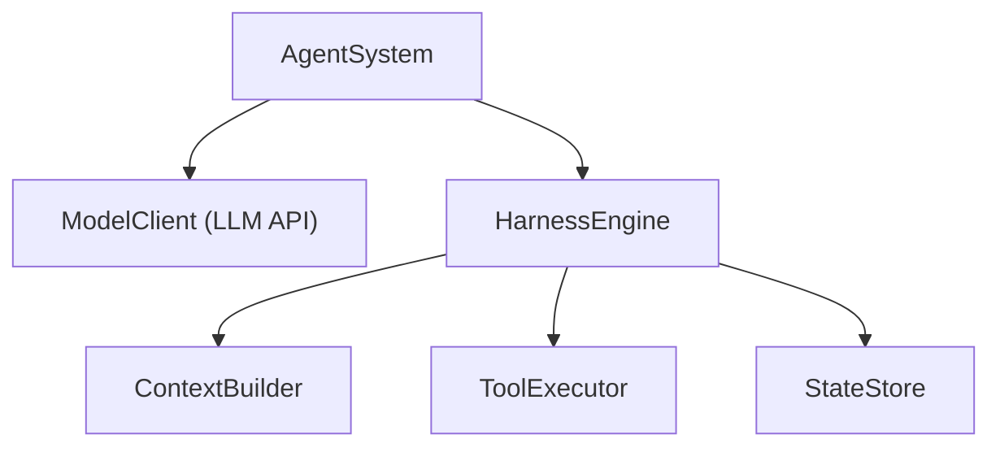
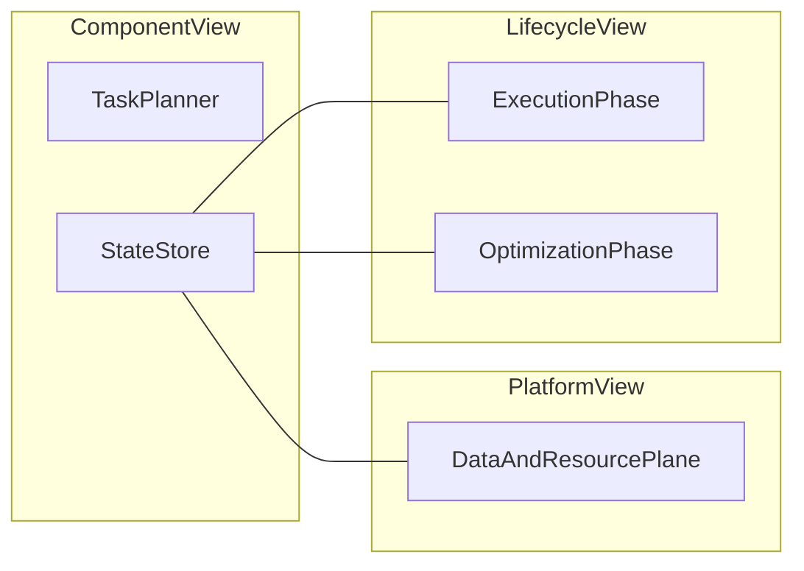

<!-- source: DeepWiki mcp.deepwiki.com · repo aliyun/ai-agent-handbook · page 2 Architecture: Agentic Applications · fetched 2026-10-29 -->

# Architecture: Agentic Applications

Relevant source files

The following files were used as context for generating this wiki page:

- [01-architecture/README.md](01-architecture/README.md)

## Purpose and Scope
This page provides an overview of Part 01 (`01-architecture`), which establishes the foundational shift in building AI-native applications `[01-architecture/README.md:1-8]`. As models evolve from simple text-generation engines into execution agents capable of maintaining state, planning goals, and invoking tools, system design shifts from single API calls to comprehensive architectures comprising both the model and its external execution harness `[01-architecture/README.md:3-6]`. 

For deep technical details, see the child pages:
- [The New Stage of AI-Native Applications (Ch.1)](#2.1)
- [Agentic Application Reference Architecture (Ch.2)](#2.2)

---

## Overview: The Shift to Agentic Systems

In modern AI architectures, the model alone does not constitute an agent. Long-running tasks, complex tool integrations, and environmental interactions require an engineering construct known as the **Harness** `[01-architecture/README.md:3-6]`. The relationship between the LLM and the surrounding system components can be conceptualized through the integration of the model client and the harness engine.

### Diagram: Model and Harness Responsibility Split

*Sources: `[01-architecture/README.md:3-6]()`*

---

## 2.1. The New Stage of AI-Native Applications (Ch.1)

Chapter 1 addresses application forms, the coexistence of workflows versus autonomous agents, and enterprise maturity models `[01-architecture/README.md:11]`. It emphasizes that application形态 (forms) and maturity levels are not defined by marketing names, but by matching agent autonomy against task risk to select the lowest sufficient architecture `[01-architecture/README.md:14]`.

For detailed exploration of application forms, determinism requirements, and selection matrices, see [The New Stage of AI-Native Applications (Ch.1)](#2.1).

*Sources: `[01-architecture/README.md:11-15]()`*

---

## 2.2. Agentic Application Reference Architecture (Ch.2)

Chapter 2 establishes the structural blueprint of agentic systems using three distinct architectural views: the **Component View**, the **Platform View**, and the **Lifecycle View** `[01-architecture/README.md:12,16]`. These views prevent capability gaps, resource conflicts, and the common pitfall of mistaking a prototype demonstration for a production-ready operational system `[01-architecture/README.md:16]`.

### Diagram: Three Views of the Architecture

*Sources: `[01-architecture/README.md:16-17]()`*

For detailed component maps, responsibility splits between the model and runtime infrastructure, and view definitions, see [Agentic Application Reference Architecture (Ch.2)](#2.2).

*Sources: `[01-architecture/README.md:12-18]()`*

---

