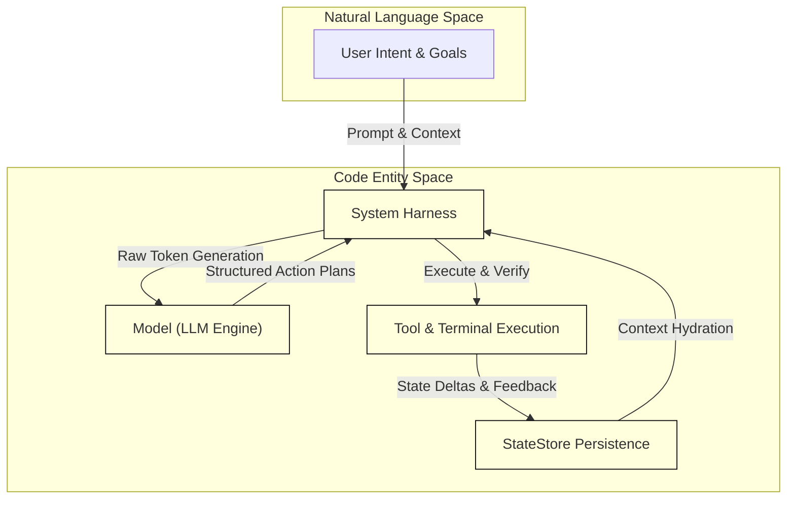
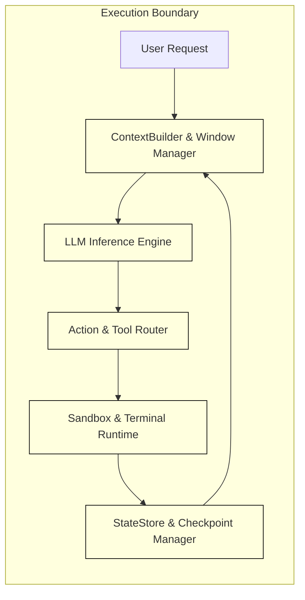
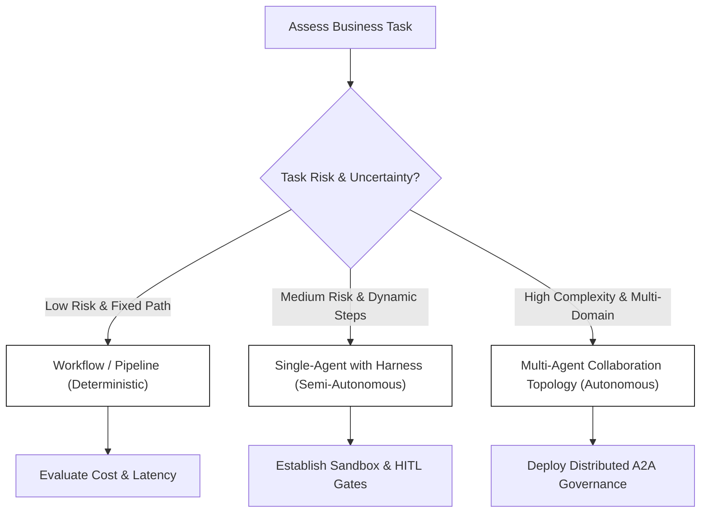

<!-- source: DeepWiki mcp.deepwiki.com · repo aliyun/ai-agent-handbook · page 2.1 The New Stage of AI-Native Applications (Ch.1) · fetched 2026-10-29 -->

# The New Stage of AI-Native Applications (Ch.1)

Relevant source files

The following files were used as context for generating this wiki page:

- [01-architecture/README.md](01-architecture/README.md)

## Purpose and Scope
This page details Chapter 1 of the architecture track (`01-architecture/README.md`), which establishes the foundational paradigm for AI-native application construction [01-architecture/README.md:1-15]. It covers the evolution of application forms (from stateless chat to autonomous agents), the core separation between the foundational model and the engineering harness, determinism requirements, and the enterprise selection guide for agentic solutions.

---

## 1. The Paradigm Shift: From Generative Engine to Execution Subject

In AI-native architectures, the operational starting point of application building has shifted. Historically, large language models (LLMs) functioned primarily as stateless generative engines invoked synchronously by traditional application code [01-architecture/README.md:3]. In the new stage, models act as execution subjects capable of:
- Maintaining long-running task states [01-architecture/README.md:3].
- Decomposing abstract goals into concrete execution steps [01-architecture/README.md:3].
- Invoking tools and programmatic interfaces [01-architecture/README.md:3].
- Adapting behavior dynamically based on real-time execution feedback [01-architecture/README.md:3].

This shift is manifested in software engineering agents (such as Codex, Claude Code, and Qoder) that interact directly with file systems, execute tests, read repositories, and maintain multi-step task plans [01-architecture/README.md:3].

*Figure 1: Control flow bridging natural language intent to code execution entities within the agentic harness.*

**Sources:**
- `01-architecture/README.md:1-5`

---

## 2. The Model vs. Harness Responsibility Split

Granting models higher task autonomy does not imply that the model alone constitutes an Agent [01-architecture/README.md:5]. As tasks grow longer, tools become more numerous, and environmental impact increases, the engineering system wrapping the model becomes the primary determinant of reliability [01-architecture/README.md:5]. 

The system boundary is partitioned between the **Model** and the **Harness**:
- **Model Responsibilities**: Natural language understanding, zero-shot/few-shot reasoning, semantic generation, and probability-based token stream production.
- **Harness Responsibilities**: Context window organization, task state persistence, tool access control, execution environment isolation, failure recovery loops, result evaluation, and safety constraint enforcement [01-architecture/README.md:5].

Enterprise architecture must move beyond treating an AI application as a single model invocation (`LLM.invoke()`), designing instead a holistic system spanning cognition, state management, tool execution, safety control, and continuous optimization [01-architecture/README.md:7].

*Data Flow & Component Interactions in the Agentic Harness.*

**Sources:**
- `01-architecture/README.md:5-7`

---

## 3. Application Forms and Selection Guide

Application forms do not follow a simple linear replacement chain; instead, deterministic workflows and probabilistic agents will coexist long-term [01-architecture/README.md:14]. 

### 3.1 Architectural Scaling Dimensions
1. **Temporal Dimension (Long-Horizon Agent)**: Scaling from single-turn request-response models to long-running asynchronous tasks spanning hours or days [01-architecture/README.md:14].
2. **Collaborative Dimension (Multi-Agent)**: Scaling from a Single-Agent handling broad toolsets to specialized Multi-Agent topologies [01-architecture/README.md:14].

These dimensions can be adopted independently or combined based on the domain requirements, but they are not mandatory upgrades for every AI application [01-architecture/README.md:14].

### 3.2 Enterprise Maturity and Determinism Requirements
Enterprise maturity is not determined by product branding, but by matching system autonomy against task risk [01-architecture/README.md:14]. The fundamental architectural rule is to select the **lowest sufficient architecture** where costs and risks are controllable [01-architecture/README.md:14].

*Figure 2: Selection guide mapping enterprise task risk profiles to appropriate application topologies.*

**Sources:**
- `01-architecture/README.md:14-18`

---

