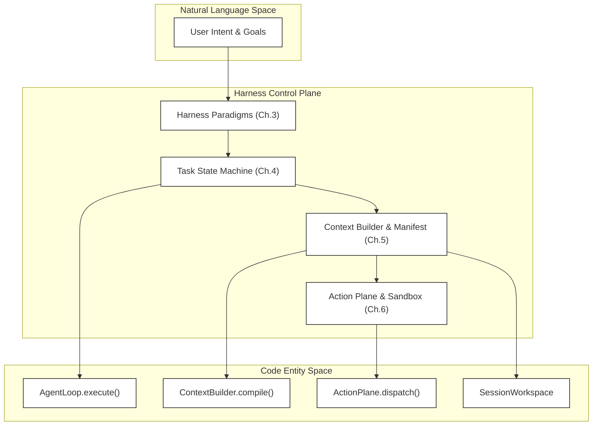
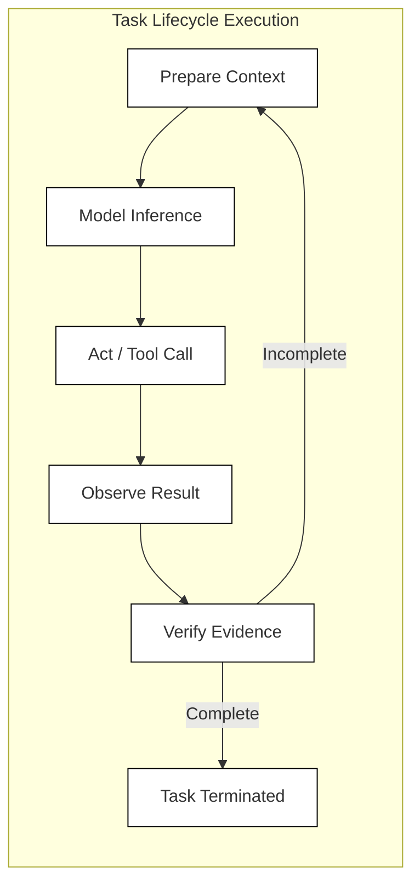

<!-- source: DeepWiki mcp.deepwiki.com · repo aliyun/ai-agent-handbook · page 3 Build: Harness Engineering · fetched 2026-10-29 -->

# Build: Harness Engineering

Relevant source files

The following files were used as context for generating this wiki page:

- [02-build/README.md](02-build/README.md)
- [03-run/README.md](03-run/README.md)

## Purpose and Scope

Part 02 ("Build") of the AI Agent Handbook focuses on the core mechanics of harness engineering: organizing discrete LLM model judgments into sustainable, interruptible, recoverable, and verifiable task execution processes [02-build/README.md:1-4]. Using coding agents as an engineering sample, this part demonstrates how model capabilities rely on context organization, task loops, state management, tool execution, permission control, and result verification [02-build/README.md:5-7].

This parent page provides a high-level overview of harness paradigms and the three core engineering contracts (Tasks, Information, Actions). For deep technical details, refer to the child pages linked below.

Sources:
- `02-build/README.md:1-8`

---

## Big Picture: The Three Engineering Contracts and Harness Paradigms

The build phase establishes the boundaries between model intelligence and system orchestration. The harness acts as the execution wrapper around the model, translating human intent into structured state transitions and verifiable tool invocations.

*Diagram 1: Mapping Natural Language Intent to Harness Code Entities*

Sources:
- `02-build/README.md:9-21`

---

## 3.1. Harness Paradigms and Responsibility Boundaries (Ch.3)

The first main theme of the build phase addresses harness construction choices: deciding where the model ends and the system begins, and selecting the appropriate integration paradigm [02-build/README.md:3-4, 02-build/README.md:16]. Four primary entry points exist for implementing a harness:
1. **High-Code Frameworks**: Provide fine-grained, code-level control over prompts, loops, and state transitions.
2. **Productized Harnesses**: Reuse mature capabilities via Coding Agent CLIs, SDKs, and workspace assistants.
3. **Managed Agents**: Standardize bounded harness logic and runtime infrastructure into managed services.
4. **Agent Cloud Products**: Deliver native creation portals and shared resource entry points.

When multiple teams and sources coexist, an `AgentPlatform` handles multi-source management, scale delivery, governance, and observation.

For details, see [Harness Paradigms and Responsibility Boundaries (Ch.3)](#3.1).

Sources:
- `02-build/README.md:9-11`, `02-build/README.md:16`

---

## 3.2. Tasks: Orchestration, Long-Running Progress, Handoff (Ch.4)

Task orchestration governs how agent workflows advance, recover from interruptions, and determine completion [02-build/README.md:12, 02-build/README.md:18]. The core mechanism centers around the `AgentLoop`, which processes execution stages via `Prepare`, `Model`, `Act`, `Observe`, and `Verify` phases.

*Diagram 2: AgentLoop State Transition and Verification Flow*

Key mechanisms include explicit task state machines, planning steps with stage gates, subagent controlled delegation, asynchronous continuation, and environment-evidence-based completion rather than relying solely on model self-termination [02-build/README.md:12, 02-build/README.md:18].

For details, see [Tasks: Orchestration, Long-Running Progress, Handoff (Ch.4)](#3.2).

Sources:
- `02-build/README.md:12`, `02-build/README.md:18`

---

## 3.3. Information: Context, State and Reusable Assets (Ch.5)

The information contract addresses the tension between finite model context windows and continuously expanding task environments [02-build/README.md:13, 02-build/README.md:18]. 

* **Context Builders and Manifests**: Dynamically compile inputs based on identity, trustworthiness, relevance, and token budgets.
* **Compression and Offloading**: Manage token growth, ensuring critical facts are persisted into authoritative state stores.
* **Storage Layering**: Clearly distinguish between `Session` (interaction continuity), `Task State` (verifiable targets), and `Workspace` (working memory outside the model window).
* **Assets**: Divide labor between `Memory`, `Knowledge` (RAG/Ontologies), and `Skill` progressive disclosure patterns.

For details, see [Information: Context, State and Reusable Assets (Ch.5)](#3.3).

Sources:
- `02-build/README.md:13`, `02-build/README.md:18`

---

## 3.4. Actions: Controlled Execution, Verification, Delivery (Ch.6)

The action contract translates model intent into controlled, observable environment side effects [02-build/README.md:14, 02-build/README.md:18]. 

* **Unified Action Plane**: Routes actions through schema validation, identity checks, policy enforcement, approval gates, execution, observation logging, and tracing.
* **Protocol Layering**: Integrates Function Calling, Model Context Protocol (MCP), and Agent-to-Agent (A2A) communication protocols.
* **Environment Contracts & Sandboxes**: Provides isolation for files, processes, networks, and secrets.
* **Feedback Loops**: Closes the loop using `Trace` and `Evaluation` telemetry to drive harness improvements from real execution failures.

For details, see [Actions: Controlled Execution, Verification, Delivery (Ch.6)](#3.4).

Sources:
- `02-build/README.md:14`, `02-build/README.md:18`

---

