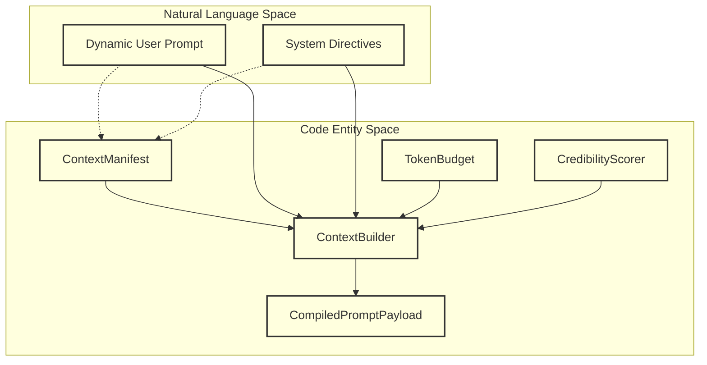
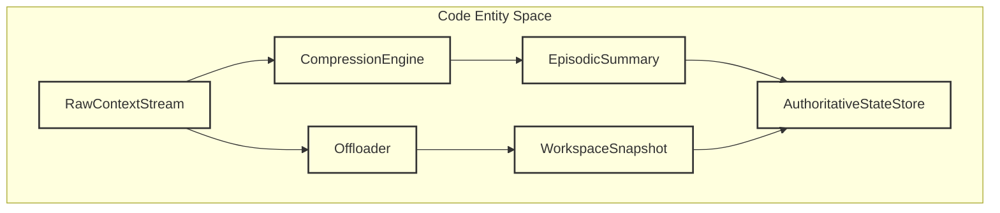
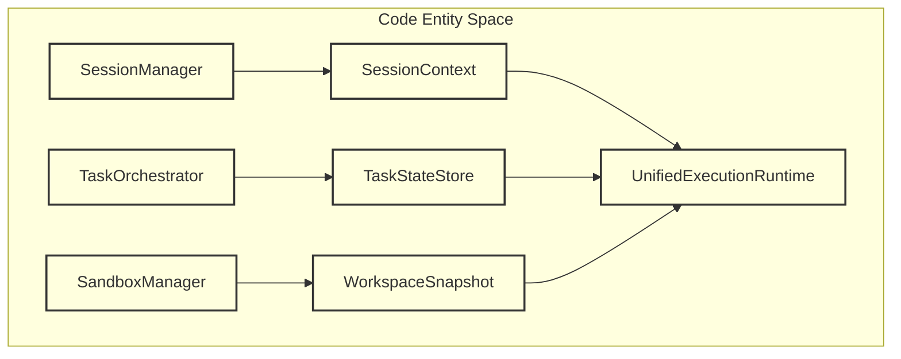
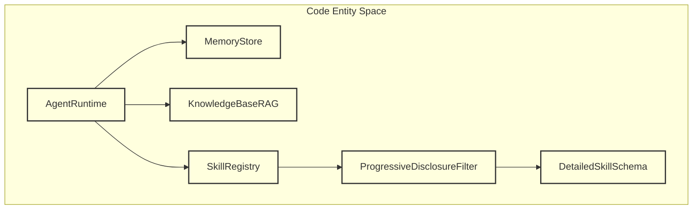

<!-- source: DeepWiki mcp.deepwiki.com · repo aliyun/ai-agent-handbook · page 3.3 Information: Context, State and Reusable Assets (Ch.5) · fetched 2026-10-29 -->

# Information: Context, State and Reusable Assets (Ch.5)

Relevant source files

The following files were used as context for generating this wiki page:

- [02-build/README.md](02-build/README.md)
- [03-run/README.md](03-run/README.md)

## Purpose and Scope
This page details Chapter 5 of the AI Agent Handbook, focusing on the **Information Contract** within harness engineering [02-build/README.md:13-18](). It addresses the core architectural challenge in agentic applications: bridging the gap between finite LLM context windows and a continuously growing task environment [02-build/README.md:13](). It covers the technical design of context building pipelines, state taxonomy (`Session`, `Task State`, `Workspace`) [02-build/README.md:13](), and reusable asset management (`Memory`, `Knowledge`, and progressive `Skill` disclosure) [02-build/README.md:13]().

---

## 1. The Context Building Pipeline and Manifest Architecture

The `ContextBuilder` acts as the primary compilation engine responsible for assembling the prompt input dynamically before each model invocation [02-build/README.md:18](). Rather than relying on static prompt templates, the pipeline ingests a declarative `Manifest` that defines identity constraints, source credibility scores, semantic relevance, and strict `TokenBudget` allocations [02-build/README.md:18]().

*Figure 1: Context compilation flow mapping input streams through `ContextBuilder` and `ContextManifest`.*

**Sources:** `[02-build/README.md:13-18]()`

---

## 2. Managing Context Growth: Compression, Offloading, and Authoritative State

As multi-turn interactions and tool outputs accumulate, naive prompt appending leads to context pollution and performance degradation. The harness employs programmatic compression and offloading strategies:

* **Semantic Compression**: Summarizing older message turns into compact episodic summaries while retaining critical references.
* **External Offloading**: Moving large document contents and file structures out of the immediate model window and into the `Workspace` or `KnowledgeBase`.
* **Authoritative State Sync**: Any critical fact discovered during reasoning must be written immediately to durable storage rather than left solely in the ephemeral context window [02-build/README.md:18]().

*Figure 2: Data flow for context compression and state offloading.*

**Sources:** `[02-build/README.md:13-18]()`

---

## 3. State Taxonomy: Session, Task State, and Workspace

State management in agentic applications is decoupled into three distinct architectural layers to prevent race conditions and ambiguity across long-running tasks:

1. **`Session`**: Captures user interaction continuity, transport metadata, and raw dialogue transcripts [02-build/README.md:18]().
2. **`Task State`**: Tracks verifiable goals, progress checkpoints, and active sub-task finite state machines [02-build/README.md:18]().
3. **`Workspace`**: Provides the physical or virtual sandbox environment (file system, process handles, working memory) that exists entirely outside the model's context window [02-build/README.md:18]().

*Figure 3: Interaction between `SessionManager`, `TaskStateStore`, and `WorkspaceSnapshot` within the runtime.*

**Sources:** `[02-build/README.md:13-18](), [03-run/README.md:13-14]()`

---

## 4. Reusable Assets: Memory, Knowledge, and Progressive Skill Disclosure

Reusable assets decouple domain logic from individual agent prompts, enabling shared capabilities across teams:

* **Memory Store**: Stores short-term episodic facts and long-term user preferences, retrievable via hybrid vector and lexical search.
* **Knowledge Base**: Houses enterprise documents, schemas, and relational ontologies integrated via Retrieval-Augmented Generation (RAG) [03-run/README.md:14]().
* **Skill Registry**: Implements progressive disclosure, where complex tools or procedural capabilities are summarized in high-level capability catalogs, exposing full implementation details and parameter schemas only when the agent specifically invokes them [02-build/README.md:13]().

*Figure 4: Resolution path for reusable assets via `SkillRegistry` and `MemoryStore`.*

**Sources:** `[02-build/README.md:13](), [03-run/README.md:14]()`

---

