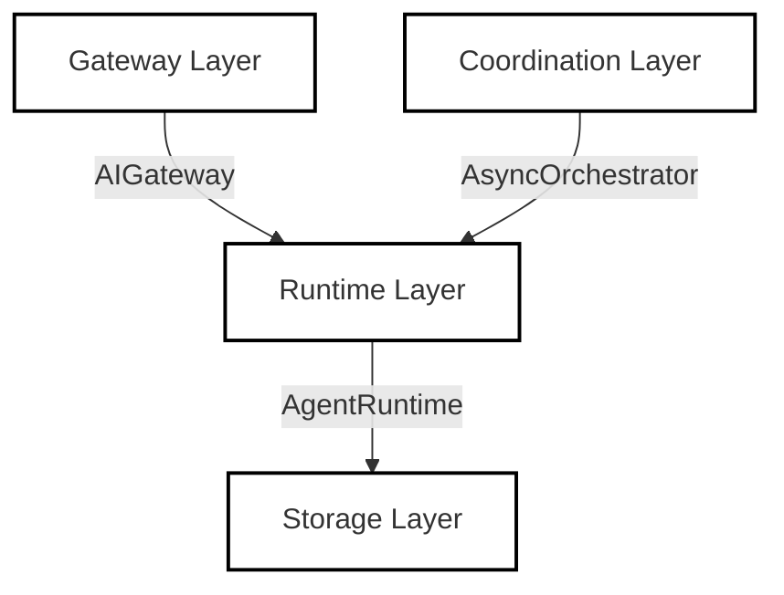

<!-- source: DeepWiki mcp.deepwiki.com · repo aliyun/ai-agent-handbook · page 4 Run: Agent Runtime and Infrastructure · fetched 2026-10-29 -->

# Run: Agent Runtime and Infrastructure

Relevant source files

The following files were used as context for generating this wiki page:

- [02-build/README.md](02-build/README.md)
- [03-run/README.md](03-run/README.md)

This section covers Part 03-run (Chapters 7 through 12) of the AI Agent Handbook [03-run/README.md:1-24](). While development environments prioritize single-session logic, production services must handle execution isolation, state persistence, traffic governance, asynchronous continuation, and distributed multi-agent communication [03-run/README.md:3-8](). 

The infrastructure is organized into two primary tracks:
1. **Execution Foundation**: Ensuring stable, isolated execution, robust state persistence, and governed traffic ingress/egress (Chapters 7–9) [03-run/README.md:9-15]().
2. **Coordination Order**: Managing long-running workflows, multi-agent organizational topologies, and distributed messaging (Chapters 10–12) [03-run/README.md:16-18]().

---

## Overview of Run Architecture

*Figure 4.1: High-Level Runtime and Infrastructure Topology.*

Sources: [03-run/README.md:9-18]()

---

## 4.1 Agent Runtime and Sandbox (Ch.7)

The agent runtime and execution sandbox provide the physical isolation and environmental scaffolding required for agents to execute code, shell commands, and tool calls safely [03-run/README.md:13](). Chapter 7 details how tool execution models are extended into programmable workspaces where agents can iteratively explore solutions without compromising host infrastructure.

For details, see [Agent Runtime and Sandbox (Ch.7)](#4.1).

Sources: [03-run/README.md:13]()

---

## 4.2 State Storage and Semantic Assets (Ch.8)

As agents move past stateless single-turn interactions, state must be externalized across multiple tiers: event logs, checkpoints, workspace snapshots, artifacts, long-term memory, and RAG-based semantic assets [03-run/README.md:14](). Chapter 8 defines the physical storage requirements and unified state contracts needed to maintain consistency across these objects.

For details, see [State Storage and Semantic Assets (Ch.8)](#4.2).

Sources: [03-run/README.md:14]()

---

## 4.3 AI Gateway and Unified Traffic Governance (Ch.9)

Chapter 9 establishes the AI Gateway as the centralized enforcement point for all external and internal traffic [03-run/README.md:15](). It separates traffic governance into distinct semantics for LLMs, Model Context Protocols (MCP), and Agent-to-Agent (A2A) interactions, handling authentication, budgeting, rate limiting, auditing, and human-in-the-loop (HITL) approvals [03-run/README.md:15]().

For details, see [AI Gateway and Unified Traffic Governance (Ch.9)](#4.3).

Sources: [03-run/README.md:15]()

---

## 4.4 Async Tasks and Automation Flows (Ch.10)

Production tasks often outlive standard HTTP request lifecycles. Chapter 10 draws the boundary between synchronous and asynchronous operations, introducing layered completion semantics, scheduled triggers, and automation pipelines to prevent task loss or duplicate execution during long-running operations [03-run/README.md:16]().

For details, see [Async Tasks and Automation Flows (Ch.10)](#4.4).

Sources: [03-run/README.md:16]()

---

## 4.5 Multi-Agent Collaboration and Distributed Communication (Ch.11–12)

When scaling from a single agent to a multi-agent team, coordination and messaging become critical [03-run/README.md:17-18](). Chapters 11 and 12 cover heterogenous agent onboarding, organizational topologies, task assignment, result aggregation, and a comprehensive communication selection map spanning capability, collaboration, internal, and human-machine planes [03-run/README.md:17-18]().

For details, see [Multi-Agent Collaboration and Distributed Communication (Ch.11–12)](#4.5).

Sources: [03-run/README.md:17-18]()

---

