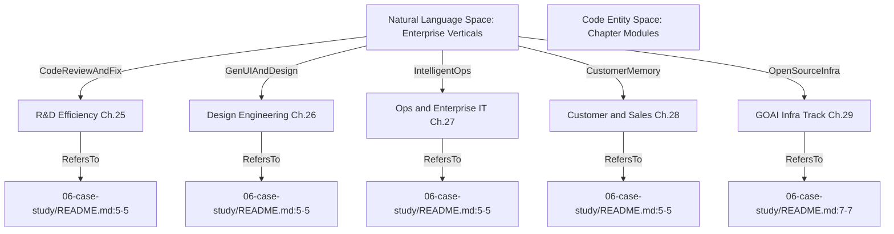
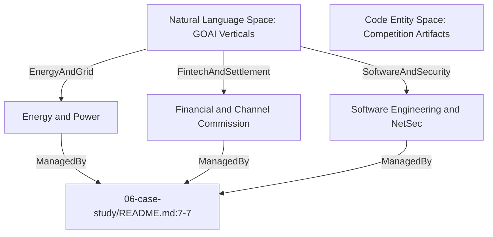

<!-- source: DeepWiki mcp.deepwiki.com · repo aliyun/ai-agent-handbook · page 7 Case Studies and Industry Practice · fetched 2026-10-29 -->

# Case Studies and Industry Practice

Relevant source files

The following files were used as context for generating this wiki page:

- [06-case-study/README.md](06-case-study/README.md)

## Purpose and Scope

Part 06-case-study (`06-case-study/README.md:1-7`) bridges theoretical architecture, harness construction, runtime infrastructure, governance, and optimization by examining real-world enterprise deployments and cutting-edge open-source competition projects. This section covers four primary vertical domains—Research & Development efficiency, Design Engineering, Operations, Security & Enterprise IT, and Customer, Sales & Operations—alongside the GOAI World Artificial Intelligence Open Source Competition Agent Infra track (`06-case-study/README.md:3-7`). 

The following diagram illustrates how natural language use-cases across these enterprise verticals map to the underlying codebase structure and chapters within Part 06:

Sources: `06-case-study/README.md:1-7`

---

## 7.1. R&D Efficiency Cases (Ch.25)

Chapter 25 explores software engineering workflows enhanced by AI agents, featuring seven core scenarios developed across Alibaba (`06-case-study/README.md:5-5`). These include automated code review agents, kernel patch generation agents, PolarDB-X database optimization loops, multi-agent developer teams, and end-to-end software delivery pipelines. These cases highlight how harness patterns and validation loops can be integrated into day-to-day developer workflows.

For details, see [R&D Efficiency Cases (Ch.25)](#7.1).

Sources: `06-case-study/README.md:5-5`

---

## 7.2. Design Engineering: GenUI and Vibe Designing (Ch.26)

Chapter 26 focuses on design engineering paradigms, detailing two primary approaches: Generative UI (GenUI) delivery and intent-driven Vibe Designing (`06-case-study/README.md:5-5`). These paradigms shift user interfaces from static layouts to dynamic, runtime-generated components driven by user intent, lowering the barrier between design specifications and frontend execution.

For details, see [Design Engineering: GenUI and Vibe Designing (Ch.26)](#7.2).

Sources: `06-case-study/README.md:5-5`

---

## 7.3. Ops, Security and Enterprise IT Cases (Ch.27)

Chapter 27 examines production-scale enterprise infrastructure and retail operations across three key organizations: Chanjet (observability), Geely Automobile (intelligent operations), and Tastien (closed-loop retail operations) (`06-case-study/README.md:5-5`). These cases demonstrate how agentic loops handle log analysis, automated fault recovery, and operational decision-making under high-throughput conditions.

For details, see [Ops, Security and Enterprise IT Cases (Ch.27)](#7.3).

Sources: `06-case-study/README.md:5-5`

---

## 7.4. Customer, Sales and Operations Cases (Ch.28)

Chapter 28 highlights customer-facing and analytical applications through four implementations: MiniMax's long-horizon memory base, Bilibili's content insight engines, Shinewing's office and accounting efficiency tools, and Alibaba's Data Agent analytics frameworks (`06-case-study/README.md:5-5`). These systems emphasize context persistence, semantic asset management, and natural language data querying.

For details, see [Customer, Sales and Operations Cases (Ch.28)](#7.4).

Sources: `06-case-study/README.md:5-5`

---

## 7.5. GOAI Agent Infra Track (Ch.29)

Chapter 29 reviews open-source contributions from the GOAI World Artificial Intelligence Open Source Competition Agent Infra track, presenting nine projects spanning eleven distinct vertical domains (`06-case-study/README.md:7-7`). 

The mapping between competition domains and codebase components is outlined below:

Sources: `06-case-study/README.md:7-7`

Covered sectors include energy and power, financial systems, architectural engineering design, retail chains, digital content (gaming, XR, e-commerce), enterprise governance, financial accounting and commission settlement, software engineering delivery, IT operations and disaster recovery, network security operations, and data engineering (`06-case-study/README.md:7-7`).

For details, see [GOAI Agent Infra Track (Ch.29)](#7.5).

Sources: `06-case-study/README.md:7-7`

---

