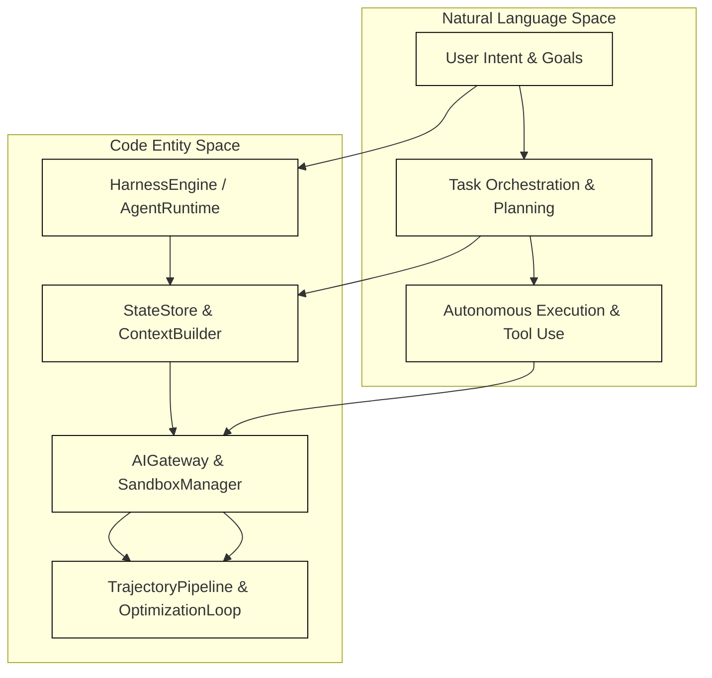
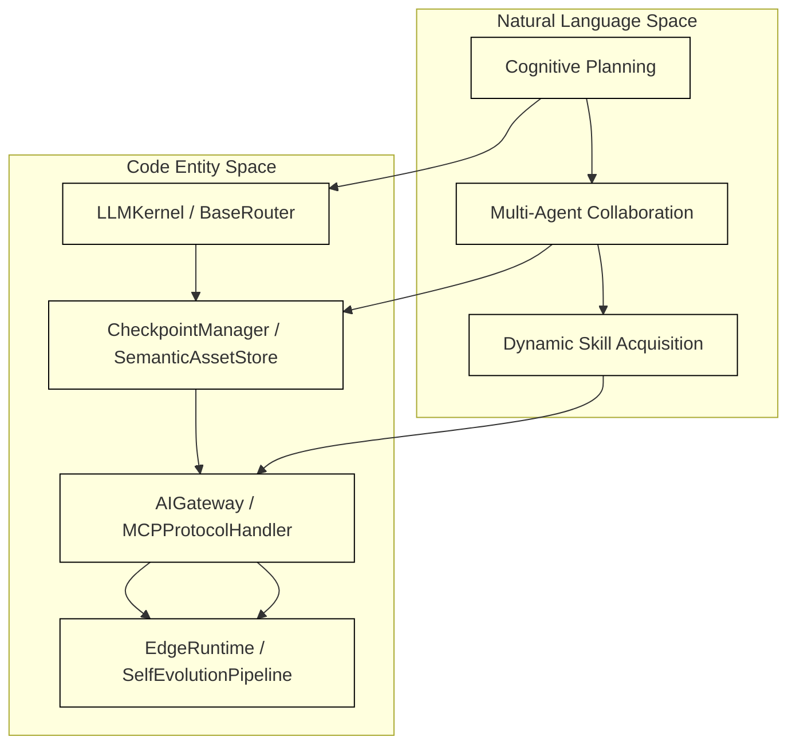

<!-- source: DeepWiki mcp.deepwiki.com · repo aliyun/ai-agent-handbook · page 8 Conclusion: From Agentic Application to Agentic OS · fetched 2026-10-29 -->

# Conclusion: From Agentic Application to Agentic OS

Relevant source files

The following files were used as context for generating this wiki page:

- [00-preface/00-preface.md](00-preface/00-preface.md)

This page defines the scope and technical outlook of Chapter 30, serving as the culmination of the AI Agent Handbook. It details how the core pillars—architecture, harness engineering, runtime infrastructure, governance, and optimization data flywheels—converge to shift the engineering paradigm from isolated agentic applications toward an integrated *Agentic OS*.

---

## 1. The Convergence of the AI Agent Lifecycle

The handbook structures the engineering lifecycle into five foundational dimensions: architectural selection, harness construction, runtime execution, governance, and continuous optimization [00-preface/00-preface.md:76-88](). As cognitive capabilities transform into widely available, low-cost commodities, the primary engineering challenge transitions from prompting models to orchestrating complex, long-running agentic tasks under strict determinism and budgetary constraints [00-preface/00-preface.md:7-19]().

*Figure 1: Lifecycle Convergence Mapping Natural Language Intent to Code Entities*

Sources: `00-preface/00-preface.md:7-35` [00-preface/00-preface.md:7-35](), `00-preface/00-preface.md:76-88` [00-preface/00-preface.md:76-88]()

---

## 2. From Application Harness to Agentic OS

The evolution from traditional software to agentic architectures requires shifting the engineering center of gravity away from isolated prompt scripts toward a robust *Harness Engineering* framework [00-preface/00-preface.md:29-32](). In this new paradigm, the foundational LLM acts as the computational kernel, while the surrounding system runtime manages memory, concurrency, tool security, and state checkpointing—analogous to a traditional operating system managing hardware resources.

*Figure 2: Agentic OS Stack Bridge from Cognitive Intent to System Infrastructure*

Sources: `00-preface/00-preface.md:29-32` [00-preface/00-preface.md:29-32](), `00-preface/00-preface.md:76-88` [00-preface/00-preface.md:76-88]()

---

## 3. Autonomous Co-Evolution and Future Outlook

As systems scale from single-agent pilots to multi-agent enterprise topologies, the boundary between application code and runtime infrastructure dissolves. The feedback loops established through trajectory data capture, golden dataset curation, and badcase optimization form a continuous self-evolution pipeline [00-preface/00-preface.md:86-88](). This ensures that the Agentic OS not only executes deterministic workflows but also learns from operational anomalies to autonomously upgrade its skill sets, tool integrations, and safety guardrails.

Sources: `00-preface/00-preface.md:86-88` [00-preface/00-preface.md:86-88]()

---

