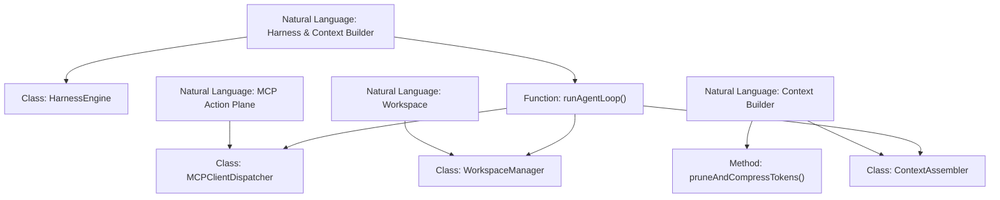
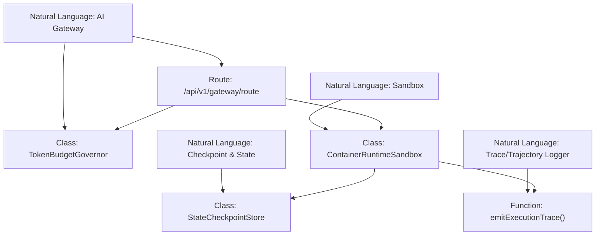

<!-- source: DeepWiki mcp.deepwiki.com · repo aliyun/ai-agent-handbook · page 9 Glossary · fetched 2026-10-29 -->

# Glossary

Relevant source files

The following files were used as context for generating this wiki page:

- [00-preface/00-preface.md](00-preface/00-preface.md)
- [06-case-study/README.md](06-case-study/README.md)
- [README.md](README.md)
- [README_EN.md](README_EN.md)

## Purpose and Scope

This glossary defines the core technical terminology, architectural abstractions, and engineering concepts used across the AI Agent HandBook. It serves as a semantic reference to align developers, architects, and product leaders on standard definitions for agentic systems—spanning architecture, build patterns, runtime infrastructure, governance, and optimization flywheels. Each term includes chapter file pointers indicating where the concept is thoroughly analyzed in the codebase and documentation repository.

Sources: [README.md:50-65](), [README_EN.md:47-64]()

---

## Core Technical Terms

### 1. Harness
* **Definition**: The systems-engineering boundary and execution container surrounding a base Large Language Model (LLM). It manages state, tool calling loops, memory access, and safety guardrails, separating model intelligence from deterministic application logic.
* **Chapter Pointer**: Chapter 3 (`02-build/第 3 章 范式：Harness 的主流构建方式和责任边界.md`) [README.md:72-72]()

### 2. Agentic Application
* **Definition**: A software application where workflows are dynamically orchestrated by LLM-driven agents rather than hardcoded control flows, capable of perceiving environments, planning multi-step tasks, and executing tool calls autonomously.
* **Chapter Pointer**: Chapters 1–2 (`01-architecture/`) [README.md:58-58]()

### 3. Agentic OS
* **Definition**: The conceptual macro-operating system layer for the intelligent era that abstracts heterogeneous computing resources, model inference nodes, execution sandboxes, agent IPC (Inter-Process Communication), and memory persistence.
* **Chapter Pointer**: Chapter 30 (`07-conclusion/第 30 章 从 Agentic Application 到 Agentic OS.md`) [README.md:64-64]()

### 4. AI Gateway
* **Definition**: A centralized traffic governance and proxy tier responsible for LLM/MCP/agent routing, identity verification, budget/quota enforcement, audit logging, rate limiting, and sensitive data masking.
* **Chapter Pointer**: Chapter 9 (`03-run/第 9 章  AI 网关与统一流量治理.md`) [README.md:78-78]()

### 5. MCP (Model Context Protocol)
* **Definition**: An open standard protocol designed for connecting AI models securely to local and remote data sources, tool servers, and enterprise systems through standardized JSON-RPC client-server contracts.
* **Chapter Pointer**: Chapter 6 (`02-build/第 6 章 行动：受控执行、验证反馈与交付准备.md`) [README.md:75-75]()

### 6. A2A (Agent-to-Agent)
* **Definition**: Protocols and communication patterns enabling decoupled, multi-agent systems to discover peers, exchange structured messages, negotiate task delegations, and aggregate decentralized outputs.
* **Chapter Pointer**: Chapters 6 & 12 (`02-build/`, `03-run/第 12 章 Agent 分布式通信.md`) [README.md:75-75, 81-81]()

### 7. Trace / Trajectory
* **Definition**: A `Trace` records the sequential execution spans and intermediate reasoning steps of a single invocation; a `Trajectory` aggregates full state transitions, tool inputs/outputs, and decision trees across long-horizon tasks for evaluation.
* **Chapter Pointer**: Chapters 13 & 19 (`04-governance/`, `05-optimization/`) [README.md:82-82, 88-88]()

### 8. Golden Dataset
* **Definition**: A curated, high-quality collection of evaluation test cases containing deterministic inputs, expected reasoning trajectories, ground-truth final outputs, and automated assertion criteria.
* **Chapter Pointer**: Chapter 21 (`05-optimization/第 21 章　Agent 黄金数据集.md`) [README.md:90-90]()

### 9. Badcase
* **Definition**: An execution instance where an agent fails to achieve its objective due to reasoning errors, tool invocation crashes, hallucinated parameters, or infinite execution loops, serving as raw material for regression testing.
* **Chapter Pointer**: Chapter 22 (`05-optimization/第 22 章　Agent 优化：Badcase.md`) [README.md:91-91]()

### 10. HITL (Human-in-the-Loop)
* **Definition**: A governance mechanism that pauses agent execution at critical phase gates or high-risk tool invocations to request human authorization, inspection, or correction before proceeding.
* **Chapter Pointer**: Chapter 6 (`02-build/第 6 章 行动：受控执行、验证反馈与交付准备.md`) [README.md:75-75]()

### 11. GenUI (Generative UI)
* **Definition**: A paradigm where agents dynamically compose and render user interfaces (widgets, tables, forms) at runtime based on user intent and structured data payload requirements rather than static templates.
* **Chapter Pointer**: Chapter 26 (`06-case-study/第26章 设计工程/`) [README.md:95-95]()

### 12. Vibe Designing
* **Definition**: An intent-driven design methodology where developers and designers express high-level stylistic or functional intent through natural language, allowing AI systems to generate complete design artifacts and codebases.
* **Chapter Pointer**: Chapter 26 (`06-case-study/第26章 设计工程/`) [README.md:95-95]()

### 13. Sandbox
* **Definition**: An isolated execution environment (e.g., lightweight containers or micro-VMs) where agents execute untrusted generated code, shell commands, and data transformations securely without risking host system integrity.
* **Chapter Pointer**: Chapter 7 (`03-run/第 7 章  Agent 运行时与沙箱.md`) [README.md:76-76]()

### 14. Checkpoint
* **Definition**: A persistent snapshot of an agent's task state, working memory, execution stack, and variable bindings taken at discrete intervals to enable crash recovery, rollbacks, and asynchronous resumption.
* **Chapter Pointer**: Chapter 8 (`03-run/第 8 章 Agent 状态存储与语义资产.md`) [README.md:77-77]()

### 15. Workspace
* **Definition**: The dedicated file system and memory container allocated to an agent session where it reads files, writes code patches, stores intermediate artifacts, and maintains working directory context.
* **Chapter Pointer**: Chapters 5 & 7 (`02-build/`, `03-run/`) [README.md:74-74, 76-76]()

### 16. Context Builder
* **Definition**: An internal component responsible for assembling, prioritizing, compressing, and pruning system prompts, historical messages, RAG retrieved chunks, and tool schemas within the model's token window limits.
* **Chapter Pointer**: Chapter 5 (`02-build/第 5 章 信息：上下文、状态与可复用能力资产.md`) [README.md:74-74]()

### 17. Managed Agent
* **Definition**: A fully hosted agent service where infrastructure scaling, retry logic, state persistence, and security guardrails are managed by a platform provider, exposing high-level declarative APIs to developers.
* **Chapter Pointer**: Chapter 3 (`02-build/第 3 章 范式：Harness 的主流构建方式和责任边界.md`) [README.md:72-72]()

### 18. Self-evolution
* **Definition**: A guarded feedback loop where an agent analyzes its past execution traces and badcases to autonomously synthesize new reusable skills, prompt refinements, or tool definitions under human supervision.
* **Chapter Pointer**: Chapter 23 (`05-optimization/第 23 章　受控自进化.md`) [README.md:92-92]()

### 19. Edge Runtime
* **Definition**: A lightweight agent execution engine optimized for deployment on edge devices, local servers, or client browsers with constrained compute resources and low-latency requirements.
* **Chapter Pointer**: Chapter 24 (`05-optimization/第 24 章　Agent 边缘运行时与全球优化.md`) [README.md:93-93]()

### 20. Agent Infra
* **Definition**: The foundational software stack, platforms, and toolchains supporting agent execution, including runtimes, gateways, vector databases, evaluation pipelines, and telemetry systems.
* **Chapter Pointer**: Chapter 29 (`06-case-study/第 29 章 GOAI Agent Infra 赛道...`) [README.md:98-98]()

Sources: [README.md:66-99](), [00-preface/00-preface.md:74-90]()

---

## Architecture Mapping: Natural Language Space to Code Entity Space

To bridge high-level conceptual terms with concrete software design, the following diagrams associate system architectural terms with their corresponding code entities, classes, and routing modules in agentic codebases.

### Diagram 1: Build & Harness Entities

Sources: [README.md:72-75](), [00-preface/00-preface.md:74-81]()

### Diagram 2: Runtime, Gateway & State Entities

Sources: [README.md:76-82](), [00-preface/00-preface.md:81-87]()