# Page: Overview: AI Agent HandBook

# Overview: AI Agent HandBook

<details>
<summary>Relevant source files</summary>

The following files were used as context for generating this wiki page:

- [.gitignore](.gitignore)
- [00-preface/00-preface.md](00-preface/00-preface.md)
- [LICENSE](LICENSE)
- [README.md](README.md)
- [README_EN.md](README_EN.md)

</details>


## Purpose and Scope

The `ai-agent-handbook` repository provides a comprehensive technical reference for designing, building, running, governing, and optimizing enterprise-grade AI agents [README.md:5-10]. As the industry transitions from probabilistic experimentation to reliable production productivity, this whitepaper addresses key engineering, scaling, and organizational challenges [README.md:17-22]. It outlines a systematic approach to moving from basic Chatbot and Copilot iterations toward autonomous `Agent` and `Managed Agent` architectures capable of executing complex multi-step workflows [00-preface/00-preface.md:17-20].

Sources: `README.md:5-27`, `00-preface/00-preface.md:37-52`

---

## Lifecycle Structure and Reading Guide

The repository is structured around the complete application lifecycle of agentic systems, spanning architecture, harness construction, runtime execution, security governance, data optimization, and real-world industrial case studies [README.md:52-65]. 

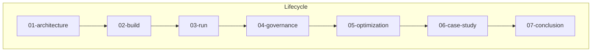
Sources: `README.md:52-64`

### Lifecycle Phases Overview

- **Architecture (Part 1, Ch. 1–2)**: Defines AI-native application forms, determinism requirements, and layered reference architectures separating model capabilities from system harnesses [README.md:70-71].
- **Build (Part 2, Ch. 3–6)**: Focuses on `Harness` engineering, task state machines, context builders, memory assets, and controlled tool execution via `MCP` and `Function Calling` [README.md:72-75].
- **Run (Part 3, Ch. 7–12)**: Covers execution sandboxes, event logs, `AI Gateway` traffic governance, asynchronous task pipelines, and distributed multi-agent communication [README.md:76-81].
- **Governance (Part 4, Ch. 13–16)**: Implements observability traces, prompt injection defense, asset registries, and pre-release behavior simulation [README.md:82-85].
- **Optimization (Part 5, Ch. 17–24)**: Establishes a data flywheel using trajectory capture, golden datasets, badcase loops, and controlled self-evolution [README.md:86-93].
- **Case Studies (Part 6, Ch. 25–29)**: Examines real-world deployments across R&D efficiency, design engineering (`GenUI`), enterprise IT, and open-source infrastructure [README.md:94-98].

Sources: `README.md:52-99`

---

## Child Pages & Core Sections

This parent page coordinates access to detailed sub-topics. Refer to the designated child pages for granular architectural specifications and contributor guidelines:

- **1.1 Repository Layout and Contribution Workflow**: Details directory conventions (`00-preface` through `07-conclusion`, asset storage under `assets/imgs/chapter-NN`), bilingual documentation (`README.md` and `README_EN.md`), `.gitignore` rules, and Apache 2.0 licensing [README.md:1-65, .gitignore:1-7, LICENSE:2-126]. For details, see [Repository Layout and Contribution Workflow](#1.1).
- **1.2 Preface and 2026 Agent Developer Survey**: Analyzes the shift from `Chatbot` to `Copilot` to `Agent`, alongside enterprise developer survey findings and production metrics [00-preface/00-preface.md:1-91]. For details, see [Preface and 2026 Agent Developer Survey](#1.2).

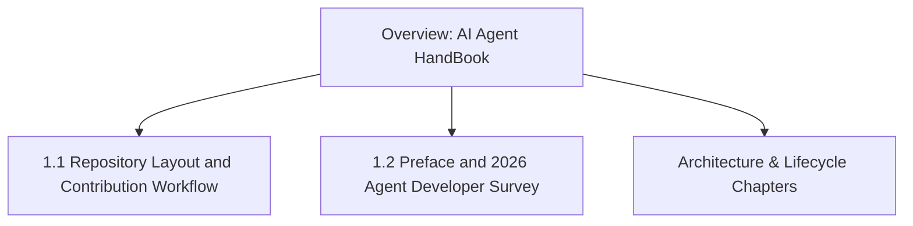
Sources: `README.md:1-116`, `00-preface/00-preface.md:1-91`

---

# Page: Repository Layout and Contribution Workflow

# Repository Layout and Context and Contribution Workflow

<details>
<summary>Relevant source files</summary>

The following files were used as context for generating this wiki page:

- [.gitignore](.gitignore)
- [LICENSE](LICENSE)
- [README.md](README.md)
- [README_EN.md](README_EN.md)

</details>


## Purpose and Scope

This document defines the structural conventions, directory layouts, bilingual documentation policies, asset organization schemas, version control exclusion rules, and licensing frameworks governing the `ai-agent-handbook` repository. Designed for contributors, maintainers, and technical reviewers, this page establishes the engineering standards required to maintain structural integrity across the whitepaper's lifecycle phases—spanning preface, architecture, building, runtime, governance, optimization, case studies, and conclusion.

Sources: `README.md:1-11`, `README_EN.md:1-10`

---

## Repository Directory Conventions

The repository organizes its core content into functional directories mirroring the software and lifecycle stages of enterprise AI agents. The root directory contains master navigation manifests, configuration rules, licensing data, and dedicated chapter modules (`00-preface` through `07-conclusion`).

```
ai-agent-handbook/
├── README.md                  # Primary Chinese master entry and navigation manifest
├── README_EN.md               # English master entry and navigation counterpart
├── 2026-agent-survey-report.md # Enterprise agent survey data asset
├── 00-preface/                # Whitepaper framing and structural overview
├── 01-architecture/           # Part 1: AI-native applications and reference architecture
├── 02-build/                  # Part 2: Harness paradigms, tasks, information, and actions
├── 03-run/                    # Part 3: Runtime, sandboxes, state storage, AI gateway, and multi-agent
├── 04-governance/             # Part 4: Observability, security, asset management, and behavior verification
├── 05-optimization/           # Part 5: Model tuning, trajectory pipelines, golden datasets, and self-evolution
├── 06-case-study/             # Part 6: Vertical industry practice and GOAI agent infrastructure tracks
├── 07-conclusion/             # Part 7: Convergence toward Agentic OS
├── .gitignore                 # Version control exclusion rules
└── LICENSE                    # Apache 2.0 Licensing terms
```

### Diagram: Repository Directory Layout Entity Flow

```mermaid
graph TD
    Root["ai-agent-handbook root"] --> ReadmeCN["README.md"]
    Root --> ReadmeEN["README_EN.md"]
    Root --> Survey["2026-agent-survey-report.md"]
    Root --> Preface["00-preface/"]
    Root --> Arch["01-architecture/"]
    Root --> Build["02-build/"]
    Root --> Run["03-run/"]
    Root --> Gov["04-governance/"]
    Root --> Opt["05-optimization/"]
    Root --> Case["06-case-study/"]
    Root --> Concl["07-conclusion/"]
    Root --> GitIgnore[".gitignore"]
    Root --> Lic["LICENSE"]

    subclassDef code fill:#f9f9f9,stroke:#333,stroke-width:1px;
    class Root,ReadmeCN,ReadmeEN,Survey,Preface,Arch,Build,Run,Gov,Opt,Case,Concl,GitIgnore,Lic code;
```

Sources: `README.md:52-64`, `README_EN.md:53-63`, `.gitignore:1-7`, `LICENSE:1-126`

---

## Bilingual Documentation Architecture

The repository enforces a dual-language synchronization strategy centered around `README.md` (Primary Chinese) and `README_EN.md` (English counterpart). 

*   **Primary Manifest (`README.md`)**: Acts as the authoritative source of truth for structural updates, chapter indices, navigation maps, and detailed technical descriptions. It defines the complete breakdown of chapters 1 through 30 and case study mappings (`README.md:52-116`).
*   **English Companion (`README_EN.md`)**: Mirrors the structural topology and navigation schema of the primary manifest to ensure global accessibility (`README_EN.md:47-115`). Cross-links between files maintain relative path integrity to support standard Markdown parsers and documentation rendering engines.

Sources: `README.md:1-3`, `README_EN.md:1-4`, `README.md:52-116`, `README_EN.md:47-115`

---

## Image Asset Organization and Naming Conventions

Visual artifacts, architectural schemas, and data flow diagrams embedded within chapters follow a strict directory hierarchy and naming convention:

*   **Asset Path Convention**: Chapter-specific image assets are housed under localized or centralized asset paths associated with their respective chapters (e.g., `assets/imgs/chapter-NN/`).
*   **Naming Schema**: Asset filenames must be kebab-case, descriptive, and prefixed with the relevant chapter identifier (e.g., `ch02-agentic-reference-architecture.png`, `ch07-sandbox-lifecycle.svg`). This prevents naming collisions and simplifies cross-referencing in markdown documents.

Sources: `README.md:52-64`

---

## Version Control Exclusions (`.gitignore`)

To maintain a clean working tree and prevent local development artifacts, environment specifics, or proprietary AI scratchpads from being committed, the repository defines explicit `.gitignore` exclusion rules:

```text
.DS_Store
.idea
.vscode
.claude
.cursor
.codex
*.impl
```

*   **OS Artifacts**: `.DS_Store` suppresses macOS directory metadata files (`.gitignore:1`).
*   **IDE Configurations**: `.idea` and `.vscode` exclude JetBrains and Visual Studio Code IDE workspace settings (`.gitignore:2-3`).
*   **AI Coding Assistant States**: `.claude`, `.cursor`, and `.codex` directories insulate local AI agent execution contexts, prompts, and temporary state caches generated by developer toolchains (`.gitignore:4-6`).
*   **Implementation Scratchpads**: `*.impl` wildcards prevent raw, uncommitted implementation drafts from polluting upstream PRs (`.gitignore:7`).

Sources: `.gitignore:1-7`

---

## Licensing and Governance Framework

The repository is licensed under the **Apache License, Version 2.0**, governing all source code, documentation, whitepaper text, and derived assets (`LICENSE:1-203`).

*   **Copyright Grant**: Contributors grant a perpetual, worldwide, non-exclusive, royalty-free copyright and patent license to reproduce, prepare derivative works of, publicly display, and distribute the work (`LICENSE:67-88`).
*   **Modification Notice**: Any modified files must carry prominent notices stating that the files were changed, and retain all upstream copyright, patent, trademark, and attribution notices from the source form (`LICENSE:98-105`).

Sources: `LICENSE:1-203`

---

## Contribution Workflow and Review Lifecycle

Contributors proposing changes to the whitepaper, architectural diagrams, or case studies must adhere to a structured validation pipeline.

### Diagram: Contribution Lifecycle and Validation Workflow

```mermaid
graph TD
    Fork["Fork & Clone Repository"] --> Branch["Create Feature Branch"]
    Branch --> Edit["Edit Content / Markdown Files"]
    Edit --> CheckGit["Verify .gitignore & Asset Paths"]
    CheckGit --> PR["Submit Pull Request"]
    PR --> Review["Automated & Peer Review"]
    Review --> Merge["Merge to Main Branch"]

    subclassDef code fill:#f9f9f9,stroke:#333,stroke-width:1px;
    class Fork,Branch,Edit,CheckGit,PR,Review,Merge code;
```

Sources: `README.md:1-116`, `.gitignore:1-7`

---

# Page: Preface and 2026 Agent Developer Survey

# Preface and 2026 Agent Developer Survey

<details>
<summary>Relevant source files</summary>

The following files were used as context for generating this wiki page:

- [00-preface/00-preface.md](00-preface/00-preface.md)
- [2026-agent-survey-report.md](2026-agent-survey-report.md)

</details>


## Purpose and Scope
This page establishes the foundational framing of the AI Agent Handbook whitepaper and analyzes empirical data from the 2026 Enterprise Agent Developer Survey (`1906` valid responses). It bridges the macroeconomic shift from conversational AI to autonomous agentic systems (`Chatbot → Copilot → Agent`) with the concrete engineering bottlenecks reported by industry practitioners, mapping them directly to the whitepaper's architectural lifecycle (`00-preface/00-preface.md:1-35`, `2026-agent-survey-report.md:1-4`).

---

## 1. The Paradigm Evolution: Chatbot to Managed Agent
The whitepaper frames the maturation of AI-native applications through an evolutionary trajectory categorized by autonomy, determinism requirements, and human-in-the-loop (`HITL`) depth (`00-preface/00-preface.md:17-20`). 

As cognitive processing costs decline, application architectures shift from reactive text generation to goal-directed autonomous execution:
* **Chatbot Stage**: Reactive, stateless interactions where models answer questions based on immediate prompt context.
* **Copilot Stage**: Human-led, model-assisted execution where users perform actions while the model provides suggestions or draft code.
* **Agent & Managed Agent Stage**: Autonomous execution where the system takes responsibility for an entire task, workflow, or job function, requiring deterministic runtime guarantees, sandboxing, and explicit authorization boundaries.

```mermaid
graph TD
    "ChatbotPhase" --> "CopilotPhase"
    "CopilotPhase" --> "AgentPhase"
    "AgentPhase" --> "ManagedAgentPhase"
```

Sources: `[00-preface/00-preface.md:17-32]()`

---

## 2. From Model-Centricity to Harness Engineering
A core thesis of the whitepaper is that raw base models no longer constitute the center of application architecture (`00-preface/00-preface.md:29-32`). Instead, production readiness relies heavily on **Harness Engineering**—the system architecture wrapping around the base model to constrain, feed, and govern its behavior.

```mermaid
graph TD
    "BaseModelLayer" --> "HarnessEngineeringLayer"
    "HarnessEngineeringLayer" --> "RuntimeAndSandbox"
    "HarnessEngineeringLayer" --> "AIGateway"
    "HarnessEngineeringLayer" --> "MemoryAndSkillAssets"
    "HarnessEngineeringLayer" --> "ObservabilityAndEvaluation"
```

Sources: `[00-preface/00-preface.md:29-35]()`

---

## 3. 2026 Agent Developer Survey Findings
The 2026 enterprise survey (`1906` technical decision-makers, architects, and engineers) highlights a major dichotomy between investment intent and production deployment (`2026-agent-survey-report.md:1-10`):

1. **Investment vs. Production Disconnect**: While `46%` of organizations are actively developing or have completed agent projects, only `18%` have successfully deployed agents into live production environments (`2026-agent-survey-report.md:7-10`).
2. **Architectural Coexistence**: Single-Agent (`40%`), Multi-Agent (`42%`), and Human-in-the-Loop (`15%`) architectures coexist as adjustable parameters of autonomy rather than mutually exclusive generational technologies (`2026-agent-survey-report.md:11-14`).
3. **Coding as the Scaled Baseline**: AI Coding tools (such as Claude Code, Cursor, and Qoder) represent the primary commercialized breakout market (`57%` adoption) due to clear verification signals, strict workspace sandboxing, and well-defined compiler/test feedback loops (`2026-agent-survey-report.md:15-18`).
4. **Core Infrastructure Bottlenecks**: Enterprises identify context/memory decay, multi-model cost governance, and automated trajectory evaluation as their top unresolved engineering hurdles (`2026-agent-survey-report.md:19-22`).

Sources: `[2026-agent-survey-report.md:1-30]()`

---

## 4. Mapping Survey Pain Points to System Architecture
To bridge natural language survey feedback with concrete codebase entities, industry pain points map directly to specific architectural components within the handbook:

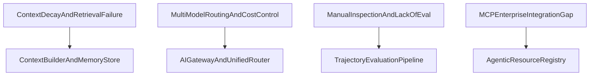

* **Context Decay (`54%` retrieval failure rate)**: Addressed via persistent state storage, vector indexing, and structured memory managers (`[2026-agent-survey-report.md:90-97]()`).
* **Multi-Model Routing (`63%` gateway demand)**: Addressed via unified traffic governance (`AI Gateway`) managing fallback, rate-limiting, and cost attribution (`[2026-agent-survey-report.md:22-26]()`).
* **Evaluation Deficit (`55%` relying on manual spot-checks)**: Addressed via automated trajectory evaluation and golden dataset pipelines (`[2026-agent-survey-report.md:125-130]()`).
* **MCP Integration Gap (`9%` private enterprise deployment)**: Addressed via centralized asset discovery registries (`[2026-agent-survey-report.md:100-106]()`).

Sources: `[2026-agent-survey-report.md:90-147]()`

---

# Page: Architecture: Agentic Applications

# Architecture: Agentic Applications

<details>
<summary>Relevant source files</summary>

The following files were used as context for generating this wiki page:

- [01-architecture/README.md](01-architecture/README.md)

</details>


## Purpose and Scope
This page provides an overview of Part 01 (`01-architecture`), which establishes the foundational shift in building AI-native applications `[01-architecture/README.md:1-8]`. As models evolve from simple text-generation engines into execution agents capable of maintaining state, planning goals, and invoking tools, system design shifts from single API calls to comprehensive architectures comprising both the model and its external execution harness `[01-architecture/README.md:3-6]`. 

For deep technical details, see the child pages:
- [The New Stage of AI-Native Applications (Ch.1)](#2.1)
- [Agentic Application Reference Architecture (Ch.2)](#2.2)

---

## Overview: The Shift to Agentic Systems

In modern AI architectures, the model alone does not constitute an agent. Long-running tasks, complex tool integrations, and environmental interactions require an engineering construct known as the **Harness** `[01-architecture/README.md:3-6]`. The relationship between the LLM and the surrounding system components can be conceptualized through the integration of the model client and the harness engine.

### Diagram: Model and Harness Responsibility Split
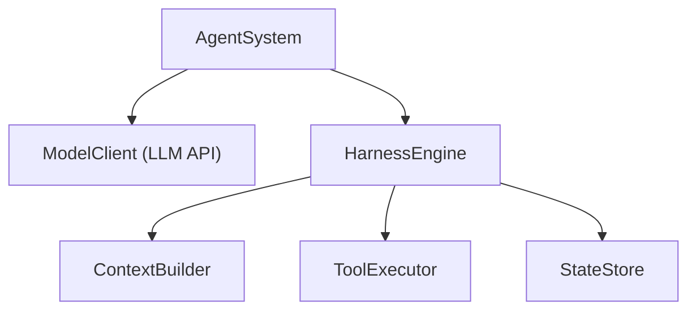
*Sources: `[01-architecture/README.md:3-6]()`*

---

## 2.1. The New Stage of AI-Native Applications (Ch.1)

Chapter 1 addresses application forms, the coexistence of workflows versus autonomous agents, and enterprise maturity models `[01-architecture/README.md:11]`. It emphasizes that application形态 (forms) and maturity levels are not defined by marketing names, but by matching agent autonomy against task risk to select the lowest sufficient architecture `[01-architecture/README.md:14]`.

For detailed exploration of application forms, determinism requirements, and selection matrices, see [The New Stage of AI-Native Applications (Ch.1)](#2.1).

*Sources: `[01-architecture/README.md:11-15]()`*

---

## 2.2. Agentic Application Reference Architecture (Ch.2)

Chapter 2 establishes the structural blueprint of agentic systems using three distinct architectural views: the **Component View**, the **Platform View**, and the **Lifecycle View** `[01-architecture/README.md:12,16]`. These views prevent capability gaps, resource conflicts, and the common pitfall of mistaking a prototype demonstration for a production-ready operational system `[01-architecture/README.md:16]`.

### Diagram: Three Views of the Architecture
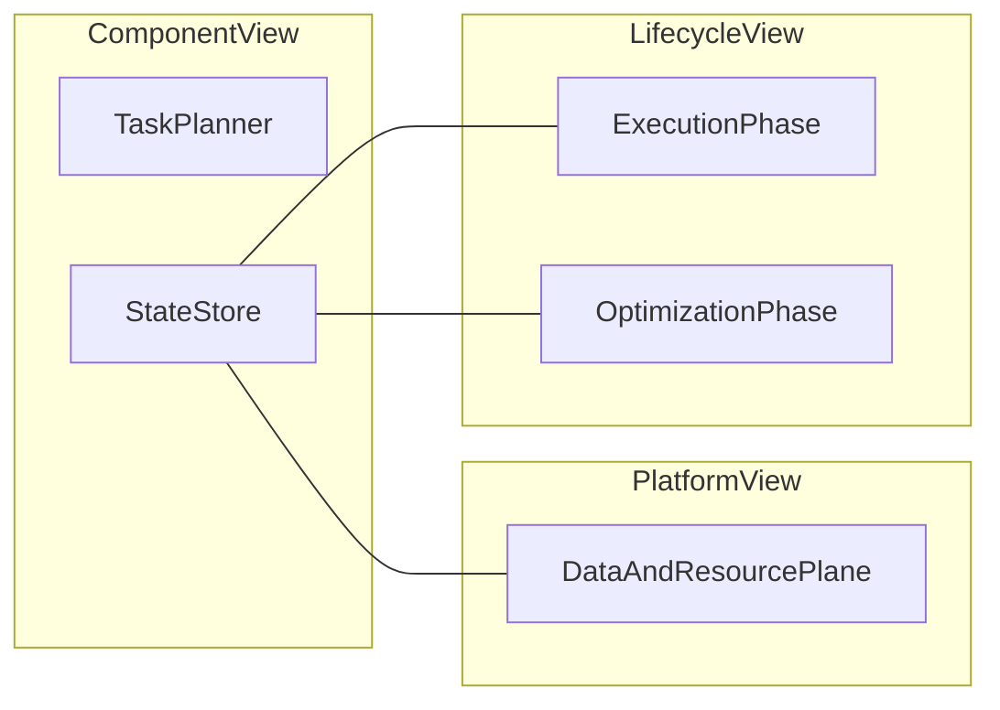
*Sources: `[01-architecture/README.md:16-17]()`*

For detailed component maps, responsibility splits between the model and runtime infrastructure, and view definitions, see [Agentic Application Reference Architecture (Ch.2)](#2.2).

*Sources: `[01-architecture/README.md:12-18]()`*

---

# Page: The New Stage of AI-Native Applications (Ch.1)

# The New Stage of AI-Native Applications (Ch.1)

<details>
<summary>Relevant source files</summary>

The following files were used as context for generating this wiki page:

- [01-architecture/README.md](01-architecture/README.md)

</details>


## Purpose and Scope
This page details Chapter 1 of the architecture track (`01-architecture/README.md`), which establishes the foundational paradigm for AI-native application construction [01-architecture/README.md:1-15]. It covers the evolution of application forms (from stateless chat to autonomous agents), the core separation between the foundational model and the engineering harness, determinism requirements, and the enterprise selection guide for agentic solutions.

---

## 1. The Paradigm Shift: From Generative Engine to Execution Subject

In AI-native architectures, the operational starting point of application building has shifted. Historically, large language models (LLMs) functioned primarily as stateless generative engines invoked synchronously by traditional application code [01-architecture/README.md:3]. In the new stage, models act as execution subjects capable of:
- Maintaining long-running task states [01-architecture/README.md:3].
- Decomposing abstract goals into concrete execution steps [01-architecture/README.md:3].
- Invoking tools and programmatic interfaces [01-architecture/README.md:3].
- Adapting behavior dynamically based on real-time execution feedback [01-architecture/README.md:3].

This shift is manifested in software engineering agents (such as Codex, Claude Code, and Qoder) that interact directly with file systems, execute tests, read repositories, and maintain multi-step task plans [01-architecture/README.md:3].

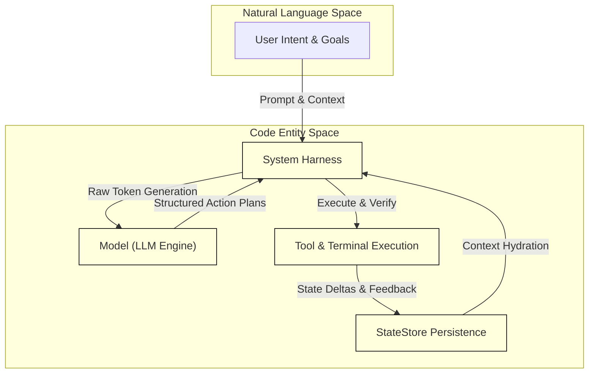

*Figure 1: Control flow bridging natural language intent to code execution entities within the agentic harness.*

**Sources:**
- `01-architecture/README.md:1-5`

---

## 2. The Model vs. Harness Responsibility Split

Granting models higher task autonomy does not imply that the model alone constitutes an Agent [01-architecture/README.md:5]. As tasks grow longer, tools become more numerous, and environmental impact increases, the engineering system wrapping the model becomes the primary determinant of reliability [01-architecture/README.md:5]. 

The system boundary is partitioned between the **Model** and the **Harness**:
- **Model Responsibilities**: Natural language understanding, zero-shot/few-shot reasoning, semantic generation, and probability-based token stream production.
- **Harness Responsibilities**: Context window organization, task state persistence, tool access control, execution environment isolation, failure recovery loops, result evaluation, and safety constraint enforcement [01-architecture/README.md:5].

Enterprise architecture must move beyond treating an AI application as a single model invocation (`LLM.invoke()`), designing instead a holistic system spanning cognition, state management, tool execution, safety control, and continuous optimization [01-architecture/README.md:7].

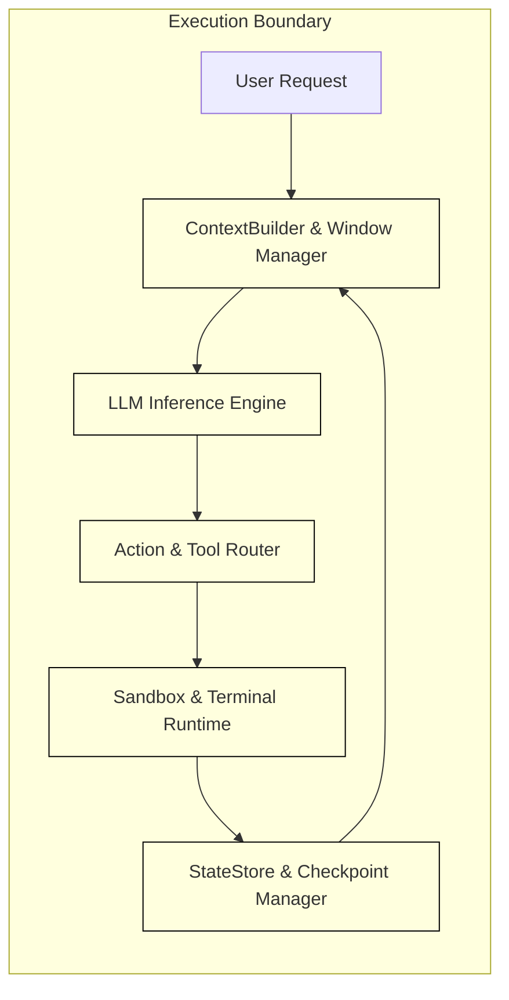

*Data Flow & Component Interactions in the Agentic Harness.*

**Sources:**
- `01-architecture/README.md:5-7`

---

## 3. Application Forms and Selection Guide

Application forms do not follow a simple linear replacement chain; instead, deterministic workflows and probabilistic agents will coexist long-term [01-architecture/README.md:14]. 

### 3.1 Architectural Scaling Dimensions
1. **Temporal Dimension (Long-Horizon Agent)**: Scaling from single-turn request-response models to long-running asynchronous tasks spanning hours or days [01-architecture/README.md:14].
2. **Collaborative Dimension (Multi-Agent)**: Scaling from a Single-Agent handling broad toolsets to specialized Multi-Agent topologies [01-architecture/README.md:14].

These dimensions can be adopted independently or combined based on the domain requirements, but they are not mandatory upgrades for every AI application [01-architecture/README.md:14].

### 3.2 Enterprise Maturity and Determinism Requirements
Enterprise maturity is not determined by product branding, but by matching system autonomy against task risk [01-architecture/README.md:14]. The fundamental architectural rule is to select the **lowest sufficient architecture** where costs and risks are controllable [01-architecture/README.md:14].

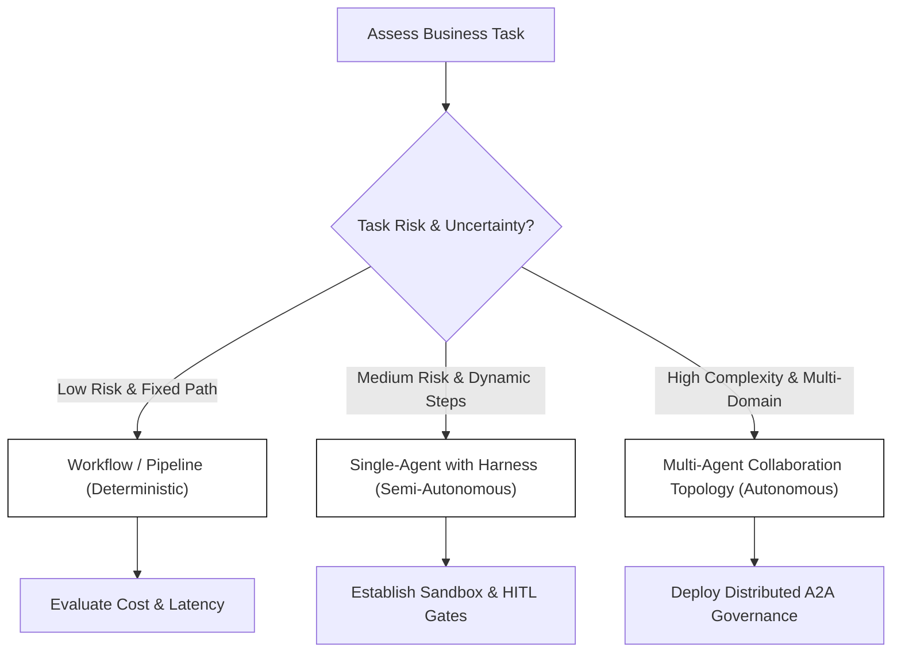

*Figure 2: Selection guide mapping enterprise task risk profiles to appropriate application topologies.*

**Sources:**
- `01-architecture/README.md:14-18`

---

# Page: Build: Harness Engineering

# Build: Harness Engineering

<details>
<summary>Relevant source files</summary>

The following files were used as context for generating this wiki page:

- [02-build/README.md](02-build/README.md)
- [03-run/README.md](03-run/README.md)

</details>


## Purpose and Scope

Part 02 ("Build") of the AI Agent Handbook focuses on the core mechanics of harness engineering: organizing discrete LLM model judgments into sustainable, interruptible, recoverable, and verifiable task execution processes [02-build/README.md:1-4]. Using coding agents as an engineering sample, this part demonstrates how model capabilities rely on context organization, task loops, state management, tool execution, permission control, and result verification [02-build/README.md:5-7].

This parent page provides a high-level overview of harness paradigms and the three core engineering contracts (Tasks, Information, Actions). For deep technical details, refer to the child pages linked below.

Sources:
- `02-build/README.md:1-8`

---

## Big Picture: The Three Engineering Contracts and Harness Paradigms

The build phase establishes the boundaries between model intelligence and system orchestration. The harness acts as the execution wrapper around the model, translating human intent into structured state transitions and verifiable tool invocations.

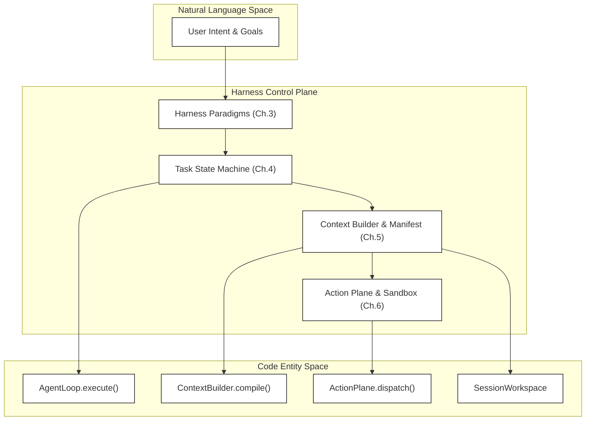
*Diagram 1: Mapping Natural Language Intent to Harness Code Entities*

Sources:
- `02-build/README.md:9-21`

---

## 3.1. Harness Paradigms and Responsibility Boundaries (Ch.3)

The first main theme of the build phase addresses harness construction choices: deciding where the model ends and the system begins, and selecting the appropriate integration paradigm [02-build/README.md:3-4, 02-build/README.md:16]. Four primary entry points exist for implementing a harness:
1. **High-Code Frameworks**: Provide fine-grained, code-level control over prompts, loops, and state transitions.
2. **Productized Harnesses**: Reuse mature capabilities via Coding Agent CLIs, SDKs, and workspace assistants.
3. **Managed Agents**: Standardize bounded harness logic and runtime infrastructure into managed services.
4. **Agent Cloud Products**: Deliver native creation portals and shared resource entry points.

When multiple teams and sources coexist, an `AgentPlatform` handles multi-source management, scale delivery, governance, and observation.

For details, see [Harness Paradigms and Responsibility Boundaries (Ch.3)](#3.1).

Sources:
- `02-build/README.md:9-11`, `02-build/README.md:16`

---

## 3.2. Tasks: Orchestration, Long-Running Progress, Handoff (Ch.4)

Task orchestration governs how agent workflows advance, recover from interruptions, and determine completion [02-build/README.md:12, 02-build/README.md:18]. The core mechanism centers around the `AgentLoop`, which processes execution stages via `Prepare`, `Model`, `Act`, `Observe`, and `Verify` phases.

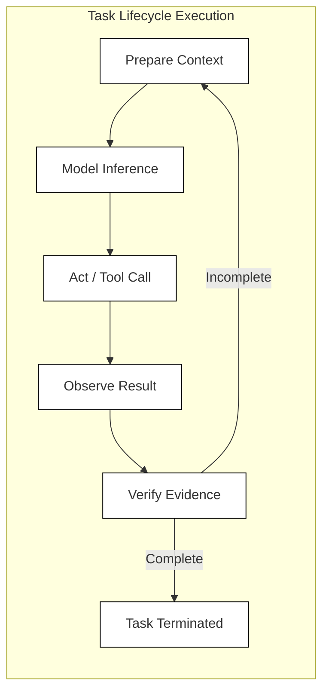
*Diagram 2: AgentLoop State Transition and Verification Flow*

Key mechanisms include explicit task state machines, planning steps with stage gates, subagent controlled delegation, asynchronous continuation, and environment-evidence-based completion rather than relying solely on model self-termination [02-build/README.md:12, 02-build/README.md:18].

For details, see [Tasks: Orchestration, Long-Running Progress, Handoff (Ch.4)](#3.2).

Sources:
- `02-build/README.md:12`, `02-build/README.md:18`

---

## 3.3. Information: Context, State and Reusable Assets (Ch.5)

The information contract addresses the tension between finite model context windows and continuously expanding task environments [02-build/README.md:13, 02-build/README.md:18]. 

* **Context Builders and Manifests**: Dynamically compile inputs based on identity, trustworthiness, relevance, and token budgets.
* **Compression and Offloading**: Manage token growth, ensuring critical facts are persisted into authoritative state stores.
* **Storage Layering**: Clearly distinguish between `Session` (interaction continuity), `Task State` (verifiable targets), and `Workspace` (working memory outside the model window).
* **Assets**: Divide labor between `Memory`, `Knowledge` (RAG/Ontologies), and `Skill` progressive disclosure patterns.

For details, see [Information: Context, State and Reusable Assets (Ch.5)](#3.3).

Sources:
- `02-build/README.md:13`, `02-build/README.md:18`

---

## 3.4. Actions: Controlled Execution, Verification, Delivery (Ch.6)

The action contract translates model intent into controlled, observable environment side effects [02-build/README.md:14, 02-build/README.md:18]. 

* **Unified Action Plane**: Routes actions through schema validation, identity checks, policy enforcement, approval gates, execution, observation logging, and tracing.
* **Protocol Layering**: Integrates Function Calling, Model Context Protocol (MCP), and Agent-to-Agent (A2A) communication protocols.
* **Environment Contracts & Sandboxes**: Provides isolation for files, processes, networks, and secrets.
* **Feedback Loops**: Closes the loop using `Trace` and `Evaluation` telemetry to drive harness improvements from real execution failures.

For details, see [Actions: Controlled Execution, Verification, Delivery (Ch.6)](#3.4).

Sources:
- `02-build/README.md:14`, `02-build/README.md:18`

---

# Page: Harness Paradigms and Responsibility Boundaries (Ch.3)

# Harness Paradigms and Responsibility Boundaries (Ch.3)

<details>
<summary>Relevant source files</summary>

The following files were used as context for generating this wiki page:

- [02-build/README.md](02-build/README.md)
- [03-run/README.md](03-run/README.md)

</details>


## Purpose and Scope

This page details Chapter 3 of the whitepaper, focusing on mainstream harness construction patterns and establishing the exact boundary where probabilistic model reasoning ends and deterministic system execution begins `[02-build/README.md:3-7]()`. It examines how discrete model inferences are organized into sustainable, recoverable, and verifiable task workflows through four primary construction entries and a unified platform management layer `[02-build/README.md:3-11]`.

Sources: `02-build/README.md:1-21`

---

## The Model vs. System Responsibility Split

A foundational principle of harness engineering is decoupling probabilistic intelligence from deterministic system guarantees `[02-build/README.md:3-7]()`. 

### Probabilistic Space (The Model)
* **Intent Extraction**: Interpreting unstructured natural language instructions and mapping them to structured parameter schemata.
* **Semantic Reasoning**: Generating tool call arguments, synthesizing textual explanations, and suggesting next-step hypotheses.
* **Local Adaptability**: Handling ambiguous or novel edge cases through prompt-guided inference.

### Deterministic Space (The System / Harness)
* **State Management**: Persisting explicit states, checkpoints, and event logs `[03-run/README.md:13-14]()`.
* **Execution Control**: Enforcing strict workflow transitions, budgeting token/cost allocations, and handling retries `[02-build/README.md:18]()`.
* **Environment Isolation**: Providing sandboxed file systems, network barriers, and secret management `[02-build/README.md:14]()`.
* **Verification**: Evaluating execution success based on environmental evidence (e.g., test suites, compiler outputs) rather than trusting model self-reports `[02-build/README.md:5-18]`.

```mermaid
Title: Model Inference to Harness Execution Boundary

graph TD
    subgraph "NaturalLanguageSpace"
        NL["UserPromptAndContext"] --> LLM["LLMInferenceEngine"]
        LLM --> ProbOutput["ProbabilisticIntentAndArguments"]
    end
    subgraph "CodeEntitySpace"
        ProbOutput --> HarnessLoop["HarnessStateMachine"]
        HarnessLoop --> SandboxExec["EnvironmentContractAndSandbox"]
        SandboxExec --> StateStore["DeterministicStatePersistence"]
    end
```

Sources: `02-build/README.md:3-18`, `03-run/README.md:13-14`

---

## Four Mainstream Harness Construction Patterns

Engineering teams must choose appropriate construction patterns based on customization depth, data boundaries, runtime responsibilities, and delivery mechanisms `[02-build/README.md:9-16]()`.

| Construction Pattern | Customization Depth | Primary Use Case | Engineering Trade-offs |
| --- | --- | --- | --- |
| **High-Code Frameworks** | High | Deeply customized agents requiring granular control over state loops and tool execution. | High development overhead; requires manual handling of memory, sandboxing, and scaling. |
| **Productized Harness** | Medium-High | Coding Agent CLIs, SDKs, and workspace assistants optimized for specific developer workflows. | Reuses mature tooling loops; constrained by the rigid structure of the productized template. |
| **Managed Agents** | Medium | Standardized agent capabilities delivered as a service within defined boundaries. | Fast time-to-market; limited visibility and control over internal model routing and prompt orchestration. |
| **Agent Cloud Products** | Low-Medium | Native creation portals offering shared cloud resources and managed multi-agent execution. | Easiest deployment and resource sharing; lowest degree of low-level system control. |

Sources: `02-build/README.md:9-16`

```mermaid
Title: Four Construction Entry Points Selection Pipeline

graph LR
    subgraph "ConstructionEntries"
        HC["HighCodeFrameworks"] --> Eval["TaskRequirementsAnalysis"]
        PH["ProductizedHarness"] --> Eval
        MA["ManagedAgents"] --> Eval
        ACP["AgentCloudProducts"] --> Eval
    end
    subgraph "CodeEntitySpace"
        Eval --> PlatformLayer["AgentPlatformMultiSourceGovernance"]
    end
```

Sources: `02-build/README.md:9-16`

---

## Agent Platform for Scale and Multi-Source Governance

When multiple teams deploy agents built across different patterns, an `Agent Platform` layer becomes necessary to provide unified creation, access control, execution scaling, and governance without acting as a fifth standalone creation entry `[02-build/README.md:16]`.

### Core Platform Responsibilities
* **Multi-Source Ingestion**: Unifying heterogeneous agents under a shared execution contract.
* **Unified Traffic Governance**: Standardizing identity propagation, quota enforcement, and audit trails `[03-run/README.md:15]()`.
* **Observability Integration**: Consolidating traces, metrics, and evaluation signals to feed the optimization flywheel `[02-build/README.md:14-18]()`.

Sources: `02-build/README.md:9-18`, `03-run/README.md:15`

---

# Page: Tasks: Orchestration, Long-Running Progress, Handoff (Ch.4)

# Tasks: Orchestration, Long-Running Progress, Handoff (Ch.4)

<details>
<summary>Relevant source files</summary>

The following files were used as context for generating this wiki page:

- [02-build/README.md](02-build/README.md)
- [03-run/README.md](03-run/README.md)

</details>


## Purpose and Scope
This page details Chapter 4 of the whitepaper, focusing on the engineering contract for **Tasks** within agentic harness systems (`[02-build/README.md:9-15]()`). Specifically, it covers the transition from discrete model outputs to sustainable, state-managed task processes via the Agent Loop, explicit task state machines, planning stage gates, controlled subagent delegation, long-running asynchronous continuation, and environment evidence-based termination (`[02-build/README.md:18-20]()`).

---

## 1. Agent Loop and Task State Machine Implementation

The core execution engine of an agentic harness relies on an explicit task state machine rather than leaving session flow entirely to the LLM's open-ended generation (`[02-build/README.md:18-19]()`). The execution iterates through a well-defined cycle: **Prepare**, **Model**, **Act**, **Observe**, and **Verify** (`[02-build/README.md:18-19]()`).

### State Machine Architecture
The task state machine maintains explicit states such as `PENDING`, `PLANNING`, `EXECUTING`, `VERIFYING`, `SUSPENDED`, `COMPLETED`, and `FAILED`. Transitions between these states are governed by deterministic system logic rather than model prompts alone, ensuring that multi-step workflows do not drift or loop infinitely.

```mermaid
graph TD
    subgraph "Natural Language & Model Space"
        A["LLM Prompt Generation"] --> B["Action Intention"]
    end
    subgraph "Code Entity Space"
        C["AgentLoopEngine:run()"] --> D["TaskStateMachine:transition()"]
        D --> E["ActionExecutor:dispatch()"]
        E --> F["EnvironmentVerifier:check()"]
        F -->| "Pass" | G["Task Status: COMPLETED"]
        F -->| "Fail/Retry" | C
    end
    B -.->| "Maps to" | E
    
    classDef default fill:#fff,stroke:#333,stroke-width:1px;
```
*Figure 1: Bridging Natural Language Intent to Code-Level Execution in `AgentLoopEngine` and `TaskStateMachine`.*

### Sources
- `[02-build/README.md:9-15]()`
- `[02-build/README.md:18-20]()`

---

## 2. Planning, Stage Gates, and Subagent Handoff

Complex enterprise tasks cannot be executed in a single monolithic prompt context. Chapter 4 establishes mechanisms for structured planning and hierarchical delegation where primary agents hand off subtasks to specialized subagents (`[02-build/README.md:18-20]()`).

### Planning and Stage Gates
1. **Decomposition**: The master agent uses a `PlanningModule` to break a user request into discrete milestone steps.
2. **Stage Gate Validation**: Before transitioning to the next milestone, a validation check must clear. If preconditions fail, the plan is dynamically revised.

### Subagent Delegation Handoff
When delegating work to a subagent, the parent agent packages a constrained context manifest, limiting tool access and token budget.

```mermaid
graph TD
    subgraph "Control Plane"
        PA["ParentAgentController"] -->| "Delegate Task" | SA["SubAgentExecutor"]
        SA -->| "Report Result" | PA
    end
    subgraph "Data & State Plane"
        WS["WorkspaceSnapshot"] -->| "Context Manifest" | SA
        SA -->| "Execution Artifacts" | WS
    end
    
    classDef default fill:#fff,stroke:#333,stroke-width:1px;
```
*Figure 2: Subagent Handoff and State Propagation via `ParentAgentController` and `SubAgentExecutor`.*

### Sources
- `[02-build/README.md:9-15]()`
- `[02-build/README.md:18-20]()`

---

## 3. Long-Running Progress and Asynchronous Continuation

Enterprise tasks often span minutes, hours, or days—far exceeding a single synchronous HTTP request cycle. The harness must decouple execution from individual network connections.

### Continuation Mechanisms
- **Checkpointing**: Every state machine transition saves a snapshot of the task graph, memory references, and workspace delta to persistent storage.
- **Asynchronous Resumption**: Background workers pick up suspended tasks using event triggers or cron-based schedules, rehydrating the `AgentLoopEngine` state without losing trajectory context.
- **Multi-Dimensional Budgets**: Execution budgets (token count, step limits, wall-clock time, financial cost) are enforced continuously to prevent runaway loops.

### Sources
- `[02-build/README.md:9-15]()`
- `[02-build/README.md:18-20]()`

---

## 4. Evidence-Based Completion and Verification

A critical architectural tenet of Chapter 4 is that **task completion is determined by environmental evidence, not by the model saying it is finished** (`[02-build/README.md:18-19]()`).

### Termination Verification Workflow
* **Model Stop Claim**: The LLM outputs a completion token or text indicating it believes the task is done.
* **Environment Verification**: The harness intercepts this claim and triggers objective verifiers (e.g., executing test suites, checking compilation output, verifying API health status).
* **Feedback Loop**: If verification fails, the failure logs and stderr outputs are fed back into the context as an explicit `Observation`, forcing the model to correct its course rather than terminating prematurely.

```
+-------------------------------------------------------------+
|                     Execution Pipeline                      |
|                                                             |
|   [TaskState] ---> [AgentLoop] ---> [ActionExecutor]        |
|                                           |                 |
|                                           v                 |
|   [VerificationGate] <--- [EnvironmentEvidence] <-- [Sandbox] |
|          |                                                  |
|     (Pass/Fail)                                             |
+----------+--------------------------------------------------+
           |
           +---> [COMPLETED] (if tests/evidence pass)
           +---> [RETRY]     (if evidence fails)
```

### Sources
- `[02-build/README.md:9-15]()`
- `[02-build/README.md:18-20]()`

---

# Page: Information: Context, State and Reusable Assets (Ch.5)

# Information: Context, State and Reusable Assets (Ch.5)

<details>
<summary>Relevant source files</summary>

The following files were used as context for generating this wiki page:

- [02-build/README.md](02-build/README.md)
- [03-run/README.md](03-run/README.md)

</details>


## Purpose and Scope
This page details Chapter 5 of the AI Agent Handbook, focusing on the **Information Contract** within harness engineering [02-build/README.md:13-18](). It addresses the core architectural challenge in agentic applications: bridging the gap between finite LLM context windows and a continuously growing task environment [02-build/README.md:13](). It covers the technical design of context building pipelines, state taxonomy (`Session`, `Task State`, `Workspace`) [02-build/README.md:13](), and reusable asset management (`Memory`, `Knowledge`, and progressive `Skill` disclosure) [02-build/README.md:13]().

---

## 1. The Context Building Pipeline and Manifest Architecture

The `ContextBuilder` acts as the primary compilation engine responsible for assembling the prompt input dynamically before each model invocation [02-build/README.md:18](). Rather than relying on static prompt templates, the pipeline ingests a declarative `Manifest` that defines identity constraints, source credibility scores, semantic relevance, and strict `TokenBudget` allocations [02-build/README.md:18]().

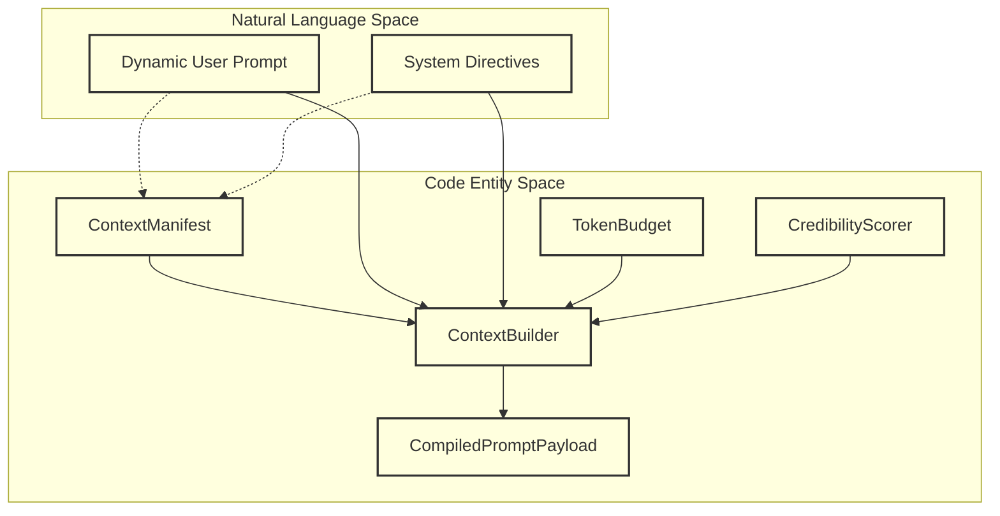
*Figure 1: Context compilation flow mapping input streams through `ContextBuilder` and `ContextManifest`.*

**Sources:** `[02-build/README.md:13-18]()`

---

## 2. Managing Context Growth: Compression, Offloading, and Authoritative State

As multi-turn interactions and tool outputs accumulate, naive prompt appending leads to context pollution and performance degradation. The harness employs programmatic compression and offloading strategies:

* **Semantic Compression**: Summarizing older message turns into compact episodic summaries while retaining critical references.
* **External Offloading**: Moving large document contents and file structures out of the immediate model window and into the `Workspace` or `KnowledgeBase`.
* **Authoritative State Sync**: Any critical fact discovered during reasoning must be written immediately to durable storage rather than left solely in the ephemeral context window [02-build/README.md:18]().

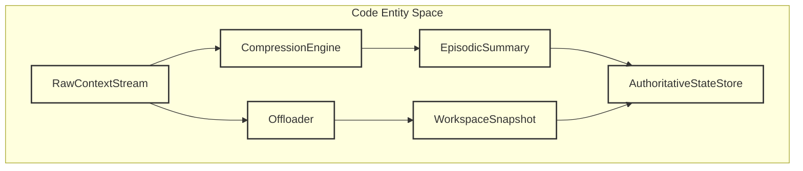
*Figure 2: Data flow for context compression and state offloading.*

**Sources:** `[02-build/README.md:13-18]()`

---

## 3. State Taxonomy: Session, Task State, and Workspace

State management in agentic applications is decoupled into three distinct architectural layers to prevent race conditions and ambiguity across long-running tasks:

1. **`Session`**: Captures user interaction continuity, transport metadata, and raw dialogue transcripts [02-build/README.md:18]().
2. **`Task State`**: Tracks verifiable goals, progress checkpoints, and active sub-task finite state machines [02-build/README.md:18]().
3. **`Workspace`**: Provides the physical or virtual sandbox environment (file system, process handles, working memory) that exists entirely outside the model's context window [02-build/README.md:18]().

```mermaid
graph TD
    subgraph "Code Entity Space"
      N["SessionManager"] --> O["SessionContext"]
      P["TaskOrchestrator"] --> Q["TaskStateStore"]
      R["SandboxManager"] --> S["WorkspaceSnapshot"]
      O --> T["UnifiedExecutionRuntime"]
      Q --> T
      S --> T
    end
    classDef default fill:none,stroke:#333,stroke-width:2px;
```
*Figure 3: Interaction between `SessionManager`, `TaskStateStore`, and `WorkspaceSnapshot` within the runtime.*

**Sources:** `[02-build/README.md:13-18](), [03-run/README.md:13-14]()`

---

## 4. Reusable Assets: Memory, Knowledge, and Progressive Skill Disclosure

Reusable assets decouple domain logic from individual agent prompts, enabling shared capabilities across teams:

* **Memory Store**: Stores short-term episodic facts and long-term user preferences, retrievable via hybrid vector and lexical search.
* **Knowledge Base**: Houses enterprise documents, schemas, and relational ontologies integrated via Retrieval-Augmented Generation (RAG) [03-run/README.md:14]().
* **Skill Registry**: Implements progressive disclosure, where complex tools or procedural capabilities are summarized in high-level capability catalogs, exposing full implementation details and parameter schemas only when the agent specifically invokes them [02-build/README.md:13]().

```mermaid
graph TD
    subgraph "Code Entity Space"
      U["AgentRuntime"] --> V["MemoryStore"]
      U --> W["KnowledgeBaseRAG"]
      U --> X["SkillRegistry"]
      X --> Y["ProgressiveDisclosureFilter"]
      Y --> Z["DetailedSkillSchema"]
    end
    classDef default fill:none,stroke:#333,stroke-width:2px;
```
*Figure 4: Resolution path for reusable assets via `SkillRegistry` and `MemoryStore`.*

**Sources:** `[02-build/README.md:13](), [03-run/README.md:14]()`

---

# Page: Run: Agent Runtime and Infrastructure

# Run: Agent Runtime and Infrastructure

<details>
<summary>Relevant source files</summary>

The following files were used as context for generating this wiki page:

- [02-build/README.md](02-build/README.md)
- [03-run/README.md](03-run/README.md)

</details>


This section covers Part 03-run (Chapters 7 through 12) of the AI Agent Handbook [03-run/README.md:1-24](). While development environments prioritize single-session logic, production services must handle execution isolation, state persistence, traffic governance, asynchronous continuation, and distributed multi-agent communication [03-run/README.md:3-8](). 

The infrastructure is organized into two primary tracks:
1. **Execution Foundation**: Ensuring stable, isolated execution, robust state persistence, and governed traffic ingress/egress (Chapters 7–9) [03-run/README.md:9-15]().
2. **Coordination Order**: Managing long-running workflows, multi-agent organizational topologies, and distributed messaging (Chapters 10–12) [03-run/README.md:16-18]().

---

## Overview of Run Architecture

```mermaid
graph TD
    sub5["Gateway Layer"]
    sub7["Runtime Layer"]
    sub8["Storage Layer"]
    sub10["Coordination Layer"]

    sub5 -->|AIGateway| sub7
    sub7 -->|AgentRuntime| sub8
    sub10 -->|AsyncOrchestrator| sub7

    classDef default fill:none,stroke:#000,stroke-width:2px;
```
*Figure 4.1: High-Level Runtime and Infrastructure Topology.*

Sources: [03-run/README.md:9-18]()

---

## 4.1 Agent Runtime and Sandbox (Ch.7)

The agent runtime and execution sandbox provide the physical isolation and environmental scaffolding required for agents to execute code, shell commands, and tool calls safely [03-run/README.md:13](). Chapter 7 details how tool execution models are extended into programmable workspaces where agents can iteratively explore solutions without compromising host infrastructure.

For details, see [Agent Runtime and Sandbox (Ch.7)](#4.1).

Sources: [03-run/README.md:13]()

---

## 4.2 State Storage and Semantic Assets (Ch.8)

As agents move past stateless single-turn interactions, state must be externalized across multiple tiers: event logs, checkpoints, workspace snapshots, artifacts, long-term memory, and RAG-based semantic assets [03-run/README.md:14](). Chapter 8 defines the physical storage requirements and unified state contracts needed to maintain consistency across these objects.

For details, see [State Storage and Semantic Assets (Ch.8)](#4.2).

Sources: [03-run/README.md:14]()

---

## 4.3 AI Gateway and Unified Traffic Governance (Ch.9)

Chapter 9 establishes the AI Gateway as the centralized enforcement point for all external and internal traffic [03-run/README.md:15](). It separates traffic governance into distinct semantics for LLMs, Model Context Protocols (MCP), and Agent-to-Agent (A2A) interactions, handling authentication, budgeting, rate limiting, auditing, and human-in-the-loop (HITL) approvals [03-run/README.md:15]().

For details, see [AI Gateway and Unified Traffic Governance (Ch.9)](#4.3).

Sources: [03-run/README.md:15]()

---

## 4.4 Async Tasks and Automation Flows (Ch.10)

Production tasks often outlive standard HTTP request lifecycles. Chapter 10 draws the boundary between synchronous and asynchronous operations, introducing layered completion semantics, scheduled triggers, and automation pipelines to prevent task loss or duplicate execution during long-running operations [03-run/README.md:16]().

For details, see [Async Tasks and Automation Flows (Ch.10)](#4.4).

Sources: [03-run/README.md:16]()

---

## 4.5 Multi-Agent Collaboration and Distributed Communication (Ch.11–12)

When scaling from a single agent to a multi-agent team, coordination and messaging become critical [03-run/README.md:17-18](). Chapters 11 and 12 cover heterogenous agent onboarding, organizational topologies, task assignment, result aggregation, and a comprehensive communication selection map spanning capability, collaboration, internal, and human-machine planes [03-run/README.md:17-18]().

For details, see [Multi-Agent Collaboration and Distributed Communication (Ch.11–12)](#4.5).

Sources: [03-run/README.md:17-18]()

---

# Page: Case Studies and Industry Practice

# Case Studies and Industry Practice

<details>
<summary>Relevant source files</summary>

The following files were used as context for generating this wiki page:

- [06-case-study/README.md](06-case-study/README.md)

</details>


## Purpose and Scope

Part 06-case-study (`06-case-study/README.md:1-7`) bridges theoretical architecture, harness construction, runtime infrastructure, governance, and optimization by examining real-world enterprise deployments and cutting-edge open-source competition projects. This section covers four primary vertical domains—Research & Development efficiency, Design Engineering, Operations, Security & Enterprise IT, and Customer, Sales & Operations—alongside the GOAI World Artificial Intelligence Open Source Competition Agent Infra track (`06-case-study/README.md:3-7`). 

The following diagram illustrates how natural language use-cases across these enterprise verticals map to the underlying codebase structure and chapters within Part 06:

```mermaid
graph TD
    sub5[""Natural Language Space: Enterprise Verticals""]
    sub5 -->|CodeReviewAndFix| ch25[""R&D Efficiency Ch.25""]
    sub5 -->|GenUIAndDesign| ch26[""Design Engineering Ch.26""]
    sub5 -->|IntelligentOps| ch27[""Ops and Enterprise IT Ch.27""]
    sub5 -->|CustomerMemory| ch28[""Customer and Sales Ch.28""]
    sub5 -->|OpenSourceInfra| ch29[""GOAI Infra Track Ch.29""]

    sub6[""Code Entity Space: Chapter Modules""]
    ch25 -->|RefersTo| file25[""06-case-study/README.md:5-5""]
    ch26 -->|RefersTo| file26[""06-case-study/README.md:5-5""]
    ch27 -->|RefersTo| file27[""06-case-study/README.md:5-5""]
    ch28 -->|RefersTo| file28[""06-case-study/README.md:5-5""]
    ch29 -->|RefersTo| file29[""06-case-study/README.md:7-7""]
```
Sources: `06-case-study/README.md:1-7`

---

## 7.1. R&D Efficiency Cases (Ch.25)

Chapter 25 explores software engineering workflows enhanced by AI agents, featuring seven core scenarios developed across Alibaba (`06-case-study/README.md:5-5`). These include automated code review agents, kernel patch generation agents, PolarDB-X database optimization loops, multi-agent developer teams, and end-to-end software delivery pipelines. These cases highlight how harness patterns and validation loops can be integrated into day-to-day developer workflows.

For details, see [R&D Efficiency Cases (Ch.25)](#7.1).

Sources: `06-case-study/README.md:5-5`

---

## 7.2. Design Engineering: GenUI and Vibe Designing (Ch.26)

Chapter 26 focuses on design engineering paradigms, detailing two primary approaches: Generative UI (GenUI) delivery and intent-driven Vibe Designing (`06-case-study/README.md:5-5`). These paradigms shift user interfaces from static layouts to dynamic, runtime-generated components driven by user intent, lowering the barrier between design specifications and frontend execution.

For details, see [Design Engineering: GenUI and Vibe Designing (Ch.26)](#7.2).

Sources: `06-case-study/README.md:5-5`

---

## 7.3. Ops, Security and Enterprise IT Cases (Ch.27)

Chapter 27 examines production-scale enterprise infrastructure and retail operations across three key organizations: Chanjet (observability), Geely Automobile (intelligent operations), and Tastien (closed-loop retail operations) (`06-case-study/README.md:5-5`). These cases demonstrate how agentic loops handle log analysis, automated fault recovery, and operational decision-making under high-throughput conditions.

For details, see [Ops, Security and Enterprise IT Cases (Ch.27)](#7.3).

Sources: `06-case-study/README.md:5-5`

---

## 7.4. Customer, Sales and Operations Cases (Ch.28)

Chapter 28 highlights customer-facing and analytical applications through four implementations: MiniMax's long-horizon memory base, Bilibili's content insight engines, Shinewing's office and accounting efficiency tools, and Alibaba's Data Agent analytics frameworks (`06-case-study/README.md:5-5`). These systems emphasize context persistence, semantic asset management, and natural language data querying.

For details, see [Customer, Sales and Operations Cases (Ch.28)](#7.4).

Sources: `06-case-study/README.md:5-5`

---

## 7.5. GOAI Agent Infra Track (Ch.29)

Chapter 29 reviews open-source contributions from the GOAI World Artificial Intelligence Open Source Competition Agent Infra track, presenting nine projects spanning eleven distinct vertical domains (`06-case-study/README.md:7-7`). 

The mapping between competition domains and codebase components is outlined below:

```mermaid
graph TD
    sub7[""Natural Language Space: GOAI Verticals""]
    sub7 -->|EnergyAndGrid| dom1[""Energy and Power""]
    sub7 -->|FintechAndSettlement| dom2[""Financial and Channel Commission""]
    sub7 -->|SoftwareAndSecurity| dom3[""Software Engineering and NetSec""]

    sub8[""Code Entity Space: Competition Artifacts""]
    dom1 -->|ManagedBy| infraRepo[""06-case-study/README.md:7-7""]
    dom2 -->|ManagedBy| infraRepo
    dom3 -->|ManagedBy| infraRepo
```
Sources: `06-case-study/README.md:7-7`

Covered sectors include energy and power, financial systems, architectural engineering design, retail chains, digital content (gaming, XR, e-commerce), enterprise governance, financial accounting and commission settlement, software engineering delivery, IT operations and disaster recovery, network security operations, and data engineering (`06-case-study/README.md:7-7`).

For details, see [GOAI Agent Infra Track (Ch.29)](#7.5).

Sources: `06-case-study/README.md:7-7`

---

# Page: Conclusion: From Agentic Application to Agentic OS

# Conclusion: From Agentic Application to Agentic OS

<details>
<summary>Relevant source files</summary>

The following files were used as context for generating this wiki page:

- [00-preface/00-preface.md](00-preface/00-preface.md)

</details>


This page defines the scope and technical outlook of Chapter 30, serving as the culmination of the AI Agent Handbook. It details how the core pillars—architecture, harness engineering, runtime infrastructure, governance, and optimization data flywheels—converge to shift the engineering paradigm from isolated agentic applications toward an integrated *Agentic OS*.

---

## 1. The Convergence of the AI Agent Lifecycle

The handbook structures the engineering lifecycle into five foundational dimensions: architectural selection, harness construction, runtime execution, governance, and continuous optimization [00-preface/00-preface.md:76-88](). As cognitive capabilities transform into widely available, low-cost commodities, the primary engineering challenge transitions from prompting models to orchestrating complex, long-running agentic tasks under strict determinism and budgetary constraints [00-preface/00-preface.md:7-19]().

```mermaid
graph TD
    subgraph "Natural Language Space"
        A["User Intent & Goals"] --> B["Task Orchestration & Planning"]
        B --> C["Autonomous Execution & Tool Use"]
    end

    subgraph "Code Entity Space"
        D["HarnessEngine / AgentRuntime"] --> E["StateStore & ContextBuilder"]
        E --> F["AIGateway & SandboxManager"]
        F --> G["TrajectoryPipeline & OptimizationLoop"]
    end

    A --> D
    B --> E
    C --> F
    F --> G

    classDef default fill:none,stroke:#000,stroke-width:1px;
```
*Figure 1: Lifecycle Convergence Mapping Natural Language Intent to Code Entities*

Sources: `00-preface/00-preface.md:7-35` [00-preface/00-preface.md:7-35](), `00-preface/00-preface.md:76-88` [00-preface/00-preface.md:76-88]()

---

## 2. From Application Harness to Agentic OS

The evolution from traditional software to agentic architectures requires shifting the engineering center of gravity away from isolated prompt scripts toward a robust *Harness Engineering* framework [00-preface/00-preface.md:29-32](). In this new paradigm, the foundational LLM acts as the computational kernel, while the surrounding system runtime manages memory, concurrency, tool security, and state checkpointing—analogous to a traditional operating system managing hardware resources.

```mermaid
graph TD
    subgraph "Natural Language Space"
        H["Cognitive Planning"] --> I["Multi-Agent Collaboration"]
        I --> J["Dynamic Skill Acquisition"]
    end

    subgraph "Code Entity Space"
        K["LLMKernel / BaseRouter"] --> L["CheckpointManager / SemanticAssetStore"]
        L --> M["AIGateway / MCPProtocolHandler"]
        M --> N["EdgeRuntime / SelfEvolutionPipeline"]
    end

    H --> K
    I --> L
    J --> M
    M --> N

    classDef default fill:none,stroke:#000,stroke-width:1px;
```
*Figure 2: Agentic OS Stack Bridge from Cognitive Intent to System Infrastructure*

Sources: `00-preface/00-preface.md:29-32` [00-preface/00-preface.md:29-32](), `00-preface/00-preface.md:76-88` [00-preface/00-preface.md:76-88]()

---

## 3. Autonomous Co-Evolution and Future Outlook

As systems scale from single-agent pilots to multi-agent enterprise topologies, the boundary between application code and runtime infrastructure dissolves. The feedback loops established through trajectory data capture, golden dataset curation, and badcase optimization form a continuous self-evolution pipeline [00-preface/00-preface.md:86-88](). This ensures that the Agentic OS not only executes deterministic workflows but also learns from operational anomalies to autonomously upgrade its skill sets, tool integrations, and safety guardrails.

Sources: `00-preface/00-preface.md:86-88` [00-preface/00-preface.md:86-88]()

---

# Page: Glossary

# Glossary

<details>
<summary>Relevant source files</summary>

The following files were used as context for generating this wiki page:

- [00-preface/00-preface.md](00-preface/00-preface.md)
- [06-case-study/README.md](06-case-study/README.md)
- [README.md](README.md)
- [README_EN.md](README_EN.md)

</details>


## Purpose and Scope

This glossary defines the core technical terminology, architectural abstractions, and engineering concepts used across the AI Agent HandBook. It serves as a semantic reference to align developers, architects, and product leaders on standard definitions for agentic systems—spanning architecture, build patterns, runtime infrastructure, governance, and optimization flywheels. Each term includes chapter file pointers indicating where the concept is thoroughly analyzed in the codebase and documentation repository.

Sources: [README.md:50-65](), [README_EN.md:47-64]()

---

## Core Technical Terms

### 1. Harness
* **Definition**: The systems-engineering boundary and execution container surrounding a base Large Language Model (LLM). It manages state, tool calling loops, memory access, and safety guardrails, separating model intelligence from deterministic application logic.
* **Chapter Pointer**: Chapter 3 (`02-build/第 3 章 范式：Harness 的主流构建方式和责任边界.md`) [README.md:72-72]()

### 2. Agentic Application
* **Definition**: A software application where workflows are dynamically orchestrated by LLM-driven agents rather than hardcoded control flows, capable of perceiving environments, planning multi-step tasks, and executing tool calls autonomously.
* **Chapter Pointer**: Chapters 1–2 (`01-architecture/`) [README.md:58-58]()

### 3. Agentic OS
* **Definition**: The conceptual macro-operating system layer for the intelligent era that abstracts heterogeneous computing resources, model inference nodes, execution sandboxes, agent IPC (Inter-Process Communication), and memory persistence.
* **Chapter Pointer**: Chapter 30 (`07-conclusion/第 30 章 从 Agentic Application 到 Agentic OS.md`) [README.md:64-64]()

### 4. AI Gateway
* **Definition**: A centralized traffic governance and proxy tier responsible for LLM/MCP/agent routing, identity verification, budget/quota enforcement, audit logging, rate limiting, and sensitive data masking.
* **Chapter Pointer**: Chapter 9 (`03-run/第 9 章  AI 网关与统一流量治理.md`) [README.md:78-78]()

### 5. MCP (Model Context Protocol)
* **Definition**: An open standard protocol designed for connecting AI models securely to local and remote data sources, tool servers, and enterprise systems through standardized JSON-RPC client-server contracts.
* **Chapter Pointer**: Chapter 6 (`02-build/第 6 章 行动：受控执行、验证反馈与交付准备.md`) [README.md:75-75]()

### 6. A2A (Agent-to-Agent)
* **Definition**: Protocols and communication patterns enabling decoupled, multi-agent systems to discover peers, exchange structured messages, negotiate task delegations, and aggregate decentralized outputs.
* **Chapter Pointer**: Chapters 6 & 12 (`02-build/`, `03-run/第 12 章 Agent 分布式通信.md`) [README.md:75-75, 81-81]()

### 7. Trace / Trajectory
* **Definition**: A `Trace` records the sequential execution spans and intermediate reasoning steps of a single invocation; a `Trajectory` aggregates full state transitions, tool inputs/outputs, and decision trees across long-horizon tasks for evaluation.
* **Chapter Pointer**: Chapters 13 & 19 (`04-governance/`, `05-optimization/`) [README.md:82-82, 88-88]()

### 8. Golden Dataset
* **Definition**: A curated, high-quality collection of evaluation test cases containing deterministic inputs, expected reasoning trajectories, ground-truth final outputs, and automated assertion criteria.
* **Chapter Pointer**: Chapter 21 (`05-optimization/第 21 章　Agent 黄金数据集.md`) [README.md:90-90]()

### 9. Badcase
* **Definition**: An execution instance where an agent fails to achieve its objective due to reasoning errors, tool invocation crashes, hallucinated parameters, or infinite execution loops, serving as raw material for regression testing.
* **Chapter Pointer**: Chapter 22 (`05-optimization/第 22 章　Agent 优化：Badcase.md`) [README.md:91-91]()

### 10. HITL (Human-in-the-Loop)
* **Definition**: A governance mechanism that pauses agent execution at critical phase gates or high-risk tool invocations to request human authorization, inspection, or correction before proceeding.
* **Chapter Pointer**: Chapter 6 (`02-build/第 6 章 行动：受控执行、验证反馈与交付准备.md`) [README.md:75-75]()

### 11. GenUI (Generative UI)
* **Definition**: A paradigm where agents dynamically compose and render user interfaces (widgets, tables, forms) at runtime based on user intent and structured data payload requirements rather than static templates.
* **Chapter Pointer**: Chapter 26 (`06-case-study/第26章 设计工程/`) [README.md:95-95]()

### 12. Vibe Designing
* **Definition**: An intent-driven design methodology where developers and designers express high-level stylistic or functional intent through natural language, allowing AI systems to generate complete design artifacts and codebases.
* **Chapter Pointer**: Chapter 26 (`06-case-study/第26章 设计工程/`) [README.md:95-95]()

### 13. Sandbox
* **Definition**: An isolated execution environment (e.g., lightweight containers or micro-VMs) where agents execute untrusted generated code, shell commands, and data transformations securely without risking host system integrity.
* **Chapter Pointer**: Chapter 7 (`03-run/第 7 章  Agent 运行时与沙箱.md`) [README.md:76-76]()

### 14. Checkpoint
* **Definition**: A persistent snapshot of an agent's task state, working memory, execution stack, and variable bindings taken at discrete intervals to enable crash recovery, rollbacks, and asynchronous resumption.
* **Chapter Pointer**: Chapter 8 (`03-run/第 8 章 Agent 状态存储与语义资产.md`) [README.md:77-77]()

### 15. Workspace
* **Definition**: The dedicated file system and memory container allocated to an agent session where it reads files, writes code patches, stores intermediate artifacts, and maintains working directory context.
* **Chapter Pointer**: Chapters 5 & 7 (`02-build/`, `03-run/`) [README.md:74-74, 76-76]()

### 16. Context Builder
* **Definition**: An internal component responsible for assembling, prioritizing, compressing, and pruning system prompts, historical messages, RAG retrieved chunks, and tool schemas within the model's token window limits.
* **Chapter Pointer**: Chapter 5 (`02-build/第 5 章 信息：上下文、状态与可复用能力资产.md`) [README.md:74-74]()

### 17. Managed Agent
* **Definition**: A fully hosted agent service where infrastructure scaling, retry logic, state persistence, and security guardrails are managed by a platform provider, exposing high-level declarative APIs to developers.
* **Chapter Pointer**: Chapter 3 (`02-build/第 3 章 范式：Harness 的主流构建方式和责任边界.md`) [README.md:72-72]()

### 18. Self-evolution
* **Definition**: A guarded feedback loop where an agent analyzes its past execution traces and badcases to autonomously synthesize new reusable skills, prompt refinements, or tool definitions under human supervision.
* **Chapter Pointer**: Chapter 23 (`05-optimization/第 23 章　受控自进化.md`) [README.md:92-92]()

### 19. Edge Runtime
* **Definition**: A lightweight agent execution engine optimized for deployment on edge devices, local servers, or client browsers with constrained compute resources and low-latency requirements.
* **Chapter Pointer**: Chapter 24 (`05-optimization/第 24 章　Agent 边缘运行时与全球优化.md`) [README.md:93-93]()

### 20. Agent Infra
* **Definition**: The foundational software stack, platforms, and toolchains supporting agent execution, including runtimes, gateways, vector databases, evaluation pipelines, and telemetry systems.
* **Chapter Pointer**: Chapter 29 (`06-case-study/第 29 章 GOAI Agent Infra 赛道...`) [README.md:98-98]()

Sources: [README.md:66-99](), [00-preface/00-preface.md:74-90]()

---

## Architecture Mapping: Natural Language Space to Code Entity Space

To bridge high-level conceptual terms with concrete software design, the following diagrams associate system architectural terms with their corresponding code entities, classes, and routing modules in agentic codebases.

### Diagram 1: Build & Harness Entities
```mermaid
graph TD
    NL_Harness["Natural Language: Harness & Context Builder"] --> CE_HarnessEngine["Class: HarnessEngine"]
    NL_Harness --> CE_AgentLoop["Function: runAgentLoop()"]
    NL_ContextBuilder["Natural Language: Context Builder"] --> CE_ContextAssembler["Class: ContextAssembler"]
    NL_ContextBuilder --> CE_TokenPruner["Method: pruneAndCompressTokens()"]
    NL_Workspace["Natural Language: Workspace"] --> CE_WorkspaceManager["Class: WorkspaceManager"]
    NL_Action["Natural Language: MCP Action Plane"] --> CE_MCPClient["Class: MCPClientDispatcher"]
    
    CE_AgentLoop --> CE_ContextAssembler
    CE_AgentLoop --> CE_WorkspaceManager
    CE_AgentLoop --> CE_MCPClient
```
Sources: [README.md:72-75](), [00-preface/00-preface.md:74-81]()

### Diagram 2: Runtime, Gateway & State Entities
```mermaid
graph TD
    NL_Gateway["Natural Language: AI Gateway"] --> CE_GatewayRouter["Route: /api/v1/gateway/route"]
    NL_Gateway --> CE_BudgetEnforcer["Class: TokenBudgetGovernor"]
    NL_Sandbox["Natural Language: Sandbox"] --> CE_RuntimeSandbox["Class: ContainerRuntimeSandbox"]
    NL_Checkpoint["Natural Language: Checkpoint & State"] --> CE_CheckpointStore["Class: StateCheckpointStore"]
    NL_Trajectory["Natural Language: Trace/Trajectory Logger"] --> CE_TrajectoryEmitter["Function: emitExecutionTrace()"]
    
    CE_GatewayRouter --> CE_BudgetEnforcer
    CE_GatewayRouter --> CE_RuntimeSandbox
    CE_RuntimeSandbox --> CE_CheckpointStore
    CE_RuntimeSandbox --> CE_TrajectoryEmitter
```
Sources: [README.md:76-82](), [00-preface/00-preface.md:81-87]()