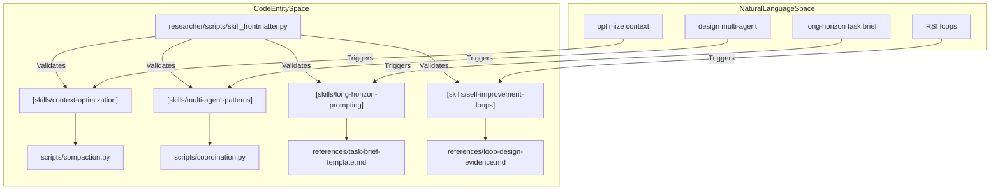

<!-- source: DeepWiki mcp.deepwiki.com · repo muratcankoylan/Agent-Skills-for-Context-Engineering · page 1 Overview: Agent Skills for Context Engineering · fetched 2026-10-26 -->

# Overview: Agent Skills for Context Engineering

Relevant source files

The following files were used as context for generating this wiki page:

- [.claude-plugin/marketplace.json](.claude-plugin/marketplace.json)
- [.plugin/plugin.json](.plugin/plugin.json)
- [AGENTS.md](AGENTS.md)
- [CHANGELOG.md](CHANGELOG.md)
- [CLAUDE.md](CLAUDE.md)
- [README.md](README.md)
- [SKILL.md](SKILL.md)
- [researcher/insights/auto-research-experiment.md](researcher/insights/auto-research-experiment.md)
- [researcher/insights/how-we-built-this.md](researcher/insights/how-we-built-this.md)

The **Agent Skills for Context Engineering** repository is a comprehensive, open collection of 17 modular "skills" designed to teach AI agents how to manage their own context windows and operating loops. While prompt engineering focuses on crafting instructions, **context engineering** addresses the holistic curation of all information—system prompts, tool definitions, retrieved documents, message history, and tool outputs—to maximize an agent's constrained "attention budget" [README.md:7-12]().

This repository serves as a **Claude Code Plugin Marketplace**, allowing tools like Claude Code to automatically discover and activate specific engineering principles based on the current task [README.md:90-93](). It is academically recognized as foundational work on **static skill architecture**, cited by Peking University (2025) and a multi-institutional survey (2026) for bridging manual skill engineering and autonomous self-improvement [README.md:15-20]().

## System Architecture & Skill Discovery

The repository follows a **Progressive Disclosure** pattern. At startup, agents load only high-level skill names and descriptions. The full technical content of a skill is only "activated" when the agent encounters a relevant task, such as diagnosing "lost-in-the-middle" issues or designing a multi-agent supervisor [README.md:76-79]().

### Plugin Infrastructure

The architecture is governed by manifests that allow for seamless integration into Open Plugins-conformant tools. Updated for v2.5.0, these manifests manage 17 published skills and ensure strict cross-platform compatibility through YAML-safe quoting and shared parsing logic [CHANGELOG.md:5-22](), [CHANGELOG.md:46-50]().

*   `.claude-plugin/marketplace.json`: Defines the `context-engineering-marketplace` (v2.5.0) and bundles all 17 skills into a single installable plugin (`context-engineering`) [.claude-plugin/marketplace.json:1-38]().
*   `.plugin/plugin.json`: Provides the Open Plugins format metadata (v2.5.0) [.plugin/plugin.json:1-9]().
*   `SKILL.md` (Root): Serves as the primary entry point and skill map for the entire collection, updated for long-horizon prompting [SKILL.md:1-87]().
*   `CLAUDE.md`: Provides project-specific guidance and rules for the Claude Code environment [CLAUDE.md:1-125]().

### From Natural Language to Code Entities: Skill Activation

The following diagram bridges natural language prompt inputs in the user space to specific skill directory structures and python validation scripts in the codebase.

**Diagram: Skill Activation and Parser Mapping**

Sources: [README.md:120-135](), [CHANGELOG.md:9-13](), [SKILL.md:36-38](), [SKILL.md:68-70]()

## The 17-Skill Taxonomy (v2.5.0)

The collection is organized into functional categories, newly expanded in v2.5.0 to include `long-horizon-prompting` as the seventeenth skill [CHANGELOG.md:9-14]().

| Category | Skills |
| :--- | :--- |
| **Foundational** | `context-fundamentals`, `context-degradation`, `context-compression` |
| **Architectural** | `multi-agent-patterns`, `long-horizon-prompting`, `memory-systems`, `tool-design`, `filesystem-context`, `hosted-agents` |
| **Operational** | `context-optimization`, `latent-briefing`, `evaluation`, `advanced-evaluation`, `harness-engineering`, `self-improvement-loops` |
| **Development** | `project-development`, `bdi-mental-states` |

Sources: [README.md:21-73](), [.claude-plugin/marketplace.json:17-35](), [CHANGELOG.md:5-22]()

## Core Engineering Patterns

The repository promotes several advanced patterns for managing agentic state and attention:

1.  **Long-Horizon Prompting**: Utilizing pseudo-formal task briefs with exact success predicates and audit-gated return conditions for long-running agents [SKILL.md:36-38](), [CHANGELOG.md:9-13]().
2.  **Self-Improvement Loops**: Building loops where the harness itself is the optimization target, utilizing Recursive Self-Improvement (RSI) and evolutionary scaffold search [SKILL.md:68-70](), [CHANGELOG.md:27-32]().
3.  **Latent Briefing (KV Memory Sharing)**: Sharing orchestrator trajectory with workers via task-guided KV cache compaction (Attention Matching) [SKILL.md:59-61]().
4.  **Harness Engineering**: Designing autonomous operating loops with locked metrics, durable logs, and novelty gates [SKILL.md:65-67](), [README.md:55-57]().

### From Task Input to Researcher OS Execution

The following diagram bridges high-level research objectives to the file-based state machine and deterministic validation gates within the execution space.

**Diagram: Researcher OS State Machine and Validation Gates**

```mermaid
graph LR
  subgraph "InputSpace"
    IN[""researcher/queue/inbox.jsonl""]
  end

  subgraph "CodeEntitySpace"
    IN -- "loop_step.py" --> RUN[""researcher/runs/run-id/run-state.json""]
    RUN -- "validate_run.py" --> PR[""PR_Ready""]
    
    subgraph "DeterministicGates"
      V_COMPAT[""researcher/scripts/validate_platform_compat.py""]
      V_REPO[""researcher/scripts/validate_repo.py""]
      V_SKILL[""researcher/scripts/skill_health.py""]
      V_ACT[""researcher/scripts/check_activation_cases.py""]
    end
    
    PR --> V_COMPAT
    V_COMPAT --> V_REPO
    V_REPO --> V_SKILL
    V_SKILL --> V_ACT
  end

  V_ACT -- "Promote" --> SKILLS["skills/SKILL.md"]
  SKILLS -- "NewClaim" --> C_IDX["researcher/claims/index.jsonl"]
  SKILLS -- "NewMech" --> M_REG["researcher/mechanisms/registry.jsonl"]
```

Sources: [AGENTS.md:16-22](), [CHANGELOG.md:17-21](), [README.md:118-119]()

## Navigation & Child Pages

This wiki is structured to lead you from installation to advanced autonomous research.

*   **[Getting Started: Installation & Plugin Setup](#1.1)**: Step-by-step guide for installing the skill collection (v2.5.0) in Claude Code, Cursor, and other tools. Covers directory-based install paths and the `validate_platform_compat.py` gate [CHANGELOG.md:50-54](), [README.md:94-119]().
*   **[Skill Authoring Guide](#1.2)**: How to create and maintain skills using the `template/SKILL.md` blueprint and YAML-safe quoting requirements. Covers the 19-test frontmatter regression suite [CHANGELOG.md:46-48](), [CLAUDE.md:85-103]().
*   **Core Context Engineering Concepts**: Deep dives into foundational skills (Section 2).
*   **Agent Architecture Patterns**: Detailed coverage of multi-agent, memory systems, and long-horizon prompting (Section 3).
*   **Tool Design, Project Development & Harness Skills**: Covers tool-design, project-development, harness-engineering, and `self-improvement-loops` (Section 4).
*   **Evaluation Frameworks**: Measuring agent quality and bias mitigation (Section 5).
*   **Example Projects**: Six complete implementations, including the `long-horizon-prompt-lab` and `digital-brain-skill` [README.md:5-5](), [CHANGELOG.md:21-22]().
*   **Researcher Operating System**: The autonomous research-to-skill pipeline and benchmarking results (Gemini 0.920, Composer 0.913). Covers the state machine and the v2.5.0 research run for long-horizon prompting [AGENTS.md:23-30](), [CHANGELOG.md:17-21]().

For a full list of terminology, including **Pseudo-formal Task Brief** and **Audit-Gated Return Condition**, see the **[Glossary](#8)**.

Sources: [README.md:88-119](), [SKILL.md:75-87](), [CHANGELOG.md:5-23](), [AGENTS.md:1-41]()

---

