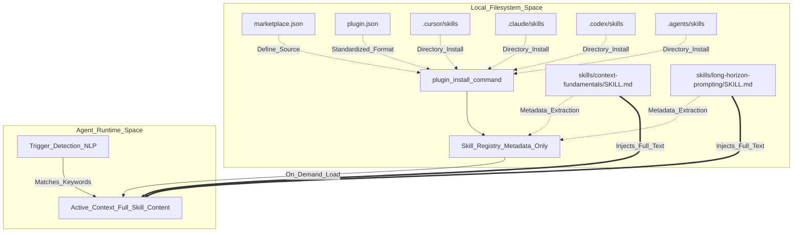
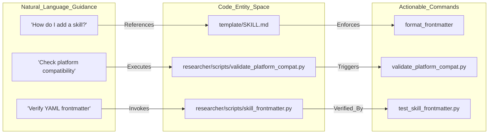

<!-- source: DeepWiki mcp.deepwiki.com · repo muratcankoylan/Agent-Skills-for-Context-Engineering · page 1.1 Getting Started: Installation & Plugin Setup · fetched 2026-10-26 -->

# Getting Started: Installation & Plugin Setup

<details>
<summary>Relevant source files</summary>

The following files were used as context for generating this wiki page:

- [.claude-plugin/marketplace.json](.claude-plugin/marketplace.json)
- [.plugin/plugin.json](.plugin/plugin.json)
- [AGENTS.md](AGENTS.md)
- [CLAUDE.md](CLAUDE.md)
- [README.md](README.md)
- [SKILL.md](SKILL.md)
- [researcher/scripts/skill_frontmatter.py](researcher/scripts/skill_frontmatter.py)
- [researcher/scripts/skill_health.py](researcher/scripts/skill_health.py)
- [researcher/scripts/tests/test_skill_frontmatter.py](researcher/scripts/tests/test_skill_frontmatter.py)
- [researcher/scripts/validate_platform_compat.py](researcher/scripts/validate_platform_compat.py)

</details>


## Purpose and Scope

This page provides a technical guide for installing, configuring, and verifying the **Agent Skills for Context Engineering** collection. Designed as an Open Plugins-conformant resource, the repository integrates into AI-native developer environments including Claude Code, Cursor, Codex, and GitHub Copilot [CLAUDE.md:5-8](). 

The installation process leverages a **Progressive Disclosure** architecture, where agents load metadata (names and descriptions) during startup and fetch full skill contents only when specific triggers match the task context [README.md:76-79](). This document covers marketplace manifests, directory-based installation paths, activation triggers, platform configuration files (`CLAUDE.md` and `AGENTS.md`), YAML-safe frontmatter quoting [researcher/scripts/skill_frontmatter.py:136-141](), and the platform compatibility validation gate [researcher/scripts/validate_platform_compat.py:1-13]().

Sources: [README.md:76-79](), [CLAUDE.md:5-8](), [researcher/scripts/skill_frontmatter.py:136-141](), [researcher/scripts/validate_platform_compat.py:1-13]()

---

## Plugin Architecture & Manifests

The collection uses two manifest files to define how agentic platforms discover and bundle skills. Updated for **v2.5.0**, these manifests support 17 published skills across the repository [.claude-plugin/marketplace.json:9-35](), [.plugin/plugin.json:4-4]().

### 1. Claude Code Marketplace Manifest
The `.claude-plugin/marketplace.json` file registers the repository as a marketplace source, bundling all 17 skills into a single plugin named `context-engineering` [.claude-plugin/marketplace.json:2-35](). 

**Design Note on Bundling:** 
Distributing skills as a single bundled plugin optimizes cache performance. Claude Code caches each plugin source directory separately; bundling prevents redundant multi-repository clones that would occur if each skill were registered as an independent plugin [CLAUDE.md:118-120]().

### 2. Open Plugins Manifest
The `.plugin/plugin.json` file adheres to the Open Plugins specification, providing cross-platform compatibility for Cursor, Amp, Letta, Goose, and OpenAI Codex [CLAUDE.md:7-7](). The manifest points to the root `skills/` directory for automated discovery [.plugin/plugin.json:8-8]().

### System Data Flow: Installation to Activation

**Plugin Discovery and Activation Flow**

Sources: [README.md:90-119](), [CLAUDE.md:118-120](), [.claude-plugin/marketplace.json:11-37](), [researcher/scripts/validate_platform_compat.py:31-36](), [.plugin/plugin.json:1-9]()

---

## Installation Procedures

### Claude Code Installation
To install the collection inside Claude Code, register the marketplace and install the unified plugin via the CLI:

1. **Add the Marketplace Source:**
   ```bash
   /plugin marketplace add muratcankoylan/Agent-Skills-for-Context-Engineering
   ```
   [README.md:98-102]()

2. **Install the Plugin Collection:**
   ```bash
   /plugin install context-engineering@context-engineering-marketplace
   ```
   [README.md:114-116]()

### Directory-Based Installation (Cursor, Codex, etc.)
For platforms supporting local skill discovery without a marketplace daemon, copy or symlink the individual skill directories from `skills/` into the target platform directories located in your project root [researcher/scripts/validate_platform_compat.py:31-36]():
* `.cursor/skills/`
* `.claude/skills/`
* `.codex/skills/`
* `.agents/skills/`

Sources: [README.md:90-117](), [researcher/scripts/validate_platform_compat.py:31-36]()

---

## Skill Activation Triggers & YAML-Safe Quoting

Skills activate when user intent matches the description defined in the YAML frontmatter of each `SKILL.md`. To prevent parsing failures caused by unquoted colons or special characters in skill descriptions, the codebase uses `format_frontmatter` to enforce JSON-encoded string quoting [researcher/scripts/skill_frontmatter.py:136-141]().

| Skill Directory | Primary Activation Triggers & Purpose |
| :--- | :--- |
| `context-fundamentals` | Establishing context mental models, anatomy of context, attention budgets [README.md:29]() |
| `context-degradation` | Diagnosing attention failures, lost-in-middle, poisoning, and context clash [README.md:30]() |
| `context-compression` | Designing and evaluating summarization and compression strategies [README.md:31]() |
| `context-optimization` | Applying compaction, observation masking, and prefix caching [README.md:52]() |
| `latent-briefing` | KV cache sharing between orchestrator and worker agents [README.md:53]() |
| `multi-agent-patterns` | Configuring supervisor, swarm, and hierarchical multi-agent teams [README.md:39]() |
| `long-horizon-prompting` | Writing pseudo-formal task briefs for long-running autonomous runs [README.md:40]() |
| `memory-systems` | Designing vector stores, property graphs, and tiered memory architectures [README.md:41]() |
| `tool-design` | Building consolidated, robust agent tools and actionable error handlers [README.md:42]() |
| `filesystem-context` | Using filesystems for plan persistence, scratchpads, and dynamic discovery [README.md:43]() |
| `hosted-agents` | Configuring sandboxed VMs, background coding agents, and warm pools [README.md:44]() |
| `bdi-mental-states` | Transforming RDF context into BDI (Beliefs, Desires, Intentions) states [README.md:73]() |
| `harness-engineering` | Designing autonomous harnesses with locked metrics and novelty gates [README.md:56]() |
| `self-improvement-loops` | Implementing recursive self-improvement and evolutionary scaffold search [README.md:57]() |
| `project-development` | Designing idempotent five-stage pipelines and task-model fit analysis [README.md:65]() |
| `evaluation` | Building multi-dimensional evaluation rubrics and process metrics [README.md:54]() |
| `advanced-evaluation` | Mastering LLM-as-a-Judge direct scoring, pairwise comparison, and bias mitigation [README.md:55]() |

Sources: [README.md:29-73](), [.claude-plugin/marketplace.json:18-34](), [researcher/scripts/skill_frontmatter.py:136-141]()

---

## Configuration & Environment Setup (`CLAUDE.md` / `AGENTS.md`)

Repository behavior and agent workspace memory are governed by root configuration files:
* **`CLAUDE.md`**: Directs Claude Code when navigating repository structure, running deterministic gates, and adhering to skill authoring rules [CLAUDE.md:1-22]()
* **`AGENTS.md`**: Workspace memory defining learned user preferences (e.g., CTO technical tone, prohibition of unapproved pushes, strict adherence to evidence-backed validation) [AGENTS.md:1-13]()

Sources: [CLAUDE.md:1-22](), [AGENTS.md:1-13]()

---

## Compatibility Gates & Verification (`validate_platform_compat.py`)

To guarantee that corpus modifications do not break cross-platform discovery, the validation pipeline executes automated compatibility checks [CLAUDE.md:26-37]().

### 1. Frontmatter Parser & Regression Suite
The shared parser in `researcher/scripts/skill_frontmatter.py` parses YAML headers and validates required fields [researcher/scripts/skill_frontmatter.py:43-70](). It is guarded by unit tests in `researcher/scripts/tests/test_skill_frontmatter.py` [CLAUDE.md:29-29]().

### 2. Platform Compatibility Gate
The script `researcher/scripts/validate_platform_compat.py` simulates directory-based install layouts across Cursor, Claude, and Codex roots, verifying manifest parity between `.plugin/plugin.json` and `.claude-plugin/marketplace.json` [researcher/scripts/validate_platform_compat.py:78-158]().

**Configuration to Code Entity Mapping**

Sources: [CLAUDE.md:26-37](), [researcher/scripts/validate_platform_compat.py:1-13](), [researcher/scripts/skill_frontmatter.py:1-8](), [CLAUDE.md:87-104]()

---

