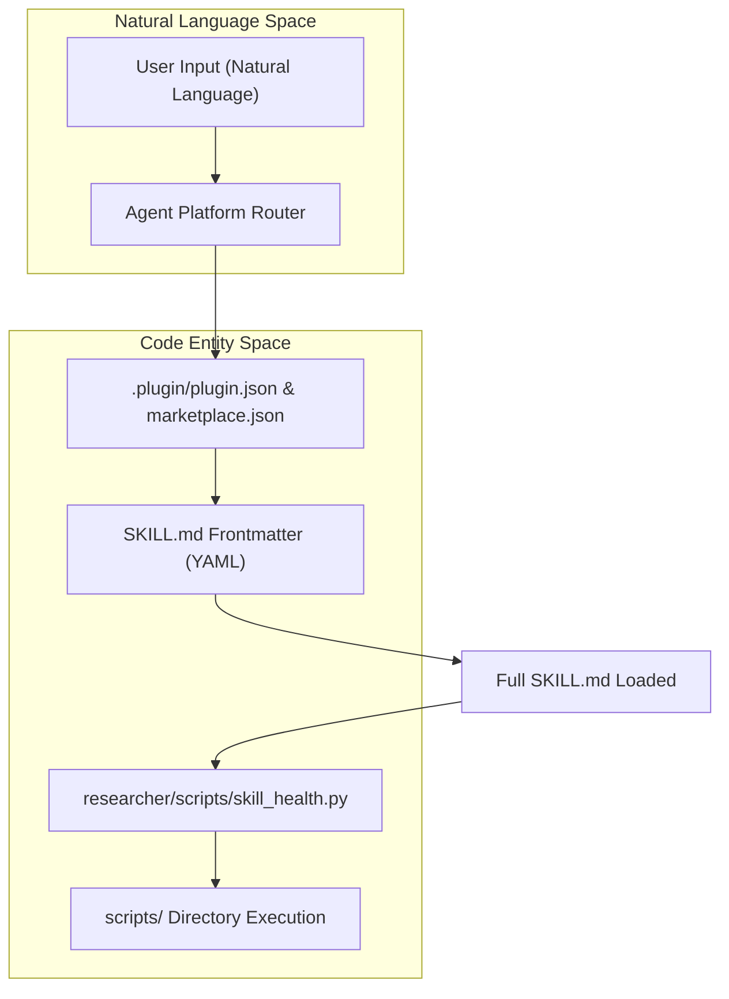
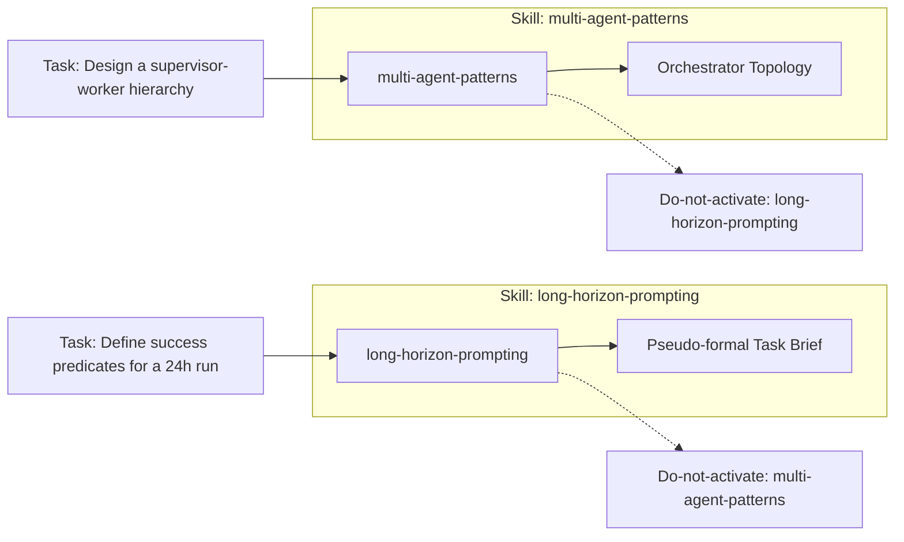

<!-- source: DeepWiki mcp.deepwiki.com · repo muratcankoylan/Agent-Skills-for-Context-Engineering · page 1.2 Skill Authoring Guide · fetched 2026-10-26 -->

# Skill Authoring Guide

<details>
<summary>Relevant source files</summary>

The following files were used as context for generating this wiki page:

- [researcher/scripts/skill_frontmatter.py](researcher/scripts/skill_frontmatter.py)
- [researcher/scripts/skill_health.py](researcher/scripts/skill_health.py)
- [researcher/scripts/tests/test_skill_frontmatter.py](researcher/scripts/tests/test_skill_frontmatter.py)
- [researcher/scripts/validate_platform_compat.py](researcher/scripts/validate_platform_compat.py)
- [skills/context-fundamentals/SKILL.md](skills/context-fundamentals/SKILL.md)
- [skills/project-development/SKILL.md](skills/project-development/SKILL.md)
- [skills/tool-design/SKILL.md](skills/tool-design/SKILL.md)
- [template/SKILL.md](template/SKILL.md)

</details>


This guide provides the technical specifications and procedural requirements for creating, structuring, and maintaining new skills within the Agent Skills for Context Engineering collection. It ensures that all contributions adhere to the **Progressive Disclosure** pattern and the corpus-wide hardening standards introduced in v2.3.0, refined in v2.3.1, and updated for v2.5.0 [template/SKILL.md:1-12]().

## Skill Structure & Directory Conventions

Every skill must be contained within its own directory under `skills/`, named using lowercase with hyphens (e.g., `long-horizon-prompting`) [researcher/scripts/validate_platform_compat.py:37-37](). A skill consists of a mandatory specification file and optional supporting directories.

### File Organization
| Component | Path | Purpose |
| :--- | :--- | :--- |
| **Skill Spec** | `SKILL.md` | The primary entry point. Contains metadata, activation logic, and core instructions [template/SKILL.md:1-4](). |
| **References** | `references/` | Detailed documentation, deep dives, and extended patterns to keep the main spec lean [template/SKILL.md:49-51](). |
| **Scripts** | `scripts/` | Executable examples, CLI tools, or implementation patterns [researcher/scripts/skill_health.py:30-31](). |

### The 500-Line Limit
To prevent "Context Bloat" and maintain high signal-to-noise ratios, the main `SKILL.md` file **must stay under 500 lines** [template/SKILL.md:10-10](). This requirement is enforced by `researcher/scripts/skill_health.py` (`compute_score` and line checks) [researcher/scripts/skill_health.py:81-82](). If a topic requires more detail, authors must move that content into the `references/` directory [template/SKILL.md:49-50]().

Sources: `[template/SKILL.md:10-10]`, `[researcher/scripts/skill_health.py:30-82]`

---

## The SKILL.md Blueprint (v2.5.0 Standards)

New skills must use the `template/SKILL.md` blueprint. v2.5.0 emphasizes explicit multi-agent patterns and harness-engineering routing boundaries [template/SKILL.md:1-12]().

### YAML Frontmatter & Quoting Rules
Every `SKILL.md` requires YAML frontmatter parsed by `researcher/scripts/skill_frontmatter.py` [template/SKILL.md:1-4](), [researcher/scripts/skill_frontmatter.py:43-70]().
```yaml
---
name: skill-identifier
description: "A concise description. Use quotes if it contains a colon: like this."
---
```
**Critical v2.3.1 Update**: Description fields containing colons (`:`) must be wrapped in double quotes. Unquoted colons cause strict-parser failures in agent environments like Cursor, Claude Code, and Codex [researcher/scripts/tests/test_skill_frontmatter.py:118-123](). The shared `researcher/scripts/skill_frontmatter.py` parser enforces these rules across the corpus via `parse_frontmatter` [researcher/scripts/skill_frontmatter.py:43-70]().

### Mandatory Sections
1.  **When to Activate**: Defines the skill's ownership boundary. Must include an explicit **"Do not activate"** block to route work to adjacent skills [template/SKILL.md:23-27]().
2.  **Core Concepts**: Focuses on behavior-changing mechanisms rather than general background. Reusable patterns should be registered in `researcher/mechanisms/registry.jsonl` [template/SKILL.md:37-38]().
3.  **Practical Guidance**: Must be **executable** by an agent (workflows, checklists, or decision tables) [template/SKILL.md:61-62]().
4.  **Gotchas**: Numbered, experience-derived failure modes [template/SKILL.md:83-85]().
5.  **Integration**: Explains routing and composition boundaries with other skills [template/SKILL.md:90-96]().

Sources: `[template/SKILL.md:1-118]`, `[researcher/scripts/skill_frontmatter.py:43-70]`, `[researcher/scripts/tests/test_skill_frontmatter.py:118-123]`

---

## Data Flow & Architecture

The repository utilizes a **Progressive Disclosure** architecture to bridge "Natural Language Space" (user intent) to "Code Entity Space" (specific tool/skill logic).

### Skill Discovery and Activation Lifecycle
Title: "From Natural Language Intent to Code Entity Execution"

Sources: `[researcher/scripts/skill_health.py:2-13]`, `[researcher/scripts/skill_frontmatter.py:43-70]`, `[researcher/scripts/validate_platform_compat.py:78-146]`

### Mechanism-Based Routing and Boundary Enforcement
Title: "Explicit Boundary Routing: Long-Horizon vs. Multi-Agent"

Sources: `[template/SKILL.md:23-27]`

---

## Authoring Rules & Validation Checklist

To maintain corpus quality standards, all contributions must pass the automated validation suite.

### Update Checklist
When adding a new skill, update the following:
1.  **Manifests**: Update `.plugin/plugin.json` and `.claude-plugin/marketplace.json` [researcher/scripts/validate_platform_compat.py:78-146]().
2.  **Frontmatter**: Ensure the `name` in `SKILL.md` matches the directory name exactly [researcher/scripts/validate_platform_compat.py:70-71]().
3.  **Quoting**: Use double quotes for the `description` field in frontmatter [researcher/scripts/skill_frontmatter.py:136-141]().
4.  **Activation Cases**: Add at least one entry to `researcher/fixtures/activation-cases.jsonl` [researcher/scripts/skill_health.py:34-34]().

### Automated Validation Commands
Run these before submitting a PR:
*   `python3 researcher/scripts/validate_platform_compat.py --require-reference-validator`: Checks YAML safety and platform install layout compatibility [researcher/scripts/validate_platform_compat.py:1-13]().
*   `python3 -m unittest researcher.scripts.tests.test_skill_frontmatter`: Runs the frontmatter regression suite (`test_skill_frontmatter.py`) [researcher/scripts/tests/test_skill_frontmatter.py:1-7]().
*   `python3 researcher/scripts/skill_health.py --strict`: Verifies the 500-line limit and required sections [researcher/scripts/skill_health.py:38-47]().

Sources: `[researcher/scripts/validate_platform_compat.py:1-146]`, `[researcher/scripts/skill_health.py:34-82]`, `[researcher/scripts/tests/test_skill_frontmatter.py:1-158]`

---

