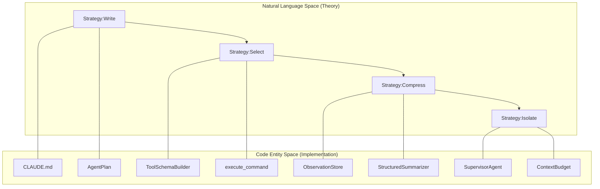
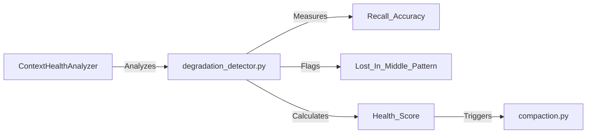
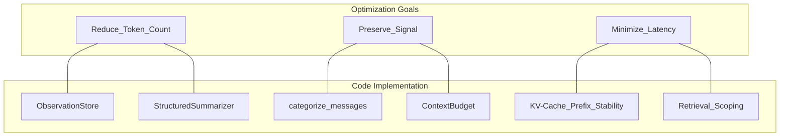

<!-- source: DeepWiki mcp.deepwiki.com · repo muratcankoylan/Agent-Skills-for-Context-Engineering · page 2 Core Context Engineering Concepts · fetched 2026-10-26 -->

# Core Context Engineering Concepts

Relevant source files

The following files were used as context for generating this wiki page:

- [skills/context-degradation/SKILL.md](skills/context-degradation/SKILL.md)
- [skills/context-fundamentals/SKILL.md](skills/context-fundamentals/SKILL.md)
- [skills/context-optimization/SKILL.md](skills/context-optimization/SKILL.md)
- [skills/memory-systems/SKILL.md](skills/memory-systems/SKILL.md)
- [skills/multi-agent-patterns/SKILL.md](skills/multi-agent-patterns/SKILL.md)
- [skills/project-development/SKILL.md](skills/project-development/SKILL.md)
- [skills/tool-design/SKILL.md](skills/tool-design/SKILL.md)

Context engineering is the foundational discipline of curating the high-signal token sets required for an agent to perform a specific task step [skills/context-fundamentals/SKILL.md:8-9](). It shifts the focus from "writing better prompts" to managing the model's working memory—the context window—as a finite resource [skills/context-fundamentals/SKILL.md:31-32]().

This page provides a high-level theoretical framework for the skill collection, centered on the transition from monolithic prompting to dynamic context management. For deep dives into specific operational areas, see the child pages:
- **[Context Fundamentals](#2.1)** — Attention budgets, U-shaped attention curves, static vs dynamic context, and state preservation [skills/context-fundamentals/SKILL.md:1-73]().
- **[Context Degradation & Health Monitoring](#2.2)** — Failure modes, Four-Bucket mitigation, and `ContextHealthAnalyzer` [skills/context-degradation/SKILL.md:1-75]().
- **[Context Compression](#2.3)** — Anchored Iterative Summarization, `StructuredSummarizer`, and probe-based evaluation [skills/context-optimization/SKILL.md:33-52]().
- **[Context Optimization Techniques](#2.4)** — KV-cache optimization, Observation Masking, and partitioning strategies [skills/context-optimization/SKILL.md:28-84]().

Sources: [skills/context-fundamentals/SKILL.md:8-32](), [skills/context-degradation/SKILL.md:1-75](), [skills/context-optimization/SKILL.md:28-84]()

---

## The Attention Budget & Mechanics

The core constraint of context engineering is the **Attention Budget**. While modern models advertise large context windows (e.g., 200K+ tokens), they operate on a performance gradient rather than a binary limit [skills/context-fundamentals/SKILL.md:71-73](). 

### The U-shaped Curve (Lost-in-the-Middle)
Recall accuracy is not uniform across the context window. Information placed at the **beginning** and **end** of the context is retrieved with higher reliability, while information in the **middle** suffers a significant drop in recall accuracy [skills/context-fundamentals/SKILL.md:31-32](). This "lost-in-the-middle" effect means that every token added competes for a limited attention budget that cannot be refilled mid-inference [skills/context-fundamentals/SKILL.md:31-32]().

### Effective Capacity
The "Effective Capacity" of a model is typically materially below the advertised window until measured on a target workload [skills/context-fundamentals/SKILL.md:73-74](). Beyond this threshold, the model's ability to maintain pairwise relationships between tokens degrades, leading to performance cliffs in complex reasoning [skills/context-fundamentals/SKILL.md:71-73]().

For details, see [Context Fundamentals](#2.1).

Sources: [skills/context-fundamentals/SKILL.md:31-32](), [skills/context-fundamentals/SKILL.md:71-74]()

---

## The Four-Bucket Strategy

To manage the attention budget, the skill collection categorizes context operations into four strategic "buckets" that guide how information is handled [skills/context-fundamentals/SKILL.md:33-38]().

| Strategy | Definition | Code/Pattern Implementation |
| :--- | :--- | :--- |
| **Write** | Persisting state outside the active window for future retrieval or handoff. | `NOTES.md`, `CLAUDE.md`, `AgentPlan` [skills/context-fundamentals/SKILL.md:61-62](), [skills/project-development/SKILL.md:92-94]() |
| **Select** | Dynamically pulling only relevant high-signal fragments into the current window. | `ls`, `grep`, `db_*` namespacing [skills/tool-design/SKILL.md:45-47](), [skills/tool-design/SKILL.md:63-65]() |
| **Compress** | Reducing the token footprint of existing history while preserving actionable signal. | `StructuredSummarizer`, `compaction.py` [skills/context-optimization/SKILL.md:33-35](), [skills/memory-systems/SKILL.md:23-23]() |
| **Isolate** | Partitioning tasks into separate windows to prevent cross-contamination. | `SupervisorAgent`, `ContextBudget` [skills/tool-design/SKILL.md:3-3](), [skills/project-development/SKILL.md:19-19](), [skills/multi-agent-patterns/SKILL.md:28-28]() |

### From Natural Language to Code Entities
The following diagram illustrates how these theoretical strategies manifest as specific implementations and code symbols within the repository.

**Context Engineering Implementation Map**

Sources: [skills/context-fundamentals/SKILL.md:33-38](), [skills/tool-design/SKILL.md:45-47](), [skills/tool-design/SKILL.md:63-65](), [skills/context-optimization/SKILL.md:54-62](), [skills/multi-agent-patterns/SKILL.md:68-73]()

For details, see [Context Degradation & Health Monitoring](#2.2).

---

## Context Health & Degradation

Context is subject to "rot" or degradation over long-running sessions. The system monitors for several primary failure modes that manifest as predictable patterns [skills/context-degradation/SKILL.md:8-9]().

1. **Context Poisoning:** Errors compounding as they are fed back into the model's history [skills/context-degradation/SKILL.md:30-31]().
2. **Context Distraction:** Irrelevant information overwhelming the relevant signal [skills/context-degradation/SKILL.md:58-60]().
3. **Lost-in-Middle:** Critical information buried in the low-attention center of the context window [skills/context-degradation/SKILL.md:41-43]().
4. **Context Clash:** Contradictory information appearing across different turns or sources [skills/context-degradation/SKILL.md:70-72]().
5. **Attention Sink:** Tokens that consume disproportionate attention (like verbose tool outputs) without contributing to the task [skills/context-fundamentals/SKILL.md:66-67](), [skills/context-degradation/SKILL.md:28-29]().

**Health Monitoring Workflow**

Sources: [skills/context-degradation/SKILL.md:8-75](), [skills/context-fundamentals/SKILL.md:31-32](), [skills/context-fundamentals/SKILL.md:66-67](), [skills/context-optimization/SKILL.md:43-45]()

For detection algorithms and health scoring, see **[Context Degradation & Health Monitoring](#2.2)**.

---

## Optimization & Compression

Once degradation is detected or the attention budget is exceeded, the system applies optimization techniques to restore context health and efficiency.

*   **Observation Masking:** Replacing verbose tool outputs with compact references via `ObservationStore` [skills/context-optimization/SKILL.md:54-62]().
*   **Selective Compaction:** Triggering summarization when utilization exceeds 70% while preserving high-signal system prompts [skills/context-optimization/SKILL.md:43-45]().
*   **Structured Summarization:** Utilizing explicit sections for session intent, file tracking, and decisions to preserve artifact trails [skills/memory-systems/SKILL.md:23-23]().
*   **KV-cache Optimization:** Reordering prompts to maximize prefix hits (System Prompt → Tool Definitions → History → Query) [skills/context-optimization/SKILL.md:64-75]().

**Optimization Strategy Mapping**

Sources: [skills/context-optimization/SKILL.md:28-89](), [skills/context-fundamentals/SKILL.md:66-68](), [skills/memory-systems/SKILL.md:23-24]()

For implementation details on compression and optimization, see:
*   **[Context Compression](#2.3)**
*   **[Context Optimization Techniques](#2.4)**

---

